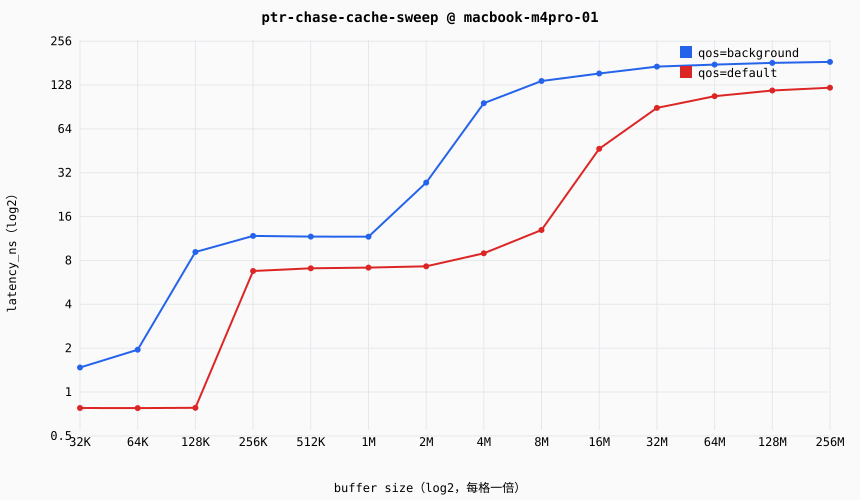

# Cache/内存层次延迟报告 — ptr-chase-cache-sweep

## 元信息（measurement-discipline §7 强制项）

| 项 | 值 |
|---|---|
| 目标 | macbook-m4pro-01（apple-m4-pro，darwin/aarch64） |
| 探针 | ptr_chase protocol=1.0 impl=portable |
| 探针谱系 | git `0b2d70e749` dirty=False sha256=1211e935a67e8cb2… |
| 测量日期 | 2026-09-24T15:37:22.913345+00:00 |
| 温度口径 | warm（显式预热 + 多趟 median，§1 主口径） |
| 页策略 | 默认 4K 页（未启用 hugepage；TLB 效应与 cache 效应在小步长区间耦合，见 probes/cache-mem/README 已知局限） |
| 重复次数 | 每 case 5 次，统计量 median（min/p25/p75/max 见 records.jsonl） |
| 证据等级 | MEASURED |
| 核型识别 | 按 environment.control 分组（macOS QoS 分流，OI-5 实测双峰；default≈P-core 档，background=E-core） |

## 延迟曲线

## 数据表（median，ns）

| buffer | qos=background | qos=default |
|---|---|---|
| 32KiB | 1.474 | 0.777 |
| 64KiB | 1.953 | 0.776 |
| 128KiB | 9.149 | 0.780 |
| 256KiB | 11.790 | 6.766 |
| 512KiB | 11.664 | 7.067 |
| 1MiB | 11.652 | 7.142 |
| 2MiB | 27.391 | 7.292 |
| 4MiB | 95.968 | 8.961 |
| 8MiB | 136.361 | 12.939 |
| 16MiB | 153.689 | 46.701 |
| 32MiB | 171.138 | 89.142 |
| 64MiB | 176.753 | 107.235 |
| 128MiB | 181.611 | 117.306 |
| 256MiB | 184.393 | 122.624 |

### 双峰比值（qos=default / qos=background，随频率漂移，不作常量引用）

- 32KB：×0.53
- 64KB：×0.40
- 128KB：×0.09
- 256KB：×0.57
- 512KB：×0.61
- 1024KB：×0.61
- 2048KB：×0.27
- 4096KB：×0.09
- 8192KB：×0.09
- 16384KB：×0.30
- 32768KB：×0.52
- 65536KB：×0.61
- 131072KB：×0.65
- 262144KB：×0.67

## 层级台阶（推断，阈值：相邻档位比值 >1.5×）

**qos=background**
- 64KB→128KB：1.95→9.15 ns（×4.7）
- 1024KB→2048KB：11.65→27.39 ns（×2.4）
- 2048KB→4096KB：27.39→95.97 ns（×3.5）

**qos=default**
- 128KB→256KB：0.78→6.77 ns（×8.7）
- 8192KB→16384KB：12.94→46.70 ns（×3.6）
- 16384KB→32768KB：46.70→89.14 ns（×1.9）

## 置信度：MEDIUM

- **噪声来源**：无锁频（DVFS 漂移，QoS 比值 2.6~3.9× 区间漂移即其表现）；QoS 分流是调度 hint 而非严格绑核，同 QoS 内可能迁移；页策略为 4K 默认页。
- **提升计划（MEDIUM→HIGH）**：测量期 powermetrics 并发采样核频入档；hugepage 对照组；重复次数提升至 7+ 并监控热漂移。

---
数据来源：data/public/runs/20260924T153722Z-ptr-chase-cache-sweep/records.jsonl（raw 样本引用见各记录 raw_samples_ref）
