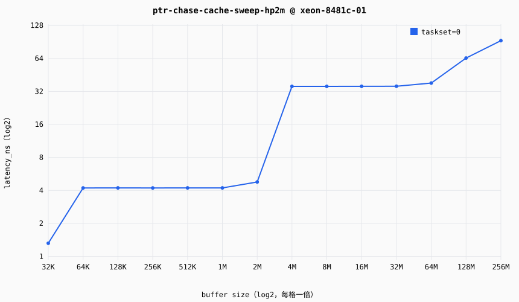

# Cache/内存层次延迟报告 — ptr-chase-cache-sweep-hp2m

## 元信息（measurement-discipline §7 强制项）

| 项 | 值 |
|---|---|
| 目标 | xeon-8481c-01（sapphire-rapids-8481c，linux/x86_64） |
| 探针 | ptr_chase protocol=1.0 impl=portable |
| 探针谱系 | git `41e7ea3734` dirty=False sha256=55f68bc53eb767d6… |
| 测量日期 | 2026-09-24T18:43:41.663406+00:00 |
| 温度口径 | warm（显式预热 + 多趟 median，§1 主口径） |
| 页策略 | 默认 4K 页（未启用 hugepage；TLB 效应与 cache 效应在小步长区间耦合，见 probes/cache-mem/README 已知局限） |
| 重复次数 | 每 case 5 次，统计量 median（min/p25/p75/max 见 records.jsonl） |
| 证据等级 | MEASURED |
| 控制口径 | 按 environment.control 分组（Linux taskset 绑核到指定物理核（SMT sibling 空闲纪律见平台配置 notes）） |

## 延迟曲线

## 数据表（median，ns）

| buffer | taskset=0 |
|---|---|
| 32KiB | 1.320 |
| 64KiB | 4.213 |
| 128KiB | 4.217 |
| 256KiB | 4.217 |
| 512KiB | 4.222 |
| 1MiB | 4.221 |
| 2MiB | 4.780 |
| 4MiB | 35.614 |
| 8MiB | 35.606 |
| 16MiB | 35.626 |
| 32MiB | 35.694 |
| 64MiB | 38.190 |
| 128MiB | 64.539 |
| 256MiB | 92.979 |

## 层级台阶（推断，阈值：相邻档位比值 >1.5×）

**taskset=0**
- 32KB→64KB：1.32→4.21 ns（×3.2）
- 2048KB→4096KB：4.78→35.61 ns（×7.5）
- 65536KB→131072KB：38.19→64.54 ns（×1.7）

## 置信度：MEDIUM

- **噪声来源**：无锁频——实测 powersave governor、800MHz~3.8GHz 浮动（2026-09-25 接入时采集），ns 绝对值受 DVFS 污染，跨档比较需谨慎；4K 默认页（TLB 遍历与 LLC 行为耦合）；单控制组，sibling 隔离未主动执行（口径见平台配置 notes）。
- **提升计划（MEDIUM→HIGH）**：锁频复测（governor=performance 或固定 scaling_setspeed，需 root）；hugepage 对照组；cycles 口径（perf 需 sudo，paranoid=4）；evict 工具对照 warm/cold。

---
数据来源：data/public/runs/20260924T184334Z-ptr-chase-cache-sweep-hp2m/records.jsonl（raw 样本引用见各记录 raw_samples_ref）
