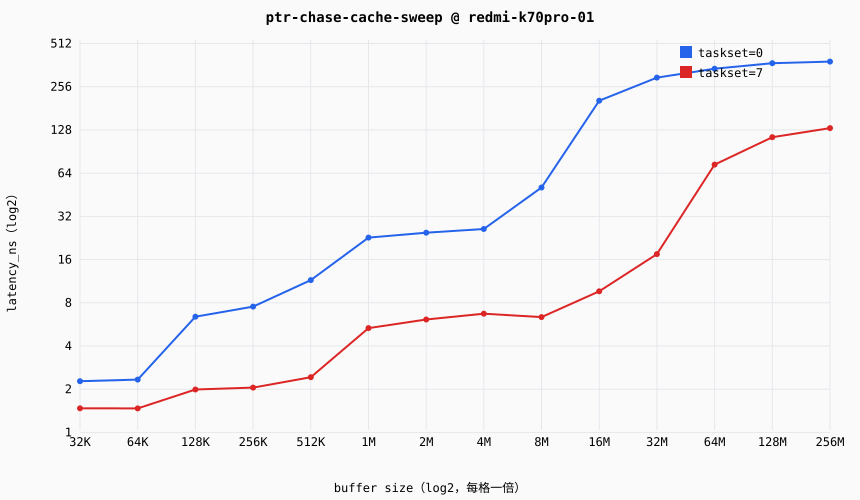

# Cache/内存层次延迟报告 — ptr-chase-cache-sweep

## 元信息（measurement-discipline §7 强制项）

| 项 | 值 |
|---|---|
| 目标 | redmi-k70pro-01（sm8650-8gen3，android/aarch64） |
| 探针 | ptr_chase protocol=1.0 impl=portable |
| 探针谱系 | git `6d125196c9` dirty=True sha256=058db618a76ab171… |
| 测量日期 | 2026-09-27T06:05:13.602254+00:00 |
| 温度口径 | warm（显式预热 + 多趟 median，§1 主口径） |
| 页策略 | 默认 4K 页（未启用 hugepage；TLB 效应与 cache 效应在小步长区间耦合，见 probes/cache-mem/README 已知局限） |
| 重复次数 | 每 case 5 次，统计量 median（min/p25/p75/max 见 records.jsonl） |
| 证据等级 | MEASURED |
| 控制口径 | 按 environment.control 分组（Linux taskset 绑核到指定物理核（SMT sibling 空闲纪律见平台配置 notes）） |

## 延迟曲线

## 数据表（median，ns）

| buffer | taskset=0 | taskset=7 |
|---|---|---|
| 32KiB | 2.274 | 1.472 |
| 64KiB | 2.334 | 1.470 |
| 128KiB | 6.399 | 1.992 |
| 256KiB | 7.529 | 2.051 |
| 512KiB | 11.516 | 2.425 |
| 1MiB | 22.753 | 5.335 |
| 2MiB | 24.609 | 6.119 |
| 4MiB | 26.149 | 6.715 |
| 8MiB | 50.817 | 6.357 |
| 16MiB | 204.524 | 9.619 |
| 32MiB | 296.551 | 17.472 |
| 64MiB | 342.023 | 73.360 |
| 128MiB | 373.442 | 113.952 |
| 256MiB | 383.016 | 131.936 |

### 双峰比值（taskset=7 / taskset=0，随频率漂移，不作常量引用）

- 32KB：×0.65
- 64KB：×0.63
- 128KB：×0.31
- 256KB：×0.27
- 512KB：×0.21
- 1024KB：×0.23
- 2048KB：×0.25
- 4096KB：×0.26
- 8192KB：×0.13
- 16384KB：×0.05
- 32768KB：×0.06
- 65536KB：×0.21
- 131072KB：×0.31
- 262144KB：×0.34

## 层级台阶（推断，阈值：相邻档位比值 >1.5×）

**taskset=0**
- 64KB→128KB：2.33→6.40 ns（×2.7）
- 256KB→512KB：7.53→11.52 ns（×1.5）
- 512KB→1024KB：11.52→22.75 ns（×2.0）
- 4096KB→8192KB：26.15→50.82 ns（×1.9）
- 8192KB→16384KB：50.82→204.52 ns（×4.0）

**taskset=7**
- 512KB→1024KB：2.43→5.33 ns（×2.2）
- 8192KB→16384KB：6.36→9.62 ns（×1.5）
- 16384KB→32768KB：9.62→17.47 ns（×1.8）
- 32768KB→65536KB：17.47→73.36 ns（×4.2）
- 65536KB→131072KB：73.36→113.95 ns（×1.6）

## 置信度：MEDIUM

- **噪声来源**：无锁频——实测 powersave governor、800MHz~3.8GHz 浮动（2026-09-25 接入时采集），ns 绝对值受 DVFS 污染，跨档比较需谨慎；4K 默认页（TLB 遍历与 LLC 行为耦合）；单控制组，sibling 隔离未主动执行（口径见平台配置 notes）。
- **提升计划（MEDIUM→HIGH）**：锁频复测（governor=performance 或固定 scaling_setspeed，需 root）；hugepage 对照组；cycles 口径（perf 需 sudo，paranoid=4）；evict 工具对照 warm/cold。

---
数据来源：data/public/runs/20260927T060512Z-ptr-chase-cache-sweep/records.jsonl（raw 样本引用见各记录 raw_samples_ref）
