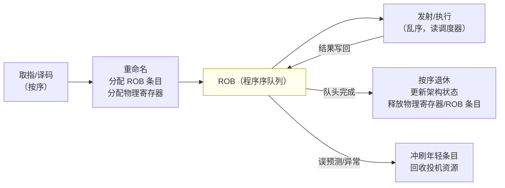
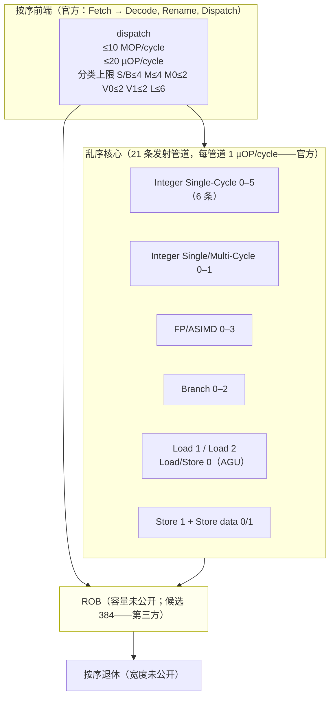

# ROB 微架构深度分析报告

> **2026-10-09 v0.2**：§4.2与§5已按第一性原理修订。独立探针修复生成码/PMU/FP及双链布局；软件检查与板上证据分开，当前实测结果以 `docs/reviews/2026-10-09-minimal-probes-results.md` 为准。仍不声明物理ROB容量。
>
> 版本：v0.2（2026-10-09）——方法与软件合同；历史材料保留来源限定。
> 范围：ROB（Reorder Buffer，重排序缓冲）技术原理、前后端组件联动、总体架构、探测原理剖析（含对参考材料的批判性审视）、面向 Cortex-X4 的分级探测方案。
> 方法论依据：`common/method-transfer-matrix-方法迁移矩阵.md`（v0.2，按外部评审4 修订）；本报告是该矩阵 ROB 列 🔧/✏️ 项的第一次具体化落地，矩阵相应升级为 v0.3（见该文件修订记录）。
> 与 TLB 项目的关系：平台落地约束直接复用 TLB 报告 §5.2（SM8650 约束表），不重复抄录；文书纪律（版本沿革、事实/推断/第三方三级标注、评审登记）照 TLB 报告同骨架。
> 边界声明：本报告引用的 Arm 官方文档（TRM / 优化指南）均已逐字核验原文；第三方材料（框图、知乎文、参考代码、博客）全部按"候选/声称"处理，未在 X4 目标机上验证的任何数值不得进入判据。

## 项目范围与边界（任务书折入，六项拍板结论）

本项目为 cpu-uarch-explorer 第二个微架构部件深度分析（第一个是 TLB，报告 v1.6）。启动前需求讨论形成以下决策，作为本报告的硬边界：

1. **估计量先行**：第一个具体动作是定义待估计量（§4.3），然后混淆清单（§4.4），再落探测方案；矩阵修订是这些动作的汇总产物。
2. **版本节奏**：v0.1 = 采数前版本（本文件）；目标板首次采数后出 v0.2 起。
3. **第三方候选区间表**：由 A1 材料组建阶段建立（§0），每行注明"探针测的是什么量"；Cardyak 框图的 384 等数字为示意图级候选，权重最低。
4. **必读材料**：知乎《初评 Arm Cortex X4、A720、A520》已获取（仓库外 `cpu-uarch-ref/docs/`，登记于 `docs/reference-materials.md`）。
5. **平台范围**：测量对象仅 SM8650（红米 K70 Pro）的 Cortex-X4 核；macOS M4 只做交叉编译、二进制冒烟与生成机器码人工检查；gem5 D9300 明确为非目标。
6. **不做工程对接**：本阶段不挂本仓 runner / analysis / probes-CMake 体系；探针为独立目录 + 自带编译说明；原始数据按 B3 纪律逐轮落盘但不进 runner 数据模型。采数阶段的数据分层/quarantine 纪律（AGENTS.md 铁律 1/2）仍然适用。
7. **任务书附件 txt 不入库**：任务内容已用自己的话折入本报告与矩阵修订；附件原文留在消息资产目录，不进 git。

---

## 0. 材料清单与可信度分级

| 材料 | 角色 | 可信度处理 |
| --- | --- | --- |
| **Arm Cortex-X4 Core TRM（102484_0003_06_en，Issue 06）** | **权威依据** | 官方一手。**已全文核验：无任何 ROB 容量/组织披露**；第 17 章 stall 事件族已逐条核验（§2.5 表）。这是与 TLB 项目的最大差异——TLB 有 Table 5-1 地面真值，ROB 没有 |
| **Arm Cortex-X4 Core Software Optimization Guide（PJDOC-1505342170-538636，Issue 3.0）** | **必读 1（权威）** | 官方一手。**已全文检索：无 ROB、无 retire 宽度披露**；给出 dispatch 宽度约束（10 MOP / 20 µOP 每周期 + 分类上限，§2.2）、MOP/µOP 两级模型（§1.4）、store 拆 SA+SD µOP、NZCV/SP 全重命名——这些是 ROB 估计量设计的硬约束 |
| Henry Wong (stuffedcow), *Measuring Reorder Buffer Capacity*, 2013 | **必读 2（方法谱系起点）** | 个人技术博客，方法原创且被广泛使用；明确讨论了 PRF 限制与 MOV 消除特例；**x86 专用，指令组成与对照须为 X4 重做**（§4.1 剖析） |
| **travisdowns/robsize（GitHub，源码已通读）** | **必读 2.5（直接工程祖先）** | stuffedcow 方法的现代维护版，44 个测试（ROB/PRF/SIMD-PRF/kreg-PRF/LB/SB/混合共享类），手写字节 mini-JIT + 寄存器轮转 + NO_COMP 补偿逻辑 + 入口对齐抖动 + `--write-asm` 黄金汇编回归（check-gold.sh）。**x86 专用；仍纯 rdtsc 时延检测（无 PMU 交叉验证）；许可证未明示 → 只借鉴设计、不复用代码**（§4.1 剖析） |
| `cpu-uarch-ref/cpu微架构材料/src/`（CPUSUIT 套件，C/C++ 混合，仓库所有者自研，署名 Michael Yao） | **必读 3（自研参考，需审视）** | 分两层：**(a) `.cc` 部件表征层**——基于 **xbyak_aarch64**（开源 JIT 汇编器库）的延迟/吞吐框架（墙钟+频率估算，无 PMU；~7570 万指令/次取 pattern 最小值；SIGILL 陷阱记 n/a；`mov.cc` 注释块是矩阵"零延迟 MOV"条目的实际出处，§2.4；`math_fp.cc` 有 fsqrt 延迟/吞吐测量可复用于 E0-6）；**(b) `pattern.c`+`main.c` 汇编级容量探针层**——ROB/BTB/TLB/RAS 四容量探针 + 取指带宽探针（`ifetch_block.S`）+ cache 时延（`cache_lat.cc`，lmbench 式，Phase 0-0b 参考），ROBSize 探针为 fsqrt 链锚点协议（§4.1.3）。已知瑕疵：fdiv 缺（FIXME）；`StartCycleCounter` 失败返回 -1 而调用方不检查（PMU 失败伪装成数据，同 TLB 评审 2-6 类问题）。声称未经 X4 核实，不作真值 |
| 知乎《初评 Arm Cortex X4、A720、A520》（作者 JamesAslan，2023） | **必读 4（第三方声称）** | 知乎文，微架构分析向。ROB 相关声称：Arm 的 MCQ/ROB"不是完全传统的 ROB"，某些情况一条可容纳两条指令，且有"early deallocation"优化 → 等效容量大于标称；X3 纸面 6 ALU 但作者实测 dispatch 级每周期仅 4 条简单 ALU。**全部为作者声称/实测（未附完整方法），预注册为待验假设** |
| Cardyak《Cortex-X4 Microarchitecture Block Diagram》（2023，jpg） | **参考（候选区间，最低权重）** | 第三方示意图：ROB 384 条、decode queue 10 MOP/cycle、ROB→issue 20 µOP、调度器 80 INT + 80 FP + 42 MEM、Store buffer 72、Load buffer 96、3 branch + 8 ALU 纸面。**示意图非实测，全部数字按"候选区间"入 §3.2 表，不进判据** |
| 方法迁移矩阵 v0.2 + 外部评审4 | 流程依据 | ROB 列 🔧/✏️ 项的执行模板；本报告完成第一次具体化 |

**与 TLB 项目的最大差异（真值策略）**：TLB 走"TRM 真值校准"（C1 ✅ 档）；ROB 无任何官方真值，走 C1 ✏️ 档"**估计量优先 + 第三方候选区间 + 交叉约束**"——两个置信区间重叠也不证明测的是同一结构（矩阵 v0.2 C1 修订）。

---

## 1. ROB 技术原理及其在计算机体系结构中的作用

### 1.1 要解决的问题：乱序执行与"按序"之间的桥

乱序执行的收益来自在指令流中向后搜索可并行执行的独立指令；但体系结构对软件承诺的是**按序的因果语义**：精确异常（中断/故障必须像发生在某条确切指令处）、内存序（程序序的访存效果不能重排越界）、上下文恢复（jmp/longjmp、信号、调试）。这两者之间的桥就是 ROB：

- **取指/译码/重命名按序**，ROB 在重命名后按程序序为每条指令分配一个条目——指令从此有了"年龄"。
- **发射/执行乱序**：ROB 条目跟踪指令状态（等待操作数/已执行/可退休），调度器在窗口内自由挑选。
- **退休（retire/commit）严格按序**：ROB 队头指令完成且无副作用遗留时才提交，按序离开。**ROB 是"乱序世界"与"按序世界"之间的唯一闸口**。
- **冲刷语义**：分支误预测、异常、debug 事件 → ROB 中较年轻条目整批作废，窗口状态瞬间回滚到队头。ROB 容量直接等于投机深度上限：窗口越大，能掩盖的延迟（cache miss、分支惩罚）越长。

量级概念：窗口在飞指令数 W 与延迟掩盖能力的关系由 Little 定律给出——要掩盖 D 周期延迟、平均每条指令 1 周期供给，需要在飞约 D 条指令。若锚点延迟 300 周期而 W=384，则窗口恰好在"将满未满"区间，这正是 §5.4 协议选择锚点延迟的定量依据。

### 1.2 ROB 的基本原理

ROB 是一个**按程序序组织的队列**，核心字段（教科书模型，非 X4 披露）：

- 条目状态：等待发射 / 已完成（结果在物理寄存器就绪）/ 已执行待提交；
- 重命名映射：目的架构寄存器 → 物理寄存器（或结果就绪标志）；
- 异常/副作用挂起位：load/store 的页故障、标志更新、条件执行效果，全部延迟到退休时按序结算。

三条不变量构成探测的理论基础（§4 的所有协议都从它们推导）：
1. **ROB 满 → 重命名停 → 前端整体停**（窗口上限的硬件表达）；
2. **队头被长延迟指令阻塞时，整个窗口成为"在飞快照"**（测量的时间结构基础）；
3. **窗口同时被 ROB 以外的资源限制**（PRF、调度器、load/store buffer、发射端口）——"单一变量"在 ROB 测量中**结构上不可能**，只能靠类别×对照设计做归因（§4.4）。

### 1.3 ROB 在体系结构中的四个作用

1. **投机深度的供给者**：窗口越大，缓存/分支延迟掩盖越强；这是大核微架构竞争的核心参数之一（Apple M 系的大窗口是其 IPC 优势的公开解释之一，X4 的 384 候选值正是这一竞赛的产物）。
2. **精确异常的实现者**：异常像发生在程序序的某条指令上——fault 的 FAR/ELR 语义、单步调试、信号上下文，全部依赖 ROB 的按序结算。
3. **内存序与副作用的缓冲者**：store 效果在退休前不可见（store buffer 按序 drain）；标志寄存器、系统寄存器写入（OG p61：FPSR/FPSCR/APSR 读必须等待所有可能更新它们的指令**执行并退休**——这是构造"强串行化点"的文档依据）的按序语义由 ROB 闸口保证。
4. **冲刷恢复的锚点**：误预测恢复代价 ∝ 窗口内年轻指令数（冲刷浪费的工作），这是前端 0x8162 STALL_FRONTEND_FLUSH 事件的微架构含义（§2.5）。

### 1.4 MOP/µOP 两级模型：X4 语境下"一条指令"是什么（估计量问题的根源）

优化指南 §2.1（p11，原文核验）确立了 X4 的两级内部表示：

> "Instructions are first fetched and then decoded into internal **Macro-OPerations (MOPs)**. From there, the MOPs proceed through register renaming and dispatch stages. **A MOP can be split into two Micro-OPerations (µOPs)** further down the pipeline after the decode stage. Once dispatched, µOPs wait for their operands and issue out-of-order to one of **21 issue pipelines**. Each issue pipeline can accept one µOP per cycle."

配套事实（均原文核验）：
- 每个 store MOP 拆为 **store address + store data 两条 µOP**（指南 §3.15/§3.21："Stores MOPs are split into store address and store data µOPs"）。
- Dispatch 带宽 **≤10 MOP/周期 且 ≤20 µOP/周期**（§4.1，p55）。
- NZCV 与 SP **完全重命名**（p61）——标志依赖不阻塞重命名。

由此产生本项目最根本的估计量歧义：**ROB 条目按 MOP 还是按 µOP 分配？** 若一条指令产生 2 个 µOP 而 ROB 按 µOP 计数，"384 条"的候选值对应的指令窗口就是 192；若按 MOP 计数则是 384。Arm 官方不披露，第三方各说各话（知乎文称 MCQ"某些情况可容纳两条指令"暗示条目粒度≠指令且非固定）。**这决定了本项目不能把任何拐点直接命名为"ROB 条目数"**——矩阵 C1 修订与评审4 放行条件由此从纪律上升为结构必然。可操作的拆解工具恰好由 PMU 提供：`INST_RETIRED`(0x0008) 计"architecturally executed **instruction**"，`INST_SPEC`(0x001B) 计"**operation** speculatively executed"——两者之比直接暴露拆分因子（§2.5、§5.6）。

---

## 2. ROB 与前后端组件的联动及接口形式

ROB 没有任何面向 ISA 的编程接口，它的全部可观测性来自与上下游的联动。本章按数据/控制流向梳理——**本章也是混淆清单（§4.4）的结构基础**：每一个联动方都是潜在的窗口限制者，都可能先于 ROB 把拐点"截胡"。

### 2.1 与前端（取指→译码→重命名）

**接口形式：重命名分配，内部握手，无独立引脚**。ROB 条目在重命名阶段按程序序分配；ROB 满（或调度器满、PRF 满——三者都表现为"rename 进不去"）时前端整体停摆。

- **rename full 是前端停摆的总信号**。X4 TRM 第 17 章已核验：`0x816D STALL_BACKEND_RENAME` 语义为 "**Backend stall cycles, rename full**"（PDF p.137）。**它是"重命名级背压"的周期计数，背压来源可以是 ROB 满、调度器满、PRF 满中的任何一个——TRM 不提供区分**。矩阵 v0.2 的事件警示由此精确化：禁止把 0x816D 当作"ROB 满"计数器使用；但它与分类 stall 事件（§2.5）组合后可作瓶颈级定位的辅助证据。
- **取指/译码带宽是填充流的供给侧约束**。dispatch ≤10 MOP/周期（官方）意味着：300 周期锚点延迟内前端最多注入约 3000 条填充指令，远大于候选窗口（384 量级）——**带宽不限制窗口测量本身**，但它限制"窗口外指令的注入速度"，决定了锚点延迟必须 ≫ W/dispatch 宽度（W≈384、10 MOP/cycle → ≥38 周期只是注满窗口的底线；再考虑稳态判读，锚点应在百周期量级，§5.4 预注册了两个锚点档位）。
- **前端结构是填充流设计的隐性要求**：填充流必须全部取自一个已驻留 L1I 的小循环（否则 i-cache miss 引入 0x8159 STALL_FRONTEND_L1I），且无 taken 分支（否则 fetch redirect 打断填充；JIT 套件声称无条件分支"never issues"，预注册为 E0 待验假设）。取指预取器对紧凑循环的预取行为会放大有效供给，属有利因素但需记录。

### 2.2 与后端（dispatch→调度器→执行→退休）

**Dispatch 宽度（官方真值，OG §4.1 p55 逐字核验）**：

> "The dispatch stage can process up to **10 MOPs per cycle** and dispatch up to **20 µOPs per cycle**"，分类上限："Up to **4** µOPs utilizing the **S or B** pipelines；Up to **4** utilizing the **M** pipelines；Up to **2** utilizing the **M0** pipelines；Up to **2** utilizing the **V0** pipeline；Up to **2** utilizing the **V1** pipeline；Up to **6** utilizing the **L** pipelines"；超订时"oldest to youngest age-order"。

**联动要点与测量含义（表格逐行为推断的依据标注）**：

| 联动方 | 与 ROB 的关系 | 对窗口测量的纠缠方式 | 依据 |
|---|---|---|---|
| **调度器（候选：INT 80 / FP 80 / MEM 42）** | 已分派未发射的 µOP 驻留调度器；发射后立即腾出 | **这是 ROB 测量中最容易被忽视的纠缠**：若填充指令"不可发射"（如被阻塞的操作数），它们同时占 ROB 和调度器——调度器先满则窗口被截短。反之 NOP/立即可发射的 ADD 在调度器中停留极短，调度器不构成约束 | 容量为 Cardyak 候选；机制为 OoO 通用结构 |
| **物理寄存器堆 PRF（容量未公开；INT/FP 是否共享未公开）** | rename 时每个写目的寄存器的指令消耗一个物理寄存器，退休时释放（或提前释放，见 §2.4） | stuffedcow 的核心理论警告：**PRF  speculative 部分常小于 ROB**（Sandy Bridge 实测 131 vs ROB 168），用产生目的寄存器的填充指令测到的拐点量到的是 PRF 不是 ROB。**X4 上该纠缠必然存在**（NZCV/SP 全重命名证实 PRF 机制存在） | 机制=OG p61 + stuffedcow 实测先例 |
| **Load buffer（候选 96）/ Store buffer（候选 72）** | 每条 load/store 在窗口内各占一条目，退休时释放 | 填充类若为 load/store，96/72 远小于 384 候选窗口 → **拐点必然先撞 buffer 而非 ROB**；这恰是类别矩阵的设计动机（§5.5）：buffer 约束用专门类别流显性测量 | 容量为 Cardyak 候选 |
| **发射端口（官方 21 管道）** | 窗口内已发射指令的执行资源 | 填充流瞬时发射率 ≤21/周期 ≫ dispatch 20/周期，不构成窗口约束；但**混合类别流**（int+fp 交错）可能暴露共享池（stuffedcow 在 Sandy Bridge 上发现的 147 窗口未解之谜即此类），交叉类结果须保守命名 | 21 管道=官方；共享池纠缠=stuffedcow 实测先例 |
| **退休端（宽度未公开）** | ROB 队头按序退休 | 窗口协议（§5.4）中退休被锚点阻塞，宽度无关；但 E3 退休率拐点协议（§5.4-备）对退休宽度敏感——它决定 knee 是"陡沿"还是"斜坡"，预注册为判读参数而非混淆 | 未公开=全文检索确认 |
| **DSU 内他核** | X4 无 SMT；同簇 A720/A520 与 DSU-120 共享 L3/互连 | 他核 snoop/调度竞争对单线程微基准的影响**待核查**（矩阵 v0.2 D3 修订）；对策 = 锁大核 + 轻载窗口采数 + 记录他核状态 | 矩阵 D3 |

### 2.3 与指令拆分/融合的关系

- **store 拆 SA+SD（官方）**：每条 store 指令 = 1 个 MOP = 2 个 µOP。若 ROB 按 µOP 计数，store 填充流消耗窗口速度是 NOP 流的 2 倍/指令——`INST_SPEC/INST_RETIRED` 比值（§5.6）可把这一因子显性化。
- **MOP 不拆的常见指令**（add/sub/logical 等）：1 MOP = 1 µOP（推断：指南仅说 store 类拆分；X 系公开资料未列其他拆分）。
- **知乎文声称**（必读 4）：MCQ"某些情况下可容纳两条指令"——若条目打包存在，窗口对"指令数"与"条目数"的关系出现 2:1 的例外区间。**预注册为 H-pack 假设**：若实测窗口随填充类别在小 N 处出现台阶状 2 倍增益，H-pack 存活；判据见 §5.8。
- **零延迟 MOV / rename 消除**（详见 §2.4）：被消除的 MOV 是否仍占 ROB 条目，直接决定"MOV 填充流"量到什么。

### 2.4 与 rename 消除类优化的关系（"零延迟 MOV"专项）

矩阵 D3 的"零延迟 MOV 待核查"已定位出处：`cpu微架构材料/src/mov.cc` 第 25–34 行注释块（第三方在 Arm 核上的测量笔记，**未经 X4 核实**）：

| 指令形态 | 注释声称 | 对 ROB 测量的含义 |
|---|---|---|
| `mov x0, #0` | rename 消除 | 零延迟；**是否占 ROB 条目未知** |
| `mov x0, x1`（64 位） | 通常 rename 消除 | 同上；32 位版本不消除 |
| `mov x0, #imm`（立即数，含 movz/movn 别名） | rename 消除，**上限每 8 条指令 2 条** | **速率上限会扭曲在飞 µOP 数**：长填充流下消除配额耗尽后行为切换 |
| `movi/mov v,v`（向量全宽） | rename 消除 | FP/VEC 窗口测量须选边 |
| `nop` / 无条件 `b` | **永不发射** | NOP 是否占 ROB 条目 = stuffedcow 的 ROB 测量前提（在 x86 上成立）；X4 上预注册为 E0 验证项 |

 stuffedcow 在 Ivy Bridge 上证明了这类优化的探测价值： eliminated MOV 不消耗目的寄存器 → MOV 填充流的窗口回到 ROB 限制，而 Sandy Bridge（无消除）的 MOV 流窗口被 PRF 截短。**同构实验在 X4 上是天然的混淆对照**（§5.3 E0）。

### 2.5 与 PMU（探测者的入口）

TRM 第 17 章已逐条核验的事件（本报告引用的全集；PDF 页码为 102484_0003_06_en 物理页）：

| 事件号 | 助记符 | 语义（TRM 原文要点） | ROB 测量用途 |
|---|---|---|---|
| 0x0008 | `INST_RETIRED` | Instruction **architecturally executed** | 退休侧主计数；E3 协议分子 |
| 0x001B | `INST_SPEC` | **Operation** speculatively executed | 拆分因子探测（与 0x0008 配对）；**"operation"口径≠instruction 已核验** |
| 0x0011 | `CPU_CYCLES` | Cycle | 所有时延归一化分母 |
| 0x0010 / 0x0012 | `BR_MIS_PRED` / `BR_PRED` | 误预测/可预测分支投机执行 | 冲刷协议（§5.4 变体）的污染监测 |
| 0x0023 / 0x0024 | `STALL_FRONTEND` / `STALL_BACKEND` | No operation issued, because of the frontend/backend | 瓶颈两分类顶层分解 |
| **0x8158–0x8162** | `STALL_FRONTEND_{MEMBOUND,L1I,MEM,TLB,CPUBOUND,FLOW,FLUSH}` | 前端 stall 细分 | 前端类混淆的定位 |
| **0x8164–0x816D** | `STALL_BACKEND_{MEMBOUND,L1D,TLB,ST,CPUBOUND,BUSY,RENAME}` | 后端 stall 细分；**0x816D = "rename full"** | 后端类混淆定位；**无任何"ROB full"专用事件（全文检索确认）** |

三个对探测设计至关重要的语义事实：
1. **不存在 ROB-full 计数器**。0x816D 计的是 rename 级背压周期，来源混合（§2.1）——事件面只能做"瓶颈在哪一级"的辅助定位，窗口数值必须来自时延协议（§5.4）。
2. **INST_RETIRED 与 INST_SPEC 口径不同**（instruction vs operation）——这为 MOP/µOP 计数歧义（§1.4）提供了免费的分解通道，是本项目独有的有利条件（stuffedcow 时代只能靠指令选择间接推断）。
3. **stall 事件族是周期占比语义**（"stall cycles"），不是计数语义——跨事件比较须同窗口同周期基准，且 vendor 内核可能裁剪导出集（Phase 0 用 `simpleperf list` 实测为准）。

---

## 3. ROB 可能的总体架构

### 3.1 传统 ROB 组织（通用模型，非 X4 披露）

教科书 ROB：环形队列 + 头尾指针；每条目 = {状态, 目的架构寄存器/物理寄存器号, 异常挂起位, （内存指令的）访存完成跟踪}；配套一个 free-list 管理空闲条目。变体沿三条轴展开，**每轴都直接改变"容量"的可操作定义**：

- **计数粒度轴**：按指令 / 按 MOP / 按 µOP（X4 存在 MOP↔µOP 拆分，§1.4）；
- **复用轴**：条目固定 1:1，或打包（知乎文声称 X4 MCQ "某些情况可容纳两条指令"），或提前释放（early deallocation 声称）；
- **提交轴**：退休宽度（未公开）决定队头 drain 速率，影响 knee 形态。

### 3.2 Cortex-X4 具体化：已知、候选、未公开三栏

| 参数 | 值 | 状态 | 来源 |
|---|---|---|---|
| dispatch 宽度 | ≤10 MOP/cycle，≤20 µOP/cycle；分类上限 S/B≤4、M≤4、M0≤2、V0≤2、V1≤2、L≤6 | **官方（已核验）** | 优化指南 §4.1 p55 |
| 发射管道数 | 21 条，每管道 1 µOP/cycle | **官方（已核验）** | 优化指南 §2.1 p11 |
| store 拆分 | 1 MOP → SA + SD 两条 µOP | **官方（已核验）** | 优化指南 §3.15/3.21 |
| NZCV/SP 重命名 | 完全重命名 | **官方（已核验）** | 优化指南 p61 |
| ROB 容量 | **384** | **候选（示意图级，最低权重）** | Cardyak 框图 |
| ROB 计数粒度 | 未公开（MOP 或 µOP） | 未公开 | §1.4 |
| 条目打包 | "某些情况可容纳两条指令" | 第三方声称（待验） | 知乎必读 4 |
| early deallocation | 存在（访存 µOP 提前释放） | 第三方声称（待验） | 知乎必读 4 |
| 调度器容量 | INT 80 / FP 80 / MEM 42 | 候选 | Cardyak 框图 |
| Load buffer / Store buffer | 96 / 72 | 候选 | Cardyak 框图 |
| PRF 容量（INT/FP，是否共享） | 未公开 | 未公开 | 全文检索 TRM/OG 零披露 |
| 退休宽度 | 未公开 | 未公开 | 全文检索 TRM/OG 零披露 |
| ROB-full PMU 事件 | 不存在 | **已核验（负结果）** | TRM 第 17 章全文 |

**候选区间表（矩阵 C1 要求的正式登记）**：目前仅一条候选（384，示意图级）。本项目采数前若获得新第三方实测值（Geekerwan / Chips and Cheese / AnandTech 等渠道，待查），按同一格式补登：{数值， 来源， 探针类别， 声称测的是哪个量}。**两个置信区间重叠不证明测的是同一结构**——不同探针可能量到 ROB / PRF / 调度器 / buffer 中的任何一个。

### 3.3 关键微架构行为清单（探测可观测点）

| 行为 | 可观测后果 | 对应探测 |
|---|---|---|
| 窗口上限（ROB 或其替代限制者） | 两个锚点 miss 从重叠转为串行的 N 拐点 | §5.4 E1（主实验） |
| PRF speculative 容量 | 目的寄存器填充流的窗口 < NOP 流窗口 | §5.4 E2 / §5.5 类别矩阵 |
| MOP/µOP 拆分因子 | `INST_SPEC/INST_RETIRED` 比值 ≠ 1 | §5.6 事件交叉验证 |
| rename 消除 | MOV 流窗口异常大 / 消除配额行为（2/8） | §5.3 E0 |
| 条目打包（H-pack） | 特定类别出现 2:1 窗口台阶 | §5.5 / §5.8 判据 |
| early deallocation | store/load 填充流窗口 > 标称一致性预期 | §5.5 类别矩阵 |
| 退休行为 | 退休率 knee 形态（陡沿/斜坡） | §5.4 E3（备协议） |
| 瓶颈级定位 | stall 事件族占比分解 | §5.6 |

---

## 4. ROB 微架构探测原理分析

### 4.1 方法谱系：stuffedcow 原始方法与 robsize 现代实现

#### 4.1.1 stuffedcow 原始方法（必读 2）

**协议（原文核验）**：两条指针追逐 load（保证每次必 miss），之间隔 N 条填充指令，成块循环 k 次：

- **三要素映射（矩阵 C2 修订的理论出处）**：①**长延迟锚点** = 第一个 cache-missing load——它作为最老未完成指令阻塞 commit；②**第二可观测量** = 第二个 load 的 miss 是否与第一个重叠（块时延 ≈ 1 次 miss vs ≈ 2 次 miss，可判读的时延跳变）；③**串行化点位置** = 第二个 load 相对填充流的位置（N 条之后）——N 超过窗口时两 miss 从"重叠"转为"串行"。
- **填充指令是探针的"选择旋钮"**：NOP 占 ROB 条目但不占目的寄存器 → 窗口限制=ROB；ADD 各占一个目的寄存器 → 窗口限制=PRF speculative 部分；MOV reg,reg → 探测 rename 消除（Ivy Bridge 上 eliminated MOV 不占目的寄存器，窗口回到 ROB）；XOR zeroing idiom → 探测零寄存器优化；int 与 SSE/AVX 交错 → 预期回到 ROB 限制，但 Sandy Bridge 出现 ~147 的未解窗口（疑似共享分配池）——**类别交叉是归因工具，也是未知行为的暴露口**。
- **验证记录**：Ivy Bridge 168 / Lynnfield 128 / Sandy Bridge 168 / Northwood 126 / Yorkfield 96 / Palermo 72 / Coppermine 40，均与公开值吻合——方法在 x86 六种微架构上自洽。

**方法论缺陷（批判性审视，X4 重做时必须修复）**：
1. **锚点延迟是隐含假设**（"typical cache miss latency > 200 cycles"）：X4/SM8650 的 miss 延迟结构（L2→DSU→LLCC→DRAM）未经校准，锚点档位必须先做延迟标定（§5.2 Phase 0 之 0b）。
2. **单类别单曲线，无显式对照组**：作者靠"换填充指令看拐点移动"做归因，但未预注册"哪个拐点归因于哪个结构"的判据——X4 版本必须把类别×对照矩阵（§5.5）写进判据再采数。
3. **时延通道裸奔**：rdtsc + 墙钟，无 PMU 交叉验证、无频率归一化；X4 版本以 `CPU_CYCLES` 为分母、stall 事件族做瓶颈分解（§5.6）。
4. **Sandy Bridge 147 之谜未解**：交叉类别暴露共享池的先例——X4 混合流的任何"异常窗口"不得强行归因 ROB。
5. **HT 分区结论不适用于 X4**（无 SMT），但提示"分区/共享"问题是窗口测量的普遍维度（X4 的他核干扰是其替代形态）。

#### 4.1.2 travisdowns/robsize（必读 2.5，源码通读后的剖析）

robsize 是 stuffedcow 方法的现代工程实现（作者经 Wong 授权重发布），其价值不在方法创新而在**把 stuffedcow 的隐式工程决策全部显性化、可回归化**。源码级要点（均已通读核实）：

**可继承的工程决策（我们的探针骨架直接采用）**：

1. **手写字节 mini-JIT**：填充指令以硬编码机器字节写入 `valloc` 缓冲区，`mprotect` 转 RWX 执行。**编译器优化改写问题由构造消除**（B5 纪律的激进解法）；AArch64 定长 4 字节指令使发射器比 x86 变长编码简单一个量级。
2. **寄存器轮转**：填充指令在 4 个（x86 测试）寄存器间轮转（`reg[i&3]` / `reg[(i+1)&3]`），规避"同寄存器 MOV 不被消除"这类特例（Ivy Bridge 先例）污染整流。
3. **NO_COMP 补偿逻辑**：标记"不与锚点 load 争用资源的填充类"（如向量 MOV），对其不做 `icount−2` 补偿——这是x86原实现的计数约定；本项目v0.2不继承隐式补偿，N始终为实际filler条数，锚点/循环另报。
4. **入口对齐抖动**：每次测量从例程入口 `+ (i%13)` 字节处开始，打散取指/µOP-cache 对齐伪影——X4 无 µOP cache（知乎必读 4 声称 X4 去掉 macro-op cache），但 L1I 行对齐效应仍在，抖动保留。
5. **黄金汇编回归（`--write-asm` + `check-gold.sh`）**：44 个测试的生成码 objdump 后入 `asm-gold/` 金库，CI 逐字节 diff。**"生成机器码人工检查"从一次性动作升级为回归测试**——我们骨架的 README 将内置同等机制（M4 本机 `otool -tv` / 目标板 `objdump -d`）。
6. **44 测试的类别矩阵先例**：LB 测试（load 填充，test 32/34）与 SB 测试（store 填充，test 33）证明"buffer 容量可用同协议测量"——本报告 §5.5 的 W_LDR/W_STR 类别行有成熟先例；混合类（GP+SIMD 交错 20/21、mask+GP 29 等）专门探测 PRF 跨类共享（并实际发现了 mask/x87 共享池 ~150 例，见作者 kreg 博文）——**共享池探测在 X4 的 INT/FP PRF 关系未公开背景下是必须项**。

**已识别的局限（X4 重做必须修复或预注册）**：

1. **仍纯 rdtsc 时延检测，无 PMU 交叉验证**——频率漂移、中断污染全靠 min/avg/max 聚合吸收；X4 版本以 `CPU_CYCLES` 为分母 + `INST_SPEC`/stall 族每轮快照（§5.6），这是本项目相对谱系的增量。
2. **补偿近似被代码注释自我承认**：末轮补偿"exact only for measuring the PRF size——for ROB size we should also compensate for the jump"；**锚点与循环控制指令对窗口计数的贡献在 X4 上属未公开粒度，必须预注册补偿口径声明**（§5.8 判据表新增一行）。
3. **MAX_ICOUNT=400**：若 X4 窗口真在 384 量级，400 的上限贴边（锚点+循环开销占位），扫描上限必须 ≥512 并留裕量——我们骨架取 1024。
4. **x86 专用**：所有填充编码、µOP cache 讨论、kreg 语义均不迁移；锚点的"稳定 miss"构造（256 MB 随机化指针链，`cycle_length=1024` 不保证每次DRAM miss）思路可迁移，但 SM8650 的内存层级（L2→DSU→LLCC→DRAM）需重新标定（§5.2 Phase 0 之 0b）。
5. **许可证未明示**（仓库无 LICENSE 文件，源码头注记 Wong 署名）→ 只借鉴设计与口径，**不复制代码**（本仓 Apache-2.0，将来公开）。

**README 附注的相关工作（登记待查，不阻塞本项目）**：Microarchitecturometer（Veedrac 实现，编译期 Python 生成变体，**支持 Arm**）与 rob.rs（eigenform/lamina，JIT + 真助记符）——两者在 X4 适配上可能已有可用部件，探针骨架 v2 迭代时评估（附录待办）。

#### 4.1.3 同仓另一路线：`pattern.c` 的 ROBSize 探针（fsqrt 链锚点，源码通读）

任务材料 `cpu微架构材料/src/pattern.c` 提供了**与 stuffedcow 不同锚点路线**的完整 ROB 容量协议（ROBSize_Probe_H1/H2 + `main.c` 主控，已通读）：

**协议结构**：循环体 = 8×链式 `fsqrt d0,d0`（每条依赖前一条的 d0）+ N 条 NOP + 循环控制（`subs w0,w0,#1; b.ne`），外层 8192 次迭代 × 64 轮重复，主控以ns×假设频率换算cycles，CSV输出 (N, cycles/iteration)，不是实测PMU cycles。

**机制**：链式 fsqrt 构成"最老未完成"锚点（锚点延迟 = 8 × t_fsqrt，**核内延迟、不经过存储器**）；N 条 NOP 比链年轻，N 不超窗口余量时在链执行的阴影里分派/退休（每轮 ≈ 链延迟）；N 超窗时分派背压显现，每轮耗时随 N 线性增长。不能固定推成 N*=ROB−8：锚点会逐步退休，剩余未退休数取决于动态状态；连续sqrt的operand也必须标定。原主控清零d0且统计累加跨N污染，不能直接复用旧CSV。

**相对 stuffedcow/robsize 路线的结构性差异（混淆谱互补）**：

| 维度 | miss 锚点（stuffedcow/robsize） | fsqrt 链锚点（pattern.c） |
|---|---|---|
| 锚点资源 | load buffer + MSHR + cache 层级 | FP 除/开方单元 + FP 调度器少量条目 |
| 混淆 C3/C4/C9（LB/SB/cache 标定） | 直接纠缠 | **完全绕开** |
| 锚点延迟确定性 | 受页表/预取/互连影响 | 核内固定（**但 t_fsqrt 须标定**） |
| 缓冲区需求 | 256 MB 级追逐区 | 无 |
| 时钟通道 | rdtsc（robsize，仍需区分TSC与core cycles） | 原主控ns×假设频率，不能作为实测core cycles |

**批判性审视（X4 重做必须修复）**：扫描步长 20 过粗（精确拐点需 ±1 细扫）；仅 NOP 单类别、无类别矩阵（PRF/LB/SB 归因全缺）；无 `BR_MIS_PRED`/前端污染门控；64 轮只取均值、无分布与 CI；包装循环开销（subs+b.ne）未补偿；**fsqrt 的 µOP 粒度未公开——若走微码，链占条目 ≠ 8，拐点系统性偏移**（E0 必须先标定）。

**对本项目的采用方式**：作为 §5.4 的**锚点 C 档**预注册——与 miss 锚点（A 档）构成跨锚点对照：两种锚点的响应须分别标定；一致性只增加相容性，不能预设±2条精度或直接归因ROB；分歧用于调查混淆（这正是 stuffedcow 单一锚点结构上做不出来的判据）。

### 4.2 v0.2 估计量与命名权限

主观察量是每迭代PMU cycles与ns，随实际每gap填充数N变化的曲线，以及同地址独立/串行差异。miss模式采用对称 `A→N→B→N`，避免 B_i 与 A_(i+1)重配。仅在有限扫描确有可定位过渡、且hot/串行与前端供给控制支持时报告有效窗口区间W_class。

N是ISA filler指令数，不是MOP/µOP/ROB entry数。SOG r0p1 Issue3.0 §4.11 p63明确列NOP+Any instruction fusion；NOP不发射不能推出不占退休窗口。INST_SPEC/INST_RETIRED或OP_RETIRED比值也不能校准ROB分配粒度。跨类别差值不是PRF容量下界；跨锚点相同转折只能增加相容性，不能独立证明同一结构。

384为第三方候选，不参与拟合中心、取整、接受条件。物理ROB命名要求独立证据识别分配粒度、融合及PRF/调度器/LSQ/前端竞争，目前没有这样的证明。曲线不支持窗口存在时正常报告未识别，不用第三方数值补结论。

### 4.3 混淆清单 D3-ROB（重建，先于探针写全）

按"与 ROB 的耦合强度 × 候选容量相对大小"排序；每行给控制手段。**这张表是评审最容易抓的部分，也是 stuffedcow 方法在 X4 上的主要风险面**：

| # | 混淆变量 | 机制 | 候选量级 | 控制手段 |
|---|---|---|---|---|
| C1 | **PRF（INT/FP，是否共享未知）** | 目的寄存器指令消耗物理寄存器，speculative 部分常 < ROB（Sandy Bridge 131 vs 168 先例） | 未公开 | 类别对照：W_NOP（不消耗）vs W_ADD（消耗）；混合 int+fp 流探共享池 |
| C2 | **调度器容量（INT 80/FP 80/MEM 42）** | 不可发射 µOP 同时占 ROB + 调度器 | 候选，均 < 384 | 填充指令选立即可发射类（NOP/简单 ADD）；每类别预注册"发射可行性"声明 |
| C3 | **Load buffer 96** | load 填充流撞 buffer 而非 ROB | 候选 | 类别隔离：W_LDR 单独报告，归因 buffer |
| C4 | **Store buffer 72** | store 填充流同理；且 store 退休前占 SB + ROB 双份 | 候选 | 类别隔离：W_STR；early deallocation 声称若真，W_STR 形态会异常——这正是检测它的探针 |
| C5 | **rename 消除（零延迟 MOV）** | 被消除 MOV 是否占 ROB 未知；立即数消除有 2/8 配额声称 | 未公开 | E0 先行验证（§5.3）；W_MOVI 结果按"消除配额耗尽前后"分段报告 |
| C6 | **MOP/µOP 拆分** | store=2 µOP（官方）；ROB 计数粒度未公开 | 拆分因子 1–2 | 实测执行/退休口径但不当ROB分配因子；目标r0p1须单独核验 |
| C7 | **条目打包（H-pack）** | 一条目容纳两条指令的声称若真，窗口呈 2:1 台阶 | 未公开 | §5.8 判据：特定类别台阶可复现 + 对照类别无台阶 |
| C8 | **前端供给** | decode 10 MOP/cycle、L1I 驻留要求 | 官方 | 紧凑无分支循环；`STALL_FRONTEND_L1I` 监控 |
| C9 | **锚点本身** | 锚点 miss 延迟决定窗口是否被注满；锚点占用 load buffer/MSHR | 需标定 | 双档位锚点预注册 + 延迟标定先行；锚点 miss 到 LLCC/DRAM 级 |
| C10 | **DVFS/他核干扰** | 时延通道漂移；DSU 他核竞争 | 平台 | 锁频 + CPU_CYCLES 归一 + 他核状态记录（矩阵 D3） |
| C11 | **冲刷污染** | 误预测、异常或显式序列化可能清空/限制推测；正确预测taken本身不必冲刷 | — | 填充流禁 taken 分支；`BR_MIS_PRED` 每轮监控，非零即作废该轮 |

**已确证风险（矩阵 v0.2 原文）**：测量值与 PRF/调度器容量纠缠，"单一变量"极难保证——预注册判据必须写清纠缠假设与对照设计（§5.8 已落实）。

---

## 5. v0.2 最小探测与验证路线

### 5.1 软件合同

实现 `docs/cpu-uarch-deep-analysis/rob-deep-analysis/probes/rob_window_probe.c`，说明 `docs/cpu-uarch-deep-analysis/rob-deep-analysis/probes/README.md`，计划 `docs/design/2026-10-09-minimal-tlb-rob-probes.md`。保留mini-JIT、导出码与类别替换；不先接runner/CMake。N=0是锚点控制而非纯底噪，不从其它点统一扣除。

双miss默认对称两gap，same-VA paired模式通过同allocation重连指针图实现真实串行负控；每次重连后同样预热。每node64B，记录实际访问足迹与4K backing，不能拿大allocation断言必miss。fsqrt operand固定1.0，FPCR显式核验，改变链长检查转折敏感性；正常数连续sqrt趋向1，不能声称恒常规operand延迟。

### 5.2 软件证据与硬件资格分离

`docs/cpu-uarch-deep-analysis/rob-deep-analysis/probes/tests/test_rob_probe.py`检查实际生成码的回跳、精确filler/anchor/loop数量、N=0/1/9/384/1024/4096和四种loop对齐、寄存器交集、输入错误、生产PMU decoder及环图遍历。`probes/common/perf_group_read.h`按 GROUP+ID 严格身份解码，全部事件打开，正确处理累计时间增量和mux。host通过与NDK交叉编译不是目标机执行证据。

板上先查INST_RETIRED与实际发射动态指令数相符，再看hot/long、独立/串行的重叠收益、FP链每条成本和无锚点供给斜率。按 `tools/diagnostic/run_sm8650_minimal.py` 的固定预算执行，保留所有尝试、原始round、生成码及源码/二进制溯源；失败停止、不挑重复、不修改热服务。

### 5.3 曲线判读

理想独立双缺失的两段充分重叠/不重叠时，每迭代可能约D/2D；**平台差是D，比值是2**。这是须用串行控制验证的预测，不是硬判每块都达到某个比值。随N增大的供给时间也可能主导曲线，不能把斜率折点都叫ROB。先完整报告原始每迭代cycles/ns、独立与串行收益及其离散；只有清晰过渡才细扫。

NOP、ADD、FADD、MOV、load/store分别可能触发融合、PRF、执行吞吐、消除、LSQ等不同限制。W_ADD<W_NOP只支持额外资源限制；差值不是PRF容量。rename-full事件只定位背压层，不是ROB-full专属事件。跨锚点、真实对齐和类别对照尚不足时保持OPEN；不要用±2形式精度遮盖未识别分配粒度。

### 5.4 后续分工与停止线

软件设计可与TLB并行，设备采样始终单操作者串行。当前低预算探索不是原TLB正式48/48/32矩阵，二者数据不拼接。任何不做项在 `docs/open-items.md` 的 OI-ROB-PROBE-20261009 跟踪，含PRF/LSQ/前端、跨锚点、事件口径资格与正式runner对接。科学问题未解不要求m0b恢复开发或永续保留功能分支。

## 附：本报告材料关键引用点

- dispatch 宽度与分类上限：Cortex-X4 SW Optimization Guide Issue 3.0 §4.1（PDF p.55）；MOP/µOP 模型与 21 管道：§2.1（p.11–12）；store 拆分：§3.15/§3.21（p.24/35）；NZCV/SP 重命名与 FPSR 退休等待：§4（p.61）。
- PMU 事件：Cortex-X4 TRM 102484_0003_06_en 第 17 章——0x0008/0x001B/0x0011/0x0010/0x0012（p.125–127），0x0023/0x0024（p.127），stall 族 0x8158–0x816D（p.136–137）。**负结果：ROB/retire 宽度/TRM 第 5 章无 ROB 披露 = TRM+OG 全文检索确认**。
- stuffedcow 方法：博客原文（2013-05）方法节、PRF 节、147 未解之谜节。
- robsize：`robsize.cc`（44 测试表、add_filler、make_routine 的 NO_COMP 补偿、入口抖动、MAX_ICOUNT=400）、`check-gold.sh`（黄金汇编回归）、README（test 32/33/34 与相关说明）。
- JIT 套件：`mov.cc` 第 25–34 行（rename 消除注释块）；`port.cc`（端口碰撞法）；`load.cc`（热/冷缓冲 memmgr）。
- 知乎必读 4：ROB/MCQ 段（"不是完全传统的 ROB"、"容纳两条指令"、"early deallocation"）；X3 dispatch 实测 4 条段。

## 附：待办与开放问题

| # | 状态 | 事项 | 归属 / 触发条件 |
|---|---|---|---|
| 1 | ⬜ 待办 | 第三方实测值候选区间表扩充（Geekerwan / Chips and Cheese / AnandTech X4 文渠道） | A1 材料组建，采数前 |
| 2 | ⬜ 待办 | Microarchitecturometer（支持 Arm）与 rob.rs 的 X4 适配部件评估 | 探针骨架 v2 迭代 |
| 3 | ⬜ 待办 | E0-3 若触发风险预案：填充类替代决策（cmp/混合类）并记录 | E0 阶段 |
| 4 | ⬜ 待办 | Phase 0：0a 事件导出集 / 0b 锚点标定 / 0c 核确认，§5.8 表冻结 | 采数前置 |
| 5 | 🔍 开放问题 | ROB 计数粒度（MOP vs µOP）官方未披露——J4 判据给口径证据但不给定论 | 全程 |
| 6 | 🔍 开放问题 | INT/FP PRF 是否共享——MIX-I+F 判据可证存在性，不能证全貌 | E2 阶段 |
| 7 | 🔍 开放问题 | 知乎"双指令容纳 + early deallocation"声称——J5/J6 判据检验，来源方法未附，置信上限"作者实测声称" | E2 阶段 |
| 8 | 🔍 开放问题 | DSU 他核对窗口测量的干扰量级 | 采数期间记录，事后判读 |

## 附：术语与缩略语表

| 术语 | 含义（本报告用法） |
|---|---|
| ROB / MCQ | Reorder Buffer / 知乎文对 Arm ROB 的称呼（Micro-operations Completion Queue 类术语） |
| MOP / µOP | 宏操作 / 微操作；X4 官方两级模型（指南 §2.1）：指令→MOP，MOP 可拆 2 µOP（store 拆 SA+SD） |
| 窗口 / 在飞 | instruction window：提交被阻塞时流水线内可前瞻执行的指令范围 |
| W_c | 类别 c 的窗口拐点读数（§4.2 预注册命名，归因前不得称"ROB 容量"） |
| 锚点 / 锚点延迟 | 阻塞 commit 的最老未完成指令（长延迟 load）及其 miss 延迟 |
| 串行化点 | 第二锚点相对填充流的位置（N 条之后）；其转移（重叠→串行）是拐点本体 |
| PRF | Physical Register File 物理寄存器堆；speculative 部分 = 持有未完成投机结果的寄存器 |
| 调度器 | Scheduler/Reservation Station；候选容量 INT 80 / FP 80 / MEM 42（Cardyak 候选） |
| LB / SB | Load Buffer（候选 96）/ Store Buffer（候选 72） |
| rename 消除 / 零延迟 MOV | 重命名阶段消解寄存器移动（MOV/NOP 类），目的寄存器不经执行单元 |
| rename full | 重命名级背压（ROB/调度器/PRF 任一满）；X4 事件 0x816D |
| early deallocation | 访存 µOP 提前释放 ROB 条目的优化（知乎声称，J6 待验） |
| H-pack | ROB 条目打包两条指令的假设（知乎声称，J5 待验） |
| golden-asm 回归 | 生成机器码入库逐字节 diff 的回归机制（robsize check-gold.sh 同款） |
| NO_COMP 补偿 | 不与锚点争资源的填充类不做 icount−2 补偿的口径（robsize 决策） |
| E0 / E1 / E2 / E3 | 附带验证 / 窗口主协议 / 类别矩阵 / 事件面交叉验证（§5） |
| J1–J7 | 预注册判据编号（§5.8） |
| 铁律 | AGENTS.md 仓库工作纪律（数据纪律/分层/注释/schema/git） |
