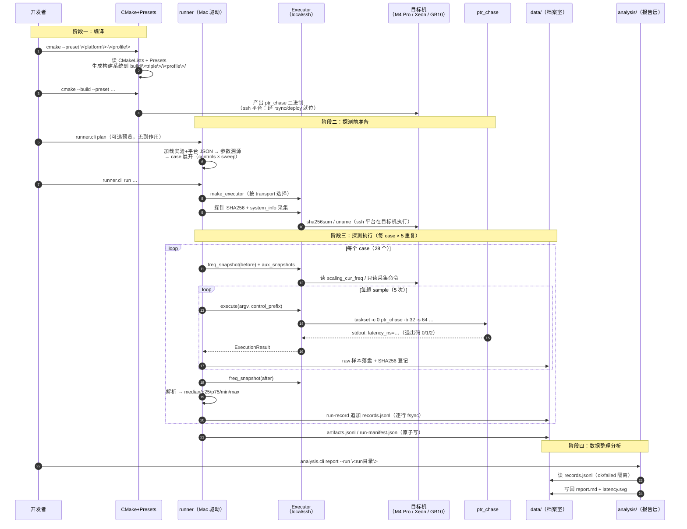

# ptr_chase 全链路分析报告：从源码到数据的完整旅程

> 分析对象：`probes/cache-mem/ptr_chase.cpp` 及其上下游全链路（构建 → 探测前准备 → 探测执行 → 数据生成与分析）。
> 基准：2026-09-25 的仓库状态（HEAD `e25c648`）。读者：工程师（不需要微架构背景）。
> 本文所有事实均可在仓内复核，关键处给出文件锚点。

## 1. 目录结构与文件职责总览

仓库是一棵"四层流水线 + 治理文档"的树。只列有实际内容的文件；同类文件只析其一。

```text
cpu-uarch-explorer/
├── CMakeLists.txt / CMakePresets.json   # 构建入口（§2）
├── cmake/toolchain-linux-aarch64.cmake  # 交叉编译工具链（Android 预演）
├── probes/                              # 探针层（C++）
│   ├── cache-mem/ptr_chase.cpp          # 主角：指针追逐内存延迟探针（247 行）
│   ├── cache-mem/CMakeLists.txt         # 仅 1 行：add_executable
│   ├── platform/CMakeLists.txt          # if(APPLE) 守卫——macOS 专属探针不进 Linux 构建
│   │   └── macos-arm64/                 # timer_resolution / qos_steering 能力探针
│   └── core|branch|tlb|sync/README.md   # 四个规划域占位（暂无探针）
├── runner/                              # 编排层（Python，stdlib 零依赖）
│   ├── cli.py / spec.py / plan.py       # 入口、配置加载、确定性计划展开
│   ├── resolve.py                       # 参数解析与溯源（单位严格化）
│   ├── engine.py                        # Run 引擎（221 行，全链核心）
│   ├── adapters/ptr_chase.py            # 探针适配器（argv 组装 + 输出解析）
│   ├── executor/{local,ssh}.py          # 本地/SSH 执行器 + __init__.py 工厂
│   ├── artifacts.py / records.py / statistics.py  # 落盘三件套
│   ├── deploy.py                        # 二进制部署 + SHA256 校验（GB10 管线用）
│   ├── environment/                     # 环境事务（coordinator/journal/controllers，已实现未接线）
│   ├── targets/capabilities.py          # 平台能力采集（cache 拓扑 / cpufreq）
│   └── schema/                          # 四类 JSON Schema（数据模型宪法）
├── configs/
│   ├── experiments/                     # 实验方案书（3 份：基础 / hugepage 对照 / L3 边界细扫）
│   └── platforms/                       # 平台档案（macbook-m4pro-01 / xeon-8481c-01）
├── analysis/                            # 报告层：load / report / chart / cli
├── scripts/quarantine_intake.py         # 回传数据检疫（GB10 自驱模式的入库闸门）
├── tests/                               # C++ 边界测试（CTest）
├── runner/tests/ + analysis/tests/      # Python 测试（51 + 7 项）
├── docs/                                # 治理：requirements / adr / methodology / design /
│                                        # tasks / runbooks / reviews / learning / open-items
├── third_party/                         # gem5 submodule + 134 文件增量树 + SPDX 清单
└── data/
    ├── public/runs/                     # 8 份实机 run（M4 Pro × 2、Xeon × 6）
    ├── public/capabilities/             # 平台能力清单（目前只有 Xeon 一份，原因见 §5.5）
    ├── public/legacy/                   # 历史数据（SM8550/SM8650，UNKNOWN 级）
    └── private/hosts.md                 # 真实主机映射（永不入库）
```

**一句话理解分工**：`probes/` 造零件，`runner/` 组装流水线，`configs/` 是配方和机器档案，`analysis/` 讲故事，`data/` 是档案室，`docs/` 是规章制度。

## 2. 编译系统分析

### 2.1 框架设计：CMake + Presets 的"单一入口、分层输出"

设计决策记录在 ADR-0008。要解决的问题：早期三个平铺的 `build/`、`build-ubsan/`、`build-x86/` 目录各自手工配置、无谱系、部分没被 gitignore 覆盖。现在的形态：

- **CMakeLists.txt 只描述"要编什么"**（目标、标准、选项），**CMakePresets.json 描述"为哪个平台、用什么 profile 编"**（binaryDir + cacheVariables）——两者分离，新增平台只加 preset 不动构建脚本；
- 输出按 `build/<target-triple>/<profile>/` 分层，一行 `build/` gitignore 全覆盖；
- preset 本身入库 = **构建配置的谱系可审计**（任何产物都能回答"用什么参数编的"）。

现有 6 个 preset：`macos-arm64-release`（默认）/ `macos-arm64-ubsan`（UBSan 变体）/ `darwin-x86_64-release`（Mac 上交叉 x86_64，可移植性检查）/ `linux-x86_64-release`（Xeon 原生）/ `linux-aarch64-release`（GB10 等原生 ARM64 Linux）/ `linux-aarch64-cross-release`（Xeon 交叉编译 aarch64 静态二进制，Android 预演）。

### 2.2 ptr_chase.cpp → 可执行文件的完整过程

以最常用的 `macos-arm64-release` 为例：

```
cmake --preset macos-arm64-release
  ├─ 读 CMakePresets.json → binaryDir=build/macos-arm64/release
  ├─ 读 CMakeLists.txt（cmake_minimum_required 3.16，C++17 强制）
  ├─ add_subdirectory(probes/cache-mem)
  │    └─ probes/cache-mem/CMakeLists.txt：add_executable(ptr_chase ptr_chase.cpp)
  ├─ add_subdirectory(probes/platform) → if(APPLE) 才编译 macos-arm64 能力探针
  ├─ add_subdirectory(tests) → 注册 5 个 CTest 边界测试
  └─ 生成 Ninja/Makefile 构建系统到 binaryDir

cmake --build --preset macos-arm64-release
  └─ Apple Clang 编译 ptr_chase.cpp（C++17，Release=-O3 -DNDEBUG）
       → build/macos-arm64/release/probes/cache-mem/ptr_chase（Mach-O arm64）
```

**编译选项细节**：

| 选项 | 值 | 来源 |
|---|---|---|
| 语言标准 | C++17（`CMAKE_CXX_STANDARD_REQUIRED ON`，禁用编译器扩展写法） | 根 CMakeLists |
| 构建类型 | Release（默认；`-O3 -DNDEBUG`） | 根 CMakeLists 缺省逻辑 + preset |
| UBSan | 仅 `macos-arm64-ubsan` preset 开 `-fsanitize=undefined -g -O1` | `ENABLE_UBSAN` option |
| 交叉编译 | `linux-aarch64-cross-release` 走 toolchain 文件（指定 `aarch64-linux-gnu-gcc` + 静态链接） | cmake/toolchain-linux-aarch64.cmake |
| hugepage 平台差 | **不靠编译选项**：`ptr_chase.cpp` 内 `#ifndef MAP_HUGETLB → CPU_UARCH_NO_HUGEPAGE` 宏自检测（macOS 无该宏，自动走 4K 分支，-h 时退出码 2=unsupported） | 探针源码内 |

**`build/` 目录分层现状**：`build/macos-arm64/{release,ubsan}/`、`build/darwin-x86_64/release/`（本机）；服务器侧 `build/linux-x86_64/release/`。每个子目录是自包含的 CMake 构建树（CMakeCache.txt 记录配置谱系 + Makefile + 产物）。注意 `cmake/`（源树内，放 toolchain 文件）与 `build/`（产物树，gitignore）是两个不同的东西。

## 3. 探测前的准备工作

### 3.1 configs/：为什么用 JSON 配置

两份配置文件对应两个正交关注点：

- **实验方案书**（`configs/experiments/ptr-chase-cache-sweep.json`）：测什么——buffer 从 32KiB 扫到 256MiB 共 14 档、stride 64B、每档重复 5 次、指标是 latency_ns 的 median；
- **平台档案**（`configs/platforms/macbook-m4pro-01.json`）：在哪测——target 五要素（os/isa/abi/target_id/执行与传输方式）、探针二进制路径、控制手段（controls）、默认参数。

**为什么是 JSON 而不是代码或 YAML**：

1. **语言中立**：探针是 C++、编排是 Python、未来报告/看板可能是别的——JSON 是所有语言的共同零依赖格式（ADR-0003 的"双端零依赖"精神）；
2. **schema 可校验**：四类配置都有 JSON Schema（`runner/schema/`），错误在加载期被结构校验拦住，而不是跑到一半才暴露；
3. **声明式 = 可审计**：`plan` 子命令不执行任何东西就能把全部 case 展开预览——配置是数据，数据可以 diff、可以评审、可以入库；
4. **演进宽容**：`additionalProperties=true`——新增字段不破坏旧读者（扩展字段登记到 `runner/schema/README.md`）。

### 3.2 runner/：准备阶段的流水线

一次 `runner.cli run` 在真正执行探针之前做的事（全部在 `runner/` 内）：

1. **加载与校验**（`spec.py`）：experiment 与 platform 两份 JSON 的结构校验（运行必需项）；
2. **Plan 展开**（`plan.py`）：controls × sweep 笛卡尔积 → 确定性 case 集合；参数解析带四层溯源（`ResolvedValue{value, source}`：CLI > 实验 > 平台默认 > 规格默认）；**单位解析严格化**——只认 KiB/MiB/GiB/KB/MB/GB/B，未知单位硬报错（GB10 评审实证教训：`64MiB` 被静默降级为 1024KB 的事故）；派生参数在此计算（loads = max(min_loads, 8×槽位数)，对齐 8 次展开因子）；repetitions 落到每个 case；
3. **执行器选择**（`executor/__init__.py`）：按 platform 的 `transport` 字段——`local` → LocalExecutor；`ssh` → SshExecutor（host 是 ssh config 别名，真实 IP 只住 `data/private/hosts.md`）。**唯一选择点，主流程零平台特判**；
4. **探针登记**（`engine.py:_register_probe`）：算二进制的 SHA256 + git commit/dirty 入 artifact-manifest——"这数字是哪版二进制测的"从此可答；ssh 平台经执行器通道在**目标机**上算摘要（本机读不到远端字节，也不假装读得到）；
5. **环境采集**（`executor.system_info()`）：os/kernel/compiler——ssh 平台描述的是目标机而非本机；
6. **辅助快照**（`aux_snapshots`，配置驱动）：平台可在配置里声明只读采集命令（如 GB10 的 GPU 利用率），run 前后各采一次。

另有 `runner/environment/`（事务协调器：锁 → journal → apply → verify → 逆序 restore）已实现但**尚未接线**到 run 主链——它是未来 governor 锁频的载体（OI-8 主线）。

## 4. 探测过程分析

### 4.1 探测原理（指针追逐）

要测的是 **load-to-use latency**：一次 load 从发出到数据可用的真实延迟。两个拦路虎与对策：

1. **硬件预取器**：顺序/固定步长访问会被 stride prefetcher 预测并提前取数，测出的延迟系统性偏低。对策：缓冲区按 64B（一个 cacheline）切格，Fisher–Yates 洗牌成**随机环链**（固定种子 42 保证可复现，`std::uniform_int_distribution` 保证无偏置换）；
2. **访存并行（MLP）**：要保证 MLP=1——每下一步地址来自上一步读出的值，依赖链强制串行。曾经的坑：用 4 条独立链摊薄循环开销，MLP=4，L1 测出 0.42ns 的荒谬值。**任何引入并行性的"优化"都在改变被测量本身**。现在的做法：同一条链展开 8 次（8 个 load 仍严格串行，循环控制开销摊薄 8 倍）。

防编译器优化三重保障：mmap 真实内存（编译器看不见内容）+ 链上真实数据依赖 + 结果写 volatile 变量强制物化。

**计时口径**（与能力探针联动）：macOS 计时器有效分辨率实测 41.67ns，单次计时区间必须装 ≥10⁵ 次 load 才能把量化噪声平均到 10⁻⁴ 以下——这是 `min_loads` 默认 4,194,304 的由来。统计口径是"总时间 ÷ 总次数"，不逐 load 计时。

### 4.2 运行参数全表

| 参数 | 含义 | 默认 | 校验 |
|---|---|---|---|
| `-b KB` | 缓冲区大小（工作集） | 8192 | >0 且够 2 个槽位 |
| `-s bytes` | 槽位步长 | 64 | 必须是指针宽度（8B）整数倍 |
| `-n loads` | 依赖 load 总数 | 2²⁸（268M） | ≥8 且程序内对齐到 8 的倍数 |
| `-w loads` | 预热次数（不计入测量） | 200000 | ≥0 |
| `-h` | 2MB hugepage；页池不足时回退 4K 并在输出标注 `page_policy=fallback-4k` | 关 | Linux only |
| `-H` | hugepage 严格模式：页池不足直接退出码 2（unsupported） | 关 | Linux only |

退出码语义（Probe ABI，ADR-0006 §3）：**0=成功 / 1=输入或环境错误 / 2=能力不支持**。非法输入绝不静默产出记录。

### 4.3 运行命令是如何组装的

以 Xeon 的 hugepage 对照实验、32KiB 档、core0 控制组为例，逐层组装：

```
实验 JSON（sweep buffer=32KiB…256MiB，fixed hugepage=1）
  → plan.py：参数溯源 + 派生计算（32KiB/64B=512 槽位 ×8=4096 < min_loads → loads=4194304）
  → adapters/ptr_chase.py build_argv：["-b","32","-s","64","-n","4194304","-w","200000","-h"]
  → 探针路径：build/linux-x86_64/release/probes/cache-mem/ptr_chase（远端仓库根相对路径）
  → 控制前缀：platform controls → ["taskset","-c","0"]
  → executor/ssh.py：shlex.quote 逐参数引用 + cd 远端仓库根
```

**最终实际执行的完整命令**（记录在每条 run-record 的 `raw_command` 字段）：

```bash
ssh -o BatchMode=yes xeon-8481c-01 'cd ~/cpu-uarch-explorer && exec taskset -c 0 build/linux-x86_64/release/probes/cache-mem/ptr_chase -b 32 -s 64 -n 4194304 -w 200000 -h'
```

本机 M4 Pro 的 E 核组则是（探针为绝对路径）：

```bash
/usr/sbin/taskpolicy -b /Users/michaelyao/workspace/cpu-uarch-explorer/build/macos-arm64/release/probes/cache-mem/ptr_chase -b 32 -s 64 -n 4194304 -w 200000
```

## 5. 数据生成与分析

### 5.1 完整调用流程

```
runner.cli run
 └─ engine.run_plan()
     ├─ 探针登记（SHA256 + git 谱系 → artifact-manifest）
     ├─ system_info / freq_snapshot / aux_snapshots 采集
     └─ for case in plan.cases:            # 28 个 case（14 档 × 2 控制组）
         └─ _run_case()
             ├─ freq_snapshot(before)      # 锁频落地前的频率证据
             ├─ for sample in range(5):    # repetitions 真实驱动循环
             │    ├─ executor.execute()    # 探针跑一趟
             │    ├─ raw stdout/stderr 落盘（raw/）+ SHA256 登记
             │    └─ adapter.parse_output() → latency_ns
             ├─ freq_snapshot(after)
             ├─ summarize() → median/p25/p75/min/max
             └─ build_run_record() → records.jsonl（逐行 fsync）
 └─ artifacts.jsonl / run-manifest.json（原子写：tmp→fsync→replace→父目录fsync）

analysis.cli report --run <run目录>
 └─ load.py（ok/failed 隔离）→ report.py（Markdown）+ chart.py（SVG 曲线）
     → report.md + latency.svg 写回 run 目录
```

### 5.2 analysis/ 目录

| 文件 | 职责 |
|---|---|
| `load.py` | 读 run 目录；只收 schema_version=2.0 的记录；**failed 记录隔离**（单列不进图表） |
| `report.py` | Markdown 报告：元信息块（测量纪律 §7 全项）、数据表、双峰比值（声明不作常量）、台阶推断（相邻档位比值 >1.5×，标注为推断）、置信度评级 |
| `chart.py` | 纯 stdlib 手写 log-log SVG（不引 matplotlib，保持零依赖）；XML 转义防注入 |
| `cli.py` | `report --run <目录>`，产出写回 run 目录作为派生档案 |

### 5.3 data/ 目录

`data/public/runs/` 下每个 run 目录：`records.jsonl`（28 条记录，每 case 一条）+ `artifacts.jsonl`（141 条清单：1 个二进制 + 140 个原始样本）+ `run-manifest.json` + `report.md` + `latency.svg` 入库；`raw/`（280 个原始输出文件）**不入库**——可再生中间产物，SHA256 在 manifest 里锚定完整性（v0.3 §7 数据策略）。`capabilities/` 存平台能力清单，`legacy/` 存来源不可考的历史数据，`private/` 永不入库。

### 5.4 问题一：为什么 raw/ 里有些文件是空的？

验证：`*_qos-default_b32K-s64B.s0.stderr.txt` 大小为 0。**这是正确行为，不是 bug**：ptr_chase 成功路径只往 stdout 打 `key=value` 行（stderr 内容为 0 字节）；stderr 是为错误/警告保留的通道——比如 `-h` 页池不足回退时会打 `warning: hugepage pool unavailable, falling back to 4K pages`。raw 样本把 stdout 和 stderr **都**落盘，是为了失败时能审计（非法输入的错误说明在 stderr 上），成功时空 stderr 恰好证明"无警告无错误"。manifest 里每个样本的 SHA256 由 stdout+stderr 合并计算，空文件不影响完整性校验。

### 5.5 问题二：为什么 capabilities/ 只有 Xeon，没有 M4 Pro？

真实原因是**时序差**，不是设计如此：

- M4 Pro 的能力探测（计时器 41.67ns、QoS 双峰、powermetrics 清单）是 2026-09-24 **手工执行的**，结论以散文形式写进了 v0.3 §2.1（证据等级 MEASURED）——当时 capability-manifest 的**采集代码还不存在**；
- capability 采集器（`runner/targets/capabilities.py`，cache 拓扑 + cpufreq 经执行器通道自动采集）是 09-25 随 Xeon 接入任务才落地的，Xeon 因此有了第一份**机器生成**的清单（`xeon-8481c-01-20260924T182612Z.json`）。

**这是一个真实的缺口**（改进点见 §7）：M4 Pro 应该补一份机器生成的 capability-manifest，让两个平台的能力证据形态一致。

### 5.4' 补充：Xeon 首跑数据揭示的真实微架构问题

Xeon 首跑的 `freq_snapshot` 显示 **governor=powersave 下指针追逐全程锁在 800MHz**（ALU 密集负载才能冲到 2.0GHz）——内存敏感负载不触发升频。这正是频率管理设计（按能力分级：能锁的平台走环境事务锁 governor=performance）的直接证据：当前 Xeon 数据的 ns 绝对值不可跨档比较，仅台阶位置可用（已在平台配置 capabilities_note 中如实登记）。hugepage A/B 对照组（`-hp2m` 实验）随之建立。

## 6. 全链路时序图



## 7. 总体设计评估与改进空间

### 7.1 做得对的（值得保持）

1. **纪律从文档变成了结构**："不许编数"不是道德要求而是 schema 强制（metrics 条件化 + 结构化 failure）；"静默降级"在代码层被禁止（单位硬报错）；"requested/actual"双记录贯穿（控制值 vs 实际命令、页策略 vs page_policy 入档）；
2. **平台差异收敛得干净**：Xeon 接入验证了"主流程零特判"——transport 选择集中在 `make_executor` 一处；`probes/platform/CMakeLists.txt` 的 `if(APPLE)` 守卫让 macOS 专属探针不污染 Linux 构建；
3. **实测驱动的自我修正**：Xeon 首跑就抓到 governor=powersave 下内存负载不升频（800MHz 平线）——频率快照这个"低成本先行项"立刻证明了自己的价值；
4. **失败留痕文化**：三次 gem5 构建失败、with_suffix 样本覆盖、频率快照首跑漏采（12 条记录无快照后修复并注释）——全部转化为防线和回归测试。

### 7.2 改进空间（按优先级）

| # | 问题 | 证据 | 建议 |
|---|---|---|---|
| 1 | **M4 Pro 缺机器生成的 capability-manifest**（§5.5） | `data/public/capabilities/` 只有 Xeon | 为 macOS 写采集器（sysctl perflevels / 计时器 / QoS 探针结果封装），或至少把 §2.1 的实测散文导出为清单 JSON |
| 2 | **环境事务已实现未接线** | `runner/environment/coordinator.py` 存在但 `cli.py` 只有 plan/run 两个子命令 | governor=performance 锁频（Xeon 的第一受控项）需要 CLI 的 env 子命令 + run 前 apply/run 后 restore 接线；Xeon 数据质量（§5.4'）证明这是刚需 |
| 3 | **探针适配器注册是硬编码** | `engine.py` 的 `_ADAPTERS` 字典写死 ptr_chase | 新探针（core/branch/TLB）接入前改为注册表模式（ decorator 或 entry-point 式发现），消除"加探针改引擎" |
| 4 | **SSH 每条命令一个会话** | `ssh.py` 每次 execute 都新建 TCP+认证 | 当前量级（280 条命令/run）可接受；Android/adb 或更大 sweep 前考虑长连接复用或批量化 |
| 5 | **频率快照是瞬时值** | engine.py 注释已自承"非区间精确" | 环境事务落地后升级：Linux 锁频 + 测量期多次采样（或 powermetrics 并发采样入档 macOS 侧） |
| 6 | **n=5 时 p25/p75 很粗** | statistics 用 inclusive 插值 | 不改统计代码；需要更高置信时把 repetitions 提到 7+（实验 JSON 里一行的事） |
| 7 | **报告层只支持单 run** | analysis/README 自述 | 跨 run 汇总（同实验多次复测的漂移分析）是下一个自然增强；校准差异单等 gem5 建模启动后再做 |
| 8 | **GB10 回传链路未演练** | quarantine_intake.py 已备但未跑过真实数据 | GB10 首跑即演练；检疫脚本校验项随真实数据演化 |

### 7.3 一个结构性的观察

这个仓库最值钱的不是任何一段代码，而是**"教训 → 防线 → 测试"的转化机制**：每个踩过的坑（静默降级、死参数、fixture 臆造、样本覆盖、频率漏采、版本混合）都被转成了代码防线 + 契约/回归测试 + 文档锚点。保持这个转化率的优先级高于任何单个功能。

## 8. 补充：本文未覆盖的角落

- **`runner/environment/` 事务协调器**（§3.2 末提及）：GB10 模型的重实现，锁+journal+逆序 restore 完整，等 governor 锁频任务接线；
- **`scripts/quarantine_intake.py`**：GB10 自驱模式的数据检疫闸门（回传数据先检疫后入 public）；
- **`runner/deploy.py`**：GB10 三机管线的二进制分发 + SHA256 校验 + 一次重试——GB10 改自驱模式后暂未被使用，但 Android 接入时会成为主路径；
- **`docs/learning/`**：12 页费曼笔记，新人从 `00-why-this-framework.md` 读起；
- **gem5 侧**（`third_party/`）：v25.0.0.1 + 134 文件最小增量已在 Xeon 验证，建模后置（启动条件：探针套件 + D9300 实机），不在本报告范围。

---

*分析完毕。所有引用的文件、命令、数据均来自仓库当前状态（HEAD `e25c648`）；文中"实测"数字引自 `data/public/runs/` 与 v0.3 §2 平台画像。*
