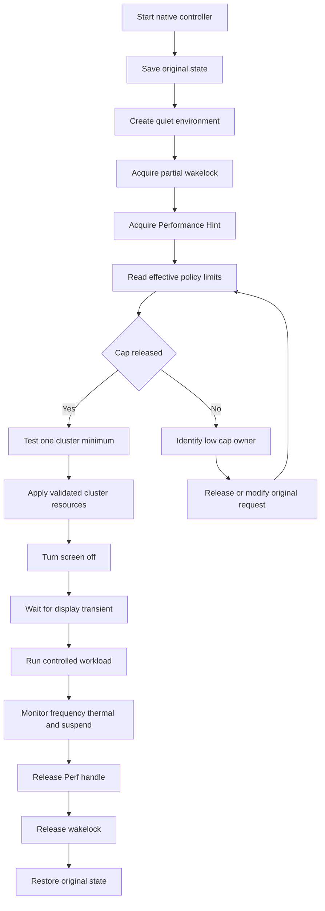

# Android 灭屏静默环境下 CPU 最高频锁定实验与证据链

## 1. 目标和安全边界

最终目标是在以下环境中进行可重复性能实验：

- 屏幕关闭；
- 飞行模式开启；
- Wi-Fi、Bluetooth、NFC 关闭；
- 非必要后台应用停止；
- 系统保持 awake，不进入 suspend；
- 无 thermal throttle 时，各 CPU policy 可运行于最高 OPP；
- 保留 thermal、PMIC、电池过流和 emergency shutdown 保护。

本项目不以禁用 thermal protection 为目标。

最高 OPP 由本机 sysfs 实测获得：

| Policy | `cpuinfo_max_freq` | 最高 OPP |
|---|---:|---:|
| policy0 | 2265600 kHz | 2265.6 MHz |
| policy2 | 3148800 kHz | 3148.8 MHz |
| policy5 | 2956800 kHz | 2956.8 MHz |
| policy7 | 3302400 kHz | 3302.4 MHz |

policy 对应的 CPU 列表仍应通过以下节点保存：

```bash
for P in /sys/devices/system/cpu/cpufreq/policy*; do
    echo "=== $P ==="
    cat "$P/related_cpus"
    cat "$P/affected_cpus"
done
```

---

## 2. 结论分级

### 2.1 已由运行时实验直接证明

1. policy2、policy5、policy7 存在稳态 max-frequency cap：

   ```text
   policy2 = 2707200 kHz
   policy5 = 2707200 kHz
   policy7 = 2745600 kHz
   ```

2. 唤醒后存在约 3 秒的临时高频窗口：

   ```text
   policy2 = 2956800 kHz
   policy5 = 2956800 kHz
   policy7 = 3052800 kHz
   ```

3. 唤醒 boost 并非所有 policy 的硬件最高 OPP。

4. AOSP fixed-performance mode 在当前 ROM 上没有改变可观测 cpufreq policy 状态。

5. root 写入 `scaling_max_freq=cpuinfo_max_freq` 返回成功，但立即回读仍是较低上限。

6. 普通 cpufreq sysfs 写入不能覆盖当前有效 cap。

7. 同一 policy 的 max limit 可以动态变化，因此当前稳态 cap 不是不可改变的 fuse 上限。

### 2.2 已由设备配置和 ELF 符号证明

1. 本机存在 Qualcomm Perf client：

   ```text
   /vendor/lib64/libqti-perfd-client.so
   ```

2. 该库导出：

   ```text
   perf_hint
   perf_lock_acq
   perf_lock_rel
   ```

3. 本机配置存在 Performance mode Hint：

   ```text
   Id = 0x00001091
   Target = pineapple
   ```

4. 该 Hint 配置包含四组 `sched_fmax_cap` 资源，并提交 `0x7fffffff`。

### 2.3 尚未证明

1. `perf_hint(0x1091)` 能否解除最终 cpufreq cap；
2. `0x7fffffff` 在当前资源处理器中究竟代表 unlimited、default/reset，还是普通高值；
3. 当前 2.7 GHz cap 的唯一 request owner；
4. 显式高值 Perf Lock 能否覆盖现存低 cap；
5. policy 与四组 MPCTL cluster opcode 的完整运行时映射；
6. `/data/local/tmp` 进程能否通过 linker namespace 和 SELinux 调用 vendor Perf client；
7. 灭屏后长期锁频是否稳定。

---

## 3. 已观测到的三层频率状态

| Policy | 稳态 cap | 唤醒 boost cap | 硬件最高 OPP |
|---|---:|---:|---:|
| policy0 | 2265.6 MHz | 未发现更高档 | 2265.6 MHz |
| policy2 | 2707.2 MHz | 2956.8 MHz | 3148.8 MHz |
| policy5 | 2707.2 MHz | 2956.8 MHz | 2956.8 MHz |
| policy7 | 2745.6 MHz | 3052.8 MHz | 3302.4 MHz |

这证明：

- 2.7 GHz 左右不是硬件最高频；
- 唤醒 boost 也不等于整颗 SoC 的最高性能状态；
- vendor 控制链能够动态修改 policy limit。

---

## 4. 唤醒 boost 的 ftrace 证据

### 4.1 第一个窗口

```text
3563.667077  KEYCODE_WAKEUP_SENT

3563.838322  policy2 max=2956800
3563.838329  policy5 max=2956800
3563.838332  policy7 max=3052800
```

唤醒至上限提升的延迟：

$$3563.838322-3563.667077
=0.171245\ \mathrm{s}$$

上限恢复：

```text
3566.837884  policy2 max=2707200
3566.837897  policy5 max=2707200
3566.837910  policy7 max=2745600
```

持续时间：

$$3566.837884-3563.838322
=2.999562\ \mathrm{s}$$

### 4.2 第二个窗口

```text
3568.978429  policy2 max=2956800
3568.978438  policy5 max=2956800
3568.978445  policy7 max=3052800
```

恢复：

```text
3571.988117  policy2 max=2707200
3571.988131  policy5 max=2707200
3571.988139  policy7 max=2745600
```

持续时间：

$$3571.988117-3568.978429
=3.009688\ \mathrm{s}$$

### 4.3 PERFD 时间相关性

```text
PERFD-SERVER-1837       3568.977302
cpu_frequency_limits    3568.978429
```

时间差：

$$3568.978429-3568.977302
=1.127\ \mathrm{ms}$$

该结果强烈支持 PERFD 参与执行或仲裁，但不能证明 PERFD 是唯一上游请求者。

可能的上游包括：

- Android Power/Display；
- Xiaomi MiPerf；
- Xiaomi perfservice；
- PowerKeeper；
- SystemUI/Keyguard；
- Camera/Face authentication。

---

## 5. 已证明无效的方法

### 5.1 AOSP fixed-performance mode

命令：

```bash
cmd power set-fixed-performance-mode-enabled true
```

两次重复实验结果一致：

```text
policy0 min=556800 max=2265600 governor=walt
policy2 min=614400 max=2707200 governor=walt
policy5 min=499200 max=2707200 governor=walt
policy7 min=672000 max=2745600 governor=walt
```

结论：

- 没有解除稳态 cap；
- 没有改变 governor；
- 没有提高 min；
- 当前 ROM 上不能将该命令作为锁频入口。

恢复命令：

```bash
cmd power set-fixed-performance-mode-enabled false
```

### 5.2 直接写 `scaling_max_freq`

实测：

```text
policy2 request=3148800: write_ok readback=2707200
policy5 request=2956800: write_ok readback=2707200
policy7 request=3302400: write_ok readback=2745600
```

并且后续 10 秒没有变化。

结论：

- 不是写权限失败；
- 不是几秒后被 daemon 写回；
- 写入后立即受到更低有效约束；
- 继续轮询写 sysfs 没有价值。

### 5.3 只提高 min 或切换 governor

即使提高 min，请求仍受低 max 截断。

抽象模型为：

$$F_{\mathrm{effective,max}}
=
\min\left(
F_{\mathrm{user,max}},
F_{\mathrm{vendor,max}},
F_{\mathrm{thermal,max}},
\ldots
\right)$$

$$F_{\mathrm{effective,min}}
=
\max\left(
F_{\mathrm{user,min}},
F_{\mathrm{vendor,min}},
\ldots
\right)$$

因此在解除低 max 之前，`performance` governor 和高 min 均不是根因方案。

> 上述公式是控制模型。当前尚未通过内核 request list 证明所有约束都由标准 Linux `freq_qos` 对象实现，也可能包含 WALT/vendor cpufreq 扩展。

---

## 6. OEM Perf 资源静态证据

### 6.1 WALT 节点

`commonresourceconfigs.xml` 包含：

```xml
<Minor OpcodeValue="0x7"
       Node="/proc/sys/walt/sched_fmax_cap"/>
```

说明 `0x43C1Cxxx` 资源族关联 WALT `sched_fmax_cap`。

### 6.2 SCHED_FMAX_CAP 资源

| Opcode | 名称 | 静态证据 |
|---|---|---|
| `0x43C1C000` | `SCHED_FMAX_CAP_BIG` | 配置明确标注 |
| `0x43C1C100` | `SCHED_FMAX_CAP_LITTLE` | 配置明确标注 |
| `0x43C1C200` | `SCHED_FMAX_CAP_PRIME` | 注释顺序与资源顺序支持 |
| `0x43C1C300` | `SCHED_FMAX_CAP_TITANIUM` | 配置明确标注 |

`0x43C1C200` 的 PRIME 语义具有较高置信度，但仍建议以单资源刺激实验确认。

### 6.3 Cluster frequency 资源

| 资源组 | Max opcode | Min opcode |
|---|---|---|
| BIG | `0x40804000` | `0x40800000` |
| LITTLE | `0x40804100` | `0x40800100` |
| PLUS/PRIME | `0x40804200` | `0x40800200` |
| TITANIUM | `0x40804300` | `0x40800300` |

Cluster frequency 资源的配置值通常以 MHz 表示：

```text
0x40804000, 3148
```

`sched_fmax_cap` 使用完整频率值：

```text
0x43C1C000, 3148800
```

两类资源的单位不能混用。

### 6.4 资源与 policy 的候选映射

根据 policy 起始 CPU、最高频和 OEM 配置，当前候选映射为：

| Policy | 候选资源组 | 置信度 |
|---|---|---:|
| policy0 | LITTLE | 高 |
| policy2 | BIG | 高 |
| policy5 | TITANIUM | 高 |
| policy7 | PRIME/PLUS | 高 |

该表不是最终证明。最终闭环需要：

1. 保存 `related_cpus`；
2. 每次只提交一个资源；
3. 捕获 `cpu_frequency_limits`；
4. 观察唯一发生变化的 policy。

### 6.5 不得混淆的 opcode

```text
0x43C1C300 = SCHED_FMAX_CAP_TITANIUM
0x4080C300 = 另一类 vendor frequency/adaptive resource
```

两者不能因尾部相似而视为同一资源。

---

## 7. Performance mode Hint `0x1091`

### 7.1 已知事实

`perfboostsconfig.xml` 包含：

```text
Id="0x00001091"
Enable="true"
Target="pineapple"
```

且上下文注释为：

```text
Performance mode
```

其资源包括：

```text
0x43C1C000, 0x7fffffff
0x43C1C100, 0x7fffffff
0x43C1C200, 0x7fffffff
0x43C1C300, 0x7fffffff
0x43C20000, 0x7fffffff
```

同时设置基础 cluster min：

```text
0x40800000, 1785
0x40800100, 800
0x40800200, 1670
0x40800300, 1785
```

### 7.2 必须修正的理解

不能直接写成：

```text
0x1091 一定会解除当前 2.7 GHz cap
```

正确表述是：

> `0x1091` 是当前最有价值的原厂 Performance mode 候选入口，但它对现存低 cap 的仲裁效果尚未验证。

`0x7fffffff` 可能表示：

- unlimited；
- reset/default sentinel；
- 普通的最大数值；
- vendor handler 定义的特殊值。

只能通过运行时观察确定。

### 7.3 关键仲裁问题

如果已有客户端持有：

```text
max = 2707 MHz
```

而资源仲裁为“低上限优先”，那么新增：

```text
max = 3148 MHz
```

仍可能得到：

```text
effective max = 2707 MHz
```

因此 `0x1091` 能成功的前提可能是以下之一：

1. 它修改的是同一全局资源状态，而不是增加独立 request；
2. `0x7fffffff` 被 handler 解释为 reset/unlimited；
3. Performance mode 会释放或替换原 profile；
4. 2.7 GHz cap 本身就是 `sched_fmax_cap`，且没有其他更低 constraint。

当前尚不知道是哪一种。

---

## 8. Perf client 调用入口

### 8.1 服务和库

运行中的相关组件：

```text
vendor.qti.hardware.perf2-hal-service
vendor.xiaomi.hardware.miperf@1.0-service
perfservice
com.miui.powerkeeper
```

Perf client：

```text
/vendor/lib64/libqti-perfd-client.so
```

导出：

```text
perf_lock_acq
perf_lock_rel
perf_hint
perf_hint_renew
perf_hint_acq_rel
perf_event
```

### 8.2 ABI 状态

常见 ABI 候选为：

```cpp
int perf_hint(int hint,
              const char *user_data,
              int duration_ms,
              int type);

int perf_lock_acq(int handle,
                  int duration_ms,
                  int list[],
                  int num_args);

int perf_lock_rel(int handle);
```

但 ELF symbol table 不能证明函数参数原型。

ABI 需要通过以下方式进一步验证：

1. 搜索 vendor 头文件；
2. 反汇编设备上的真实调用方；
3. 检查寄存器参数准备；
4. 执行有限时调用并检查日志；
5. 确认返回值和 release 语义。

`perf_lock_acq()` 的 `num_args` 通常是整数元素数量，而不是资源对数量，但在当前设备上仍应基于调用方确认。

### 8.3 Android linker namespace 风险

即使以 root 运行：

```text
/data/local/tmp/perf_hint_test
```

也不保证能成功：

```cpp
dlopen("/vendor/lib64/libqti-perfd-client.so", ...)
```

可能失败于：

- vendor library 不对当前 linker namespace 可见；
- vendor 库的依赖项不可见；
- SELinux 禁止 Binder/HIDL/AIDL 访问；
- Perf HAL 对调用 UID/PID/域做权限检查。

root 不能自动绕过 SELinux。

如果失败，需要记录：

```bash
logcat -b all -d
dmesg
```

并搜索：

```text
linker
namespace
CANNOT LINK EXECUTABLE
dlopen failed
avc: denied
perf
mpctl
```

不能在没有日志的情况下将失败简单归因于 ABI。

---

## 9. 下一步：有限时 `0x1091` 单变量实验

### 9.1 实验原则

第一次只调用：

```text
perf_hint(0x1091)
```

不同时执行：

- `scaling_min_freq` 锁最高；
- cluster max Perf Lock；
- cluster min Perf Lock；
- 停止 PowerKeeper；
- 停止 MiPerf；
- 停止 thermal。

这样才能判断 `0x1091` 本身的效果。

### 9.2 必须同步记录

```text
perf_hint 返回值
process exit code
logcat
SELinux AVC
scaling_min_freq
scaling_max_freq
sched_fmax_cap
cpu_frequency_limits
release/timeout 后恢复状态
```

检查 WALT 节点：

```bash
adb -d shell "su -c '
ls -l /proc/sys/walt/sched_fmax_cap
cat /proc/sys/walt/sched_fmax_cap 2>/dev/null
'"
```

### 9.3 结果判定

#### A. policy max 达到硬件最高值

```text
policy0 = 2265600
policy2 = 3148800
policy5 = 2956800
policy7 = 3302400
```

证明：

- `0x1091` 能解除当前有效低 cap；
- 后续才有条件测试提高 min。

#### B. policy max 只达到唤醒 boost 档

```text
policy2 = 2956800
policy5 = 2956800
policy7 = 3052800
```

说明仍存在另一层限制。

不能立即认定该限制就是 cluster max，仍需检查：

- `sched_fmax_cap`；
- `cpu_frequency_limits`；
- thermal；
- 其他 active Perf profile。

#### C. handle 有效，但 policy max 不变

可能原因：

- `0x1091` 的 request 被低 cap 仲裁掉；
- `0x1091` 只修改 WALT 层，但 cpufreq QoS 仍受限；
- 低 cap 来自另一个 client/request；
- type、target 或配置匹配未命中；
- `0x7fffffff` 没有解除语义。

此时正确方向是寻找低 cap owner，而不是继续叠加更高 max request。

#### D. 调用失败

依次排查：

1. linker namespace；
2. 缺失依赖库；
3. SELinux；
4. Perf HAL 权限；
5. ABI；
6. Hint ID 和 type。

---

## 10. 显式 Perf Lock 的正确定位

静态配置支持以下候选资源：

```cpp
static int resources[] = {
    0x43C1C100, 0x7fffffff,
    0x43C1C000, 0x7fffffff,
    0x43C1C300, 0x7fffffff,
    0x43C1C200, 0x7fffffff,

    0x40804100, 2265,
    0x40804000, 3148,
    0x40804300, 2956,
    0x40804200, 3302,

    0x40800100, 2265,
    0x40800000, 3148,
    0x40800300, 2956,
    0x40800200, 3302,
};
```

但这组资源不能被描述为“必然可以覆盖 2.7 GHz cap”。

### 10.1 可能无效的原因

如果已有 max request 为：

```text
2707 MHz
```

且仲裁取最低 max，那么新增：

```text
3148 MHz
```

不会改变最终结果。

### 10.2 正确使用方法

显式 Perf Lock 首先用于：

1. 单资源刺激；
2. 验证 opcode 与 policy 映射；
3. 判断资源是否被接受；
4. 判断 min/max 的实际仲裁语义；
5. 确认 release 后是否恢复。

建议顺序：

```text
单个 sched_fmax_cap
-> 单个 cluster max
-> 单个 cluster min
-> 每一步捕获 cpu_frequency_limits
-> 最后才组合资源
```

### 10.3 第一次不应提交四 cluster 全最高频

原因：

- 无法定位哪个资源有效；
- 无法识别映射错误；
- 瞬时功耗大；
- thermal 可能迅速介入；
- 多个资源的结果会互相遮蔽。

---

## 11. 如果高值 Perf request 无法覆盖低 cap

若满足以下条件：

```text
perf_hint 返回有效 handle
+ 显式 Perf Lock 被接受
+ sched_fmax_cap 已变化
+ policy max 仍停留在 2.7 GHz
```

则下一阶段目标必须改为：

> 定位并释放、停止或修改低 cap 的原始 owner。

候选组件：

```text
vendor.qti.hardware.perf2-hal-service
vendor.xiaomi.hardware.miperf@1.0-service
perfservice
com.miui.powerkeeper
```

正确方法是一次只隔离一个组件，并保留 thermal。

需要先建立：

```text
init service name
-> process
-> executable
-> Binder/HIDL/AIDL client
-> Perf resource
-> cpu_frequency_limits
```

不应执行：

```text
一次停止全部 Perf 服务
```

否则无法归因，而且可能留下未释放 request。

永远不应停止：

```text
thermal HAL
thermal-engine
PMIC protection
battery thermal
charger thermal
emergency shutdown
```

---

## 12. 灭屏场景中的 suspend 问题

关闭屏幕不等于 CPU 保持执行。

若系统进入 suspend：

- workload 停止；
- cpufreq 不再进行正常 OPP 调度；
- “最高频”只有配置意义，没有运行意义。

最终工具必须持有 partial wakelock。

可先检查 legacy 接口：

```bash
adb -d shell "su -c '
ls -l /sys/power/wake_lock \
      /sys/power/wake_unlock 2>/dev/null
'"
```

如果存在，才可以测试：

```bash
echo maxfreq_test > /sys/power/wake_lock
```

释放：

```bash
echo maxfreq_test > /sys/power/wake_unlock
```

当前尚无本设备验证结果，因此不能把 legacy wakelock 写成既定实现。

`dumpsys deviceidle disable` 不能替代 partial wakelock，它关闭的是 Device Idle/Doze 状态机，并不严格保证系统永不 suspend。

---

## 13. 静默环境建立流程

推荐流程：

```text
开启飞行模式
-> 关闭 Wi-Fi
-> 关闭 Bluetooth
-> 关闭 NFC
-> force-stop 非必要第三方应用
-> 等待 30 到 60 秒
-> 检查中断、负载和温度基线
-> 清空 trace
-> 获取 partial wakelock
-> 获取 Performance Hint/Perf Lock
-> 验证 policy effective max
-> 必要时提高 min
-> 关闭屏幕
-> 等待 display/keyguard 瞬态结束
-> 开始正式负载
```

不推荐简单执行 `am kill-all` 后立即开始测试，因为进程重建、page fault 和服务重启会制造额外扰动。

---

## 14. 实际最高频的验证方法

不能只读取一次：

```text
scaling_cur_freq
```

原因：

- 可能是缓存值；
- 可能是采样瞬间值；
- fast-switch/WALT 路径可能让读取值与硬件瞬时状态有偏差；
- 空闲 CPU 即使 min 被提高，也可能进入 idle。

完整验证至少包括：

1. `scaling_min_freq`；
2. `scaling_max_freq`；
3. `cpu_frequency_limits` tracepoint；
4. `cpu_frequency` tracepoint；
5. 持续负载下的性能吞吐；
6. CPU active/idle residency；
7. thermal trace；
8. suspend/resume trace。

需要区分：

```text
CPU policy 被锁定到最高 OPP
```

和：

```text
CPU 持续执行、从不进入 idle
```

两者不是同一件事。

即使频率 policy 固定到最高 OPP，CPU 无任务时仍可进入 WFI 或更深 idle state。

若目标是测量持续最高频功耗，还需要：

- 持续可控负载；
- 或单独限制 cpuidle；
- 不能把“禁用 cpuidle”与“锁频”混成一个实验变量。

---

## 15. 最终控制工具架构



关键修正：

> 如果 cap 未解除，不能无条件继续叠加更高 max request；必须转入 owner 定位流程。

---

## 16. 成功判据

### 16.1 “上限已解除”

满足：

```text
scaling_max_freq == cpuinfo_max_freq
```

并由 `cpu_frequency_limits` 证明相应 policy limit 已变化。

### 16.2 “policy 已固定到最高 OPP”

满足：

```text
effective min == effective max == target OPP
```

同时 trace 中没有恢复至 2.7 GHz profile。

### 16.3 “灭屏后仍在最高频执行”

还必须满足：

- 屏幕关闭；
- 系统未 suspend；
- workload 持续运行；
- CPU active time 合理；
- `cpu_frequency` trace 与吞吐结果匹配；
- 无 thermal throttle，或明确标注 thermal 降频区间。

### 16.4 “实验可重复”

至少重复三次，并保存：

- 起始温度；
- 环境温度；
- 电池电量；
- 是否外接电源；
- Perf handle；
- policy limits；
- trace；
- 负载吞吐；
- 测试后恢复状态。

---

## 17. Thermal 安全边界

动态功耗近似：

$$P_{\mathrm{dynamic}}
\propto C V^2 f$$

从 2.7 GHz 提升到最高 OPP 时，电压通常同时提高，所以功耗增幅通常高于单纯的频率增幅。

推荐定义：

> 无 thermal throttle 时维持最高 OPP；thermal/PMIC 触发后允许安全降频。

不推荐：

> 删除 thermal request，在过温条件下继续强制最高频。

如果需要更长时间保持最高 OPP，应采用：

- 主动散热；
- 稳定环境温度；
- 外部供电和电流监控；
- 降低非 CPU 子系统功耗；
- 冷启动前统一温度条件。

---

## 18. 方法价值汇总

| 方法 | 结果 | 价值 |
|---|---|---|
| `cpu_frequency_limits` ftrace | 捕获两个约 3 秒窗口 | 核心运行时证据 |
| sysfs 周期采样 | 确认稳态和硬件 max | 建立频率基线 |
| AOSP fixed-performance mode | 无效 | 排除错误路径 |
| 只写 `scaling_max_freq` | 立即受低 cap 截断 | 证明普通 sysfs 不够 |
| OEM XML 检索 | 找到 opcode 和 `0x1091` | 建立静态资源模型 |
| ELF symbol 检查 | 找到 Perf client ABI 入口 | 为 native 工具提供入口 |
| `0x1091` 有限时实验 | 尚未执行 | 下一步最高优先级 |
| 显式单资源 Perf Lock | 尚未执行 | 用于映射和仲裁验证 |
| 四 cluster 全资源锁频 | 尚未执行 | 必须在单资源闭环后进行 |
| 停止 cap owner | 尚未执行 | 仅在高 request 无效时使用 |
| 禁用 thermal | 不允许 | 违反安全边界 |

---

## 19. 下一步严格实验顺序

### 阶段一：补齐静态映射

```text
保存 related_cpus
-> 保存 affected_cpus
-> 保存 scaling_available_frequencies
-> 保存当前 sched_fmax_cap
```

### 阶段二：验证调用通路

```text
最小 dlopen
-> dlsym
-> 检查 linker namespace
-> 检查 SELinux
-> 不提交资源
```

### 阶段三：有限时 `0x1091`

```text
调用 0x1091
-> 记录 handle
-> 记录 sched_fmax_cap
-> 记录 policy limits
-> 主动 release
-> 验证恢复
```

### 阶段四：单资源刺激

```text
单个 sched_fmax_cap
-> 单个 cluster max
-> 单个 cluster min
-> 逐项建立 opcode-policy 映射
```

### 阶段五：判断是否存在不可覆盖低 request

如果高值 request 不能抬升 max：

```text
定位低 cap owner
-> 一次隔离一个组件
-> 保留 thermal
-> 捕获 limit 变化
```

### 阶段六：灭屏闭环

```text
partial wakelock
-> 已验证的 Perf 资源
-> screen off
-> 确认未 suspend
-> 启动负载
-> 记录 frequency thermal power
-> 自动恢复
```

---

## 20. 当前最终结论

当前已经证明：

> 设备的 2.7 GHz 稳态上限无法通过普通 cpufreq sysfs 请求覆盖，并且由 OEM/WALT/Perf/vendor 控制链中的更低有效约束控制。

当前已经找到：

```text
Performance Hint 0x1091
libqti-perfd-client.so
四组 sched_fmax_cap 资源
四组 cluster min/max 资源
```

但尚未证明：

```text
0x1091 或显式高值 Perf Lock
能覆盖现存低 cap
```

因此正确的后续决策树是：

```text
调用 0x1091
-> 如果 cap 解除，继续验证 cluster min
-> 如果 cap 未解除，检查仲裁和低 cap owner
-> 不能简单叠加更高 max request
-> 不得禁用 thermal protection
```

这是当前证据能够支持的最严谨结论。