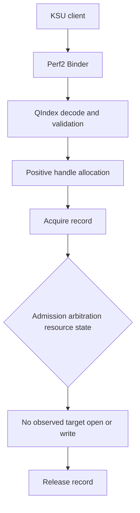

# Qualcomm Perf2 HAL 资源不生效根因分析与手工调试完整手册

**版本：** 2026-09-28 Final Consolidated Edition  
**目标设备：** Android + KernelSU  
**Host：** macOS  
**ADB目标：** USB设备，使用 `adb -d`  
**问题：** 合法 `perf_lock_acq()` 请求获得正 handle，但对应 CPUFreq/WALT 内核节点没有变化。

---

# 0. 文档状态标记

本文严格区分以下四种状态。

| 标记 | 含义 |
|---|---|
| `[VERIFIED]` | 已在目标设备实际执行并获得有效结果 |
| `[VERIFIED-NEGATIVE]` | 命令和实验有效，但资源没有生效；“不变化”本身是证据 |
| `[TODO]` | 尚未执行，不能纳入最终根因结论 |
| `[RECONSTRUCTED]` | 历史中执行过等价操作，但当前上下文未保留原始逐字命令；本文给出安全重建版本 |

## 0.1 证据强度等级

| 等级 | 示例 |
|---|---|
| 极高 | syscall trace、单变量差分、函数级 probe |
| 高 | target node多点采样、服务端records、进程身份 |
| 中 | logcat、字符串、配置推断 |
| 低 | 仅依据节点最终值、handle正值或理论推测 |

---

# 1. 最终调查目标

需要区分以下三个执行层级。

```text
Level 1：请求被服务端接受并创建handle
Level 2：请求进入ResourceQueue并成为effective optimization
Level 3：ApplyOpt/handler执行并修改内核节点或硬件状态
```

当前已经确认：

```text
Level 1成功
Level 3没有发生普通目标文件open/write
Level 2状态尚未确定
```

最终必须在以下候选中完成闭环：

1. Caller UID/SID/client class admission；
2. PowerOpt高优先级或exclusive ownership；
3. Resource运行态inactive或handler未绑定；
4. Perf HAL全局Apply被关闭；
5. 存在文件节点以外的alternate backend；
6. OEM XML和实现库版本不匹配；
7. 具体实现代码缺陷。

---

# 2. 当前进度

| 调查目标 | 完成度 | 说明 |
|---|---:|---|
| Binder/ABI基本正确性 | 95% | valid/invalid请求形成正负对照 |
| Opcode/QIndex映射 | 95% | 已测资源均能通过QIndex校验 |
| 节点存在性和格式 | 90% | partial-halt已直接写入验证 |
| 请求生命周期 | 100% | acquire/release由服务端syscall实锤 |
| 是否进入普通文件Apply | 90% | strace未见目标open/write；待补`openat2/writev` |
| 根因大类定位 | 70%～80% | 待UID、可信caller、PowerOpt内容差分 |
| 精确代码分支定位 | 45%～60% | 待库分析、simpleperf、uprobe |
| 稳定修复方案 | 35%～50% | 依赖最终根因 |

距离：

```text
根因分类闭环：约20%～30%
精确代码定位：约40%～55%
修复方案闭环：约50%～65%
```

---

# 3. 已确认的系统对象

## 3.1 Perf HAL

```text
process = vendor.qti.hardware.perf2-hal-service
binary  = /vendor/bin/hw/vendor.qti.hardware.perf2-hal-service
UID     = root
domain  = u:r:vendor_hal_perf_default:s0
PID     = 1682    # 历史值，必须动态获取
```

## 3.2 PowerOpt

```text
process = poweropt-service
UID     = 1000 / system
domain  = u:r:vendor_hal_poweroptservice_qti:s0
PID     = 1634    # 历史值，必须动态获取
```

## 3.3 其他相关服务

```text
vendor.xiaomi.hardware.miperf@1.0-service
perfservice
qsap_qapeservice
```

历史domain：

```text
u:r:hal_miperf_default:s0
u:r:vendor_perfservice:s0
u:r:vendor_perf_qesdk:s0
```

## 3.4 测试客户端

```text
binary  = /data/local/tmp/perf_lock_resource
UID     = 0
GID     = 0
domain  = u:r:ksu:s0
```

已确认：

```text
能连接Perf2 Binder
能传递resource array
valid QIndex可获得正handle
invalid QIndex返回-1
能主动release handle
```

尚未确认：

```text
是否进入ResourceQueue
是否成为effective optimization
是否通过trusted-client admission
```

---

# 4. 变量速查

```bash
PERF_SERVICE=vendor.qti.hardware.perf2-hal-service
POWEROPT_SERVICE=poweropt-service
BIN=/data/local/tmp/perf_lock_resource

ASYMCAP_NODE=/proc/sys/walt/sched_asymcap_boost
PARTIAL_HALT_NODE=/proc/sys/walt/sched_max_freq_partial_halt
FMAX_CAP_NODE=/proc/sys/walt/sched_fmax_cap
CPU_MIN_NODE=/sys/kernel/msm_performance/parameters/cpu_min_freq

ASYMCAP_OPCODE=0x43C00000
FMAX_CAP_OPCODE=0x43C1C000
PARTIAL_HALT_OPCODE=0x43C20000
CPU_MIN_OPCODE=0x40800000
INVALID_OPCODE=0x7FFE0000
```

以下值不可跨重启或跨实验写死：

```text
PID
TID
perf lock handle
PowerOpt handle
```

---

# 5. Opcode/QIndex编码

## 5.1 编码关系

```text
Major base = 0x40000000 + (Major << 22)
Opcode     = Major base + (Minor << 14)
```

WALT Major为 `0xF`：

```text
0x40000000 + (0xF << 22)
= 0x43C00000
```

## 5.2 映射

| Major | Minor | Opcode | 资源 |
|---:|---:|---:|---|
| `0xF` | `0x0` | `0x43C00000` | `sched_asymcap_boost` |
| `0xF` | `0x7` | `0x43C1C000` | `sched_fmax_cap` |
| `0xF` | `0x8` | `0x43C20000` | `sched_max_freq_partial_halt` |
| CPUFreq Major | 对应Minor | `0x40800000` | `cpu_min_freq` |

## 5.3 当前结论

已测：

```text
0x43C00000
0x43C20000
0x40800000
```

均得到过正handle。

因此：

```text
Opcode位域构造错误
```

已降为极低概率。

`sched_fmax_cap`为多字段节点，不能在未确认formatter前直接按单scalar测试。

---

# 6. 已完成实验台账

| 资源 | Opcode | Value | 历史Handle | 节点结果 | 状态 |
|---|---|---:|---:|---|---|
| CPU min | `0x40800000` | `1785` | `1527` | 不变 | `[VERIFIED-NEGATIVE]` |
| partial halt | `0x43C20000` | `1000000` | `1529` | 不变 | `[VERIFIED-NEGATIVE]` |
| partial halt | `0x43C20000` | `1300000` | `1530` | 不变 | `[VERIFIED-NEGATIVE]` |
| asymcap boost | `0x43C00000` | `1` | `1534/1535` | 不变 | `[VERIFIED-NEGATIVE]` |
| invalid control | `0x7FFE0000` | `1` | `-1` | 被拒绝 | `[VERIFIED]` |

历史节点基线：

```text
sched_asymcap_boost         = 0
sched_max_freq_partial_halt = 1190400
sched_fmax_cap              = 1804800 2707200 2707200 2147483647
cpu_min_freq                = 0:0 1:0 2:0 3:0 4:0 5:0 6:0 7:0
```

---

# 7. 当前决定性证据

asymcap请求：

```text
client PID = 23995
opcode     = 0x43C00000
value      = 1
duration   = 3000 ms
hold       = 1000 ms
handle     = 1535
```

Perf HAL TID `1837`只执行：

```text
write(/proc/perflock_records,
      "type = acquire ... pl_handle = 1535 ...") = 98

write(/proc/perflock_records,
      "type = release ... pl_handle = 1535 ...") = 98
```

没有观察到：

```text
open/openat sched_asymcap_boost
write sched_asymcap_boost
EACCES
EPERM
EINVAL
ENOENT
```

当前执行链：



精确结论：

```text
请求到达服务端
请求通过基本QIndex校验
服务端建立完整lock生命周期
但本次请求没有进入普通目标文件open/write路径
```

尚不能确定：

```text
caller suppression
priority pending
resource inactive
alternate backend
```

---

# 8. 正handle的真实含义

错误模型：

```text
handle > 0
=> resource已经Apply
```

当前正确模型：

```text
handle > 0
=>
request通过基本校验
+ request生命周期对象建立
+ acquire/release可被记账
```

正handle不保证：

```text
ResourceQueue insertion
effective vote
ApplyOpt
OptsHandler执行
target node write
```

---

# 9. 进程和身份检查

## 9.1 Perf HAL身份

```bash
adb -d shell "su -c '
PID=\$(pidof vendor.qti.hardware.perf2-hal-service)

echo \"PERF_PID=\$PID\"
ps -AZ -p \$PID

printf \"cmdline=\"
tr \"\\0\" \" \" </proc/\$PID/cmdline
echo

printf \"exe=\"
readlink /proc/\$PID/exe
echo

printf \"context=\"
cat /proc/\$PID/attr/current
echo
'"
```

状态：

```text
[VERIFIED]
```

## 9.2 PowerOpt身份

```bash
adb -d shell "su -c '
PID=\$(pidof poweropt-service)

echo \"POWEROPT_PID=\$PID\"
ps -AZ -p \$PID

printf \"context=\"
cat /proc/\$PID/attr/current
echo
'"
```

状态：

```text
[RECONSTRUCTED]
```

## 9.3 全部Perf/Power进程

```bash
adb -d shell "su -c '
ps -AZ |
grep -i -E \
    \"perf|mpctl|qti.*power|poweropt\"
'"
```

状态：

```text
[VERIFIED]
```

## 9.4 当前KSU身份

```bash
adb -d shell "su -c '
id
cat /proc/self/attr/current
'"
```

历史结果：

```text
uid=0(root)
gid=0(root)
groups=0(root)
context=u:r:ksu:s0
```

状态：

```text
[VERIFIED]
```

---

# 10. 系统能力总检查

```bash
adb -d shell "su -c '
echo \"=== tools ===\"

for T in \
    strace simpleperf perf atrace perfetto \
    trace-cmd bpftool gdbserver lsof toybox \
    strings readelf objdump nm
do
    printf \"%-12s : \" \"\$T\"
    command -v \"\$T\" 2>/dev/null || echo MISSING
done

echo
echo \"=== tracefs ===\"

for D in \
    /sys/kernel/tracing \
    /sys/kernel/debug/tracing
do
    if [ -d \"\$D\" ]; then
        echo \"FOUND \$D\"
        ls -ldZ \"\$D\"
    fi
done

echo
echo \"=== symbols and BTF ===\"

ls -lZ \
    /proc/kallsyms \
    /sys/kernel/btf/vmlinux \
    2>/dev/null

echo
echo \"=== perf restrictions ===\"

for F in \
    /proc/sys/kernel/perf_event_paranoid \
    /proc/sys/kernel/perf_event_max_sample_rate \
    /proc/sys/kernel/kptr_restrict \
    /proc/sys/kernel/yama/ptrace_scope
do
    if [ -e \"\$F\" ]; then
        printf \"%s=\" \"\$F\"
        cat \"\$F\"
    fi
done
'"
```

当前已知：

```text
/system/bin/strace存在
setpriv不存在
run-as存在
su存在
```

其余：

```text
[TODO]
```

---

# 11. 测试工具检查

```bash
adb -d shell "su -c '
BIN=/data/local/tmp/perf_lock_resource

ls -lZ \$BIN
file \$BIN 2>/dev/null || true

echo
\$BIN 2>&1 || true
'"
```

参数语义：

```text
perf_lock_resource OPCODE VALUE DURATION_MS HOLD_MS
```

输出事件：

```text
event=process_start
event=request_parameters
event=perf_lock_acq_return
event=perf_lock_rel_return
```

注意：

```text
duration_ms = 服务端lock超时
hold_ms     = client主动持锁后release的等待时间
```

若：

```text
duration=3000
hold=1000
```

实际持锁约为1秒。

---

# 12. 节点和SELinux检查

## 12.1 读取节点

```bash
adb -d shell "su -c '
for N in \
    /proc/sys/walt/sched_asymcap_boost \
    /proc/sys/walt/sched_max_freq_partial_halt \
    /proc/sys/walt/sched_fmax_cap \
    /sys/kernel/msm_performance/parameters/cpu_min_freq
do
    if [ -e \"\$N\" ]; then
        printf \"%s = \" \"\$N\"
        cat \"\$N\"
    else
        echo \"MISSING: \$N\"
    fi
done
'"
```

## 12.2 权限和label

```bash
adb -d shell "su -c '
ls -lZ \
    /proc/sys/walt/sched_asymcap_boost \
    /proc/sys/walt/sched_max_freq_partial_halt \
    /proc/sys/walt/sched_fmax_cap \
    /sys/kernel/msm_performance/parameters/cpu_min_freq
'"
```

历史：

```text
WALT节点    = u:object_r:proc:s0
CPU-min节点 = u:object_r:vendor_sysfs_msm_perf:s0
```

KSU直接写成功不等于：

```text
vendor_hal_perf_default也拥有写权限
```

但是handle `1535`期间根本没有target open/write，所以权限不是该次请求的直接失败点。

---

# 13. 节点直接写验证

## 13.1 partial-halt安全写入

```bash
adb -d shell "su -c '
NODE=/proc/sys/walt/sched_max_freq_partial_halt
NEW=1000000
OLD=\$(cat \$NODE)

restore()
{
    echo \$OLD >\$NODE
}

trap restore EXIT INT TERM HUP

echo \"old=\$OLD\"

echo \$NEW >\$NODE

printf \"during=\"
cat \$NODE

sleep 0.3

restore

printf \"restored=\"
cat \$NODE

trap - EXIT INT TERM HUP
'"
```

历史结果：

```text
old      = 1190400
during   = 1000000
restored = 1190400
```

状态：

```text
[VERIFIED]
```

证明：

```text
节点存在
KSU/root可写
parser接受raw kHz
1000000有效
300 ms内没有立即恢复
```

## 13.2 asymcap直接写

```bash
adb -d shell "su -c '
NODE=/proc/sys/walt/sched_asymcap_boost
OLD=\$(cat \$NODE)

restore()
{
    echo \$OLD >\$NODE
}

trap restore EXIT INT TERM HUP

echo \"old=\$OLD\"
echo 1 >\$NODE

printf \"during=\"
cat \$NODE

sleep 0.3

restore

printf \"restored=\"
cat \$NODE

trap - EXIT INT TERM HUP
'"
```

状态：

```text
[TODO]
```

## 13.3 fmax_cap限制

该节点为：

```text
1804800 2707200 2707200 2147483647
```

在确认以下信息前不要直接写：

```text
四字段与cluster/policy映射
handler期望单值还是向量
XML是否指定special formatter
```

---

# 14. XML和资源配置

## 14.1 搜索资源名

```bash
adb -d shell "su -c '
grep -RnsI \
    -E \"sched_asymcap_boost|sched_max_freq_partial_halt|sched_fmax_cap|cpu_min_freq\" \
    /vendor/etc /odm/etc /product/etc /system_ext/etc \
    2>/dev/null
'"
```

## 14.2 搜索Major/Minor和属性

```bash
adb -d shell "su -c '
grep -RnsI \
    -E \"Major|Minor|Qindex|QIndex|Supported|Compare|Priority|sched_asymcap_boost|partial_halt|fmax_cap\" \
    /vendor/etc /odm/etc \
    2>/dev/null |
head -n 2000
'"
```

## 14.3 获取文件列表

```bash
adb -d shell "su -c '
grep -RslI \
    -E \"sched_asymcap_boost|sched_max_freq_partial_halt|sched_fmax_cap\" \
    /vendor/etc /odm/etc \
    2>/dev/null
'"
```

历史确认：

```text
common XML中存在目标resource
没有发现对应Supported=no
```

状态：

```text
[RECONSTRUCTED]
```

找到配置后立即归档：

```bash
adb -d pull /vendor/etc/FOUND.xml /tmp/
```

---

# 15. valid/invalid QIndex正负对照

## 15.1 valid

```bash
adb -d shell "su -c '
/data/local/tmp/perf_lock_resource \
    0x43C00000 1 2500 1000
'"
```

预期历史结果：

```text
positive handle
```

## 15.2 invalid

```bash
adb -d shell "su -c '
/data/local/tmp/perf_lock_resource \
    0x7FFE0000 1 2500 1000
'"
```

历史结果：

```text
handle = -1
```

状态：

```text
[VERIFIED]
```

结论：

```text
resource array到达服务端
QIndex decode/validation确实执行
服务端不是对所有请求无条件返回正handle
```

---

# 16. perflock records与exception

## 16.1 读取

```bash
adb -d shell "su -c '
echo \"=== records ===\"
cat /proc/perflock_records

echo
echo \"=== exceptions ===\"
cat /proc/perflock_exception
'"
```

## 16.2 只看末尾

```bash
adb -d shell "su -c '
tail -n 30 /proc/perflock_records
'"
```

## 16.3 按PID或handle过滤

```bash
adb -d shell "su -c '
CLIENT_PID=23995
HANDLE=1535

grep -E \
    \"pid = \$CLIENT_PID|pl_handle = \$HANDLE\" \
    /proc/perflock_records
'"
```

当前证据边界：

```text
acquire/release records只证明生命周期
不证明Apply
```

---

# 17. PowerOpt长期锁

已观察PowerOpt持有：

```text
duration = INT_MAX
hint_id  = 0
```

的长期direct lock。

历史handle：

```text
1512
1526
1528
```

handle变化提示：

```text
PowerOpt可能释放并重建锁
```

尚未证明：

```text
该锁包含目标WALT/CPUFreq资源
该锁具有exclusive优先级
```

## 17.1 按PowerOpt PID过滤

```bash
adb -d shell "su -c '
PID=\$(pidof poweropt-service)

echo \"POWEROPT_PID=\$PID\"

grep -E \
    \"pid = \$PID|tid = \$PID\" \
    /proc/perflock_records |
tail -n 100
'"
```

## 17.2 当前禁止操作

在未取得resource array和恢复机制前，不要执行：

```text
kill poweropt-service
stop poweropt-service
perf_lock_rel未知PowerOpt handle
```

---

# 18. CPUFreq检查

```bash
adb -d shell "su -c '
for P in /sys/devices/system/cpu/cpufreq/policy*; do
    echo \"=== \$P ===\"

    for F in \
        affected_cpus related_cpus scaling_governor \
        scaling_cur_freq scaling_min_freq scaling_max_freq \
        cpuinfo_min_freq cpuinfo_max_freq
    do
        if [ -r \"\$P/\$F\" ]; then
            printf \"%s=\" \"\$F\"
            cat \"\$P/\$F\"
        fi
    done
done
'"
```

注意：

```text
scaling_cur_freq自然变化不能证明CPU-min请求生效
```

---

# 19. CPU-min请求

```bash
adb -d shell "su -c '
BIN=/data/local/tmp/perf_lock_resource
NODE=/sys/kernel/msm_performance/parameters/cpu_min_freq
OUT=/data/local/tmp/cpu_min_probe.out

rm -f \$OUT

printf \"before=\"
cat \$NODE

\$BIN 0x40800000 1785 5000 3000 \
    >\$OUT 2>&1 &

PID=\$!

sleep 0.05
printf \"during_50ms=\"
cat \$NODE

sleep 0.15
printf \"during_200ms=\"
cat \$NODE

sleep 0.6
printf \"during_800ms=\"
cat \$NODE

sleep 1.2
printf \"during_2000ms=\"
cat \$NODE

wait \$PID
RC=\$?

printf \"after=\"
cat \$NODE

echo
cat \$OUT
echo \"probe_rc=\$RC\"
'"
```

历史：

```text
正handle
cpu_min_freq不变
scaling_min_freq不变
```

状态：

```text
[VERIFIED-NEGATIVE]
```

---

# 20. partial-halt双向夹逼

## 20.1 低值

```bash
adb -d shell "su -c '
NODE=/proc/sys/walt/sched_max_freq_partial_halt

printf \"before=\"
cat \$NODE

/data/local/tmp/perf_lock_resource \
    0x43C20000 1000000 5000 3000

printf \"after=\"
cat \$NODE
'"
```

## 20.2 高值

```bash
adb -d shell "su -c '
NODE=/proc/sys/walt/sched_max_freq_partial_halt

printf \"before=\"
cat \$NODE

/data/local/tmp/perf_lock_resource \
    0x43C20000 1300000 5000 3000

printf \"after=\"
cat \$NODE
'"
```

历史：

```text
baseline 1190400
lower不生效
higher不生效
```

结论：

```text
单纯猜错min/max comparator方向
```

已显著降级，但不能排除：

```text
先按client priority分层，再做comparator
```

---

# 21. asymcap请求

```bash
adb -d shell "su -c '
BIN=/data/local/tmp/perf_lock_resource
NODE=/proc/sys/walt/sched_asymcap_boost
OUT=/data/local/tmp/asymcap_probe.out

rm -f \$OUT

printf \"before=\"
cat \$NODE

\$BIN 0x43C00000 1 5000 3000 \
    >\$OUT 2>&1 &

PID=\$!
echo \"client_pid=\$PID\"

sleep 0.05
printf \"during_50ms=\"
cat \$NODE

sleep 0.15
printf \"during_200ms=\"
cat \$NODE

sleep 0.6
printf \"during_800ms=\"
cat \$NODE

sleep 1.2
printf \"during_2000ms=\"
cat \$NODE

wait \$PID
RC=\$?

printf \"after=\"
cat \$NODE

echo
cat \$OUT
echo \"client_rc=\$RC\"
'"
```

状态：

```text
[VERIFIED-NEGATIVE]
```

---

# 22. Perf HAL文件描述符

## 22.1 目标相关FD

```bash
adb -d shell "su -c '
PID=\$(pidof vendor.qti.hardware.perf2-hal-service)

for F in /proc/\$PID/fd/*; do
    T=\$(readlink \"\$F\" 2>/dev/null)

    case \"\$T\" in
        *sched_asymcap_boost*|\
        *sched_max_freq_partial_halt*|\
        *sched_fmax_cap*|\
        *cpu_min_freq*|\
        *msm_performance*|\
        *walt*)
            echo \"\$F -> \$T\"
            ;;
    esac
done
'"
```

历史只发现：

```text
/sys/kernel/msm_performance/events/cpu_hotplug
```

## 22.2 全部proc/sys/dev FD

```bash
adb -d shell "su -c '
PID=\$(pidof vendor.qti.hardware.perf2-hal-service)

for F in /proc/\$PID/fd/*; do
    T=\$(readlink \"\$F\" 2>/dev/null)

    case \"\$T\" in
        /proc/*|/sys/*|/dev/*)
            echo \"\$F -> \$T\"
            ;;
    esac
done |
head -n 500
'"
```

历史关键FD：

```text
/proc/perflock_records
/proc/perflock_exception
/sys/kernel/tracing/trace_marker
/sys/kernel/msm_performance/events/cpu_hotplug
/dev/binderfs/binder
/dev/binderfs/vndbinder
```

状态：

```text
[VERIFIED]
```

---

# 23. logcat标准流程

## 23.1 清理所有buffer

```bash
adb -d logcat -b all -c
```

不要只用：

```bash
adb -d logcat -c
```

后续若读取 `-b all`，可能混入其他buffer历史。

## 23.2 Perf窄过滤

```bash
rm -f /tmp/perf-admission-apply.log

adb -d logcat -b all -v threadtime |
grep --line-buffered -i -E \
'ANDR-PERF|PerfGlue|PerfModule|perf_lock|perflock|invalid|unsupported|not supported|hardening|harden|whitelist|caller|applyopt|pending|opcode|Qindx|avc:|denied' \
> /tmp/perf-admission-apply.log &

LOGCAT_PID=$!
echo "LOGCAT_PID=$LOGCAT_PID"
```

## 23.3 停止

```bash
kill "$LOGCAT_PID" 2>/dev/null || true
wait "$LOGCAT_PID" 2>/dev/null || true

jobs -l
ps aux |
grep '[a]db -d logcat'
```

## 23.4 按时间过滤

```bash
grep -E \
'18:14:0[5-9]|18:14:1[0-2]' \
/tmp/perf-admission-apply.log |
grep -i -E \
'ANDR-PERF|PerfGlue|PerfModule|perf_lock|perflock|Qindx|invalid|unsupported|hardening|whitelist|caller|applyopt|pending|23995|1535' |
tail -n 500
```

## 23.5 按PID/handle/opcode过滤

```bash
grep -n -E \
'23995|1535|0x43[cC]00000|43[cC]00000' \
/tmp/perf-admission-apply.log |
tail -n 300
```

已观察：

```text
AIBinder_linkToDeath is being called with a non-null cookie...
```

该警告不是Apply失败根因：

```text
Binder成功
handle成功
release成功
records成功
```

`GreezeManager THAW ... Check Binder caller : 1000` 当前无证据与Perf Apply直接相关。

避免过宽关键词：

```text
resource
request
apply
write
uid
```

---

# 24. kernel log与SELinux

## 24.1 持续kernel日志

```bash
adb -d shell "su -c '
dmesg -w
'" > /tmp/perf-kernel-live.log &

DMESG_PID=$!
echo "DMESG_PID=$DMESG_PID"
```

停止：

```bash
kill "$DMESG_PID" 2>/dev/null || true
wait "$DMESG_PID" 2>/dev/null || true
```

## 24.2 AVC检查

```bash
adb -d logcat -b all -d -v threadtime |
grep -i -E \
'avc:.*denied|scontext=u:r:vendor_hal_perf_default|scontext=u:r:ksu:s0'
```

```bash
adb -d shell "su -c '
dmesg |
grep -i -E \
    \"avc:.*denied|vendor_hal_perf_default|ksu\"
'"
```

无AVC不能完全排除SELinux：

```text
dontaudit可能隐藏拒绝
初始化失败可能发生在服务启动阶段
```

---

# 25. strace标准流程

## 25.1 能力检查

```bash
adb -d shell "su -c '
command -v strace 2>/dev/null ||
which strace 2>/dev/null
'"
```

历史：

```text
/system/bin/strace
```

状态：

```text
[VERIFIED]
```

## 25.2 基础版本

```bash
adb -d shell "su -c '
PID=\$(pidof vendor.qti.hardware.perf2-hal-service)
OUT=/data/local/tmp/perf_hal_strace.txt

rm -f \${OUT}*

strace -ff \
    -p \$PID \
    -s 256 \
    -tt \
    -T \
    -yy \
    -e trace=openat,open,close,write,pwrite64 \
    -o \$OUT
'"
```

历史成功attach：

```text
48 threads
```

状态：

```text
[VERIFIED]
```

## 25.3 增强版本

```bash
adb -d shell "su -c '
PID=\$(pidof vendor.qti.hardware.perf2-hal-service)
OUT=/data/local/tmp/perf_clean

rm -f \${OUT}*

strace -ff \
    -p \$PID \
    -s 512 \
    -tt \
    -T \
    -yy \
    -e trace=open,openat,openat2,close,write,pwrite64,writev \
    -o \$OUT
'"
```

状态：

```text
[TODO]
```

`-ff`生成：

```text
OUT.<TID>
```

必须：

```bash
rm -f "${OUT}"*
```

不能只删除基础文件。

## 25.4 提取结果

```bash
adb -d shell "su -c '
BASE=/data/local/tmp/perf_clean

echo \"=== trace files ===\"
ls -l \${BASE}* 2>/dev/null

echo
echo \"=== target operations ===\"
grep -Hn -E \
\"sched_asymcap_boost|sched_max_freq_partial_halt|sched_fmax_cap|cpu_min_freq|msm_performance/parameters\" \
\${BASE}* 2>/dev/null

echo
echo \"=== records ===\"
grep -Hn -E \
\"perflock_records|type = acquire|type = release\" \
\${BASE}* 2>/dev/null |
tail -n 200

echo
echo \"=== errors ===\"
grep -Hn -E \
\"EACCES|EPERM|ENOENT|EINVAL|EROFS|EBADF\" \
\${BASE}* 2>/dev/null |
tail -n 300

echo
echo \"=== non-marker writes ===\"
grep -Hn -E \
\"write\\(|pwrite64\\(|writev\\(\" \
\${BASE}* 2>/dev/null |
grep -v trace_marker |
tail -n 1000
'"
```

## 25.5 判读

| Trace结果 | 判断 |
|---|---|
| 只有records | 未进入普通文件Apply |
| `openat = EACCES/EPERM` | Perf HAL节点访问权限问题 |
| `write = EINVAL` | formatter或kernel parser不匹配 |
| write成功后写回旧值 | 被restore或更高vote覆盖 |
| 无目标syscall但uprobe命中ApplyOpt | ApplyOpt走alternate backend或提前返回 |

---

# 26. UID 1000差分

## 26.1 工具结果

```text
setpriv不存在
run-as存在
su存在
```

`setpriv`实验失败：

```text
setpriv: inaccessible or not found
rc=127
```

该次没有发出Perf请求。

## 26.2 身份构造

```bash
adb -d shell "su -c '
su 1000 -c \"
    id
    cat /proc/self/attr/current
\"
'"
```

历史结果：

```text
uid=1000(system)
gid=0(root)
groups=0(root)
context=u:r:ksu:s0
```

状态：

```text
[VERIFIED]
```

近似单变量：

```text
UID 0 -> 1000
SID保持ksu
binary不变
```

残余变量：

```text
GID仍为0
```

## 26.3 完整资源实验

```bash
adb -d shell "su -c '
BIN=/data/local/tmp/perf_lock_resource
NODE=/proc/sys/walt/sched_asymcap_boost
OUT=/data/local/tmp/uid1000_probe.out

rm -f \$OUT

echo \"=== parent ===\"
id
printf \"sid=\"
cat /proc/self/attr/current
echo

printf \"node_before=\"
cat \$NODE

su 1000 -c \"
    echo child_identity
    id

    printf sid=
    cat /proc/self/attr/current
    echo

    \$BIN 0x43C00000 1 5000 3000
\" >\$OUT 2>&1 &

PID=\$!

sleep 0.05
printf \"during_50ms=\"
cat \$NODE

sleep 0.15
printf \"during_200ms=\"
cat \$NODE

sleep 0.6
printf \"during_800ms=\"
cat \$NODE

sleep 1.2
printf \"during_2000ms=\"
cat \$NODE

wait \$PID
RC=\$?

sleep 0.2
printf \"node_after=\"
cat \$NODE

echo
cat \$OUT

echo
echo \"wrapper_rc=\$RC\"

echo
tail -n 10 /proc/perflock_records
'"
```

状态：

```text
[TODO]
```

判读：

| 结果 | 推论 |
|---|---|
| UID 1000生效 | 强支持UID admission |
| UID 1000 handle失败 | UID影响入口准入 |
| 正handle且无write | 排除简单UID-only gate |
| binary执行失败 | 文件权限问题，实验无效 |

---

# 27. 统一实验前状态快照

Host：

```bash
TS=$(date +%Y%m%d-%H%M%S)
DIR=/tmp/perf-debug-$TS
mkdir -p "$DIR"
echo "DIR=$DIR"
```

设备状态：

```bash
adb -d shell "su -c '
echo \"=== time ===\"
date
uptime

echo
echo \"=== build ===\"
uname -a
getprop ro.build.fingerprint
getprop ro.vendor.build.fingerprint

echo
echo \"=== processes ===\"
ps -AZ |
grep -i -E \
    \"vendor.qti.hardware.perf2|poweropt|miperf|perfservice|qapeservice\"

echo
echo \"=== display ===\"
dumpsys power |
grep -i -E \
    \"Wakefulness|mWakefulness|mInteractive|Display Power\"

dumpsys display |
grep -i -E \
    \"mScreenState|mDisplayState|state=\"

echo
echo \"=== connectivity ===\"
settings get global airplane_mode_on
settings get global wifi_on 2>/dev/null

echo
echo \"=== target nodes ===\"

for N in \
    /proc/sys/walt/sched_asymcap_boost \
    /proc/sys/walt/sched_max_freq_partial_halt \
    /proc/sys/walt/sched_fmax_cap \
    /sys/kernel/msm_performance/parameters/cpu_min_freq
do
    [ -r \"\$N\" ] && {
        printf \"%s=\" \"\$N\"
        cat \"\$N\"
    }
done

echo
echo \"=== records ===\"
tail -n 30 /proc/perflock_records

echo
echo \"=== exceptions ===\"
cat /proc/perflock_exception
'" > "$DIR/pre-state.txt"
```

---

# 28. 亮屏与灭屏

不优先使用：

```text
input keyevent 26
```

因为它是状态翻转。

使用：

```text
KEYCODE_SLEEP  = 223
KEYCODE_WAKEUP = 224
```

## 28.1 当前状态

```bash
adb -d shell "su -c '
dumpsys power |
grep -i -E \
    \"Wakefulness|mWakefulness|mInteractive|Display Power\"

dumpsys display |
grep -i -E \
    \"mScreenState|mDisplayState|state=\"
'"
```

## 28.2 灭屏

```bash
adb -d shell "su -c '
echo \"MARKER_SCREEN_OFF_BEGIN\"
date \"+%F %T.%N\"

input keyevent 223
sleep 2

dumpsys power |
grep -i -E \
    \"Wakefulness|mWakefulness|mInteractive|Display Power\"

echo \"MARKER_SCREEN_OFF_END\"
date \"+%F %T.%N\"
'"
```

## 28.3 亮屏

```bash
adb -d shell "su -c '
echo \"MARKER_SCREEN_ON_BEGIN\"
date \"+%F %T.%N\"

input keyevent 224
sleep 2

dumpsys power |
grep -i -E \
    \"Wakefulness|mWakefulness|mInteractive|Display Power\"

echo \"MARKER_SCREEN_ON_END\"
date \"+%F %T.%N\"
'"
```

必要时：

```bash
adb -d shell "su -c '
wm dismiss-keyguard 2>/dev/null || true
'"
```

不要自动输入设备密码。

## 28.4 PowerOpt handle联动

```bash
adb -d shell "su -c '
PID=\$(pidof poweropt-service)

echo \"=== before ===\"
grep -E \
    \"pid = \$PID|tid = \$PID\" \
    /proc/perflock_records |
tail -n 30

input keyevent 223
sleep 2

echo \"=== screen off ===\"
grep -E \
    \"pid = \$PID|tid = \$PID\" \
    /proc/perflock_records |
tail -n 30

input keyevent 224
sleep 2

echo \"=== screen on ===\"
grep -E \
    \"pid = \$PID|tid = \$PID\" \
    /proc/perflock_records |
tail -n 30
'"
```

状态：

```text
[TODO]
```

---

# 29. Wi-Fi开关

## 29.1 保存状态

Host：

```bash
WIFI_OLD=$(adb -d shell settings get global wifi_on |
    tr -d '\r')

echo "WIFI_OLD=$WIFI_OLD"
```

## 29.2 查询

```bash
adb -d shell "su -c '
printf \"wifi_on_setting=\"
settings get global wifi_on 2>/dev/null

dumpsys wifi |
grep -i -m 30 -E \
    \"Wi-Fi is|WifiState|mWifiEnabled|enabled|disabled\"
'"
```

## 29.3 关闭

```bash
adb -d shell "su -c '
echo \"MARKER_WIFI_OFF_BEGIN\"
date \"+%F %T.%N\"

svc wifi disable
sleep 4

settings get global wifi_on 2>/dev/null

dumpsys wifi |
grep -i -m 30 -E \
    \"Wi-Fi is|WifiState|mWifiEnabled|enabled|disabled\"

echo \"MARKER_WIFI_OFF_END\"
date \"+%F %T.%N\"
'"
```

## 29.4 打开

```bash
adb -d shell "su -c '
echo \"MARKER_WIFI_ON_BEGIN\"
date \"+%F %T.%N\"

svc wifi enable
sleep 6

settings get global wifi_on 2>/dev/null

dumpsys wifi |
grep -i -m 30 -E \
    \"Wi-Fi is|WifiState|mWifiEnabled|enabled|disabled\"

echo \"MARKER_WIFI_ON_END\"
date \"+%F %T.%N\"
'"
```

## 29.5 恢复

```bash
if [ "$WIFI_OLD" = "1" ]; then
    adb -d shell su -c 'svc wifi enable'
else
    adb -d shell su -c 'svc wifi disable'
fi
```

状态：

```text
[TODO]
```

Wi-Fi开关是异步过程，应同时确认：

```text
settings
dumpsys wifi
driver/network稳定状态
```

---

# 30. 飞行模式

飞行模式可能改变：

```text
蜂窝网络
Wi-Fi
Bluetooth
OEM PowerOpt策略
```

只能使用USB ADB。

## 30.1 保存状态

```bash
AIRPLANE_OLD=$(adb -d shell settings get global airplane_mode_on |
    tr -d '\r')

echo "AIRPLANE_OLD=$AIRPLANE_OLD"
```

## 30.2 检查cmd支持

```bash
adb -d shell "su -c '
cmd connectivity help 2>&1 |
grep -i -A 5 -B 5 airplane
'"
```

## 30.3 开启

```bash
adb -d shell "su -c '
echo \"MARKER_AIRPLANE_ON_BEGIN\"
date \"+%F %T.%N\"

cmd connectivity airplane-mode enable
sleep 5

settings get global airplane_mode_on
cmd connectivity airplane-mode 2>&1 || true

echo \"MARKER_AIRPLANE_ON_END\"
date \"+%F %T.%N\"
'"
```

## 30.4 关闭

```bash
adb -d shell "su -c '
echo \"MARKER_AIRPLANE_OFF_BEGIN\"
date \"+%F %T.%N\"

cmd connectivity airplane-mode disable
sleep 5

settings get global airplane_mode_on
cmd connectivity airplane-mode 2>&1 || true

echo \"MARKER_AIRPLANE_OFF_END\"
date \"+%F %T.%N\"
'"
```

## 30.5 兼容回退

仅在`cmd connectivity`不可用时：

```bash
adb -d shell "su -c '
settings put global airplane_mode_on 1

am broadcast \
    -a android.intent.action.AIRPLANE_MODE \
    --ez state true

sleep 5
settings get global airplane_mode_on
'"
```

恢复：

```bash
adb -d shell "su -c '
settings put global airplane_mode_on 0

am broadcast \
    -a android.intent.action.AIRPLANE_MODE \
    --ez state false

sleep 5
settings get global airplane_mode_on
'"
```

状态：

```text
[TODO]
```

---

# 31. 系统事件logcat

```bash
TS=$(date +%Y%m%d-%H%M%S)
LOG=/tmp/system-event-$TS.log

adb -d logcat -b all -c

adb -d logcat -b all -v threadtime |
grep --line-buffered -i -E \
'ANDR-PERF|PerfGlue|PerfModule|perf_lock|perflock|poweropt|miperf|PowerManager|DisplayPower|Wakefulness|Wifi|wlan|ConnectivityService|airplane|thermal|cpufreq|sched|avc:|denied' \
> "$LOG" &

LOGCAT_PID=$!

echo "LOG=$LOG"
echo "LOGCAT_PID=$LOGCAT_PID"
```

该宽过滤只适合：

```text
系统事件时间线
```

Perf内部决策仍应使用窄过滤。

---

# 32. tracefs/ftrace能力检查

```bash
adb -d shell "su -c '
if [ -d /sys/kernel/tracing ]; then
    TR=/sys/kernel/tracing
elif [ -d /sys/kernel/debug/tracing ]; then
    TR=/sys/kernel/debug/tracing
else
    echo \"tracefs not found\"
    exit 1
fi

echo \"TR=\$TR\"

echo
echo \"=== tracers ===\"
cat \$TR/available_tracers 2>/dev/null

echo
echo \"=== syscall events ===\"
grep -E \
    \"sys_enter_(openat|openat2|write|writev|pwrite64)|sys_exit_(openat|openat2|write|writev|pwrite64)\" \
    \$TR/available_events 2>/dev/null

echo
echo \"=== binder events ===\"
grep -E \
    \"^binder:|binder_transaction\" \
    \$TR/available_events 2>/dev/null

echo
echo \"=== power events ===\"
grep -E \
    \"^(power|sched|thermal|irq):\" \
    \$TR/available_events 2>/dev/null |
head -n 500

echo
echo \"=== uprobes ===\"
ls -l \
    \$TR/uprobe_events \
    \$TR/events/uprobes \
    2>/dev/null
'"
```

状态：

```text
[TODO]
```

---

# 33. ftrace跟踪Perf HAL syscall

```bash
adb -d shell "su -c '
PID=\$(pidof vendor.qti.hardware.perf2-hal-service)

if [ -d /sys/kernel/tracing ]; then
    TR=/sys/kernel/tracing
else
    TR=/sys/kernel/debug/tracing
fi

OUT=/data/local/tmp/perf_hal_syscalls.trace

echo 0 >\$TR/tracing_on
echo >\$TR/trace
echo nop >\$TR/current_tracer 2>/dev/null || true
echo >\$TR/set_event_pid 2>/dev/null || true

for T in /proc/\$PID/task/*; do
    echo \${T##*/} >>\$TR/set_event_pid
done

for E in \
    syscalls/sys_enter_openat \
    syscalls/sys_exit_openat \
    syscalls/sys_enter_openat2 \
    syscalls/sys_exit_openat2 \
    syscalls/sys_enter_write \
    syscalls/sys_exit_write \
    syscalls/sys_enter_writev \
    syscalls/sys_exit_writev \
    syscalls/sys_enter_pwrite64 \
    syscalls/sys_exit_pwrite64
do
    if [ -e \$TR/events/\$E/enable ]; then
        echo 1 >\$TR/events/\$E/enable
        echo \"enabled \$E\"
    fi
done

echo 1 >\$TR/tracing_on

/data/local/tmp/perf_lock_resource \
    0x43C00000 1 5000 3000

sleep 0.3
echo 0 >\$TR/tracing_on

cat \$TR/trace >\$OUT

for E in \
    syscalls/sys_enter_openat \
    syscalls/sys_exit_openat \
    syscalls/sys_enter_openat2 \
    syscalls/sys_exit_openat2 \
    syscalls/sys_enter_write \
    syscalls/sys_exit_write \
    syscalls/sys_enter_writev \
    syscalls/sys_exit_writev \
    syscalls/sys_enter_pwrite64 \
    syscalls/sys_exit_pwrite64
do
    [ -e \$TR/events/\$E/enable ] &&
        echo 0 >\$TR/events/\$E/enable
done

echo >\$TR/set_event_pid 2>/dev/null || true

tail -n 1500 \$OUT
'"
```

状态：

```text
[TODO]
```

局限：

```text
新创建TID可能不在最初set_event_pid列表中
syscall tracepoint通常看不到write buffer
```

工具优先级：

```text
strace用于路径和buffer
ftrace用于低侵入和长窗口交叉验证
```

---

# 34. Binder tracepoint

## 34.1 检查

```bash
adb -d shell "su -c '
TR=/sys/kernel/tracing
[ -d \$TR ] || TR=/sys/kernel/debug/tracing

grep -E \
    \"^binder:\" \
    \$TR/available_events
'"
```

## 34.2 捕获

```bash
adb -d shell "su -c '
TR=/sys/kernel/tracing
[ -d \$TR ] || TR=/sys/kernel/debug/tracing

OUT=/data/local/tmp/perf_binder.trace

echo 0 >\$TR/tracing_on
echo >\$TR/trace

for E in \
    binder/binder_transaction \
    binder/binder_transaction_received
do
    [ -e \$TR/events/\$E/enable ] &&
        echo 1 >\$TR/events/\$E/enable
done

echo 1 >\$TR/tracing_on

/data/local/tmp/perf_lock_resource \
    0x43C00000 1 5000 3000

sleep 0.2
echo 0 >\$TR/tracing_on

cat \$TR/trace >\$OUT

for E in \
    binder/binder_transaction \
    binder/binder_transaction_received
do
    [ -e \$TR/events/\$E/enable ] &&
        echo 0 >\$TR/events/\$E/enable
done

tail -n 1500 \$OUT
'"
```

Binder tracepoint可关联：

```text
client PID/TID
server PID/TID
transaction方向
时间关系
```

通常不能直接解析AIDL resource array。

---

# 35. ftrace系统事件

```bash
adb -d shell "su -c '
TR=/sys/kernel/tracing
[ -d \$TR ] || TR=/sys/kernel/debug/tracing

OUT=/data/local/tmp/system_event_ftrace.txt

echo 0 >\$TR/tracing_on
echo >\$TR/trace
echo nop >\$TR/current_tracer 2>/dev/null || true

for E in \
    power/cpu_frequency \
    power/cpu_idle \
    thermal/thermal_temperature \
    irq/irq_handler_entry \
    irq/irq_handler_exit
do
    if [ -e \$TR/events/\$E/enable ]; then
        echo 1 >\$TR/events/\$E/enable
    fi
done

echo 1 >\$TR/tracing_on

echo \"Run exactly one external system event now\"
sleep 10

echo 0 >\$TR/tracing_on
cat \$TR/trace >\$OUT

for E in \
    power/cpu_frequency \
    power/cpu_idle \
    thermal/thermal_temperature \
    irq/irq_handler_entry \
    irq/irq_handler_exit
do
    [ -e \$TR/events/\$E/enable ] &&
        echo 0 >\$TR/events/\$E/enable
done

echo \"saved: \$OUT\"
'"
```

不要默认开启全局：

```text
sched_switch
```

否则数据量过大。需要时应缩短窗口或加filter。

---

# 36. atrace/systrace

## 36.1 类别检查

```bash
adb -d shell atrace --list_categories
```

## 36.2 异步捕获

```bash
adb -d shell "su -c '
atrace \
    --async_start \
    -b 32768 \
    sched freq idle irq binder_driver power thermal am wm view
'"
```

执行一个系统事件后：

```bash
adb -d shell "su -c '
atrace --async_stop
'" > /tmp/perf-system-event.atrace
```

## 36.3 定时捕获

```bash
adb -d shell "su -c '
atrace \
    -z \
    -b 32768 \
    -t 10 \
    sched freq idle irq binder_driver power thermal am wm
'" > /tmp/perf-system-event.atrace
```

category必须以设备输出为准。

atrace适合：

```text
系统时间线
Binder活动
CPU频率/idle
Perf/Power服务线程调度
```

不适合单独证明：

```text
ApplyOpt代码条件
write buffer
```

状态：

```text
[TODO]
```

---

# 37. Perfetto

## 37.1 能力检查

```bash
adb -d shell "su -c '
command -v perfetto
perfetto --help 2>&1 |
head -n 50
'"
```

## 37.2 配置

Host：

```bash
cat > /tmp/perfetto-perf-hal.cfg <<'EOF'
buffers: {
  size_kb: 32768
  fill_policy: RING_BUFFER
}

data_sources: {
  config {
    name: "linux.ftrace"
    ftrace_config {
      ftrace_events: "sched/sched_switch"
      ftrace_events: "sched/sched_wakeup"
      ftrace_events: "power/cpu_frequency"
      ftrace_events: "power/cpu_idle"
      ftrace_events: "binder/binder_transaction"
      ftrace_events: "binder/binder_transaction_received"

      atrace_categories: "power"
      atrace_categories: "freq"
      atrace_categories: "idle"
      atrace_categories: "binder_driver"
      atrace_categories: "am"
      atrace_categories: "wm"

      atrace_apps: "*"
    }
  }
}

data_sources: {
  config {
    name: "linux.process_stats"
    process_stats_config {
      scan_all_processes_on_start: true
    }
  }
}

duration_ms: 10000
EOF
```

运行前必须核对：

```text
tracefs available_events
atrace --list_categories
```

## 37.3 捕获

```bash
adb -d push \
    /tmp/perfetto-perf-hal.cfg \
    /data/local/tmp/perfetto-perf-hal.cfg

adb -d shell "su -c '
rm -f /data/local/tmp/perf-hal-event.pftrace

perfetto \
    --txt \
    -c /data/local/tmp/perfetto-perf-hal.cfg \
    -o /data/local/tmp/perf-hal-event.pftrace
'" &

PERFETTO_HOST_PID=$!

sleep 1

# 在窗口中执行一个事件

wait "$PERFETTO_HOST_PID"

adb -d pull \
    /data/local/tmp/perf-hal-event.pftrace \
    /tmp/perf-hal-event.pftrace
```

重点进程：

```text
vendor.qti.hardware.perf2-hal-service
poweropt-service
perfservice
system_server
netd
wificond
```

状态：

```text
[TODO]
```

---

# 38. simpleperf

## 38.1 能力检查

```bash
adb -d shell "su -c '
command -v simpleperf

simpleperf --help 2>&1 |
head -n 30

simpleperf list |
head -n 100
'"
```

## 38.2 线程列表

```bash
adb -d shell "su -c '
PID=\$(pidof vendor.qti.hardware.perf2-hal-service)
ps -T -p \$PID
'"
```

## 38.3 采样

终端A：

```bash
adb -d shell "su -c '
PID=\$(pidof vendor.qti.hardware.perf2-hal-service)
OUT=/data/local/tmp/perf-hal-simpleperf.data

rm -f \$OUT

simpleperf record \
    -p \$PID \
    -g \
    --duration 10 \
    -f 1000 \
    -o \$OUT
'"
```

终端B：

```bash
adb -d shell "su -c '
/data/local/tmp/perf_lock_resource \
    0x43C00000 1 5000 3000
'"
```

报告：

```bash
adb -d shell "su -c '
simpleperf report \
    -i /data/local/tmp/perf-hal-simpleperf.data \
    --sort comm,pid,tid,dso,symbol
'" > /tmp/perf-hal-simpleperf-report.txt
```

局限：

```text
请求关键路径可能只有微秒级
纯采样容易漏掉
stripped符号会降低可读性
```

建议：

```text
1000 Hz以上
重复请求
最终使用uprobe做函数命中确认
```

状态：

```text
[TODO]
```

---

# 39. Perf HAL加载库

## 39.1 相关库

```bash
adb -d shell "su -c '
PID=\$(pidof vendor.qti.hardware.perf2-hal-service)

awk \"
/\\.so([[:space:]]|$)/ {
    print \\\$NF
}
\" /proc/\$PID/maps |
sort -u |
grep -i -E \
    \"perf|qti|mpctl|power|resource|boost\"
'"
```

## 39.2 全部vendor库

```bash
adb -d shell "su -c '
PID=\$(pidof vendor.qti.hardware.perf2-hal-service)

awk \"
/\\/vendor\\/.*\\.so([[:space:]]|$)/ {
    print \\\$NF
}
\" /proc/\$PID/maps |
sort -u
'"
```

## 39.3 字符串搜索

```bash
adb -d shell "su -c '
PID=\$(pidof vendor.qti.hardware.perf2-hal-service)

LIBS=\$(awk \"
/\\/vendor\\/.*\\.so([[:space:]]|$)/ {
    print \\\$NF
}
\" /proc/\$PID/maps | sort -u)

for L in \$LIBS; do
    [ -r \"\$L\" ] || continue

    HIT=\$(strings -a \"\$L\" 2>/dev/null |
        grep -i -E \
        \"ResourceQueue|ApplyOpt|pending|Qindx|hardening|whitelist|caller|client.*allow|priority|no optimizations|invalid request\" |
        head -n 50)

    if [ -n \"\$HIT\" ]; then
        echo
        echo \"========== \$L ==========\"
        echo \"\$HIT\"
    fi
done
'"
```

状态：

```text
[TODO]
```

---

# 40. uprobe

目标函数：

```text
Request::Process
ResourceQueue::Add
ResourceQueue::Pend
ApplyOpt
ResetOpt
node-write wrapper
```

## 40.1 支持检查

```bash
adb -d shell "su -c '
TR=/sys/kernel/tracing
[ -d \$TR ] || TR=/sys/kernel/debug/tracing

ls -lZ \
    \$TR/uprobe_events \
    \$TR/events/uprobes \
    2>/dev/null

grep -i uprobe /proc/kallsyms |
head -n 30
'"
```

## 40.2 函数offset

非stripped库：

```bash
readelf -Ws lib