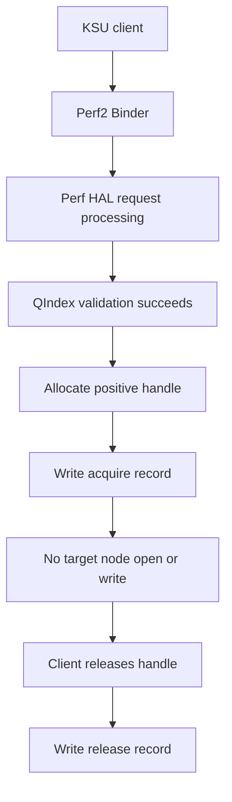
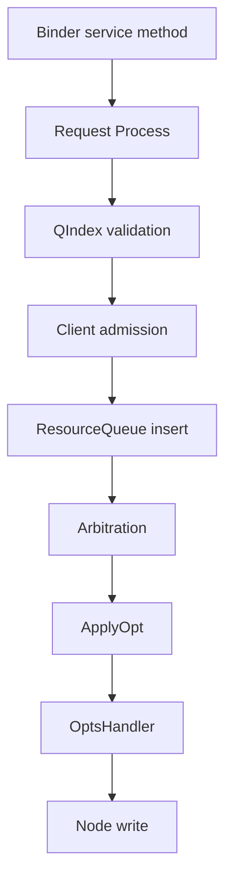
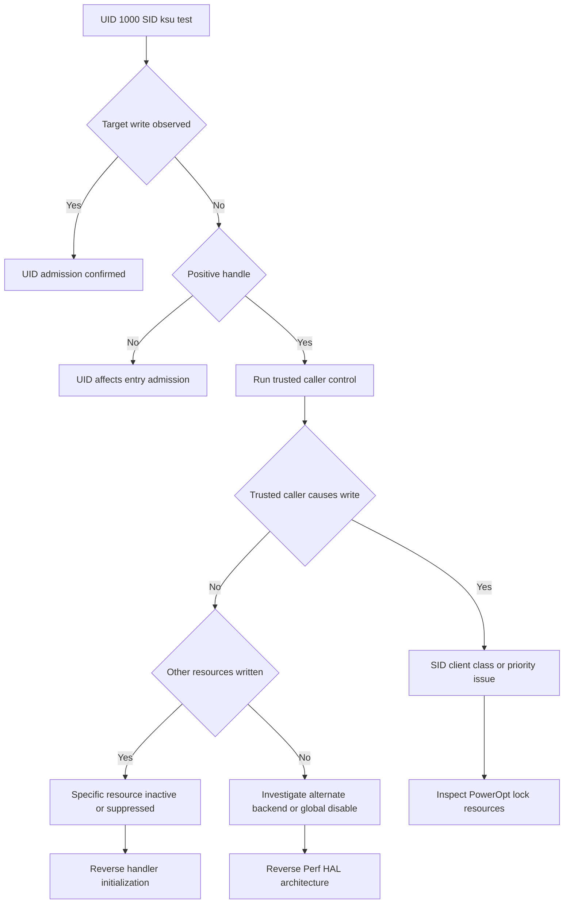
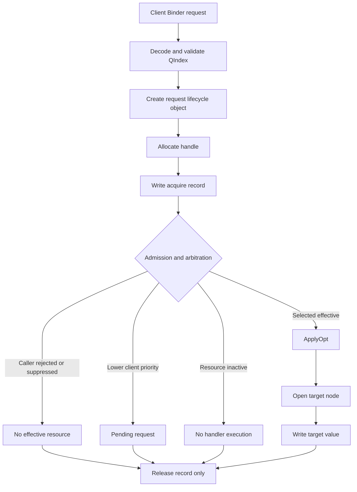

# Qualcomm Perf2 Resource Apply 失效根因分析

**更新时间：** 2026-09-28  
**调查目标：** 解释为什么合法的 `perf_lock_acq()` 请求能够获得正 handle，却没有改变对应的 CPUFreq/WALT 内核节点；最终确定精确根因并形成可复现、可修复的方案。

---

# 1. 当前总体进度

## 1.1 进度评估

| 目标层级 | 当前完成度 | 剩余工作 |
|---|---:|---|
| Binder/ABI/参数传输正确性 | 95% | 仅需源码级最终复核 |
| Opcode/QIndex/XML映射正确性 | 95% | 不再是主要风险 |
| 内核节点可写性及格式验证 | 90% | `sched_fmax_cap` 多字段格式尚未单独验证 |
| Perf HAL请求生命周期确认 | 100% | acquire/release已由 syscall证实 |
| ApplyOpt是否执行 | 90% | 已证实本次请求没有普通文件写；建议补齐 `openat2/writev` |
| 根因大类定位 | 70%～80% | 需要 UID、可信调用方和 active vote差分 |
| 精确代码条件定位 | 45%～60% | 需要二进制字符串/XREF/动态探针 |
| 最终修复或稳定绕过 | 35%～50% | 取决于根因属于caller gate、仲裁还是资源初始化 |

## 1.2 距离最终目标

### 若最终目标是“判断属于哪一类问题”

预计还需要：

1. UID `1000`、SID保持 `ksu` 的差分；
2. 一个可信系统调用方的正对照；
3. 一次补齐 syscall 类型的干净 trace。

预计再经过 **1～2轮关键实验**即可完成根因分类。

### 若最终目标是“定位到具体代码分支”

还需要：

1. 定位 Perf HAL核心实现库；
2. 对 `Request::Process`、ResourceQueue、`ApplyOpt` 相关字符串做 XREF；
3. 必要时使用 uprobe、断点或反汇编验证条件分支；
4. 识别 caller UID/SID、priority、resource state 中哪个字段阻止 Apply。

预计需要 **2～4轮源码/二进制级实验**。

### 若最终目标是“形成可交付修复方案”

需要根据最终根因选择：

- 修改 caller身份或调用入口；
- 修改 Perf HAL admission策略；
- 修复资源配置/handler初始化；
- 修改资源优先级；
- 避免与 PowerOpt长期锁冲突；
- 或绕开 Perf HAL，使用受控的内核节点接口。

---

# 2. 已确认的系统组成

## 2.1 Perf HAL

```text
PID     = 1682
process = /vendor/bin/hw/vendor.qti.hardware.perf2-hal-service
domain  = u:r:vendor_hal_perf_default:s0
```

完整进程名：

```text
vendor.qti.hardware.perf2-hal-service
```

## 2.2 PowerOpt服务

```text
PID     = 1634
process = poweropt-service
UID     = 1000
domain  = u:r:vendor_hal_poweroptservice_qti:s0
```

PowerOpt持有一个长期 direct Perf lock：

```text
duration = INT_MAX
hint_id  = 0
```

在不同实验时间点观察到的 handle包括：

```text
1512
1526
1528
```

handle变化说明 PowerOpt会释放并重建长期锁，但 `/proc/perflock_records` 当前没有提供该锁的 resource array。

## 2.3 测试客户端

```text
binary  = /data/local/tmp/perf_lock_resource
UID     = 0
GID     = 0
domain  = u:r:ksu:s0
```

该客户端：

- 可以访问 Perf2 Binder接口；
- 可以传递合法resource array；
- 可以获得正 handle；
- 可以释放handle；
- invalid QIndex会收到明确失败；
- 当前没有证据证明其资源请求进入 effective queue。

---

# 3. 已确认的资源映射

## 3.1 CPU minimum frequency

```text
Opcode = 0x40800000
Node   = /sys/kernel/msm_performance/parameters/cpu_min_freq
```

节点基线：

```text
0:0 1:0 2:0 3:0 4:0 5:0 6:0 7:0
```

提交：

```text
0x40800000,1785
```

得到正handle，但整个持锁窗口内：

- `cpu_min_freq`不变；
- 各policy的`scaling_min_freq`不变；
- 当前频率变化属于正常负载波动，不能归因于该请求。

## 3.2 WALT sched_fmax_cap

```text
Major  = 0xF
Minor  = 0x7
Node   = /proc/sys/walt/sched_fmax_cap
```

节点基线：

```text
1804800 2707200 2707200 2147483647
```

该节点为四字段形式，推测对应四个CPU frequency policy/cluster，但尚未通过内核源码或安全写入实验确认字段映射。

## 3.3 WALT partial-halt maximum frequency

```text
Major  = 0xF
Minor  = 0x8
Opcode = 0x43C20000
Node   = /proc/sys/walt/sched_max_freq_partial_halt
```

节点基线：

```text
1190400
```

双向夹逼请求：

```text
1000000
1300000
```

两者均：

- 获得正handle；
- 节点在50 ms、200 ms、800 ms、1500 ms均不变；
- release成功；
- 没有perflock exception。

## 3.4 WALT asymcap boost

```text
Major  = 0xF
Minor  = 0x0
Opcode = 0x43C00000
Node   = /proc/sys/walt/sched_asymcap_boost
```

节点基线：

```text
0
```

请求：

```text
0x43C00000,1
```

结果：

```text
handle = 1534 / 1535
node   = 0
```

节点在50 ms、500 ms、1500 ms均不变。

---

# 4. 内核节点独立验证

## 4.1 partial-halt节点可直接写

对以下节点：

```text
/proc/sys/walt/sched_max_freq_partial_halt
```

执行：

```text
1190400 -> 1000000 -> 1190400
```

结果：

```text
old      = 1190400
during   = 1000000
restored = 1190400
```

由此确认：

1. 节点存在；
2. 内核parser接受`1000000`；
3. 节点使用raw kHz值；
4. KSU/root具有写权限；
5. 没有后台服务在300 ms内立即覆盖该值；
6. Perf请求不生效不能归因于内核节点拒绝所有写入。

## 4.2 仍未确认的边界

KSU能够写节点不能直接证明：

```text
u:r:vendor_hal_perf_default:s0
```

也能够写节点。

但是最新的syscall trace表明，本次请求中Perf HAL根本没有尝试打开或写目标节点，因此节点权限不是本次失败的直接触发点。

---

# 5. 决定性 syscall 证据

## 5.1 Trace方法

对Perf HAL PID `1682`及其全部线程执行：

```text
strace -ff
```

跟踪：

```text
open
openat
close
write
pwrite64
```

测试请求：

```text
client PID = 23995
opcode     = 0x43C00000
value      = 1
duration   = 3000 ms
hold       = 1000 ms
handle     = 1535
```

## 5.2 实际服务端syscall

Perf HAL Binder worker TID `1837`只执行了：

```text
write(/proc/perflock_records,
      "type = acquire pid = 23995 ... pl_handle = 1535 ...") = 98

write(/proc/perflock_records,
      "type = release pid = 23995 ... pl_handle = 1535 ...") = 98
```

没有观察到：

```text
open/openat("/proc/sys/walt/sched_asymcap_boost", ...)
write(target_fd, "1", ...)
```

也没有观察到：

```text
EACCES
EPERM
EINVAL
ENOENT
EROFS
EBADF
```

## 5.3 精确结论

已经确认的执行路径：



本次请求没有进入普通的目标节点文件写入路径。

因此以下解释可以排除或大幅降级：

- 节点写入返回`EACCES`；
- 节点写入返回`EINVAL`；
- 节点写入后被快速恢复；
- 50 ms采样错过了首次写入；
- 内核parser拒绝了本次实际write。

## 5.4 syscall覆盖范围的残余风险

第一轮trace没有包含：

```text
openat2
writev
ioctl
```

同时FD快照表明Perf HAL没有长期持有目标节点FD。

因此通过其他系统调用写入目标节点的概率较低，但为形成严格结论，仍建议补充一次：

```text
open
openat
openat2
write
writev
pwrite64
ioctl
```

其中`ioctl`可能产生大量Binder噪声，可单独过滤。

---

# 6. 正handle的真实含义

现有证据推翻了以下假设：

```text
positive handle == resource已经生效
```

更准确的解释是：

```text
positive handle
=
request通过基本校验
+ 建立request生命周期对象
+ acquire/release可以被记账
```

它不保证：

- resource进入effective queue；
- resource赢得仲裁；
- `ApplyOpt()`被调用；
- handler有效；
- target node被写入。

---

# 7. 当前根因候选及置信度

## 7.1 Caller admission / hardening

可能检查：

```text
Binder caller UID
SELinux SID
process name
client registration type
client token
trusted vendor domain
```

当前caller：

```text
UID     = 0
SID     = u:r:ksu:s0
process = perf_lock_resource
```

正常PowerOpt caller：

```text
UID     = 1000
SID     = u:r:vendor_hal_poweroptservice_qti:s0
process = poweropt-service
```

可能存在以下行为：

```text
valid request
-> allocate handle
-> maintain lifecycle
-> reject or suppress optimization insertion
```

**置信度：中高。**

## 7.2 PowerOpt高优先级或exclusive vote

PowerOpt持有：

```text
duration = INT_MAX
hint_id  = 0
```

如果资源仲裁先比较request priority或client class，而不是直接比较resource value，则低值和高值均不生效是合理的。

可能的两级仲裁模型：

```text
第一层：选择最高client priority/class
第二层：在同级request中执行min/max comparator
```

这能解释：

```text
1000000不生效
1300000不生效
boolean 1不生效
```

但尚未证明PowerOpt长期锁包含这些具体resource。

**置信度：中高。**

## 7.3 Resource运行态inactive或handler未绑定

即使XML存在且QIndex能够通过，运行态还可能存在：

```text
feature gate disabled
target capability mask disabled
resource initialization failure
handler callback为空
node initialization失败
OEM XML与实现库版本不匹配
```

这也可能产生：

```text
positive handle
+ no target syscall
```

**置信度：中等。**

## 7.4 普通min/max comparator竞争

仅使用普通value comparator已不能很好解释：

```text
lower value不生效
higher value不生效
另一boolean资源不生效
CPUFreq资源也不生效
```

除非存在更高层的priority/client-class机制。

**置信度：低。**

## 7.5 SELinux阻止目标节点写入

对本次handle `1535`而言，Perf HAL没有执行目标节点open/write，因此SELinux不是本次失败的直接位置。

仍不能排除资源初始化阶段曾因SELinux失败，但需要启动期日志或二进制状态证明。

**置信度：低到中。**

---

# 8. 已排除或显著降级的假设

| 假设 | 状态 | 证据 |
|---|---|---|
| Binder ABI错误 | 基本排除 | 服务端分配handle并写records |
| Opcode编码错误 | 基本排除 | QIndex validation通过 |
| XML没有该resource | 排除 | common XML中存在 |
| target配置将resource禁用 | 排除 | 未发现`Supported=no` |
| 节点不存在 | 排除 | 可读取且可直接写 |
| KSU无节点写权限 | 排除 | direct write成功 |
| kernel parser拒绝`1000000` | 排除 | direct write成功 |
| target node写入失败 | 对本次请求排除 | 服务端没有尝试write |
| 写入后50 ms内恢复 | 对本次请求排除 | 没有首次write |
| 正handle代表Apply成功 | 已推翻 | 只有records write |
| client Binder death warning导致失败 | 基本排除 | IPC和handle生命周期正常 |

---

# 9. 下一步实验计划

## P0：UID 1000、SID保持KSU的差分实验

已验证以下身份构造可行：

```text
su 1000 -c ...
```

输出：

```text
uid=1000(system)
gid=0(root)
context=u:r:ksu:s0
```

该实验只改变UID，SID和binary保持不变。

### 实验矩阵

| Case | UID | SID | 预期用途 |
|---|---:|---|---|
| A | 0 | `ksu` | 已知基线 |
| B | 1000 | `ksu` | 检查UID-only admission |

### 判读

| UID 1000结果 | 结论 |
|---|---|
| 节点生效 | 强烈支持UID admission |
| handle变为失败 | UID影响入口准入 |
| 正handle但不生效 | 排除简单UID-only gate |
| 无法执行binary | 文件权限问题，实验无效 |

### 建议同步trace

同时跟踪：

```text
open
openat
openat2
write
writev
pwrite64
```

UID 1000若仍然只有`perflock_records`写入，则根因进一步转向SID、client class、priority或resource state。

---

## P1：建立可信调用方正对照

这是区分“client身份问题”和“resource本身问题”的关键实验。

不建议直接向PowerOpt进程注入binary。更安全的方法是：

1. 找到系统中一个正常触发Perf HAL的行为；
2. 使用官方系统入口切换该行为；
3. 同时对Perf HAL执行strace；
4. 确认可信caller是否会触发目标节点或其他已知resource的write。

候选事件：

```text
电源模式切换
省电模式开关
屏幕刷新率/性能模式变化
系统认可的Power HAL boost
已知应用启动boost
```

应优先选择可恢复且不会重启设备的系统操作。

### 判读

| 可信caller结果 | 推论 |
|---|---|
| 触发目标节点write | KSU caller admission/priority问题 |
| 触发其他resource write但不触发该节点 | 该resource运行态或仲裁问题 |
| 所有合法操作均无write | Perf HAL可能只负责记账，另有apply backend |
| PowerOpt换锁同时节点变化 | 强化PowerOpt profile ownership |

---

## P1：确认PowerOpt长期锁的resource array

当前最大证据缺口：

```text
无法证明PowerOpt handle 1528具体包含哪些resource
```

推荐顺序：

1. 检查Perf/PowerOpt dumpsys接口；
2. 搜索vendor debug节点；
3. 搜索PowerOpt配置文件；
4. 对PowerOpt重新获取锁的Binder调用做动态跟踪；
5. 必要时解析Binder transaction中的resource数组；
6. 最后才考虑受控释放锁。

不建议当前直接：

```text
perf_lock_rel(1528)
kill poweropt-service
stop poweropt-service
```

除非已经确认其自动恢复机制并准备设备状态回滚。

---

## P1：补齐干净syscall trace

第一轮trace核心证据有效，但存在旧的per-thread trace文件残留风险。

下一轮应使用：

```text
rm -f /data/local/tmp/perf_clean*
```

并跟踪：

```text
open
openat
openat2
close
write
writev
pwrite64
```

目标是确认：

```text
acquire record存在
target syscall完全不存在
release record存在
```

若结果重复，则“请求未进入文件Apply路径”的置信度接近最终闭环。

---

## P2：定位Perf HAL核心实现库

从：

```text
/proc/1682/maps
```

中提取所有vendor库，搜索：

```text
Request::Process
ResourceQueue
ApplyOpt
Qindx
pending
priority
caller
hardening
whitelist
no optimizations
invalid request
```

对候选库执行：

```text
strings
readelf
nm
objdump
Ghidra/IDA XREF
```

重点寻找以下调用链：



目标是回答：

```text
handle在哪一步分配
caller检查在哪一步发生
ResourceQueue insert返回值是否被忽略
ApplyOpt触发条件是什么
priority从哪里生成
```

---

## P2：动态函数级探针

若候选库有符号或能够通过反汇编定位函数offset，可使用：

```text
uprobe
simpleperf
debugger breakpoint
```

对以下位置计数：

```text
Request::Process entry/exit
ResourceQueue::Add
ResourceQueue::Pend
ApplyOpt
ResetOpt
write-node wrapper
```

比较两类caller：

```text
KSU UID 0
KSU UID 1000
trusted PowerOpt/system caller
```

这是把根因从“高概率推断”提升为“代码条件实锤”的关键步骤。

---

## P3：受控移除PowerOpt锁

只有在以下条件全部满足后才执行：

1. 已获取handle resource明细；
2. 确认PowerOpt会自动重建锁；
3. 准备恢复动作；
4. 设备处于非关键测试状态；
5. 已记录所有相关节点基线；
6. 设置超时恢复脚本。

实验目标：

```text
release PowerOpt lock
-> 立即提交测试request
-> 观察是否触发target write
-> 允许PowerOpt恢复
```

若移除PowerOpt锁后KSU request开始执行，则实锤priority/exclusive ownership。

当前阶段不建议直接执行。

---

# 10. 决策树



---

# 11. 当前最可能的执行模型



当前实测路径终止在：

```text
acquire record
-> no target syscall
-> release record
```

尚未区分：

```text
caller suppression
priority pending
resource inactive
```

---

# 12. 当前结论与置信度

| 结论 | 置信度 |
|---|---:|
| Perf HAL PID和SELinux domain确认 | 极高 |
| Binder调用成功 | 极高 |
| QIndex基本校验成功 | 极高 |
| 正handle只代表request生命周期 | 极高 |
| handle 1535服务端完成acquire/release记账 | 极高 |
| 本次请求没有普通target open/write | 极高 |
| 节点本身可写且parser正常 | 极高 |
| 本次失败不是kernel write返回错误 | 极高 |
| 单纯value单位问题 | 低 |
| 单纯min/max comparator问题 | 低 |
| caller UID/SID/client class抑制 | 中高 |
| PowerOpt高优先级或exclusive ownership | 中高 |
| resource运行态inactive/handler缺失 | 中等 |
| Perf HAL全局Apply关闭 | 中低 |
| Opcode/ABI错误 | 极低 |

---

# 13. 推荐执行顺序

1. 执行UID `1000`、SID保持`ksu`的资源请求。
2. 同步完成补齐`openat2/writev`的干净strace。
3. 建立可信系统caller正对照。
4. 确认PowerOpt长期锁resource array。
5. 定位Perf HAL核心实现库。
6. 使用XREF或uprobe确认ResourceQueue/ApplyOpt条件。
7. 最后才考虑受控释放PowerOpt锁。
8. 根据根因设计修复或绕过方案。

---

# 14. 最终成功判据

调查完成必须至少满足以下之一。

## Caller admission根因闭环

```text
同一binary和resource
+ 改变单一caller身份字段
+ 从no target syscall变为target write
```

## Priority/PowerOpt根因闭环

```text
确认PowerOpt持有同resource
+ 移除或降低其vote
+ 原请求开始进入ApplyOpt
```

## Resource inactive根因闭环

```text
定位resource initialization/feature gate失败
+ 修复状态
+ target write出现
```

## 实现缺陷根因闭环

```text
定位具体代码条件或空handler
+ 修改二进制/配置
+ request触发预期节点变化
```

在满足上述闭环前，不能仅凭正handle宣称resource已经生效。