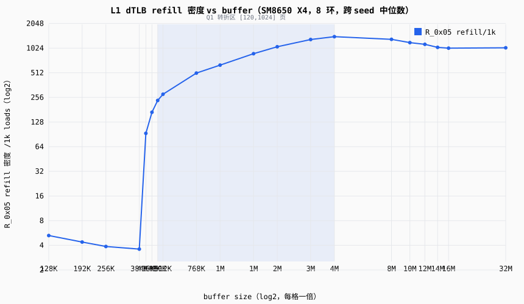
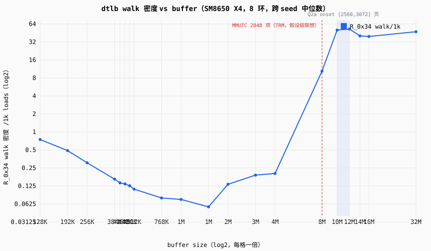
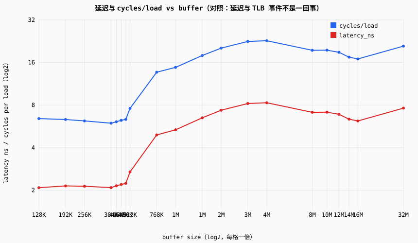
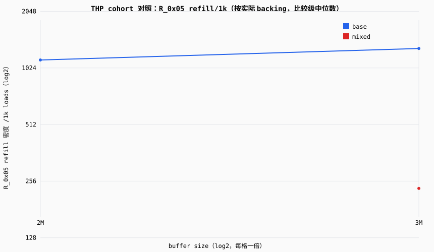

# SM8650 X4 TLB 战役：同事版图表与读法

> 面向无微架构背景的同事：四张图 + 大白话读法。终态口径以战役终审 `docs/reviews/2026-09-28-sm8650-tlb-hierarchy.md` 为准（本报告是它的图表附件）。报告由 `python -m analysis.tlb_figures` 生成：只读 `records.jsonl`（中位数经 `runner.statistics.summarize`），无时钟/随机/环境依赖，同输入必同输出。

## 一分钟背景

TLB（Translation Lookaside Buffer）是「虚拟页 → 物理页」翻译的缓存：程序每访问一次内存，CPU 都要把虚拟页号翻译成物理页号，TLB 缓存最近用过的翻译，免得每次都走内存里的页表。本战役用指针追逐负载逐级加大程序同时使用的内存量：buffer 越大、用到的页数越多（4 KiB 一页），TLB 压力越大。测试机 redmi-k70pro-01（SM8650 Cortex-X4 核），全部数字为 8 环正式窗口下逐进程样本的中位数口径。

## 数据来源（钉死的战役数据集）

- 粗扫 `20260930T004843Z-ptr-chase-sm8650-x4-tlb-coarse`：13 档 buffer × seed{7,42}，8 环；
- 致密 `20260930T010808Z-ptr-chase-sm8650-x4-tlb-dense`：8 档 × 4 seed，8 环（4096 KiB 与粗扫重合，逐 seed 合并中位数）；
- Phase D `-B` `20260930T014014Z-ptr-chase-sm8650-x4-tlb-thp-base` / `-T` `20260930T013743Z-ptr-chase-sm8650-x4-tlb-thp-madvise`：各 3 点 × 4 seed。

曲线构造：每 (buffer, seed) 取组中位数，跨 seed 合并 = 各 seed 中位数的中位数；粗扫/致密重合点（4096 KiB）逐 seed 先合并。

## 图 1：L1 TLB 重填密度（refill-density.svg）

**怎么读**：TLB 是页表翻译的缓存；横轴是程序正在用的内存量（换算成页数 = KiB ÷ 4），纵轴是每 1000 次访问里有多少次要重填 L1 TLB。在 480 KiB 到 4 MiB 之间（灰蓝区，对应 120–1024 页），重填从几乎为零一路爬到超过每次访问一次——这一片宽区间就是「L1 TLB 开始不够用」的区域。注意两点：它不是悬崖而是缓坡；纵轴超过 1000/1k 并不矛盾——它是事件密度而不是概率（一次访问可能触发多次重填事件）。

## 图 2：page table walk onset（walk-onset.svg）

**怎么读**：这条曲线回答「什么时候连片上缓存都救不了、必须走内存里的页表」——这个动作叫 page table walk。10 MiB 以下几乎没有 walk，10–12 MiB（灰蓝区）突然开始。竖虚线是芯片手册（TRM）写的 MMUTC 2048 项参考位置（2048 页 × 4 KiB = 8 MiB）：walk onset 落在它右边，这件事目前只是机制联想，不是证明。

## 图 3：延迟对照（latency-cycles.svg）

**怎么读**：延迟和 TLB 事件不是一回事。中段（约 4 MiB）延迟最高时 walk 还没开始，walk 开始后延迟反而下降——中段由 L1 refill 风暴主导（图 1 里 >1000/1k 的区间），其成本高过 onset 后的 walk 服务。所以本报告的结论都不画在延迟轴上；这张图只是对照，提醒「看延迟猜 TLB」会误判。

## 图 4：THP cohort 对照（thp-cohort.svg）

**怎么读**：进程内部分页拿到大页（THP，2 MiB 一页）的 cohort，TLB 压力掉到约 1/5（3072 KiB 处 R_0x05 **-82%**），延迟 **-12.4%**。但只有一部分进程真的拿到了大页（3072 KiB 转化表：40 进程次中 base 25 + mixed 15），其余仍用普通 4 KiB 页。图上只画达到「比较级」（≥5 有效样本）的 cohort 中位数：3072 KiB 的 mixed 只有 seed42 达标（n=5）；2304 KiB 的 mixed 全体 INSUFFICIENT_COHORT，如实不出点。

cohort 分级明细（`grade_thp_cohorts` 产出原样，可审计）：

- 2304 KiB × base（跨 seed 合并=False）：seed7 comparative n=19；seed42 comparative n=18；seed1337 comparative n=20；seed20260928 comparative n=18
- 2304 KiB × mixed（跨 seed 合并=False）：seed7 insufficient n=1（终态 INSUFFICIENT_COHORT）；seed42 insufficient n=2（终态 INSUFFICIENT_COHORT）；seed20260928 insufficient n=2（终态 INSUFFICIENT_COHORT）
- 3072 KiB × base（跨 seed 合并=True）：seed7/42/1337/20260928 comparative n=65
- 3072 KiB × mixed（跨 seed 合并=False）：seed7 descriptive n=4（终态 INSUFFICIENT_COHORT）；seed42 comparative n=5；seed1337 descriptive n=3（终态 INSUFFICIENT_COHORT）；seed20260928 descriptive n=3（终态 INSUFFICIENT_COHORT）

## 终态表（终审 §1，每 Q 独立）

| Q | 终态 | 结果 |
|---|---|---|
| Q1 `0x05` 第一有效转折 | INTERVAL_IDENTIFIED | [120, 1024] 页（480 KiB–4 MiB），宽饱和区而非锐边；4 seed × 双训练量同区间 |
| Q2a `0x34` walk-onset | INTERVAL_IDENTIFIED | [2560, 3072] 页（10–12 MiB）；4 seed × 双训练量一致 |
| Q2b L2 层级辨识 | 降级完成 | `0x2d`（unified refill）QUALIFIED；`0x2f` SEMANTICS_UNVERIFIED |
| Q2c 第二级 effective reach | 未授权（OPEN） | 授权门槛未满足，不结案 |
| Q3 walk 暴露成本 | MODEL_UNIDENTIFIABLE | walk 密度与延迟/cyc 反相关，单调性不成立；MMUTC 混杂未分离 |
| Q4 THP cohort 对照 | 机制方向一致（受限比较级） | 3072 mixed（seed42，n=5）延迟 -12.4%、R_0x05 -82%；2304 mixed 与 3072 其余 seed = INSUFFICIENT_COHORT |

## 没测到什么（边界）

- **TLB 物理项数没有测出来**，也不能由本协议报出：固定随机环访问分不清容量、预取与页布局各自的贡献（同一条曲线三种解释都兼容）。要测需要可控布局探针——已立项登记（`docs/open-items.md` OI-14）。
- **Q2c（L2 TLB 容量 / effective reach）未授权**：`0x2f` 事件语义未核实 + 授权门槛未满足，保持 OPEN，不由 walk-onset 区间外推。
- 图上的「页数」全部按 4 KiB base 页换算；TRM 的 MMUTC 2048 项只是参考线（假设级联想），不构成结构证明。

## 复算

- 本报告全部图表再生（同输入必同输出）：
  `python -m analysis.tlb_figures --runs-root data/public/runs --out <目录>`
- 终态数字的复算入口：判定分析器 `analysis/sm8650_tlb.py`（knee / walk-onset / THP cohort 分级等冻结规则）与战役终审 `docs/reviews/2026-09-28-sm8650-tlb-hierarchy.md`（§1 终态总表 + §3 分 Q 证据）。
