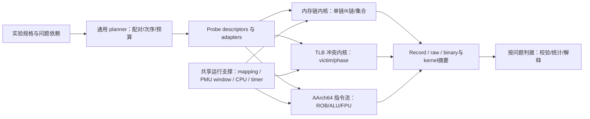

# SM8650 TLB r2 任务书评审：可识别性、探针正确性与后续执行端探测

> 日期：2026-09-30（Asia/Shanghai）。评审对象：`cpu-uarch-explorer-tlb-r2` 的任务书 v1.0；审阅源码快照 `a104dbf7f6d5813b144e1995e36a5a74dbe9c4ae`。报告落在当前主工作区 `cpu-uarch-explorer`（原 HEAD `5c996a1337b8e406bb8b5d864205f3b523309b41`）。
>
> 本文是独立评审和修订建议，未改写 r2 任务书、实验判据或生产代码，也未进行目标板采数。判定依据是观测量与因果机制能否对应，不以此前评审轮数、文档版本或仓内命名禁令代替技术验证。所有合成复核值与硬件测量分开。

总体意见：**设计方向可保留，v1.0 需要实质修订后再进入正式实验。** 三层架构、同窗比值、实际页 backing 审计、逐样本留存和允许不可识别终态都值得保留。主要问题集中在 Q-A 的归因跳跃、Q-B 的对照构造、Q-C 的假设可区分性，以及把仍有确定性缺陷的原型认作有效算法蓝本。M0 仅抽取页策略和放宽 metric 集，尚不足以承接新探针，更不足以承接 ROB/ALU/FPU。

## 1. 本次实际核对的资料与证据边界

| 来源                                                                                                                                                         | 本次核对内容                                                                                              | 可支持什么                                                                                                                                                          |
| ------------------------------------------------------------------------------------------------------------------------------------------------------------ | --------------------------------------------------------------------------------------------------------- | ------------------------------------------------------------------------------------------------------------------------------------------------------------------- |
| [Arm X4 软件优化指南](/Users/michaelyao/workspace/cpu-uarch-ref/docs/Arm_Cortex_X4_Core_Software_Optimization_Guide.pdf)                                      | r0p1 / Issue 3.0；§2、§3、§4.1；图 2-1、表 2-1；PDF p.12–16、FP/ASIMD 指令表及 dispatch 约束          | 官方流水线分类、指令形式的延迟/吞吐、MOP/µOP 及 dispatch 约束；不能提供 ROB 384 的官方真值                                                                         |
| [Arm X4 TRM](/Users/michaelyao/workspace/cpu-uarch-ref/docs/Arm_Cortex_X4_Core_TRM_102484_0003_06_en.pdf)                                                     | r0p3 / Issue 06，Table 5-1（PDF p.55）、PMU 事件表（含 p.135 的 0x8128）、CPUECTLR_EL1（p.192–194）      | L1 dTLB fully associative / 96 entries；unified L2 TLB 2048 entries / 8-way；中间描述符条目共存、HPA 控制与事件语义                                                 |
| [Inferring TLB Configuration with Performance Tools](</Users/michaelyao/workspace/cpu-uarch-ref/docs/Inferring TLB Configuration with Performance Tools.pdf>) | Agredo / Langehaug / Graham，2024；§2.4、Listing 3、§2.6、Power9 结果及结论；相关页完整文本及方法页图像 | 候选映射与冲突试验、二维扫描和热图；论文自身报告跨厂商移植失败，不能把 Intel XOR 假设直接认作 X4 映射。DOI：[10.3390/jcp4040044](https://doi.org/10.3390/jcp4040044) |
| [2023 Cortex-X4 框图](</Users/michaelyao/workspace/cpu-uarch-ref/docs/2023 - Cortex-X4.jpg>)                                                                  | 图像直接检查；作者署名 Cardyak；明确标注`384 Entry Reorder Buffer (ROB)`                                | **第三方候选值 384**，可用于规划扫描范围，不作目标设备实测结果；图中其它队列容量同样待验证                                                                    |
| [CPUSUIT src](/Users/michaelyao/workspace/cpu-uarch-ref/cpu微架构材料/src/)                                                                                   | `pattern.c`、`alu.cc`、`fpu.cc`、`port.cc` 及 `utils/` 的相关构造/测量代码                      | 指令生成、依赖链、独立链和混合流的设计参考；本次不是整个参考工程的逐文件质量认证                                                                                    |
| r2 代码                                                                                                                                                      | 两个 TLB 原型、ROB 骨架、ptr_chase、Linux perf 支撑、runner plan/engine/adapter、TLB 分析器与事件注册表   | 下面的确定性代码发现与工程扩展性评估                                                                                                                                |

TRM Issue、CPU revision、目标设备 MIDR 是三个不同维度。新提供的本地 TRM 已经是 r0p3 / Issue 06；任务书仍以 Issue 05 为唯一来源并把 r0p3 核对后置，应改为明确记录实际引用版本。本文只核对与本次结论有关的条款，**没有声称完成 Issue 05/06 全文差异审计**。

用户指定的四项材料已另写入全局记忆引用笔记。知识库身份表示后续跨项目可查阅，不表示第三方观点、参考代码或所有参数已验证。

## 2. 必须优先处理的发现

| ID | 优先级 | 发现                                                         | 后果                                                      |
| -- | ------ | ------------------------------------------------------------ | --------------------------------------------------------- |
| F1 | P1     | Q-A 把分布敏感性归因为 PFN 着色/冲突，把无差异归因为渐进饱和 | 两类观测都不足以识别指定机制，遗漏 HPA 等竞争解释         |
| F2 | P1     | Q-B 的 T/T2 原型是两个各自同 set 的链                        | 理想正确哈希下两组同样自冲突，缺少真正非冲突对照          |
| F3 | P1     | filler 选址无映射上界；强制`-w 0` 路径除零                 | 冒烟可能访问映射外；空窗对照不能按任务书执行              |
| F4 | P1     | 256 MiB 默认地址池不足以普遍区分 H1/H3、H2/H4                | 可把仅重命名 set 的假设误判为独立验证结果                 |
| F5 | P1     | 短 probe 的逐事件 read/syscall 不满足严格同窗和无干预前提    | 8–16 次访问的信号可能受计数/时钟/内核翻译污染            |
| F6 | P1     | M0 没有覆盖 planner 的 ptr_chase 硬编码和新几何分组键        | tlb-set 不能只靠注册 adapter 接入；不同模式可能被分析合组 |
| F7 | P2     | 固定 K 变 N 被描述为分离 MSHR/load queue；比值平台判据不足   | 同时改变多个资源压力，无法作排他归因                      |
| F8 | P2     | 校准池、正式采数与 M0 完成条件的先后关系未闭合               | 新窗口统计量的池无法在新探针完成前可信建立                |
| F9 | P2     | 事件资格、OI 编号与文档引用存在漂移                          | 同一来源被重复资格化，后置项无法唯一定位                  |
| R1 | P1     | ROB 生成码的回跳位移多除以 4                                 | 稳态循环绕过锚点，ROB 窗口协议实际不存在                  |
| R2 | P1     | ROB perf GROUP read 布局错误                                 | enabled/running 被误读为事件值，cycles 等失真             |
| R3 | P1     | fsqrt 锚点输入未初始化，FP filler 覆写 d0                    | 锚点时延/依赖不能按文档保证                               |
| R4 | P2     | 把 INST_SPEC/INST_RETIRED 当作直接拆分因子                   | 执行、融合、消除与投机重执行混入，不能直接换算 ROB entry  |

P1 表示会破坏对应实验的正确性或可识别性，应在该实验正式采数前解决；不表示所有正交研究都必须一起停下。R 系列属于用户要求的后续 ROB 扩展检查，不要求塞进本轮 TLB 实施范围。

### F1：Q-A 应先回答“分布是否改变 refill 行为”，再讨论为什么

位置：任务书 L24–26、L122、L128；深析报告 §5.1-6、§5.9 已有 HPA/合组降级要求，但 r2 没有把它们变成执行门。

TLB 查找使用 VA/VPN 与地址空间标识；PFN 着色通常首先解释物理 cache 的集合竞争，不能未经证明就作为 L1 TLB 索引解释。TRM 明确描述 X4 L1 dTLB 为 fully associative，所以“L1 refill 出现布局差异 → L1 set 共振”尤其不成立。差异还可能来自 HPA/PTE 连续提示、L2 TLB 冲突、翻译预取、页表层级/局部性、数据 cache 竞争及替换/投机行为。

`AnonHugePages=0` 证明的是未观察到匿名 THP backing，不能证明没有 PTE contiguous hint，也不能证明硬件没有聚合。TRM 列有 HPA_L1_DIS/HPA_DIS；复位默认值不能代替当前固件/OS 的实际状态。官方固件资料也存在修改 HPA 状态的场景，因此配置应实查或明确 UNKNOWN。[TF-A 官方说明](https://tf-a.docs.trustedfirmware.org/en/latest/security_advisories/security-advisory-tfv-12.html)

三分布结果一致，只能说明**本次采样分布和精度内未观察到差异**；不是“渐进饱和”被唯一验证。提前、推迟或曲线形状变化均可能有意义，预注册不应只保留“提前”这一方向。

建议把 Q-A 主结论收敛为 `DISTRIBUTION_SENSITIVE / NO_DIFFERENCE_DETECTED / INCONCLUSIVE`，附差异区间、检出能力和证据覆盖。`ATTRIBUTED` 必须是额外正交对照通过后的升级状态。

几何变量需独立定义：

| 变量             | 定义                     | 控制原则                                                               |
| ---------------- | ------------------------ | ---------------------------------------------------------------------- |
| page set         | 实际访问的 N 个 VPN 集合 | 连续、步距集合、稀疏随机集合分别构造；不要用打乱顺序冒充随机集合       |
| visit order      | 同一集合上的遍历顺序     | 各集合先用相同随机环协议；顺序/逆序作为独立对照                        |
| in-page offset   | 页内指针所在 cache line  | 固定页首与页内 line 分散至少做一组对照，避免 cache 索引共振            |
| mapping span     | 保留 VA 范围及页表覆盖   | 与 N/驻留字节分字段；大步距扩大的是地址跨度和页表覆盖，不只是 TLB 压力 |
| allocation epoch | 重新分配/进程实例        | 重复访问顺序 seed 与重新分配导致的 PFN 布局变化分别留存                |

按传统 64 KiB/4-way/64 B line 索引推算，同一 4 KiB 页内偏移只使用少数 L1 cache set；X4 的具体别名/索引实现仍须核验。这不是断言当前曲线由 cache 引起，而是指出 `-s 4096` 本身没有控制该混淆。可以用 `offset_i=64×(i mod 64)` 等页内分散方式作对照，确保指针对齐且仍是每页一条链节点。

如需要进一步排歧，可评估“多个 VA 映射到同一小块物理 backing”的 alias 对照，以降低数据 cache 工作集，同时改变翻译集合；但 alias、聚合、权限与真实映射支持也必须核验。该路径是建议，不是假定已有可用能力。

### F2：T2 换一个 set，不会自动变成无冲突对照

位置：`l2_set_probe.c` L227–239、L253–259、L303–309；任务书 L27–30、L123、L129。

原型对 T 构造 `ways` 个索引为 target 的页，对 T2 构造同样多、索引为 target2 的页；filler 避开两个 set。在理想均匀 8-way L2 中，w≤8 时两组都可容纳，w>8 时两组都可能自冲突。因而 **T−T2 差异不是这套构造应当产生的主要效应**。有差异还可能是两个 set 的背景占用不均；没有差异也不能据此拒绝 H。

需要从两种不同估计量中选一个：

1. **同 set 自冲突曲线**：N 个页集中到候选 set，负控用同样 N 个页分散到多个候选 set，保持访问数、节点偏移、代码路径和页策略匹配。跨多个目标 set 和独立 VA epoch 重复。
2. **单 victim 驱逐概率**：固定 victim v，先将其翻译填入，访问 m 个候选同 set aggressor（须保证这些访问实际进入 L2 翻译查找，而非一直命中 L1），再做经验证的 L1 驱逐，最后测 v；负控把 aggressor 放到其它候选 set。扫描的是 aggressor 数 m，估计量是 `P(v 被驱逐 | m, H, 协议)`。

两者都可以合理实验，但“way 跳变”和“victim 驱逐概率”不是同一个量。替换策略、中间描述符条目和背景翻译会改变曲线，不能只用“混合条目有效相联度”这个名字消除歧义。按 H 避开 filler 的 leaf VPN set，也不能保证这些页产生的中间描述符翻译不占目标 set。首先报告冲突曲线/概率，再有条件解释为有效相联度。8→9 仅适用于总竞争条目数口径；单 victim 加 m 个 aggressor 时必须明确 victim 是否计入横轴。

建议先以不依赖 H 的经验驱逐集取得正控，再测试候选 H；否则“已知冲突正控”依赖尚未识别的哈希，存在循环论证。T/T2 还需 AB/BA 或随机配对次序，当前每轮固定先 T 后 T2 不构成次序平衡。

### F3：算法蓝本仍有确定性边界缺陷

**filler 越界**：L247 只映射 `filler_pages` 页；L256 从 page index 1 开始，为取得足额合格页跳过过滤页，却没有 `< mapped_pages` 上界。即使不跳过，收集 512 个页也会包含 index 512，而映射合法范围只有 0..511。合成 base=0x100000000、F=512、T=7/T2=100 时，H1–H4 都选到 index 516，其中 5 个地址超出已映射范围。实际结果可能是 SIGSEGV，也可能误写邻接 VMA；独立 mmap 不能证明这些越界地址仍与目标不相交。

**空窗除零**：任务书强制 `-w 0`；原型 `want=ways=0` 后进入 `collect_set_addrs`，L92 执行 `total_pages/need`。本次用包含原型的最小 harness 调用该函数，UBSan 明确报 division by zero；无需运行目标板。

修订要求：映射池大小与“需要的合格页数”分开；所有候选地址验证 `[base, end)` 和对齐，不足时结构化失败；空窗是独立模式，不构造或解引用长度为零的链。任意轮 PMU 失败都必须逐轮失效，不能只检查第 1 个保留轮，然后把后续 `UINT64_MAX` 哨兵累计成大计数（L333–346）。

### F4：H1–H4 必须先证明在实验地址域内可区分

位置：`l2_set_probe.c` L75–81、L86–108、默认 L168；任务书 L31–32。

H3=H1 XOR VPN[23:16]，H4=H2 XOR VPN[23:16]。默认 65536 页只有 256 MiB VA 跨度；在对齐的 256 MiB 区间里，VPN[23:16] 恒定。因此 H3 只是给 H1 的 set 标签 XOR 一个常数，H4 对 H2 同理，**同 set 关系完全一样**。本次合成复核常数为 16，65536 页全一致。非对齐区间最多跨两个这样的高字段桶，仍不能把普通分桶采样视为充分激励。

建议在映射合法性允许的前提下使用多个相隔至少 256 MiB 的稀疏 VA 区域，显式改变高字段、检查各候选的冲突关系矩阵，并报告“当前采样域内等价的假设组”。要改变完整八位高字段需要更广的地址域；无需因此分配等量物理内存，但保留 VA 与触碰页必须分开规划。

训练地址/目标 set 用来构造候选；留出地址、不同基址和其它目标 set 用来验证预测。只能拒绝在独立验证样本上失败的候选；无可区分输入时终态应为 `HYPOTHESES_EQUIVALENT_ON_TEST_DOMAIN`，不能报真实哈希唯一或假设全拒。

### F5：短窗口需要新的 PMU 读数协议，不能原样继承长链实现

位置：`perf_counter.cpp` L40–49、L67–79、L86–95；原型 `l2_set_probe.c` L292–309。

现有 perf 支撑故意独立打开事件，逐个 enable、逐个建立 baseline、逐个 stop read；既有长 ptr_chase 窗口已进行固定开销分析，可以作为其限定协议资产。它没有保证所有事件从同一指令边界开始/结束。`enabled==running` 证明没有该事件的时间复用，**不证明多个事件的窗口完全重合**。

set 探针一次只做少数 load，却在 filler 与 target 之间对每个事件调用 read；T 路径还额外调用两次时钟函数，T2 路径没有等同的时钟调用。内核态也未排除。即使不计内核事件，系统调用仍可能扰动 shared TLB；统一 L2 refill 的 I 侧贡献也未必是与条件无关的常数。

`-w 0` 与 w>0 的分支/计时/状态不同，不能未经检验就逐点减一个空窗均值。减法后的负值也必须保留并解释，不能截零后当作概率。

建议补 `PerfWindow` 能力：core PMU 原子组启停/组读、显式计数特权级、阶段标记、窗口 delta 的 enabled/running、读数失败、事件 ID 和 CPU 归属。短窗口优先评估用户态 PMU read 能力；能力不可用时用较长、配对、可分析开销的批量协议。批量协议若把 filler 也纳入窗口，要明确估计量改变，不能声称直接得到纯 victim 事件。

空窗、无冲突同长度窗口及重复次数尺度扫描用于标定开销是否线性/是否足够小；多个实验状态下验证 I 侧事件，而非预设统一底噪可减。Linux 对 PMU group 同时调度与 read 布局的定义见 [perf_event_open(2)](https://man7.org/linux/man-pages/man2/perf_event_open.2.html)。

这不要求撤销 r1 在长窗口内的所有结果；要求的是**重新建立短窗口、K 链和新指标的有效性范围**。

### F6：应把 M0 从局部修补升级为最小的多探针纵向闭环

位置：任务书 L99–103；`runner/plan.py` L192–300、`engine.py` L24–37；`analysis/sm8650_tlb.py` L412–417、L744–759、L1818 附近。

当前 planner 无论 probe 名称为何，都派生 buffer/stride/slots/loads/warmup 与页策略。新增 tlb-set 的参数是 H、target、aggressor 数、rounds、phase 等，单加 adapter registry 不能绕过 planner 的必需 ptr_chase 参数。runner progress 文本还把第一个 metric 固定标为 ns。CMake/adapter 是需要的，但并非全部接入点。

现有 TLB 分析器按 `(buffer, seed, backing, ring_passes)` 分组。加入集合分布、页内偏移、K、mapping span 后，这些维度也必须进入分析身份；否则同大小同 seed 的不同实验被合并，或者旧归一化把 loads/slots 错用于 K 链与稀疏映射。

建议由 probe descriptor/adapter 提供参数规范化与实际几何派生；planner 负责通用控制、sweep 展开、随机化/配对次序和预算。分析器以每个科学问题需要的事件集合声明依赖：缺少无关事件不阻止计算，缺少必要事件则输出明确不可计算状态。**宽容地读字段不等于宽容地合并实验条件。**

`required ⊆ present` 是合理的一个修正，但应同时保留 per-observation 的事件编码、窗口、页审计与分母契约；不能把“新事件多了”与“关键事件缺了”混成统一放行。

### F7：Q-D 的占用比值正确，机制排除方案需要降级表述

令 A 为同窗 0x8128 增量，C 为 cycles，M 为 0x34 增量。按 TRM，A 累积每周期进行中的数据翻译 walk 事件数，因此：

```text
L̄ = A / C                         窗口内平均在飞 walk 事件占用
λ = M / C                         每周期 walk-causing access 率
T_eff = A / M  （M>0）             每个计数事件对应的有效驻留周期
L̄ = λ × T_eff
```

最后一式在数值上是恒等式；把 T_eff 解释成平均 walk 驻留时间还需要事件范围匹配、稳态及窗口边界效应小。它不是暴露的 stall latency，也不是单个物理 walker 的服务时间。

L̄ 平台既可能是并行占用上限，也可能由请求率下降、驻留时间增加、发射瓶颈或测量开销变化产生。固定 K 变每链 N 会同时改变总翻译工作集 K×N、数据 line 工作集、页表覆盖、cache 命中率和 walk 率，**不是把 MSHR/load queue 独立拿出来控制**。

建议至少同时画 `L̄、λ、T_eff、loads/cycle`；配置中分别记录每链 N、总页数、总访问数和物理数据 footprint。K 扫描至少有固定总页数与固定每链页数两种条件，并验证前者的工作集确实 walk-active。增加低 walk 但相近数据 cache 压力的负控，帮助判断 K 内核本身是否受发射/数据 miss 限制。

K 内核应为小范围 K 的显式寄存器独立链，检查反汇编的链依赖与 spill；原型的动态 `ps[k]` 双循环不是对无限 K 都无额外开销的并行度发生器。不需要为报告“该负载的平均占用”排除全世界的瓶颈；需要限制的是对物理队列深度/资源数的进一步解释。

### F8/F9：统计与契约收口

- **先可行性后方差池**：任务书 M0-3 要先为新窗口统计量建池，M0 未完成又不能进入正式采数，新探针在 M0 后才完成。建议明确：安全性修正 → 能力/窗口 pilot（保留 raw，标 CALIBRATION/PILOT）→ 独立校准与规则冻结 → 正式矩阵。M0-3 的指标池不能用旧长链率代替短阶段 delta。
- **3% 规则冲突**：任务书 L66 禁止照搬 3% 门，L156 又硬设跨日 >3% 冻结。已知 OI-12 有 +3.6% 变化，必须澄清 3% 是调查触发器还是数据排除门；两者不能隐式等同。
- **统计单位**：同一进程内 rounds、访问顺序 seed、重新分配、跨 session 是不同层次。比较按 session/分配配对，bootstrap/区间估计按独立分配或 session 聚类；不能把 rounds 全当独立样本。knee 若是宽区间，区间差异和删失语义要明示，不以两个点估计作确定裁决。多 H/多 set 的选择需要留出验证或处理多重检验。
- **比值先配对再汇总**：A/C 在同 observation 计算，再选择“平均样本占用”或按 cycles 加权的 `ΣA/ΣC`；不能取独立中位数 `median(A)/median(C)` 而称其为同窗样本比值。
- **事件率不是概率**：r1 表中 R_0x05 可超过 1000/1k loads；正式 set 模式须核对额外访问、重执行、窗口和事件范围，不能自动把 refill/load 当作 [0,1] miss probability。victim 二值概率需要单独定义分类器及误判率。
- **旧资格不是“新事件”**：`configs/pmu-event-registry.json` 已记录 0x11 与 0x8128 qualified；任务书 L84–85 又称新事件待资格化。应改成“继承已有长链资格，新增 K/短窗作用域验证”，保留各自 scope。
- **跟踪 ID 不唯一**：`docs/open-items.md` 当前有两个 OI-12（ROB 与跨日基线），任务书分别引用。建议迁移为唯一 ID 并保留别名/映射；不要在归档报告里静默改历史含义。
- **文档交叉引用**：任务书头部提 5 条架构修正，M0 实列 4 项；M0–M4、M1、§10.3 等指称未与实际章节对齐。这些属于 P2 维护问题，但会影响实施顺序和退出验收。

## 3. 可扩展架构：按测量形状复用，不按部件名挤入 ptr_chase

保留现有 runner/artifact/环境事务的数据管道是正确决定。应把“同属容量/拐点”进一步拆成实际 kernel：单链延迟、K 链吞吐、分阶段冲突、JIT 指令窗口。它们的观测单位和执行协议不同。



这里的结构是建议，不要求本轮一次性重构整个框架。

| 层                 | 应共享的职责                                                                 | 本轮最小增量                                                            |
| ------------------ | ---------------------------------------------------------------------------- | ----------------------------------------------------------------------- |
| 支撑层             | RAII 映射、守卫、页 backing 审计、合法地址池、timer、CPU/MIDR、core PMU 窗口 | 页支撑抽取 + 短窗口 core PMU 模式；generic perf/uncore 的旧模式可以并存 |
| kernel 层          | 受控访问或精确指令流                                                         | 单链继续复用；K 链做独立 kernel；tlb-set 独立 phase kernel              |
| adapter/descriptor | 参数规范化、几何、能力要求、输出解析                                         | 消除 planner 的 ptr_chase 专属派生                                      |
| 管道层             | 环境事务、调度、raw/manifest、每进程与每窗口证据                             | 保留现有实现；显式 round/phase/pair ID，不只留终端均值                  |
| 判据层             | 所需事件/估计量、锚点、对照与终态                                            | QA/QB/QC/QD 分开；锚点判定独立于主体指标全集                            |

建议在 records 中区分 requested params 与 realized geometry，至少容纳：page count、VA span、node offset policy、chains、总 retired/执行访问口径、allocation/round/phase/pair、实际页策略、PMU event type/config/privilege scope、窗口时间、核身份、二进制 SHA、生成 kernel SHA。字段可渐进添加，不必为一个新探针推翻全部 schema。

### 为什么 ROB 也应接入管道

目前 ROB 独立 CSV 的工程边界有助于原型探索，但随着 ALU/FPU/端口研究扩大，会重复实现 PMU、环境门、样本身份和机器码留存。建议**重新讨论接口边界**：研究算法与判据独立，证据运输共用。这是一项架构建议，不把此前“ROB 不对接”的决定视为不可讨论，也不在本次直接修改该决定。

原型放在 docs/、C 或 C++、是否经过两轮评审，都不是科学有效性的充分或必要条件。完整协议、正确生成码、真实可审计 raw、负控和可重复性才是根本；本仓可以要求正式数据经统一管道，这属于可执行的工程准入规则。

## 4. ROB：384 是好候选，现骨架还不能拿去测

图确实给出 384 Entry ROB，建议以它规划宽扫与局部细扫，例如宽扫覆盖到 1024，细扫覆盖 256–512；这些是建议范围，不是采用该值作为判定中心。现 ROB 报告也已把它登记为低权重候选，**本次没有发现官方 384 真值**。

ROB 实验测的是“在长延迟锚点阻止退休时，可容纳多少特定填充流，使第二独立 miss 仍可提前发出”的窗口 W_class。它可能先被 ROB、PRF、调度器、load/store buffer、前端供给或融合限制。要叫 ROB 条目数，必须证明填充流占用单位及其它限制没有先触发。

### R1：循环分支在稳定运行时绕过了双锚点

位置：`rob_window_probe.c` L65–69、L141–155。

`e.pos` 是 uint32 指令数组的**指令下标**，`loop_start-e.pos` 已经是 A64 B.cond 所需的指令单位位移；L154 又做 `off >> 2`。本次调用原始 `build_routine` 生成 N=384/NOP/miss 机器码，解码得到：

```text
预期循环入口指令下标 = 28
分支指令下标         = 413
实际回跳目标下标     = 316
```

第一次执行完整 body，后续循环从填充区后段开始，两个 miss 锚点不再按主协议执行。程序能结束、指令反汇编可读，均不能证明控制流正确。应增加“分支目标、每次迭代锚点数、填充数、退出条件”级黄金检查，而不是仅检查 opcode 合法。

### R2：Linux perf GROUP 数据被错位解释

位置：`rob_window_probe.c` L182–213、L389–397。

代码布局为 `nr, val[MAX_EV], ena, run`，Linux 实际布局为 `nr, time_enabled, time_running, values[nr]`，不使用 ID 时仍是这个顺序。即使字节数读成功，前三个“事件值”也会读到 enabled、running 和第一个真实计数，ena/run 固定位置还可能保留 0。

合成合法输入 `[3,1000,1000,111,222,333]` 应得到计数 `[111,222,333]`，原结构得到 `[1000,1000,111]`。这会把时间增量当 cycles，直接污染 INST_SPEC 等交叉证据。应按实际 `nr/read_format` 解码，按 ID 映射事件，并用窗口 delta 检测完整性。[Linux 官方 man-pages](https://man7.org/linux/man-pages/man2/perf_event_open.2.html)

此外，若 CPU_CYCLES 打开失败而其它事件成功，原型仍默认第一个事件是 cycles；应按成功事件身份映射，失败字段为 n/a，而不是按位置替代。

### R3/R4：浮点锚点和 PMU 语义也需要重审

fsqrt 模式在 L148 使用 d0，但 build_routine 没有初始化 d0；结果依赖调用者残留浮点状态及 operand。反复 sqrt 还会向特定值收敛，输入/FPCR 和数据相关时延必须标定。C_FADD 的目的寄存器循环包含 s0（L99），会覆写 d0 并打断锚点依赖；两类寄存器必须分配为无交集并验证机器码依赖图。

`INST_SPEC` 是执行 operation 事件，`INST_RETIRED` 是退休 instruction 事件；执行、融合、消除、错误路径和重执行都可能改变比值。它可提供辅助约束，不能仅凭这两个名称把比值等同于 ROB 分配 µOP/条目数。优化指南还列出 NOP 与其它指令的融合情形（§4.11），E0 中的 NOP/消除控制应保留。

建议 ROB 先完成生成码控制流、PMU decoder、寄存器交集和锚点实际时延的正确性门，再做 W_class 矩阵。load/store filler 的早退役/释放差异也不要写成所有 OoO CPU 的固定规则。

## 5. ALU、FPU 与执行资源：先测能力曲线，再推资源拓扑

官方指南的 8 条整数路径（6 条单周期 + 2 条单/多周期）、4 条 FP/ASIMD issue 路径适合作为候选拓扑。**某条指令每周期执行 8 条，不自动证明有 8 个同质 ALU；4 条 FP 路径也不自动证明四个独立同质 FPU。** 要区分操作支持集合、initiation interval、旁路和共享资源。

| 探测             | 估计量                                | 推荐构造                                 | 主要排歧                                                  |
| ---------------- | ------------------------------------- | ---------------------------------------- | --------------------------------------------------------- |
| ALU/FP 延迟      | 指定 producer→consumer 的 cycles/op  | 单依赖链，精确 A64 指令形式              | 旁路、标志、融合、operand、FP 异常与 FPCR                 |
| ALU/FP 吞吐      | 独立流的 ops/cycle 平台               | 多寄存器独立链，扫链数与展开量           | 前端供给、分支、spill、循环开销、频率                     |
| 资源共享         | 混合流相对单项吞吐的退化              | A、B 和不同比例 A+B，依赖图不变          | dispatch 类型限制、rename、前端限制；共享端口只是候选解释 |
| 长延迟单位       | latency 与 initiation interval 分别测 | UDIV/SDIV、FDIV、FSQRT；多组受控 operand | 数据相关提前结束、同流水线阻塞、FPCR/特殊值               |
| ROB/PRF/调度窗口 | W_class 或类别混合窗口                | 长退休锚点 + 独立第二观测 + 填充类别     | 单元吞吐不能代替队列容量，窗口 knee 需跨类别约束          |

独立链数的初始选择可用 `K >= latency × target_throughput`，再实测平台。例如指南普通 ADD 为 1 cycle / 8 instructions per cycle，至少 8 个独立 accumulator 是自然起点；变量是精确指令形式，shifted/flags/MUL/DIV 不应共用一个“ALU”标签。整数除法的延迟范围和 early termination 已在指南表 3-4 说明。

FP 先分 scalar/ASIMD、F16/F32/F64、FADD/FMUL/FMA/FDIV/FSQRT；FMA 的 accumulator 旁路延迟与一般输入延迟单独测。采用稳定正常数，记录 FPCR/FPSR；零、NaN、非正规数作为独立实验条件。ASIMD throughput 的单位写清 instruction/cycle 与 lane/FLOP 换算。

CPUSUIT 的 `both/lat/thr`、`port.cc` 混合流与 xbyak 构造有参考价值，但旧 `utils` 同时存在“假定 ADD 一周期推频率”和 PMU 读数路径，移植必须追踪究竟消费哪个周期来源。SIGILL 用 -1 作为占位的约定、FD 打开/读取错误、旧吞吐字段的 reciprocal 注释也不能原样当作新 ABI。`pattern.c` 的 TLB 片段重复加载少数地址，`probeCount` 是指令数量而非已经证明的 distinct-page 数；该片段不能替代本仓集合生成方法。

建议顺序：**共享测量正确性 → ALU/FP 基础 latency/throughput 标定 → ROB 锚点/窗口矩阵 → 混合流共享资源与队列专项**。不必等 TLB 哈希全部识别后才开展不依赖它的执行端标定；但 ROB 的内存 miss 锚点应携带 TLB/cache 状态证据。

## 6. 建议的 r2 修订与实施出口

| 步骤 | 工作                                                                     | 出口证据                                                        |
| ---- | ------------------------------------------------------------------------ | --------------------------------------------------------------- |
| S0   | 明确 QA 估计量，重做 QB 对照；QC 加采样域等价状态；QD 定分母/总页数      | 修订任务书与实验示意，避免“有曲线但不能解释”                  |
| S1   | 修原型边界；planner descriptor 与共享 mapping/PMU 窗口最小闭环           | 合法地址池、零长度模式、按 ID 解码、参数几何与 round/phase 留存 |
| S2   | capability/window pilot：L1 驱逐、真正冲突正控、计数读数开销、K 内核码形 | 同状态空窗/负控、重复次数尺度、核身份与页策略记录               |
| S3   | 用独立校准样本冻结阈值、预算、统计单位和失败语义                         | 签名化规则/配置；校准样本不再用于候选优胜者验证                 |
| S4   | 执行 QA；QB/QC 可在能力达标后独立执行；QD 保持负载占用口径               | 每问独立终态；无可区分输入与未通过窗口能力分开报告              |
| S5   | 复核结论与跨协议差异；ROB/ALU/FPU 另立方法契约并共享管道                 | 保留有限终点，不用 OPEN 掩盖工程缺陷                            |

“不反推物理 entry”可以作为本轮任务的 scope；从第一性原理看，物理参数并非永远不可估。若聚合状态、条目粒度、对照和结构排他约束齐备，可以提出带条件的参数估计。眼下的不足是**实验尚不能唯一识别这些参数**，应补证据而不是只靠改名。

## 7. 本次验证与未覆盖范围

复核脚本：[scripts/review_sm8650_tlb_r2.py](/Users/michaelyao/workspace/cpu-uarch-explorer/scripts/review_sm8650_tlb_r2.py)。运行方式：

```bash
.venv/bin/python scripts/review_sm8650_tlb_r2.py \
  --source-tree /Users/michaelyao/workspace/cpu-uarch-explorer-tlb-r2
```

脚本只生成临时代码/合成输入，不执行 JIT 测量、不连目标设备、不修改原型。实际结果：w=0 UBSan 除零；ROB 原始生成码回跳 316 而非 28；filler F=512 示例选到 516；H3/H1 与 H4/H2 在对齐 256 MiB 示例域仅有恒定 set 重命名；perf GROUP 合成读解析错位。

另执行：

```bash
PYTHONDONTWRITEBYTECODE=1 \
  /Users/michaelyao/workspace/cpu-uarch-explorer/.venv/bin/python \
  -m unittest analysis.tests.test_sm8650_tlb
```

工作目录为被评审 r2；**90 tests / OK**。这证明现有该测试模块通过，不证明新增 r2 原型、短窗口 PMU、HPA 状态或 ROB 骨架正确。

本次未执行 CMake 全量构建、runner 全量回归、Android PMU 实测或 Issue 05/06 全文差异审计。主要交付是评审、确定性缺陷复核和修订建议，不能据此声称任何硬件结构已经测得或问题已经修复。

本评审衍生的待处理项统一登记于当前工作区 `docs/open-items.md` 的 `REV-TLB-R2-20260930`，状态为待确认/待实施建议；不替 r2 或 ROB 分支做范围决定。
