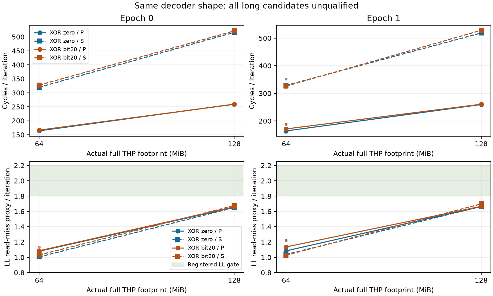

# ROB 低位有效地址编码：技术通过，长load资格不通过（2026-10-09）

## 本次任务的目的（给人类看）

按 `docs/design/2026-10-09-canonical-load-qualification.md` 有限改变bit20，补齐高位编码可能不触及有效地址值域的不足。**12进程72窗完整技术审核通过，两mask均无合格footprint，禁止N扫描；这条循环长load锚点路线收束，物理ROB继续OPEN。** 原门没有调宽，没有追门补点或跨profile/epoch池化。技术通过不等于科学资格通过。

## 交付代码与来源

分支 `codex/sm8650-tlb-hierarchy-r2`；producer `docs/cpu-uarch-deep-analysis/rob-deep-analysis/probes/rob_window_probe.c` 的binary source `1ef4baad5e9a34310b6bc53e566bd0b5b7fbfbb7`，binary SHA `cb4645f65d8352e839144541bcaefab32cad5a7ce2006d9fb219479c8384d5ba`。低位driver/summary真实producer测试/冻结文档提交c89a8cd；consumer `tools/diagnostic/analyze_encoded_load.py` 提交与本批launch `dca68b6318b7a21a96a03d8d692ebbb87dfe2ad4`。同binary复用，由当前三source SHA与source/launch Git blob一致、独立NDK重建字节相等核验，不假装重新改过探针C。

build `docs/reviews/evidence/2026-10-09-canonical-load/build.json` SHA `986e086b4e578d12a00c9be2dff6ebfb24d07c6f7e028e74b7320b97245ee3df`；plan `docs/reviews/evidence/2026-10-09-canonical-load/plan.json` SHA `8e247c720c02cad0c1168f3e4de1e65a7d73c55e6cf04aadb883428d7b0a2dc9`；driver `tools/diagnostic/run_sm8650_minimal.py` SHA `efae84d2d5535cc7e94e139db60bccb16736b0ef0d15eaf4622c3895fd158045`；protocol `docs/design/2026-10-09-canonical-load-qualification.md` SHA `8282b6585d3903c2b46664c55330bb666a8dd703c8836a71e635c32334d08533`。private raw `data/private/20261009T112550Z-rob-xor-canonical-qualify/` 原样保留，manifest SHA `230176eeb93e5e7655a8a98884e97ee569c7bc4dcc8f07c597a6ffa32d47b6a5`。完整anonymous计数、来源审核和逐文件raw SHA见 `docs/reviews/evidence/2026-10-09-canonical-load/summary.json` 与 `qualification.json`（无VA/PFN）。

环境26端点通过，max CPU [38.4, 42.3]°C；端点不证明窗内固定频率。全部initial/pre/post backing合格、full ring、actual92B代码、PMU身份/完整性与无mux通过；退休wrapper残差[238, 238]，不硬扣计数。采前fresh：122诊断、203runner、250analysis、21CTest；独立审查55 consumer/原門+25 minimal，两profile负例拒绝，旧实际资格/完整raw回执零漂移。软件数不能代替目标结构证据。

## 全部P观测与失败门

cycles为3轮中位，L2/LL为3轮均值。每轮2次load的原rate门=[1.8,2.2]，热点不作长点。

| epoch | mask | MiB | P cycles/iter | P L2 refill/iter | P LL read-miss/iter |
|---:|---|---:|---:|---:|---:|
| 0 | zero | 1 | 15.264 | 0.003001 | 0.000005 |
| 0 | bit20 | 1 | 15.701 | 0.016467 | 0.000023 |
| 0 | zero | 64 | 163.888 | 1.216204 | 1.079482 |
| 0 | bit20 | 64 | 166.582 | 1.208722 | 1.100728 |
| 0 | zero | 128 | 259.401 | 1.654139 | 1.651382 |
| 0 | bit20 | 128 | 258.737 | 1.662692 | 1.660115 |
| 1 | zero | 1 | 15.292 | 0.004044 | 0.000010 |
| 1 | bit20 | 1 | 15.591 | 0.017952 | 0.000008 |
| 1 | zero | 64 | 163.884 | 1.251129 | 1.127741 |
| 1 | bit20 | 64 | 171.165 | 1.290831 | 1.147842 |
| 1 | zero | 128 | 259.415 | 1.667210 | 1.664348 |
| 1 | bit20 | 128 | 260.592 | 1.671569 | 1.668125 |

| mask | epoch | MiB | 失败门总数 | 除L2/LL逐round rate外的失败 |
|---|---:|---:|---:|---|
| zero | 0 | 64 | 13 | P.cycle_headroom |
| zero | 0 | 128 | 12 | 无 |
| zero | 1 | 64 | 14 | P.cycle_stability, P.cycle_headroom |
| zero | 1 | 128 | 12 | 无 |
| bit20 | 0 | 64 | 13 | P.cycle_headroom |
| bit20 | 0 | 128 | 12 | 无 |
| bit20 | 1 | 64 | 15 | P.cycle_stability, paired.L2_refill_mean_difference, paired.LL_miss_mean_difference |
| bit20 | 1 | 128 | 12 | 无 |

全部8长候选仍被L2/LL rate拒绝，翻译干扰很低而远层代理不足。LL不认证DRAM；P/S接近2与长点cycles升高只证明本访问协议产生时延/并行响应，不覆盖失败门。完整三轮P/S及负值见JSON，禁止仅选中位好看的点。

`docs/reviews/evidence/2026-10-09-canonical-load/plot.py` 用公开JSON重现PNG/SVG，无拟合容量。高位历史报告 `docs/reviews/2026-10-09-encoded-load-results.md` 单列，不合并其样本。

## 裁定与研究方向

bit20在full THP长点内改变真实地址位置而保持同2MiB块；热点raw值均在自身1MiB映射外，但软件先decode。这个实验不能证明DMP不存在或已关闭预取，不同编码进程VA/PFN未匹配，zero elision等残差仍在。已完成预注册反例的收集，**循环长load策略以“不合格”收束，不再升足迹、改mask或放宽门追扫描**。

下一路线转小型single-shot冷line机制：同映射两个line、窗外仅清自有line、窗内一次对称双load，独立的冷/热和串/并对照；先验证cache维护能力、实际计时分辨率与原始事件增量，再决定有限N扫描。该路线必须另行设计/测试/冻结，不能把本批失败改名合格。PRF/RS/前端/融合与物理ROB的识别仍承接 `docs/open-items.md`，384继续只是第三方候选。
