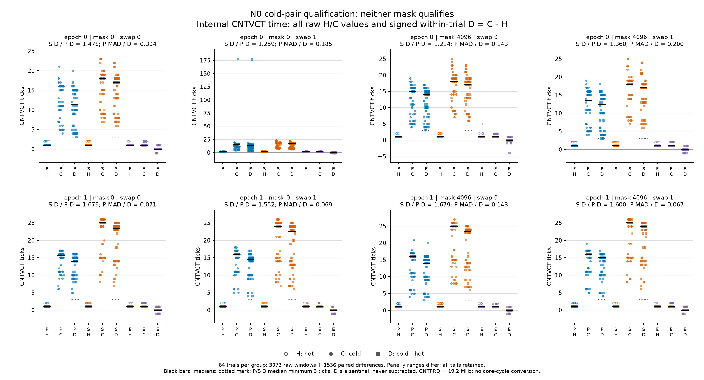
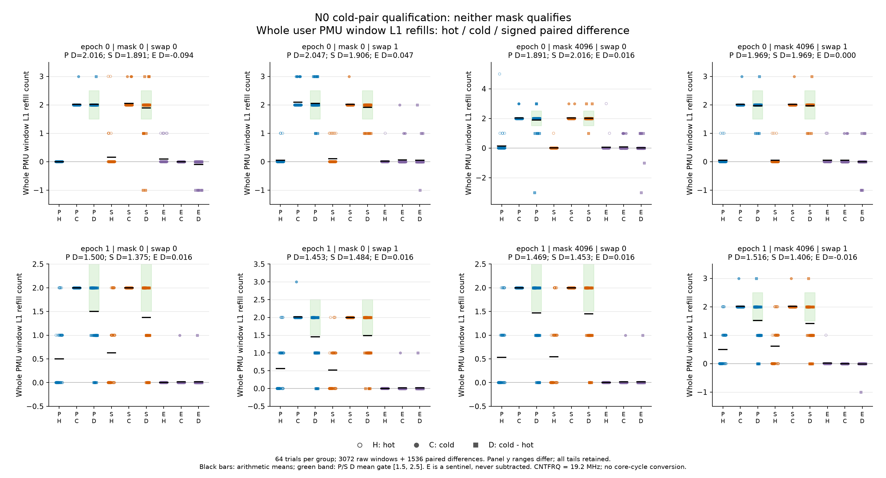
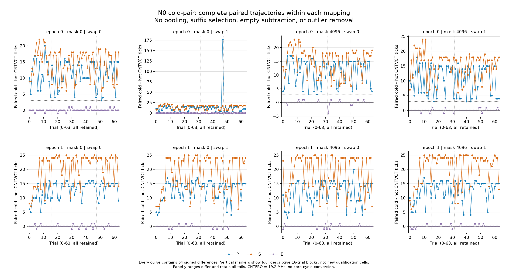

# Single-shot双冷line N0：技术通过，科学资格不通过

## 本次任务的目的（给人类看）

按 `docs/design/2026-10-09-cold-pair-qualification.md` 检查小型双line的冷热时差、串并依赖与仪器哨兵，决定其是否有资格另行注册N扫描。**完整2进程3072窗技术审核通过；两个mask各0/4候选单元合格，`qualified_masks=[]`，本路线不进入N扫描。** 保留所有负值与尾部，不改门、不跨epoch/swap/mask补格，不扣E，不认证DRAM或物理ROB。

协议与工件目录沿冻结日期2026-10-09命名；**实际采样已是Asia/Shanghai 2026-10-10**。私有目录 `data/private/20261009T160502Z-rob-cold-pair-qualify/` 的UTC建目录时刻2026-10-09 16:05:02，对应本地00:05:02；目录时间不是每窗时间戳。两进程之间没有重试或补点。

## 交付与来源绑定

分支 `codex/sm8650-tlb-hierarchy-r2`，匿名目标 `redmi-k70pro-01`，CPU7/MIDR `0x410fd821`，4KiB基页。producer `probes/diagnostic/rob_cold_pair.c` 及两个公共头文件的binary source commit为 `26d5d89d01cd1184facf1e84078afa5aa53012da`；build登记commit为 `34847bcbb021fa5016f43263097ce94a874ee9e0`。launch及消费者 `tools/diagnostic/analyze_cold_pair.py` 的提交为 `f4914ccb50b6023a2177ec1eba9eb1b6db8458b1`。source三文件在binary source与launch的Git blob SHA均匹配，实际raw中的driver匹配launch Git blob；冻结plan的精确JSON、path及SHA均与build/manifest/launch匹配。

| 组件或工件 | SHA256 |
|---|---|
| 注册/部署binary `rob_cold_pair` | `93515bd9ba5a332aaa03cef28798f9ba084f62ded5640735c5662d03bf6137d9` |
| `probes/diagnostic/rob_cold_pair.c` | `a0da3571a7825b4bf2d97d320c80277ab383dd6871fa27ddd7e6f5235f7f2f04` |
| `probes/common/perf_group_read.h` | `a57f76c6b8d4edd75aa7a5dc22b6cb18b7a7e61b3c2bd9bfff1d500333e63ea6` |
| `probes/common/rob_backing.h` | `ef1dd0f7f38dad99713322f06b3d5c70caac3e9a56ca214f687120f3fafedd29` |
| 历史launch `f4914cc` 的 `tools/diagnostic/run_sm8650_cold_pair.py`，私有raw副本 `driver.py`（不是后续新profile版本） | `c31a0dbad9c79bd6f827362e16684785f4b3cf31d44903fa0f87dfa2c797edd5` |
| `tools/diagnostic/analyze_cold_pair.py` | `44da32f8cf491c1c7388a4811b362780880ee0828e50119223baf274ecab3a09` |
| `docs/design/2026-10-09-cold-pair-qualification.md` | `330955d25185d20cf91c9a20f4c2fcbad3377ce126c309612258be642db956a3` |
| `docs/reviews/evidence/2026-10-09-cold-pair/build.json` | `2084a7ac4c0cc2af0b6cd5abee78c0b84795b451ecbcde53a5d39a59737b0bc8` |
| `docs/reviews/evidence/2026-10-09-cold-pair/plan.json` | `3dc124613b8589812fad829a2488e66fdb9728ab96507808c79e047fdcecbfe6` |
| 私有raw `manifest.json` | `2fb4b11b142016a90f84c1aaeba6f08c8245f9d4d1578266dc673a555d1ee5ef` |
| 私有raw `environment-policy.json` | `232a9c60ea302c12f1f7b886ed8b4a47c83076bbb5511f42837704ccdd79fc23` |
| launch环境配置 `configs/platforms/redmi-k70pro-01.json` | `fdcc3a288287967d66ee30fb5eb0b3c9095a373019a68599212bac16edd32658` |
| [公开summary](evidence/2026-10-09-cold-pair/summary.json) | `887fd845e8ff8611abd5ccdbc4e986f8ba9f4568c420400111235105455314ae` |
| [公开qualification](evidence/2026-10-09-cold-pair/qualification.json) | `955535a2b669ef2b9ed973921279ccff7eca1aaa05f58a5101331c632f12d82f` |

公开文件具体路径为 `docs/reviews/evidence/2026-10-09-cold-pair/{summary,qualification}.json`。summary保留全部3072个归一化原值窗口；qualification保留原始round、全部hot/cold/配对差数组、184个逐门判定和完整 `technical_acceptance`。其 `all_raw_sha256` 锚定全部25个私有文件；私有设备环境原文、binary导出文件和原始stdout不入库。公开文件不含VA/PFN或设备序列号。

## 技术完整性：通过

每epoch是一个独立8KiB对齐mapping，恰好两个4KiB页、两个不同64B line，头顺序swap0/1；mask0与4096在同一epoch/trial使用相同实际节点。mask4096的raw自指和软件解码互指均通过实际runtime检查。每进程64trial×24格，按冻结左轮转/反序，精确覆盖mask×swap×P/S/E×hot/cold，未删样本。初始和最终实际backing均为Kernel/MMU 4KiB、RSS8KiB、AnonHugePages0、Swap0、`no_huge=true`。

每进程的记录布局均为config、runtime、1536 round、backing-final，共1539记录；exit0、未timeout、stderr为空。6个事件组身份/正enabled与running相等、无mux及整数界限全部通过。全部3072窗的退休事件0x8均为**92**，全部datawalk事件0x34均为**0**。N0 JIT为29条指令；92是用户PMU整窗计数，比JIT条数多63，不硬扣、不将整窗PMUcycles替代内部时差。

两个epoch的CNTFRQ均为19,200,000Hz，即每tick约52.0833ns；此换算只说明时间分辨率，不换成核心cycles，也不命名裸load latency。cache维护/时间戳可用且完成，但不能证明DC或CNTVCT访问未被模拟，不能认证到达DRAM或所有层缓存均已清空。每窗先128次暖身、hot预读或cold维护，然后仍有group snapshot/enable ioctl，内部时间与PMU窗边界不同，见binary source `26d5d89` 的 `probes/diagnostic/rob_cold_pair.c`。

| epoch | 窗数 | driver墙钟s | 每窗PMU enabled时间范围ns | stdout SHA256 |
|---:|---:|---:|---:|---|
| 0 | 1536 | 0.119379 | 4165–25262 | `b0595c4701dbdf02fd0c403419cae8a9d848f3bd6d91ba627cba2a90a5dc547a` |
| 1 | 1536 | 0.121863 | 4217–19010 | `04f9ec3a4f446b54deda42ffe434169f2262a2e3df2d5cfe23c66f66d6fd9996` |

墙钟来自历史launch `f4914cc` 的 `tools/diagnostic/run_sm8650_cold_pair.py` 远端执行调用，包含执行与输出传输，不等同设备内部累计测量时间。两个空stderr的共同SHA为 `e3b0c44298fc1c149afbf4c8996fb92427ae41e4649b934ca495991b7852b855`。

每epoch真实host exporter导出以下6种116B代码，两epoch同种字节相等，共12份文件；全部29word逐字审核，包括常量、64B起点、DSB/ISB/CNTVCT、P/S依赖、E四NOP与SUB/RET。不是手写测量record充当producer。

| 代码key，两epoch同SHA | SHA256 |
|---|---|
| `m0-P` | `4478a17a847f8053dae32ddcf0fcda0ebecf1f28143e9f4b60393c6554d379b6` |
| `m0-S` | `7d2bf8600ebc2de1073e6c9690b02fb8dd270a524cfa4bf68de9fafe5449590f` |
| `m0-E` | `911dea971cdecc7851f64458ba370f9f4758a5c5d095c9d7efb09fd402dbe309` |
| `m4096-P` | `43132405b22237d74a530d47b0fea7c01eadb13b0f47f0a0ff19cf154a5b7737` |
| `m4096-S` | `9a9ccf3c4f370373117a13a9820e26e2c899ed8161e89fd7c97f07ffbc467adf` |
| `m4096-E` | `baa0789cd0eb5a4c535d552727b3701c67186b6141d32ef92bb0b1354777fa12` |

环境6端点均按launch profile及保存的walt governor覆盖重新计算preconditions与stability，violations/warnings均空，max CPU温度范围38.0–40.3°C。稳定字段包括governor/min/max上限；端点不能证明shot内瞬时频率固定。以下全部文件在上述私有目录下。

| 端点文件 | max CPU°C | SHA256 |
|---|---:|---|
| `initial-environment.json` | 38.0 | `a7e65442a470791d5e9af2b4ace387a1e014ab389b9c46abee12afbbfa091f94` |
| `epoch-0-pre-environment.json` | 38.8 | `9594988f6362d0b54a74bbab718d9e72a857b74416d298666ea106f7876c5b03` |
| `epoch-0-post-environment.json` | 40.3 | `edf43e6dcc98f312f4037c8f6c1c75dcf25364a65256a2e34473ddfeb7a6d7b1` |
| `epoch-1-pre-environment.json` | 38.0 | `fdf7eb5470be8d5f1fae3758d81c69afa17a87d6ebe951e30846dc9af24a8270` |
| `epoch-1-post-environment.json` | 39.2 | `72a99a2b62c6b78b913f80daa46306bd9cc8b45bb60c1ab72afed403bc097b2b` |
| `final-environment.json` | 39.2 | `512412ffbf961de1907a998cd8c386b598c19531bdfdfe840c7fac6c2670e7d3` |

## 科学资格：8个单元全部不通过

每行独立使用同trial的64项cold−hot。D为内部tick差中位；MAD未缩放，事件差是64项算术均值。串并比是 `median(S差)/median(P差)`，不是逐trial比值均值，也不是两state中位相减。每mask必须两个epoch×两个swap全过。

冻结门：P/S的D≥3，MAD/D≤0.2，S/P∈[1.5,2.5]；P/S L1/L2/LL count差均值∈[1.5,2.5]，walk绝对差均值≤0.1，IR差中位绝对值≤4；E有独立差中位/q90、refill/walk及hot/cold中位上界门。下表列出**全部失败门**，其余门通过；精确值与上下界见公开qualification。表中比值四位显示不参与判定，1.4783不能四舍五入为1.5救门。

| mask | epoch | swap | P D | S D | P MAD/D | S MAD/D | S/P | 失败门 |
|---:|---:|---:|---:|---:|---:|---:|---:|---|
| 0 | 0 | 0 | 11.5 | 17 | 0.3043 | 0.1471 | 1.4783 | `P.delta_mad_over_median`；`paired.delta_median_ratio` |
| 0 | 0 | 1 | 13.5 | 17 | 0.1852 | 0.1176 | 1.2593 | `paired.delta_median_ratio` |
| 4096 | 0 | 0 | 14 | 17 | 0.1429 | 0.1765 | 1.2143 | `paired.delta_median_ratio` |
| 4096 | 0 | 1 | 12.5 | 17 | 0.2000 | 0.0882 | 1.3600 | `paired.delta_median_ratio` |
| 0 | 1 | 0 | 14 | 23.5 | 0.0714 | 0.0213 | 1.6786 | `S.L1_count_delta_mean` |
| 0 | 1 | 1 | 14.5 | 22.5 | 0.0690 | 0.1111 | 1.5517 | `P.L1_count_delta_mean`；`S.L1_count_delta_mean` |
| 4096 | 1 | 0 | 14 | 23.5 | 0.1429 | 0.0638 | 1.6786 | `P.L1_count_delta_mean`；`S.L1_count_delta_mean` |
| 4096 | 1 | 1 | 15 | 24 | 0.0667 | 0.0417 | 1.6000 | `S.L1_count_delta_mean` |

hot P/S/E的tick中位均为1；cold P中位为12.5/15/15.5/16/15/13.5/16/16（按公开qualification的mask→epoch→swap顺序），cold S中位为18/18/25/24/18/18/25/25。E hot与cold中位均1，D中位均0，绝对D的线性q90均1，上界均3；E全部门通过。其有符号L1差均值依次为−0.09375、0.046875、0.015625、0.015625、0.015625、0、0.015625、−0.015625；L2仅mask0/e0/s0为−0.015625，其余0；LL/walk差均0。这些值未从P/S扣除。

所有P/S时差中位明显大于3tick，但epoch0四个串并比均小于1.5；epoch1的比值/稳定门通过，仍被L1冷热差门拒绝。**不合格不表示没有冷热信号，表示信号没有跨mapping满足这份操作性资格。**



图保留3072个hot/cold原值及1536个配对差，按epoch/mask/swap分别画，横向位置仅展开trial重叠，黑线是中位，纵轴各面板自适应全部原值范围。mask0/e0/s1/P trial47的hot1/cold178/D177，以及mask4096/e0/s0/E trial32的hot5/cold1/D−4均保留。E共有40个负tick差；P/S的时间差没有负值，事件差仍有负值：mask4096/e0/s0/P的L1差最低−3，mask0/e0/s0/S最低−1。不能把这些窗口裁掉或强制归零。

## L1失败来自hot整窗残差，不能写成cold少于2

下表给出全部P/S的L1整窗hot/cold均值和配对差。epoch1 cold均为2或2.015625，hot却为0.5–0.625，故差值1.375–1.515625，其中6/8个P/S门低于1.5。没有证据把整窗hot refill全部归因到两个目标load；PMU窗还包含用户wrapper。严格表述是**预热后的hot整窗仍存在L1 refill残差**，其原因未鉴定。

| mask | epoch | swap | member | hot L1均值 | cold L1均值 | cold−hot均值 |
|---:|---:|---:|---|---:|---:|---:|
| 0 | 0 | 0 | P | 0 | 2.015625 | 2.015625 |
| 0 | 0 | 0 | S | 0.15625 | 2.046875 | 1.890625 |
| 0 | 0 | 1 | P | 0.046875 | 2.09375 | 2.046875 |
| 0 | 0 | 1 | S | 0.109375 | 2.015625 | 1.90625 |
| 4096 | 0 | 0 | P | 0.140625 | 2.03125 | 1.890625 |
| 4096 | 0 | 0 | S | 0.015625 | 2.03125 | 2.015625 |
| 4096 | 0 | 1 | P | 0.046875 | 2.015625 | 1.96875 |
| 4096 | 0 | 1 | S | 0.046875 | 2.015625 | 1.96875 |
| 0 | 1 | 0 | P | 0.5 | 2 | 1.5 |
| 0 | 1 | 0 | S | 0.625 | 2 | 1.375 |
| 0 | 1 | 1 | P | 0.5625 | 2.015625 | 1.453125 |
| 0 | 1 | 1 | S | 0.515625 | 2 | 1.484375 |
| 4096 | 1 | 0 | P | 0.53125 | 2 | 1.46875 |
| 4096 | 1 | 0 | S | 0.546875 | 2 | 1.453125 |
| 4096 | 1 | 1 | P | 0.5 | 2.015625 | 1.515625 |
| 4096 | 1 | 1 | S | 0.609375 | 2.015625 | 1.40625 |

epoch1的P/S hot L2与LL均值均0，cold及差均值均2；walk全部0。epoch0的P/S L2差范围1.984375–2.109375、LL差范围2–2.015625，也均过门。这限定了反例：本批不是此前循环大足迹的高walk干扰，却仍有串并模型和hot L1残差；LL代理约2不认证DRAM。E偶发L1 refill和有符号差、全部IR92，也说明事件不能直接逐条归属于JIT两load。

所有1024个P/S cold窗的LL原值中，**1023个为2、唯一一个为3**；例外是mask0/e0/s1/P trial47，同窗cold178tick、hot1tick、D177。其cold LL=3保留进64项均值，没有用“恰好两miss”覆盖这一尾部，也没有认定其额外事件的原因。



此图同样保留每组64项原值及配对差；黑线是算术均值，绿色仅标P/S的差均值门[1.5,2.5]，不是原始hot/cold门。E独立显示、不扣除。

## 同一mapping内仍有trial变化

epoch1/mask0/swap0按连续四个16-trial块作**描述性**分解如下。块不是新资格单元，不能取稳定后缀替换冻结全64项；所有8单元的完整配对轨迹见下图。

| trial范围 | P D中位tick | S D中位tick | P hot L1均值 | S hot L1均值 | P/S cold L1均值 |
|---|---:|---:|---:|---:|---:|
| 0–15 | 10 | 14 | 0.0625 | 0 | 2 / 2 |
| 16–31 | 14 | 24 | 0.25 | 0.25 | 2 / 2 |
| 32–47 | 15 | 24 | 0.875 | 1.125 | 2 / 2 |
| 48–63 | 14.5 | 24 | 0.8125 | 1.125 | 2 / 2 |

这说明改变发生在同一epoch/mapping内，不仅是两个mapping之间的固定差异。仅用固定地址着色/固定mapping解释全部现象不足；时变访问、仪器/缓存或系统状态仍需辨别。它不支持删掉前16项、合并后48项或宣布某个稳定频率已被找到。



## 根因候选与命名边界

当前数据明确定位了**失败项**，尚未鉴定以下因果。后续模型诊断必须独立冻结，不能重评分本批。

| 候选解释 | 当前依据 | 不能据此认定的事 | 最小辨别方向 |
|---|---|---|---|
| hot预读到实际shot之间受到调用/内核边界或缓存竞争影响 | 预读后仍有snapshot read与enable ioctl；epoch1 hot L1残差明显，cold仍约2；见binary source `26d5d89` 的 `probes/diagnostic/rob_cold_pair.c` | 不能把hot整窗refill全部分配给目标line，更不能由此推物理cache索引/冲突组 | 先分清仪器整窗与目标load，并用同VA单load槽位作N0对照；若改准备/计数边界，须新协议与新数据 |
| 双load之外的计时/完成开销压低S/P，或并行/串行模型过简 | epoch0四个S/P均低；E冷热差近0仅约束空仪器冷热偏移；PS均含屏障/时间戳 | E通过不等于两cold load遵守裸延迟max/sum模型，不能事后扣E把比值救成2 | 保留同码形/槽位的A、B单load，与P/S/E逐trial比较残差；不先扫NOP |
| 访问值域、仪器/缓存或时变系统状态造成过程变化 | 两epoch各新mapping，但同一epoch内也有trial段变化；端点governor上限稳定不代表shot内频率/内存状态固定 | 不能单凭两个mapping差异归因固定地址着色；无VA/PFN匹配，不认证DMP存在/关闭、cache维护未trap或某个具体频率原因；mask4096自指也不是硬件预测器关闭证明 | 同mapping内的单槽/双槽对照优先于继续换mask、放大足迹或样本数 |
| 计时分辨率、尾部或异步干扰 | 52.0833ns/tick，空仪器约1tick，P有178tick原值尾部与较宽分布 | 不能把尾部宣布为中断，也不能靠删尾、计时单位改名或追门补样消除反例；E低偏移也不解释所有load相关开销 | 新模型先检验单load激励/稳定性及完整有符号残差；保留所有trial |

最高可命名结论是：**这个固定N0协议在目标设备产生可辨的操作性冷热与依赖响应，但两个mask均未满足预注册资格；不授权N扫描。** 没有物理ROB条目、NOP分配单位或DRAM延迟结论。未知cache维护实现、PRF/RS/前端/融合等仍由根Agent在 `docs/open-items.md` 统一追踪；本报告不改producer、旧消费者或冻结门。

## 复算、软件证据与图重现

完整raw审核CLI如下（需保留私有raw；仅输出匿名公开工件）：

```bash
PYTHONDONTWRITEBYTECODE=1 python3 tools/diagnostic/analyze_cold_pair.py \
  data/private/20261009T160502Z-rob-cold-pair-qualify \
  --summary-output docs/reviews/evidence/2026-10-09-cold-pair/summary.json \
  --output docs/reviews/evidence/2026-10-09-cold-pair/qualification.json
PYTHONDONTWRITEBYTECODE=1 python3 -m unittest tools.diagnostic.tests.test_cold_pair_analysis -v
uv run --offline --with matplotlib python docs/reviews/evidence/2026-10-09-cold-pair/plot.py
```

本轮fresh 24/24测试通过，包含真实host C config/生成码/完整3072顺序，以及类型/覆盖/负值/边界/坏SHA/技术失败无输出等软件测试；其measurement stub明确是synthetic，不冒充设备。这次3072窗是另行实际目标批次。独立从原始stdout重算配对、未缩放MAD、Type7绝对差q90、全部事件算术均值及184门，逐门与CLI一致；逐文件raw SHA和12份代码字节重新核验。所有公开JSON为有限数，数学中不可定义比值保留null而不伪造数值。

`docs/reviews/evidence/2026-10-09-cold-pair/plot.py` 只读上述公开qualification，Matplotlib3.10.0离线生成PNG/SVG。三图已实际打开核对可读性，所有轴保留尾部/负值，无拟合容量。PNG/SVG具体路径与SHA如下；排版不参与科学判定。

| 工件，均位于 `docs/reviews/evidence/2026-10-09-cold-pair/` | SHA256 |
|---|---|
| `plot.py` | `c9f8857eb5faaf15d5a2ee63ce195d438557f17df60f3c8e459f809473cc2bcf` |
| `ticks.png` | `26b2f28ca33719001e19357546de503317f4a806b524febe8f389dabd1214bca` |
| `ticks.svg` | `27c01f8b38c010db91a7de21cbb9fb239db6acd9f8b8a00a79257f782db927be` |
| `l1-refills.png` | `f1e6e7a21fb20de9beff5a94b3882ab4cfe55669988b8e58514b2cd136cb6fcb` |
| `l1-refills.svg` | `fd81b5a96687c2926108639ecbf0f258a3bac422bfef5b9823fa5822fbc19cc9` |
| `trajectory.png` | `3f53149a0ea10aa5c380b320c3768072090e03549e0b832d980dea071e35e0f6` |
| `trajectory.svg` | `3d63a67283ef62e09327307bd6172b2fc5f6efef5c359f64d6377019951a5287` |
