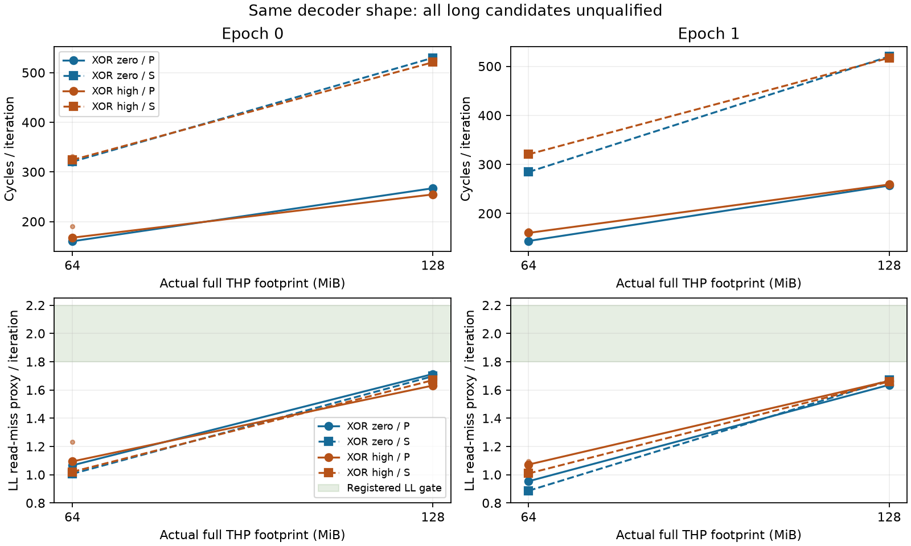

# ROB 高位编码对照：技术通过，长load资格不通过（2026-10-09）

## 本次任务的目的（给人类看）

用同样两条EOR的显式zero/high指针编码、同进程同VA的独立P与串行S，检验地址值域对长load信号的影响。按 `docs/design/2026-10-09-encoded-load-qualification.md` 唯一12进程72窗完成，完整raw技术审核通过；**两mask都没有满足原c93科学资格的footprint，禁止N扫描，物理ROB继续OPEN**。没有调门、补点或拼接旧无EOR数据。

## 谱系、审核与软件证据

分支 `codex/sm8650-tlb-hierarchy-r2`；binary source `1ef4baad5e9a34310b6bc53e566bd0b5b7fbfbb7`；启动commit `ba9068db5bab2c64d45966b6792448ab807206b9`；binary SHA256 `cb4645f65d8352e839144541bcaefab32cad5a7ce2006d9fb219479c8384d5ba`。build注册 `docs/reviews/evidence/2026-10-09-encoded-load/build.json`，SHA `0758ee542483359059501df6236a548f0749abd1f69173bf666a0f4f3430db5c`；plan `docs/reviews/evidence/2026-10-09-encoded-load/plan.json`，SHA `b690e1b6ff48c420ed05c38e977befdced84049e6a96261a8f1d165681c569e1`。driver `tools/diagnostic/run_sm8650_minimal.py` SHA `44888ee67d76ae96cdb84147e66b8c406c0ec720c201e761c2f0cb523c609f59`；protocol `docs/design/2026-10-09-encoded-load-qualification.md` SHA `cfbdcd640874abec7178b112fe14aee68de7a006fc67ff2d8d030aa701d880ba`。源码三个文件SHA与source/launch Git blob独立相等，两个NDK27.2/API34相对路径构建字节一致。

private raw `data/private/20261009T105940Z-rob-xor-qualify/` 原样保留；manifest SHA `632d8f710636823295d610493479837db46dab92e64ede1a353905ef5db7a482`。完整来源、raw逐文件SHA、72窗整数值和审核回执见 `docs/reviews/evidence/2026-10-09-encoded-load/summary.json`、`qualification.json`。这些是匿名派生观测，不含VA/PFN或raw样本。消费入口 `tools/diagnostic/analyze_encoded_load.py`（提交ba9068d）审核12条件/24member/72窗、请求→actual、事件、实际full-ring拓扑、全部92B生成码、每窗backing与IR，再每mask独立调用原数学。

26个环境端点全部通过，max CPU范围 [37.6, 42.0] °C；这不是窗内频率恒定证明。无mux/invalid；生成kernel退休量=6i+17，全部窗口实测wrapper残差238，残差未从事件硬扣。1MiB热点实际4K；64/128MiB每次initial/pre/post均full THP覆盖、Rss满、Swap0。软件证据包括真实producer16项、最小驱动24项、consumer与旧门49项，runner203/analysis250/CTest21；源码与审核另经独立审查。软件回归不充当物理结构证据。

## 全部长点观测与失败门

P为并行双链；表中cycles为3轮中位，0x17/0x37为3轮均值，分母为迭代次数。每轮两次load的原资格区间均为[1.8,2.2]。

| epoch | mask | MiB | P cycles/iter | P L2 refill/iter | P LL read-miss/iter |
|---:|---|---:|---:|---:|---:|
| 0 | zero | 64 | 160.271 | 1.223803 | 1.076176 |
| 0 | high | 64 | 167.525 | 1.263490 | 1.136580 |
| 0 | zero | 128 | 267.123 | 1.712657 | 1.710136 |
| 0 | high | 128 | 254.641 | 1.642861 | 1.640528 |
| 1 | zero | 64 | 143.888 | 1.084390 | 0.955319 |
| 1 | high | 64 | 160.378 | 1.211815 | 1.078444 |
| 1 | zero | 128 | 256.803 | 1.643208 | 1.640111 |
| 1 | high | 128 | 258.974 | 1.664168 | 1.661995 |

8个长候选全部有12个逐round的P/S L2与LL rate失败门；其余失败如下。门数包含重复的逐round检验，不能解释为独立物理证据条数。

| mask | epoch | MiB | 失败门总数 | 除rate外的失败门 |
|---|---:|---:|---:|---|
| zero | 0 | 64 | 13 | P.cycle_headroom |
| zero | 0 | 128 | 12 | 无 |
| zero | 1 | 64 | 13 | P.cycle_headroom |
| zero | 1 | 128 | 12 | 无 |
| high | 0 | 64 | 15 | P.cycle_stability, paired.LL_miss_mean_difference, P.cycle_headroom |
| high | 0 | 128 | 12 | 无 |
| high | 1 | 64 | 13 | P.cycle_headroom |
| high | 1 | 128 | 12 | 无 |

热点P中位15.615–16.791cycles/iter，热点LL所有窗满足≤.1；长点datawalk约1e-6/iter。128MiB的L2/LL代理仍低于1.8，降低翻译干扰没有补齐两次远层请求资格。P/S ratio近2只支持本协议有一定并行收益，不能覆盖miss率不合格或直接换算ROB。

重现图 `docs/reviews/evidence/2026-10-09-encoded-load/plot.py`；点是各round，线连同member中位，不拟合物理容量。完整负值与原始计数在JSON，图不挑点。

## 第一性原理解释与下一有限对照

高位编码未形成合格锚点，**不能据此断言DMP不存在或预取已经关闭**。非零mask在128MiB的P周期差在两个epoch反向；不同编码进程VA/PFN未配对，zero elision与历史/布局残差仍在。不把0x37当DRAM独占计数，也不由EOR成本/NOP数认证物理ROB。

下一有限对照 `docs/design/2026-10-09-canonical-load-qualification.md` 注册bit20 XOR，改变低位有效地址、保持THP长点同一2MiB块；同一binary、原科学门、独立新12进程72窗，不同批次不池化。这个新profile可推翻“只有高位才变化所以不触及有效地址值域”的不足；仍不认证任何硬件预取存在/关闭。hot编码raw值均在自身1MiB映射外的残差已披露，hot门不豁免。若仍无资格，结束这条循环长load策略，改用新的小型冷load机制设计，而不是放宽已见门或继续加大足迹。未竟参数与触发条件已记 `docs/open-items.md`。
