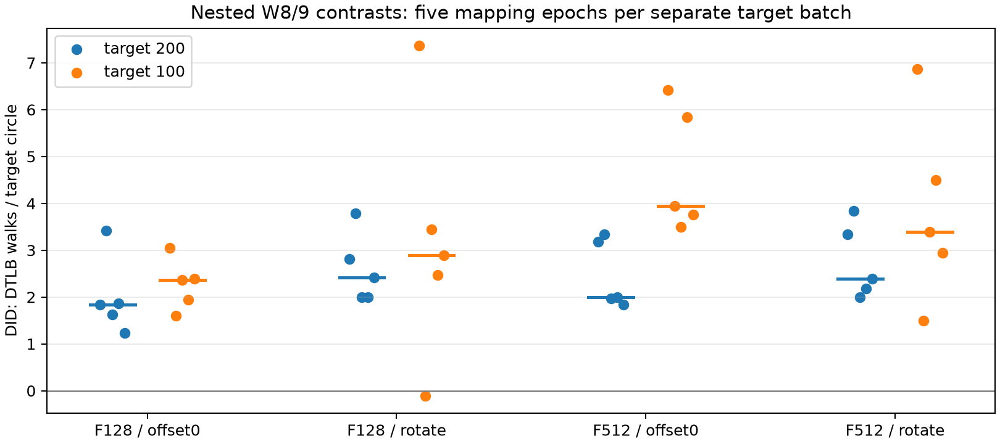
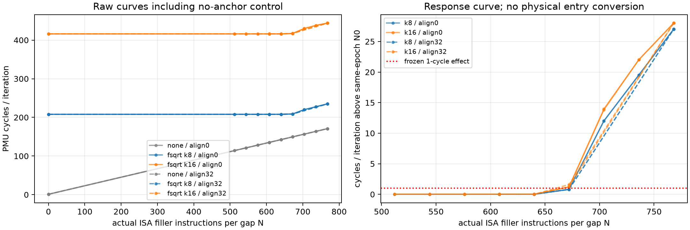
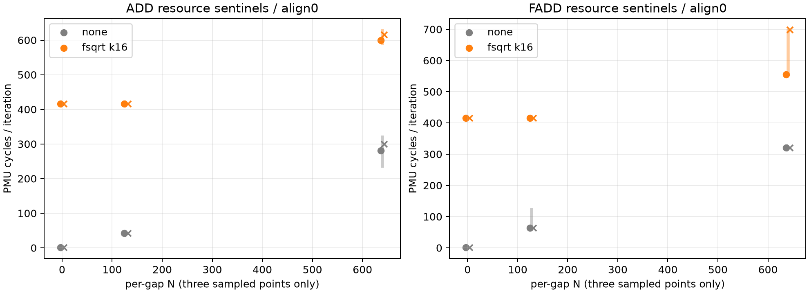

# SM8650局部确认：target100反例与ROB细网格

## 本次任务的目的（给人类看）

延续 `docs/reviews/2026-10-09-minimal-probes-results.md` 的两个最小后续：同协议确认另一TLB target；在512–768内用无锚点、链长和实际对齐对照缩小响应区间。当前Agent独占设备，TLB→ROB串行，无环境设置修改。预注册权威为 `docs/design/2026-10-09-local-confirmation.md` v1；不拼接原正式A1、旧frozen或14条旧L1记录。

## 交付代码、分支与来源

本轮所有交付在 `/Users/michaelyao/workspace/cpu-uarch-explorer-tlb-r2` / **`codex/sm8650-tlb-hierarchy-r2`**；m0b使命已结束，没有恢复开发。本轮只做本地提交，远端暂不处理。

| 代码/协议 | 路径 | commit |
|---|---|---|
| 冻结矩阵与请求/自描述/源码绑定 | `tools/diagnostic/run_sm8650_minimal.py` | `7a249e3` |
| 完整epoch/格/轮与来源审计；旧结果字节一致 | `tools/diagnostic/summarize_sm8650_minimal.py` | `7a249e3` |
| 本轮冻结协议 | `docs/design/2026-10-09-local-confirmation.md` | `7a249e3` |
| 分层配对、独立epoch、响应与删失判定 | `tools/diagnostic/analyze_local_confirmation.py` | `afe6d26` |
| 身份/覆盖/来源及判据边界22项回归 | `tools/diagnostic/tests/test_minimal_audit.py`、`test_confirmation_analysis.py` | `7a249e3` / `afe6d26` |
| 实际Android探针（本轮未改） | `probes/diagnostic/tlb_local_pair.cpp`；`docs/cpu-uarch-deep-analysis/rob-deep-analysis/probes/rob_window_probe.c` | `217e5e3` |

launch HEAD为`7a249e3`，二进制source HEAD另记`217e5e3`。沿用NDK27.2.12479018/API34静态arm64已验证产物，没有冒称本轮重新编译。TLB SHA256=`b49180240eee4885d287d06bd9e6f3dee7ef15cf7d9d2cdc745f9716f3394381`；ROB=`7d217b050ec08564e5c46160ae49dfc39ee02135adcefbce7e8f3a40e46af28d`。七份源码/依赖SHA仍与 `docs/reviews/evidence/2026-10-09-minimal-probes/build.json` 一致，部署SHA再次相等。目标匿名`redmi-k70pro-01`，CPU7/X4 r0p1/MIDR0x410fd821，base4K。

本轮先用真实旧日志复现并修了三类审计洞：请求100但geometry200、复制epoch0冒充五epoch、替换driver并只更新自摘要。另在分析层拒绝覆盖缺失、NaN、跨epoch/seed/iterations混入。旧四批完整原始数据重审，脱敏summary与已提交版本字节一致。新增22项、ROB原8项、runner203/203、analysis250/250、macOS CTest21/21通过；软件测试中的合成cycles明确不是板上证据。

## 全部尝试、数据与环境

| 私有原始目录（UTC） | 进程 | 实测窗 | 用途 |
|---|---:|---:|---|
| `data/private/20261009T002339Z-tlb-confirm100/` | 5 | 4000 | 200格，r0预排除，3800保留窗 |
| `data/private/20261009T002419Z-rob-fine/` | 114 | 342 | 两epoch×三轮；无删轮 |
| 合计 | **119** | **4342** | 全部技术通过，无失败重跑 |

stdout/driver/protocol/build/source摘要、完整条件与round覆盖、请求/realized及所有环境端点通过审计；无mux/超时/结构化failure，stderr为空。TLB 12份环境端点37.6–42.3°C；ROB 230份39.2–47.3°C。保持walt与原基线范围，未锁瞬时频率，不从端点断言窗内恒频。周期来自PMU。探针命令累计墙钟约17秒（含adb、初始化、预热与输出），逐进程环境收集占整批主要墙钟时间；不能把整批墙钟当持续CPU重负载时长。

ROB目标机实际loop mod64=0/32，FPCR=0；340轮相对于含prologue/ret的JIT预计数量多238条，另外两轮none参考多246条，保留该外围计数差异。INST_RETIRED与生成loop动态数量的最大相对偏差0.0908%（含外围调用税）。`docs/reviews/evidence/2026-10-09-local-confirmation/audit_generated.py` 独立Capstone解码本批114份真实保存生成码，config/指令数量/回跳/FP目的寄存器全部通过；完整结果 `generated-code-audit.json`。原始数据私有，不上传VA或设备序列号；脱敏逐轮表 `summary.json`，全部分层/判据 `analysis.json`，均在上述evidence目录。

## TLB：总体复现，同时获得硬容量反例

仍是同maxW9一次收集、W8为prefix，A/H1集中而C/H2分散；F及offset/seed矩阵完全相同。每格19轮均值，先在每epoch平均两个seed；五fresh-process mapping有不同VA几何，未声称PFN独立。两target分别采样、不是配对epoch。

| F / offset | target200均值（前批） | target100均值 | target100五epoch范围 |
|---|---:|---:|---:|
| 128 / 0 | 2.0000 | 2.2737 | 1.6053–3.0526 |
| 128 / rotate | 2.6053 | 3.2158 | -0.1053–7.3684 |
| 512 / 0 | 2.4684 | 4.6947 | 3.5000–6.4211 |
| 512 / rotate | 2.7526 | 3.8421 | 1.5000–6.8684 |

DID为`(A9−A8)−(C9−C8)`，单位datawalk/单圈。target100各epoch八组平均为5.9276、1.7368、3.1776、3.6908、3.0000，总均值3.5066；前批target200总均值2.4566。不能将异时两批的差值1.05仅归因于target编号。

**必须保留的反例**：target100仅38/40组双差正，范围−1.1579–7.4211。epoch1/seed42/F128/off0：A8=2.8421、A9=2.7895、C8=C9=0，DID=−0.0526；epoch1/seed137/F128/rotate：A8=8、A9=6.8421、C8=C9=0，DID=−1.1579。F128/rotate在epoch1平均两seed后仍−0.1053，不能用整体五epoch全正遮盖它。

760个保留floor窗datawalk均0；3800保留窗ITLB_WALK均0，全部4000窗`0x2d=0x34+0x35`。C/W9最高格均值0.0526，A/W8最高8 walks/圈。因此两target均出现正向总体局部响应，但跨filler、offset与映射幅值显著变化；**“8页全命中、9页才越界”解释被反例推翻**。尚不能由此命名物理ways/hash；替换历史、未建模索引与cache/页表/物理映射残差仍需区分。



## ROB：响应区间缩小，物理条目解释仍不成立

每gap N为真实ISA filler数、每迭代2N；fsqrt k每侧k条，稳定double sqrt(1.0)。每epoch三轮中位分别计算，δ=1 cycle/iteration为预注册效果量；要求两个epoch在相邻两点均越线且此前为平台。不是统计置信区间，不对none扣减后换算entries。

| NOP + fsqrt | 真实align | 冻结判据结果 |
|---|---:|---|
| k8（每迭代16条） | 0 | (672,704] |
| k8（每迭代16条） | 32 | right-edge-unconfirmed |
| k16（每迭代32条） | 0 | (640,672] |
| k16（每迭代32条） | 32 | (640,672] |

k8/align32的稀疏网格只有末点768越线，按冻结规则必须报右端未确认；不能把它当成无响应或自行补点救判据。k16/align32只有所测点支持区间，不扩大到全域对齐不变。align0在N672，k8仅增加0.806–0.808 cycle，k16增加1.205–1.206；两区间的差异与预注册1-cycle切分有关，不能直接当两个物理窗口。

**简单全重叠吞吐模型不足**：无锚点NOP在N704约156.68 cycles，比k8基线208.00更短；同N的k8实测220.01，已偏离`max(基线,无锚点)`约12.01。N768无锚点约170.90，k8/k16却分别235.02/444.02。可排除“只因无锚点供给时长超过FP基线”的简单解释；前端分配/退休、融合、PRF、FP调度及循环状态仍未区分。真实对齐0/32在多数所测点近似一致，但k16/N672/align32两epoch增量1.597/1.215，保留差异。



资源sentinel只采N0/128/640。k16在N128时ADD/FADD均接近416cycle平台；在N640时，NOP仍在416.02，而ADD/FADD已明显上升：

| N640类别 | none两epoch中位 | fsqrt k16两epoch中位 | fsqrt全部六轮范围 |
|---|---:|---:|---:|
| ADD | 281.370 / 299.581 | 599.035 / 616.408 | 585.083–630.856 |
| FADD | 320.016 / 320.017 | 555.751 / 698.255 | 555.061–699.554 |

FADD+k16六轮为555.492、699.554、555.751、699.298、698.255、555.061，波动远大于NOP；未删除、未改阈值。ADD/none N640也有231.239–324.551范围；FADD/none N640约320.02稳定。只能说类别显著改变资源响应与稳定性，不能把差异直接归PRF/RS容量。当前从NOP数除2或用整数取整凑384均无证据支持。



## 裁定、复现与持续推进

**本轮软件、数据接收及预注册局部分析通过；TLB精确ways和ROB物理条目数不通过命名门。** 新证据缩小机制空间，不伪装成两个部件已完整定案。当前用户已授权常规研究端到端持续推进，不等待上板Agent或重复人工批准。

```sh
python tools/diagnostic/summarize_sm8650_minimal.py  data/private/20261009T002339Z-tlb-confirm100  data/private/20261009T002419Z-rob-fine  --output /tmp/local-summary.json
cmp /tmp/local-summary.json docs/reviews/evidence/2026-10-09-local-confirmation/summary.json
python tools/diagnostic/analyze_local_confirmation.py  docs/reviews/evidence/2026-10-09-local-confirmation/summary.json  --previous docs/reviews/evidence/2026-10-09-minimal-probes/summary.json  --output /tmp/local-analysis.json
cmp /tmp/local-analysis.json docs/reviews/evidence/2026-10-09-local-confirmation/analysis.json
uv run --no-project --with matplotlib python  docs/reviews/evidence/2026-10-09-local-confirmation/plot.py
```

后续优先TLB固定更大max集合的预热/目标访问顺序对照，再定位W6–12局部响应；ROB优先区分NOP融合/重命名/执行资源并重新资格化long-load锚点，而非继续无限加密NOP网格。各项责任与触发写入 `docs/open-items.md`。ALU/FPU完整latency/throughput标定与正式runner/schema接入沿已登记后置，不因本轮两个fsqrt值而宣称完成。
