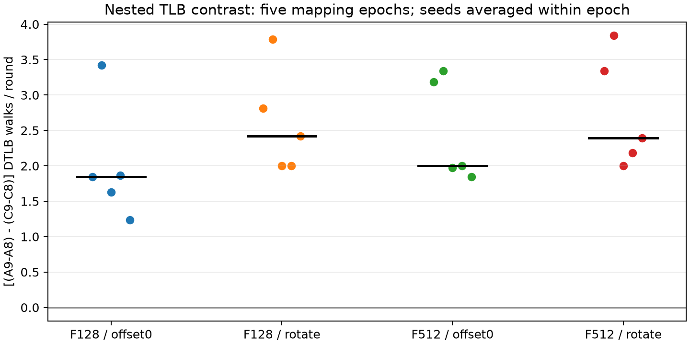
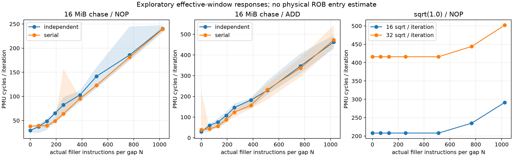

# SM8650：嵌套 TLB 对照与 ROB 最小探针实测交付

## 本次任务的目的（给人类看）

以少量可审计的探针先识别CPU部件响应：检验此前W8→9转折能否被固定地址、页内位置与filler控制推翻；修复ROB原型，再用真实指令计数、串行负控与两档FP依赖链取得第一条可信曲线。用户已授权当前Agent独占设备；原上板Agent停止。本轮端到端执行，未改变governor/min/max或热服务。

**裁定：软件修复与本轮最小实测通过；TLB局部增量方向得到加强，物理ways与ROB条目数仍未识别。** 不是原正式A1的H*验收。任务/预算依据 `docs/design/2026-10-09-minimal-tlb-rob-probes.md`；历史反例依据 `docs/reviews/2026-10-09-rob-probe-critical-reuse.md`。

## 交付代码与版本溯源

工作区 `/Users/michaelyao/workspace/cpu-uarch-explorer-tlb-r2`，全部在 **`codex/sm8650-tlb-hierarchy-r2`**；未恢复m0b开发。本轮本地提交，远端暂不处理。

| 交付代码 | 路径 | commit |
|---|---|---|
| ROB v0.2独立C mini-JIT；同VA独立/串行配对 | `docs/cpu-uarch-deep-analysis/rob-deep-analysis/probes/rob_window_probe.c` | `217e5e3` |
| C/C++ GROUP+ID纯解码与差分 | `probes/common/perf_group_read.h` | `217e5e3` |
| ROB真实生成码/输入/decoder/环图8项测试 | `docs/cpu-uarch-deep-analysis/rob-deep-analysis/probes/tests/test_rob_probe.py` | `217e5e3` |
| 固定maxW9的TLB独立配对探针与布局 | `probes/diagnostic/tlb_local_pair.cpp`、`probes/diagnostic/tlb_local_layout.h` | `217e5e3` |
| TLB签名、filler隔离、offset/VPN及W9→8→9重连检查 | `probes/diagnostic/test_tlb_local_layout.cpp` | `217e5e3` |
| 真实板测驱动；保存全输出、环境与溯源 | `tools/diagnostic/run_sm8650_minimal.py` | `217e5e3` |
| 全工件SHA/覆盖/几何/计数审计与脱敏汇总 | `tools/diagnostic/summarize_sm8650_minimal.py` | `468dad9` |
| 独立Capstone反汇编审计 | `tools/diagnostic/audit_rob_disassembly.py` | `468dad9` |
| 科学绘图及脱敏逐轮派生表 | `docs/reviews/evidence/2026-10-09-minimal-probes/plot.py`、`summary.json` | `468dad9` |

测量的源码基线为`217e5e3`，NDK **27.2.12479018 / API34 / Android arm64 / static**，`-O2 -Wall -Wextra -Werror -I probes/common`，C++另加`-std=c++17`。两探针各独立重编一次，字节完全相同；部署后设备SHA再次核对一致。完整源码commit、七份依赖源码SHA及构建flags在 `docs/reviews/evidence/2026-10-09-minimal-probes/build.json`。

| 二进制 | SHA256 |
|---|---|
| `rob_window_probe` | `7d217b050ec08564e5c46160ae49dfc39ee02135adcefbce7e8f3a40e46af28d` |
| `tlb_local_pair` | `b49180240eee4885d287d06bd9e6f3dee7ef15cf7d9d2cdc745f9716f3394381` |

目标匿名标识`redmi-k70pro-01`，CPU7 MIDR=`0x410fd821`（X4 r0p1）、4KiB基础页。PMU type8。ROB使用cycles0x11、INST_RETIRED0x08、0x03/0x17/0x34/0x02；TLB使用0x11/0x05/0x2d/0x2f/0x34/0x35。全组排除kernel/hv；失败/缺失/mux即停止，不用0填补失败。

## 全部尝试与证据等级

原始stdout、stderr、生成码、完整环境端点和manifest在`data/private/`，不入库。以下UTC目录名对应本地2026-10-09；没有删失败或挑轮。本轮设备尝试全部技术成功，旧run不移动、不拼接。

| 私有目录 | 进程 | 实测窗 | 接收用途 |
|---|---:|---:|---|
| `data/private/20261008T223118Z-rob-qualify/` | 7 | 27 | 锚点/无锚点/计数核验 |
| `data/private/20261008T223223Z-tlb-smoke/` | 1 | 800 | 实现冒烟，独立排除出主结果 |
| `data/private/20261008T223309Z-tlb/` | 5 | 4000 | 200格；每格r0预先排除，3800轮保留 |
| `data/private/20261008T223452Z-rob-window/` | 64 | 300 | 32配置×2进程，未删除异常轮 |
| 合计 | **77** | **5127** | 无invalid/mux、无超时或结构化失败 |

host8项ROB测试全部通过，包含504个模式/类别/N/对齐组合；另有TLB两target、VA签名/布局与实际链重连测试。独立Capstone解码七类实际生成循环，回跳、filler/anchor数量与FP别名检查通过，证据 `docs/reviews/evidence/2026-10-09-minimal-probes/disassembly.json`。这是静态软件证据。

目标机71个ROB进程/327窗，退休计数均为`iterations×loop_instructions+255`，支持真正执行了预期循环；相对于含prologue/ret的预期JIT指令数，最大偏差小于0.091%，固定外围用户态计数单独保留。真实loop mod64=0，FPCR=0。两种环图全覆盖已验证；同allocation重连，独立/串行逐load的VA序列相同，先后顺序逐轮交替。七类均有生成码检查，但本轮板上仅执行NOP/ADD与fsqrt相关配置，不把其它类别宣称为已标定。

既有回归：**runner203/203、analysis250/250、macOS CTest21/21**。这些不能替代上述Linux/Android实际执行证据。独立只读审查复核了实现；另一轮只读重算核对TLB原始SHA/均值/几何，ROB原始SHA/退休数/曲线均与派生表一致。

每进程前后和每批初末保存环境端点，全部policy重评通过，unfinished journal=0；各端点max-CPU传感器值范围38.0–46.1°C。TLB主批12个端点为38.1–42.8°C。瞬时频率未锁；不从端点scaling_cur_freq宣称窗内恒频。ROB周期由PMU实测，不由ns×标称频率换算。环境端点也不等于连续温度监测。

## TLB：固定地址后仍有正向局部增量

每epoch在同一mapping按maxW9一次收集H1族A与H2族C；两族各九页在自身H中集中、在另一H中分散到九set。W8严格为同一九页有序集合前八页，W不再改变collector的bucket。A/C共用同一512页filler，排除两种H下全部目标leaf-set；F128取每seed的F512排序前缀。seed仅决定filler排序及128页子集；它不是独立物理映射重复。

页内offset0与第i页`64*i`轮转共用同一mapping页并保持VPN；未逐窗核验PFN或页迁移。只改target节点位置，filler固定。每格都按“当前活跃目标链预热→F prime→snapshot→单圈W loads→snapshot”执行；链写入、backing核查和批量输出在窗外。奇数epoch反转seed/F/offset与cell顺序；5个fresh-process mapping有不同VA几何，不保证PFN独立。每格前后均核4K/AnonHugePages=0。

主对比：`DID=(A9−A8)−(C9−C8)`，单位为datawalk/window；先按每格19保留轮取均值，在每epoch内平均两个seed，再汇总5epoch。

| 条件 | 5epoch均值 | epoch中位数 | epoch范围 |
|---|---:|---:|---:|
| F128 / offset0 | 2.0000 | 1.8421 | 1.2368–3.4211 |
| F128 / rotate | 2.6053 | 2.4211 | 2.0000–3.7895 |
| F512 / offset0 | 2.4684 | 2.0000 | 1.8421–3.3421 |
| F512 / rotate | 2.7526 | 2.3947 | 2.0000–3.8421 |

40个seed分层配对DID均正，范围0.4211–6.8947；五epoch各自平均八组DID后为2.7961、3.5987、1.9013、2.0132、1.9737。不能按40个独立物理重复计算置信度。40个floor格保留轮datawalk全部0；C/W9全部格均值0。全部4000原始窗满足`0x2d=0x34+0x35`，保留轮ITLB_WALK为0；专门的I侧正控资格仍未做。



**解释**：选址随W变化，或所有target恰在相同页内offset，都不足以单独解释本批正向增量。支持此前局部响应在固定地址控制下保持。**方向稳健不等于幅值不敏感**：rotate比offset0平均增加DID约0.4447；F512相对F128也改变幅值。A/W8格均值最高2.3158，A/W9为1.5263–7，未证明“8页全命中、9页sharp miss”。

因此只报告target200的嵌套W8→9响应；不命名精确8ways、完整hash或彻底消除cache/PFN/描述符混淆。F128/512每页一条line的实际line足迹是8/32KiB，同时改变翻译和cache/页表压力。预热一圈不能证明前一W9留下的第九页历史清零。新的准备流程和共享filler也不同于旧185进程，绝对walk幅值不直接混合；原正式A1的48/48/32和frozen保持独立。

## ROB/FPU：获得可复现响应，拒绝容量过读

`-n N`为每gap实际filler数，默认每迭代2N；不做−2补偿。fsqrt参数k按每侧计，每迭代2k条；operand稳定1.0，专用v0，与FADD v4..7分开。未初始化锚点、FP别名覆盖、回跳多除4、错误GROUP布局和“首个成功事件冒充cycles”均已修复。

资格标定的k=1/8/16分别约26.001/208.003/416.005 cycles/iteration，对应当前配置下 **double fsqrt(1.0)相关链约13cycles/条**。这不是任意operand/FPCR的保证，也不是完整FPU吞吐标定。无锚点N512含1024 NOP+2控制，约114cycles，提醒必须考虑供给/退休速度与NOP融合。

粗扫每配置两进程、每进程三轮；同seed42、同loop mod64=0。三轮不是三个独立映射或随机排列。

| 每gap N | fsqrt k8（每轮16条）cycles/iteration中位数 | fsqrt k16（每轮32条）中位数 |
|---:|---:|---:|
| 0 | 208.005 | 416.010 |
| 256 | 208.009 | 416.015 |
| 512 | 208.014 | 416.022 |
| 768 | 235.015 | 444.019 |
| 1024 | 291.516 | 502.026 |

**描述性结论**：两档fsqrt+NOP均在N≤512保持平台，N768抬升，响应过渡位于每gap **(512,768]条ISA filler**。这是粗网格观察，未冻结统计onset估计器，不能给精确N*或将N/2N换算ROB entries。NOP融合/分配、供给速度、FP调度器及真实对齐变化尚未排除；384仍仅第三方候选，不能用除2或取整凑结论。



**miss路线被自身负控限制**：N=0独立双链通常快于串行，但N增加后多点串行更快。例如NOP/N128的独立/串行中位数48.639/39.384 cycles；N512为141.512/123.211。16MiB分配不保证稳定DRAM miss，不符合可直接读容量的理想D→2D模式。不能从这条曲线宣布ROB。保留`e0-miss-add-n0`首轮serial223.823cycles异常，未裁剪；图中阴影为全部轮次范围，而非置信区间。当前不归因其来源。

## 复现与后续动作

构建命令和准确参数见 `docs/cpu-uarch-deep-analysis/rob-deep-analysis/probes/README.md`、`tools/diagnostic/run_sm8650_minimal.py`、`build.json`。重新审计本轮四个完整私有目录：

```sh
python tools/diagnostic/summarize_sm8650_minimal.py \
 data/private/20261008T223118Z-rob-qualify \
 data/private/20261008T223223Z-tlb-smoke \
 data/private/20261008T223309Z-tlb \
 data/private/20261008T223452Z-rob-window \
 --output /tmp/sm8650-minimal-summary.json
cmp /tmp/sm8650-minimal-summary.json docs/reviews/evidence/2026-10-09-minimal-probes/summary.json
uv run --no-project --with matplotlib python docs/reviews/evidence/2026-10-09-minimal-probes/plot.py
```

建议顺序：

1. **TLB短确认**：同一嵌套协议复测target100，再评估是否需W7–10更宽prefix/不同目标顺序；保留方向与幅值分开报告。先完成这项最小独立确认，再决定是否替换旧正式确认设计。
2. **ROB局部细扫**：在512–768内预先固定网格，补无锚点同网格、两种真实对齐，以及ADD/FADD跨资源控制；先辨窗口/供给限制，不围绕384拟合。
3. **ALU/FPU标定**：用依赖链测latency、多个独立链测throughput，明确operand/寄存器/FPCR；复用已验证mini-JIT与PMU解码，形成独立部件结果。
4. **miss锚点资格单列**：只有hot/long/翻译与cache层级对照支持时，才用双miss交叉确认；不以增加allocation大小代替实际缺失证据。

这些尚未执行项统一登记 `docs/open-items.md` 的 OI-TLB-LOCAL-20261009、OI-ROB-PROBE-20261009。旧run、远端、m0b清理和正式A1不在本轮动作范围。收尾只读复核：active probe=0、unfinished journal=0、环境violations/warnings均空，max-CPU=39.6°C；policy7仍为walt、min672000/max2745600。未创建新的环境事务。
