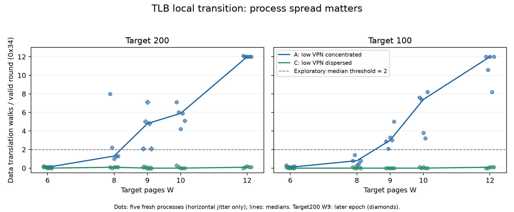

# SM8650 TLB：反证包与局部转折结果

## 本次任务的目的（给人类看）

执行用户选定的顺序：先补能推翻低VPN字段冲突解释的对照，再测局部转折。采样前设计见 `docs/runbooks/2026-10-09-sm8650-tlb-falsification.md`（初始预注册提交1556027；补点按已登记的确定性分支选择）。本次由当前Agent独占手机执行；ROB并行工作仅软件/材料审计，见 `docs/reviews/2026-10-09-rob-probe-critical-reuse.md`。

## 裁定

**反证筛选通过，当前选址协议的有效转折夹在W8与W9；精确物理ways、完整hash及正式H*均未证明。** 匹配页表footprint的B/D仍显著分离，且高refill主要对应数据walk；原解释经本包未被推翻。两target均按事前2.0 events/轮的中位响应规则得到(8,9]，但target200的W8已出现单进程8.0 walks/轮，说明不存在本批可证明的“8页全命中硬边界”。

统计口径：4KiB base页、CPU7 X4、stock walt，F512（另有F0/F128对照）、seed42、每进程r20/19有效轮、每条件5个新进程；表为**每进程窗口均值的中位数**，不扣地板，不是逐load精确归属。周期来自PMU而非频率换算；未证明窗口内锁频。证据为2026-10-09本机目标实测；对本包高低分离支持较强，对物理组织归因仍低/未识别，不给统计置信区间。

## 反证包的实际结果

单位：events/有效轮，括号为5进程最小–最大。

| 条件 | DTLB_WALK(0x34) | L2 refill(0x2d)中位 | L2 access(0x2f)中位 | 解释 |
|---|---:|---:|---:|---|
| floor K4/F512 | 0.0 (0–0.1) | 0.0 | 2.0 | 新六事件窗地板低 |
| A：H1/K4/scope0/F512 | 8.6 (5.8–10.5) | 8.6 | 14.4 | 低VPN集中，高数据walk |
| C：H2/K4/scope0/F512 | 0.1 (0–0.1) | 0.1 | 14.8 | 相近L2暴露而数据walk接近地板 |
| A/C，F0 | 0.0 / 0.0 | 0.0 / 0.0 | 0.0 / 0.0 | L1驻留过滤，不能用此否定L2冲突 |
| A/C，F128 | 6.7 / 0.1 | 6.7 / 0.1 | 12.0 / 13.9 | 较轻filler仍保持高低分离；效应幅值有变 |
| B：H1/K12/全域/F512 | 8.1 (5.1–12.0) | 8.1 | 13.9 | 12区域同低VPN |
| D：H3/K12/全域/F512 | 0.0 (0–0.1) | 0.0 | 14.5 | 同12区域、匹配leaf-table页前缀、H1下分散 |
| floor K12/F512 | 0.0 (0–0) | 0.0 | 2.1 | 多区域预约本身没有高walk地板 |
| 末尾C/A复测 | 0.0 / 9.4 | 0.0 / 9.4 | 14.9 / 14.9 | 时间方向未反转高低分组 |

A/C首尾与B/D三个配对的“正控最小−负控最大”分别5.7/7.5/5.0，满足预注册≥3继续条件；各地板/主负控最大≤0.4，满足≤0.5。正控中位数据walk/refill=1.0，满足≥80%。这是一组描述性反证筛选，不是显著性检验。

B/D由 `probes/common/tlb_set_collect.h` 与 `probes/common/tlb_set_layout.h` 的真实生产函数推演，每区域节点数相同且VA>>21相同；因此削弱“B只是12区域页表footprint”的替代解释。它没有控制PFN、所有页表中间项cache状态或完整硬件hash。F0/F128改变了L1暴露和外围扰动，不视为单纯省电优化。

## 局部转折与反序复现

| W | A / target200 | C / target200 | A / target100 | C / target100 |
|---:|---:|---:|---:|---:|
| 6 | 0.1 | 0.0 | 0.1 | 0.0 |
| 8 | 1.3 | 0.1 | 0.8 | 0.0 |
| 9 | 4.8 | 0.0 | 3.0 | 0.0 |
| 10 | 5.9 | 0.0 | 7.4 | 0.0 |
| 12 | 12.0 | 0.1 | 12.0 | 0.1 |

首轮target200粗扫8→12→6→10，观察后按预登记分支仅补9；target100按9→10→6→12→8反序复现并倒置配对顺序，W0前后夹块、末尾W12复测。target100末尾W12的A/C=10.5/0.0，两个W0中位均0.0。target200的W9在后续独立epoch采集，不能包装成同一进程固定地址曲线。

`docs/reviews/evidence/2026-10-09-tlb-falsification/local-transition.png` 展示各点全部5进程：

**不能忽略的边界样本**：target200 W8=[8.0,2.2,1.0,1.3,1.3]，target100 W8=[0.8,1.4,0.3,0.5,0.8]；W9分别[2.1,5.0,7.1,4.8,2.1]/[2.9,2.1,3.3,3.0,5.0]。中位规则虽跨在8→9，单进程分布明显重叠，**不得把它改名为精确8ways或所有样本的sharp拐点**。图中未画的W12末尾锚点仍完整保存在摘要及上述正文，不按数值择优。

## 数据完整性与环境

- 共37条件/185进程，3,515有效轮；逐样本19valid、0invalid、0mux，无failed或fallback。全部185份stdout/stderr组合SHA256、字节长度与manifest一致；重新走adapter解析后，每项metric及realized逐样本与record一致；loader/manifest闭合与请求身份检查通过。复核是当前Agent的独立后处理路径，不声称完成第二位独立评审。
- 六事件同窗、type8。全部185个输出在0.1精度下满足 `0x2d = 0x34 + 0x35`；大效应由数据walk解释。ITLB_WALK在185个进程中有3个非零（粗扫A/W10=0.1、补点target200 A/W9=0.1、末尾target100 C/W12=0.2），其它182个为0；这不是专门ITLB正控资格认证。
- 各case前后均quiet检查通过、accepted_nonbaseline为空；walt和各policy min/max保持基线，policy7 max=2745600。各段case环境端点maxCPU范围38.4–41.9 / 40.3–42.6 / 38.4–42.0°C；全段最初只读快照可更低。这些不是连续热轨迹或测量窗口频率证明。
- 三段 `run_plan` 耗时总和分别68.96/42.87/85.41秒，合计约197.24秒；准备、分析和epoch间间隔不包含。补点epoch在UTC22:00，前段在16:53/16:55，分开保存，不伪称连续采集。
- 探针未修改、未重新部署不同产物，二进制仍 `54d105930b8743e7a3a69c31d7e640cdec1044a0276a5f040efff4b1dc82398c`。所有journal终态，没有环境mutation或恢复任务。最终只读复核maxCPU36.9°C、无探针进程、unfinished=0，MIDR与二进制摘要均未变。git dirty=true如实保留（他人.gitignore及本任务文档），不能宣称旧正式clean-source合同已过。

私有原始输入/脚本/日志/raw/标准records保存在：

1. `data/private/20261008T165359Z-sm8650-tlb-controls/`：65进程；
2. `data/private/20261008T165531Z-sm8650-tlb-scan/`：40进程；
3. `data/private/20261008T220015Z-sm8650-tlb-followup/`：80进程。

匿名派生全量观测、原始摘要与分析依据在 `docs/reviews/evidence/2026-10-09-tlb-falsification/summary.json`；原始样本和设备映射不入库。复核脚本 `docs/reviews/evidence/2026-10-09-tlb-falsification/audit.py` 从私有目录重新解码；绘图脚本 `docs/reviews/evidence/2026-10-09-tlb-falsification/plot.py` 只消费公共派生摘要。

## 下一步的有限目标

1. **TLB先补转折稳健性，不扩正式大矩阵。** 以W8/9为最小焦点，固定同一最大地址集并取嵌套前缀、改变filler压力/seed或页内offset作对照。目前收集器bucket随W变化，每W又新进程/新映射；程序边界数据翻译、替换状态和cache色均未完全控制。需要的接口最小改动连同requested/realized记录一起设计，不能仅靠再加重复宣称精确ways。
2. **ROB软件线并行启动，先正确性/锚点。** 吸收mini-JIT与依赖图，先修已有R1–R3和对称协议，验证生成码/PMU身份，再用短ALU/FPU latency-throughput探针标定稳定锚点；板上测量串行。具体评审/吸收见 `docs/reviews/2026-10-09-rob-probe-critical-reuse.md`。
3. 保留原正式48/48/32、旧frozen和未完成L1的独立身份，不拼接、不回填；是否替换正式确认设计待上述机制控制结果，不增加新的流程框架。开放项已落到 `docs/open-items.md`。

本轮只改文档、派生证据和复核/绘图脚本；未改生产C++/runner/analysis语义。新执行的资格证据为真实185进程和原始数据复核；没有用旧全量测试数代替本轮实际证据。
