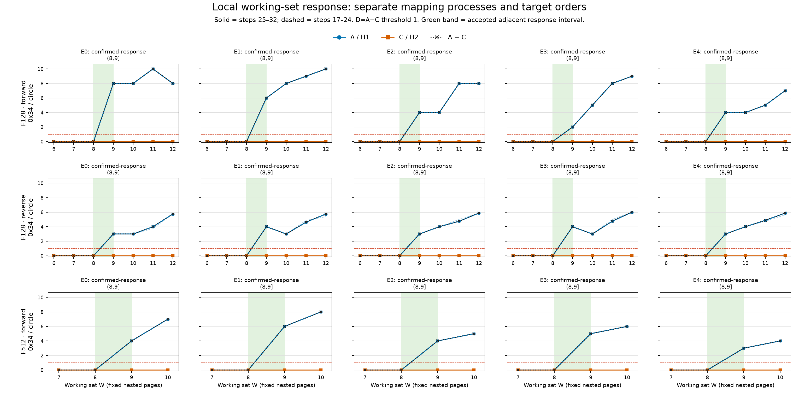
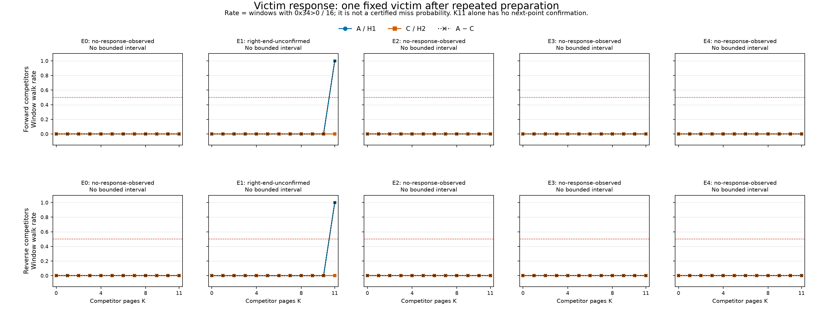

# TLB 局部工作集与 victim 竞争结果（2026-10-09）

## 本次任务的目的（给人类看）

承接 [`docs/reviews/2026-10-09-tlb-history-results.md`](2026-10-09-tlb-history-results.md)，检验固定准备过程下的整圈工作集转折，能否与单 victim 的竞争响应给出相容的局部证据。执行遵循冻结 [`docs/design/2026-10-09-tlb-local-capacity.md`](../design/2026-10-09-tlb-local-capacity.md)，与旧 target100/200、history 和正式 A1 分别汇总。

**技术审计通过；F128 局部工作集转折门通过5/5 mapping，victim 有界响应门不通过。** 两个目标访问方向在每个 mapping 都给出 `(8,9]`：W8 的末8步配对差为0，W9及W10都超过阈值。单 victim 在4个 mapping 的K0..11两种竞争顺序下均无 walk；epoch1只有K11响应，因没有下一点确认而保留为右端未确认。整圈稳态转折与准备后的单页响应是两个估计量，不能互换；本轮没有认证物理8路、纯LRU或驻留概率。

## 覆盖、接受与来源

匿名设备 `redmi-k70pro-01`；driver启动时读取CPU7 MIDR=`0x410fd821`、页长4096。探针源码设置CPU7 affinity，逐cell结束检查CPU7，五进程均成功退出；raw未逐窗记录CPU编号或重新读取MIDR。固定target100、seed137、rotate64*i、最大12页，保留本mapping旧collector9页前缀并追加3个不同other-leaf页。5组虚拟几何不同，不能据此认证PFN独立。

5进程各94 cells/2080窗，共470 cells/**10400窗**：trajectory 6080、victim 3840、floor 480。每进程2270条JSONL，188个逐cell前后backing端点；940端点均为base4K/AnonHugePages=0。全部六计数为非负整数，`enabled>0`、`running==enabled`，全部round0保留。每进程host记录调用wall为0.209–0.246秒，总和1.152秒；这不是探针内部阶段计时。

12环境端点按启动commit策略重算通过，无warning/violation；max CPU温度38.8–43.6°C。policy7端点均为walt，min/max=`672000/2745600` kHz、cur=`672000` kHz；这些端点不是每窗频率测量。本报告使用事件计数，不据端点推断窗内时钟固定。

[`tools/diagnostic/summarize_sm8650_minimal.py`](../../tools/diagnostic/summarize_sm8650_minimal.py) 从raw重跑技术审计，[`tools/diagnostic/tlb_capacity_analysis.py`](../../tools/diagnostic/tlb_capacity_analysis.py) 重算冻结门；另直接按raw六计数复算全部90个工作集点、120个victim点、三点漂移、整curve污染门、删失及异常位置，结果一致。另一个只读代理独立复核技术绑定并反汇编实际binary。接受包括生产 [`plan.json`](evidence/2026-10-09-tlb-capacity/plan.json) 的完整顺序/metadata、几何/旧前缀/filler排除、stdout/driver/protocol/build/source SHA与环境策略绑定。5份stderr为空；实际本机binary SHA与注册值相同。

| 来源锚点 | 值 |
|---|---|
| binary源码commit | `ea32ba4344e308bfa97a31f9973163d9f8209220` |
| 启动commit | `620588a57677615c5c7ce1671155bc486c7d342a` |
| binary SHA256 | `84393935b2d8ddbd3f059e1768d9a25087a1c11f74864f571b4f7b7de95143ce` |
| 原始manifest SHA256 | `0eac18c8210c8022e895f62944fd692df04d2cfa7e9393a6319b7767b5cb651a` |
| 冻结plan SHA256 | `5c7cc37ae67acdfb17aec7c93218d68fa1f157d439a22f408e3cb1b1b0b23bc2` |
| protocol SHA256 | `5cadb6a9c22857d5c57623efdaa09df39f68bae4dcd27e2edaa6b1038bbef58e` |
| 归档driver SHA256 | `662e49775be5909919fd809200668a56397967723f11a8bc7dd8f872d3437272` |

[`build.json`](evidence/2026-10-09-tlb-capacity/build.json) 保存NDK27.2/API34/flags、7项source SHA、独立字节一致重建及plan绑定。auditor同时核对binary源码和启动commit处的这些source。10400窗是相关观测，复制门的单位是5个mapping进程，不是10400个独立统计样本。

## 整圈工作集：重复的局部转折

trajectory先执行共同 `[F→history12]×8`，随后连续32步 `F→snapshot→activeW一圈→snapshot`，不额外预热target。A=H1、C=H2；主差为同epoch/F/direction的末8步（25..32）均值A−C，稳定性比较17..24与25..32。表中每格为 **W8 / W9 / W10** 的主差，单位datawalk/圈。

| mapping | F128正序 | F128逆序 | F512正序哨兵 | 同epoch双方向有界区间 |
|---|---|---|---|---|
| epoch0 | 0 / 8 / 8 | 0 / 3 / 3 | 0 / 4 / 7 | `(8,9]` |
| epoch1 | 0 / 6 / 8 | 0 / 4 / 3 | 0 / 6 / 8 | `(8,9]` |
| epoch2 | 0 / 4 / 4 | 0 / 3 / 4 | 0 / 4 / 5 | `(8,9]` |
| epoch3 | 0 / 2 / 5 | 0 / 4 / 3 | 0 / 5 / 6 | `(8,9]` |
| epoch4 | 0 / 4 / 4 | 0 / 3 / 4 | 0 / 3 / 4 | `(8,9]` |

F128十条curve的W6/7/8末8步差均为0；W9和下一点W10均≥1，前点W8<1。所需W8/9/10三点的A/C各自漂移均≤0.5；两方向先在同epoch给同一有界区间，再计5/5通过。F512五条正序哨兵也给相同区间，未替代F128主门。符号`(8,9]`仅表示本离散grid的W8低、W9首高；不是连续精度或物理容量认证。

本批全部90个工作集点的A/C绝对漂移最大0.375，实际全网格都满足≤0.5；冻结接受门仍只依赖局部三点，不能把这一批稳定性变成未来样本的默认假设。全部C末8步为0。保留三处数值下降：epoch0/F128正序W11→12为10→8，epoch1和epoch3/F128逆序W9→10为4→3。它们没有回落阈值1以下，所以不触发预注册非单调硬阻断，也不能把曲线称为严格单调。



[`working-set.svg`](evidence/2026-10-09-tlb-capacity/working-set.svg) 保留全部15条epoch/F/order curve和90个点；虚线为前8步，实线为末8步。代表整轨迹W8/W9/W12的正逆、A/C、五mapping共60条32步曲线见 [`trajectory.png`](evidence/2026-10-09-tlb-capacity/trajectory.png) / [`trajectory.svg`](evidence/2026-10-09-tlb-capacity/trajectory.svg)。其余轨迹的全部窗口仍在公开JSON。

瞬态没有被删掉：例如epoch3/F128/W8逆序A前7步为 `4,4,4,4,4,2,0`，后续均0；W9正序A前5步为 `4,1,1,2,2`，随后保持2。末段转折不能反推第一窗前有多少目标项缺失。

## 单 victim：没有重复的有界竞争响应

victim固定index0，K个竞争页固定为最大12页集合的index1..K；方向只改变相同竞争页集的顺序。每窗重新准备，随后victim训练一次，竞争页访问一次，并在训练/竞争/试探之间执行F128；最后snapshot内沿slot0只读victim一次。重复准备不是架构reset，也没有证明每个竞争访问必达某个真实L2同set。

3840个victim窗仅32个有datawalk，均为epoch1、A/K11、两order各16窗，计数均1。其余3808窗为0；C全部1920窗为0。全部K0窗口为0；每个K的A/C前后8窗率漂移均0；`count>1=0`。本批没有baseline、准备漂移或单load窗口残差阻断，因此失败来自grid响应形状，不能用“污染窗被剔除”解释。

| mapping | 正序竞争 | 逆序竞争 | 同epoch联合结论 |
|---|---|---|---|
| epoch0 | K0..11 A−C率全0 | K0..11 A−C率全0 | 无响应，界限K≤11 |
| epoch1 | K0..10率0；K11率1 | K0..10率0；K11率1 | 右端未确认，候选相邻点10/11；没有K12确认 |
| epoch2 | K0..11 A−C率全0 | K0..11 A−C率全0 | 无响应，界限K≤11 |
| epoch3 | K0..11 A−C率全0 | K0..11 A−C率全0 | 无响应，界限K≤11 |
| epoch4 | K0..11 A−C率全0 | K0..11 A−C率全0 | 无响应，界限K≤11 |

没有一条curve给有界confirmed-response，故joint成功为0/5。双order一致无响应另计4/5、右端未确认另计1/5，不能冒充有界转折复制门。`walk>0`率是全窗口响应率，不是已认证的victim缺失概率。



完整curve可缩放 [`victim.svg`](evidence/2026-10-09-tlb-capacity/victim.svg)；全部3840窗按trial/K/family/order/mapping显示于 [`victim-windows.png`](evidence/2026-10-09-tlb-capacity/victim-windows.png) / [`victim-windows.svg`](evidence/2026-10-09-tlb-capacity/victim-windows.svg)，包括ITLB活动标记。

**两个估计量不能互换。** 本批显示整圈循环在W9后可持续产生walk，而受控重新准备的victim通常在11个竞争页后仍无walk。它不支持从整圈`(8,9]`直接推出“同一真实set、8个entry、所有竞争访问均达L2、纯LRU立即驱逐victim”这一联合模型。数据没有单独否定LRU，也没有排除准备历史、真实索引/替换、L1屏蔽、descriptor/cache或snapshot背景；不能从victim无响应反过来认证容量>11。

## 非零控制与二进制窗口

floor **480窗datawalk全0**；floor仍有3个ITLB窗，各为1（下表），0x05最大2、0x2f最大7。F0目标320窗中有1个datawalk非零：epoch1 `trace-h1-w8-f0-hist12-d0` round7，六计数 `[230,5,2,7,2,0]`；其余319个为0。不能将F0控制描述为全0。全部trajectory窗均无datawalk>W。

全10400窗 `0x2d=0x34+0x35`；这是本批计数一致性，不是逐load归因证明。ITLB共 **22/10400**个非零窗，各为1；下面round从0起，全部位置保留，没有将ITLB从datawalk或主差中事后扣除。

| epoch | cell | round | 六计数（0x11,05,2d,2f,34,35） |
|---|---|---:|---|
| 0 | `trace-h1-w6-f128-hist12-d0` | 0 | `350,6,7,7,6,1` |
| 0 | `trace-h1-w10-f128-hist12-d0` | 0 | `434,10,9,11,8,1` |
| 0 | `trace-h2-w9-f128-hist12-d0` | 0 | `220,9,1,10,0,1` |
| 0 | `trace-h2-w10-f512-hist12-d0` | 0 | `247,10,1,11,0,1` |
| 0 | `victim-h1-w1-f128-hist12-d0-k7` | 0 | `138,1,1,2,0,1` |
| 1 | `victim-h2-w1-f128-hist12-d0-k6` | 11 | `201,2,1,7,0,1` |
| 1 | `trace-h2-w8-f0-hist12-d0` | 0 | `115,0,1,1,0,1` |
| 1 | `trace-h2-w8-f512-hist12-d0` | 0 | `223,8,1,9,0,1` |
| 1 | `trace-h2-w7-f512-hist12-d0` | 0 | `208,7,1,8,0,1` |
| 1 | `trace-h1-w8-f512-hist12-d0` | 0 | `391,8,7,9,6,1` |
| 1 | `trace-h2-w12-f128-hist12-d1` | 0 | `311,13,1,14,0,1` |
| 1 | `trace-h2-w12-f128-hist12-d0` | 0 | `261,13,1,14,0,1` |
| 1 | `floor-b0-f128` | 0 | `90,0,1,1,0,1` |
| 2 | `floor-b1-f512` | 12 | `490,1,1,7,0,1` |
| 3 | `floor-b1-f0` | 0 | `197,2,1,7,0,1` |
| 3 | `trace-h2-w9-f512-hist12-d0` | 0 | `226,10,1,11,0,1` |
| 3 | `trace-h2-w7-f512-hist12-d0` | 0 | `205,8,1,9,0,1` |
| 3 | `trace-h2-w12-f128-hist12-d0` | 0 | `279,13,1,14,0,1` |
| 4 | `trace-h2-w10-f512-hist12-d0` | 0 | `232,10,1,11,0,1` |
| 4 | `trace-h2-w8-f0-hist12-d0` | 0 | `116,0,1,1,0,1` |
| 4 | `victim-h1-w1-f128-hist12-d0-k6` | 0 | `125,1,1,2,0,1` |
| 4 | `victim-h2-w1-f128-hist12-d1-k4` | 0 | `137,1,1,2,0,1` |

实际NDK binary与保存的 [`binary-window-audit.txt`](evidence/2026-10-09-tlb-capacity/binary-window-audit.txt) 指令逐条核对：最后F指针循环为 `0x244dfc`，先于snapshot；snapshot调用边界 `0x244e10→0x244e34`，目标指针load为 `0x244e20`。kind2 count1/slot0只执行一次受控victim读取，目标/竞争元数据已在最后F前取得。snapshot实现仍含用户态访存及read/memcpy调用，不能称整个PMU窗口只有一条load。源段位于 [`probes/diagnostic/tlb_capacity.cpp`](../../probes/diagnostic/tlb_capacity.cpp) 的`measured_window`与 [`probes/common/perf_window.h`](../../probes/common/perf_window.h) 的snapshot包装。

## 公开证据与再生成

raw仅保留于 `data/private/20261009T090855Z-tlb-capacity/`，不入库。公开 [`summary.json`](evidence/2026-10-09-tlb-capacity/summary.json) 保存470 cells的全部10400窗、六计数及轮次；[`analysis.json`](evidence/2026-10-09-tlb-capacity/analysis.json) 保留全部轨迹、victim、floor、各epoch区间和删失/下降/漂移诊断，并以`input_sha256`绑定精确summary字节。未泄露VA或将原始目录内容转入公开区。

[`tools/diagnostic/tests/test_tlb_capacity_analysis.py`](../../tools/diagnostic/tests/test_tlb_capacity_analysis.py) 的14项回归重新通过，实际host生产`--plan`与登记plan正逆逐条一致；其中合成计数只属于软件证据。四组PNG/SVG从公开JSON在临时目录再生成，8个文件逐字节相同，并完成图面检查。

```bash
python3 -B tools/diagnostic/summarize_sm8650_minimal.py \
  data/private/20261009T090855Z-tlb-capacity \
  --output docs/reviews/evidence/2026-10-09-tlb-capacity/summary.json
python3 -B docs/reviews/evidence/2026-10-09-tlb-capacity/plot.py \
  --refresh-analysis  # requires matplotlib; recomputes analysis and four PNG/SVG pairs
```

本轮完成了固定协议下的局部工作集转折和victim竞争反证；后续实验需分别检验竞争页是否充分到达相关层级、准备分布与替换历史。命名上限仍是本访问协议的局部区间和响应，不能据此给出物理ways或认证概率。
