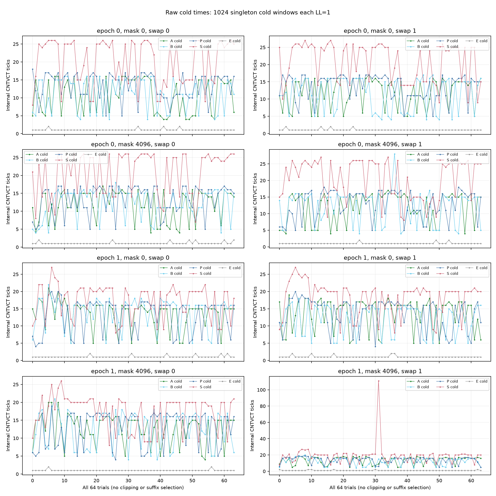
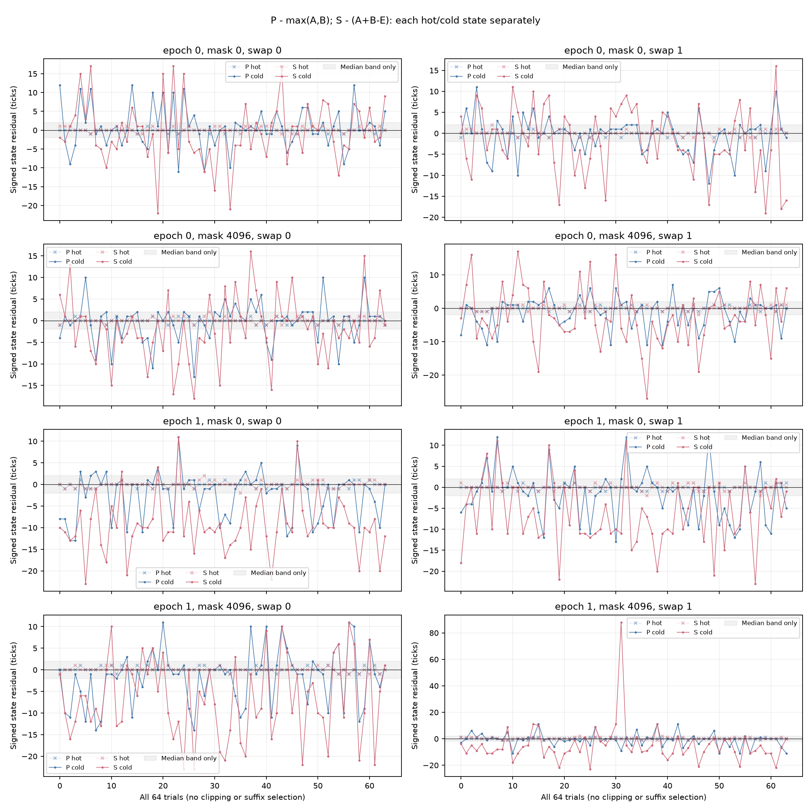

# 同 VA 单load与串并理想模型结果（2026-10-10）

## 本次任务的目的（给人类看）

补足上一批冷line资格的单独 A/B 对照，检验两个独立加载能否用 `max(A,B)`、两个依赖加载能否用 `A+B−E` 描述。冻结合同 [`docs/design/2026-10-10-cold-load-model.md`](../design/2026-10-10-cold-load-model.md) 只允许 N0；旧冷pair数据与资格不改。UTC目录日期为10月9日，实际本地采样/本报告日期为10月10日。

**技术通过；单load激励通过7/8单元，理想模型相容通过0/8。** 单load冷端的1024个窗口全部LL=1，全部5120窗datawalk=0。P冷残差中位接近零，但P/S冷残差绝对q90门16/16失败；S冷残差中位6/8超带。这支持“冷激励可观察、固定带理想模型不足”，不能把失败归于无冷load或单一硬件原因，也不授权N扫描或物理ROB命名。

## 完整覆盖、来源与独立复核

2 mapping进程，每个64 trial×40格=2560窗，共5120；每trial包含mask0/4096×swap0/1×P/S/E/A/B×hot/cold。A/B是第1/第2slot，swap后真实节点互换。全部33个raw文件、20份116B/29word代码导出、完整config/顺序/类型/六事件ID和no-mux、3项source的源码/启动Gitblob、plan/build/protocol/driver与环境绑定均通过。raw仅留 `data/private/20261009T164245Z-rob-cold-load-model/`。

6环境端点重算无warning/violation，max CPU 37.6–41.5°C。测量前确认无并发探针、unfinished journal=0；本批未修改频率、温控或用户态PMU权限。端点policy7均walt、min/max672000/2745600 kHz、cur672000 kHz，不能证明窗内频率恒定。CNTFRQ两epoch均19.2MHz，1 tick约52.083ns；内部ticks和包含用户态wrapper的PMU cycles是不同窗口，不互除推频率。每进程host调用wall为0.156/0.145秒，并非JIT内阶段时长。

| 来源 | 值 |
|---|---|
| 分支 | `codex/sm8650-tlb-hierarchy-r2` |
| binary源码commit | `a3ef370f35a06af51f25896b1a18c6b149860198` |
| 启动/consumer commit | `6f23c86df5489134f5fdb050caa39defb8b82e8e` |
| binary SHA256 | `79dde1a1351a90e8bc779d034901f105ee6313fca5562bb0ac47310adca77e73` |
| raw manifest SHA256 | `56a7936ff18346d7f1011e33def809bd199a332c8b14bc83f25364ca6db668b8` |
| 归档driver SHA256 | `a70d5fab6b55b21eb28de4a18fb4c47e00ebac18f37290eeb08b281987866e16` |
| protocol SHA256 | `fbd1b034484ac602e682b21f954e393578f51c9fd986f6f9fab3e513720831be` |
| plan SHA256 | `d4bfc2560f710cd973c9b38ff8184c3d896c2859426ce407fa4b7bf0577f8c9c` |

[`build.json`](evidence/2026-10-10-cold-load-model/build.json) 登记NDK27.2/API34与独立重编字节相同。生成器 [`probes/diagnostic/rob_cold_pair.c`](../../probes/diagnostic/rob_cold_pair.c) 的default pair输出48种导出保持旧字节；本批显式 `--singletons`。驱动 [`tools/diagnostic/run_sm8650_cold_pair.py`](../../tools/diagnostic/run_sm8650_cold_pair.py) 的profile=singletons；消费者 [`tools/diagnostic/analyze_cold_load_model.py`](../../tools/diagnostic/analyze_cold_load_model.py) 独立期待实际矩阵/码形。

根Agent从JSONL另行直接重算2048个state残差，逐值一致。另一个只读审查Agent独立重算144门、Type7分位和source/raw/环境链：120通过/24失败，与CLI完全一致；未操作设备。新23项测试的config/代码/顺序来自真实host C，测量值部分明示合成。consumer作者全量180诊断/203 runner/250 analysis/21 CTest通过；根Agent独立23/23、先178项诊断通过后补查新增两项。旧3072 raw整份summary/qualification重放字节一致。软件测试不冒称目标机证据。

## 逐单元结果

先在每trial/state计算 `R_P=T_P−max(T_A,T_B)` 与 `R_S=T_S−(T_A+T_B−T_E)`，然后才形成冷−热残差差。表中ΔA/ΔB是各自cold−hot ticks的中位；residual是cold状态中位，q90是64个绝对cold残差的线性q90。热端全部模型门通过；每state门分别判定，不能由冷热残差差小救门。

| epoch | mask | swap | ΔA / ΔB | P残差中位 / absq90 | S残差中位 / absq90 | 激励 | 模型 |
|---|---:|---:|---:|---:|---:|---|---|
| 0 | 0 | 0 | 10 / 11 | 0 / 11 | -1.5 / 15 | 不过 | 不过 |
| 0 | 0 | 1 | 13 / 13 | 0.5 / 8.4 | -3.5 / 15.4 | 过 | 不过 |
| 1 | 0 | 0 | 14 / 15 | -1 / 11 | -10 / 16.7 | 过 | 不过 |
| 1 | 0 | 1 | 15 / 13.5 | -1 / 11 | -7 / 14.4 | 过 | 不过 |
| 0 | 4096 | 0 | 13 / 13 | 1 / 9.7 | -2 / 14.4 | 过 | 不过 |
| 0 | 4096 | 1 | 14 / 13 | 0 / 9 | -4 / 15 | 过 | 不过 |
| 1 | 4096 | 0 | 13 / 15 | -1 / 11 | -8 / 20 | 过 | 不过 |
| 1 | 4096 | 1 | 15 / 13.5 | 0 / 11 | -7.5 / 17.4 | 过 | 不过 |

唯一激励失败=e0/mask0/swap0：A的MAD/Δmedian=0.5、B=3/11≈0.273，大于冻结0.2；其L2/LL差均值仍各为1。其余7单元各过既定单load tick/离散/L2/LL/walk门，L1仅披露，不临时添加新门。全部原值/差/每门详见 [`model.json`](evidence/2026-10-10-cold-load-model/model.json)。

完整2048个hot/cold state残差有738个负值、范围[-27,88]；最大raw tick111与S残差88均在e1/m4096/swap1/trial31/cold，未删尾。全部窗IR=92，是29条JIT与整个用户态wrapper的合计，未固定扣63。LL(0x37)的事件口径不能单独认证DRAM；E只用于串行时间模型的可加性假设，从未扣PMU。





两图均保留全部trial和极端值；各panel纵轴独立自动范围，不能以图高比较幅值。灰带只是±2中位分辨率带，absq90另需≤3，不是逐点接受带或统计置信区间。时间序列内也有变化：e0/m0/s0四个连续16-trial块A cold中位10.5/15/10/12.5，S为25/24/19/24.5；这里只作完整描述，不选择后缀重新判资格。

## 裁定与下一鉴别问题

本轮有限任务完成：实际冷激励大多通过，但简化串并模型被冻结分辨率带拒绝。中央P时间接近max不等于完美独立；S偏短不直接证明预取、同DRAM bank、LLCC、动态频率或DC模拟。这些cell并非同时测量，单load与双load的历史、NOP/加载资源、完成屏障与条件内存延迟也不同。

下一有区分力的问题是：保持P/S同一码形、同VA及准备历史，分别只清第一条、只清第二条或两条line，观察第二次加载在前一次加载上下文中的增量。该对照能减少A/B用NOP替换造成的码形差异，并检验“单独时间和能否当串行基线”，不会自动定位内存层级。只N0；需新协议、typed requested/realized、完整生产/消费与有限预算后执行。物理ROB/分配粒度及TLB精确ways沿 `docs/open-items.md`，不拼旧正式A1。

## 重放与工件哈希

```bash
/Users/michaelyao/workspace/cpu-uarch-explorer/.venv/bin/python tools/diagnostic/analyze_cold_load_model.py \
  data/private/20261009T164245Z-rob-cold-load-model \
  --summary-output /private/tmp/cold-load-model-summary-replay.json \
  --output /private/tmp/cold-load-model-replay.json
MPLCONFIGDIR=/private/tmp/sm8650-model-mpl uv run --offline --with matplotlib python \
  docs/reviews/evidence/2026-10-10-cold-load-model/plot.py
```

| 本轮工件 | SHA256 |
|---|---|
| `summary.json` | `77c26bc5c5e44c8a2e119005f2b414985c78373f4f9c5125dea9cb4f4d77666b` |
| `model.json` | `75a1c7361a67f0b9530846caf8bb81bbeeff1e2cec77d63b8e97315489b95d8b` |
| `plot.py` | `6f9839ee40b8903491953fe6fb3e453daf9b551b168c9428c10df540e5a520e5` |
| `raw-ticks.png` | `737d55c88bbf19dfc88f56a165f4ef1106a4835336ccdf6977841237458dfab8` |
| `raw-ticks.svg` | `b5d657168f753014d845b8f62cccd1cc0367943e3de38dcb145e7b7ebb7c8ba8` |
| `model-residuals.png` | `d93f7e06dc5ca33dbee940a561976bbbda2d63c1102d099e7148fc19e15ca06c` |
| `model-residuals.svg` | `cb3e0f3836617bc99a17b0bb9d99409f600430e0cc5042f75f066dab1be359cd` |
