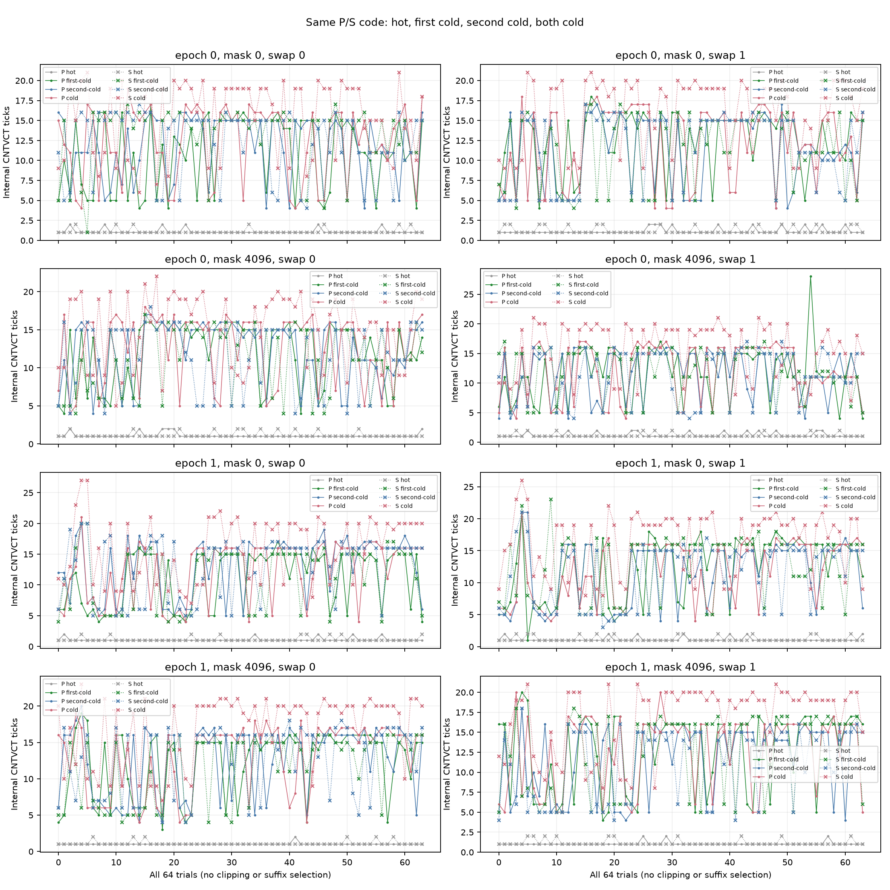
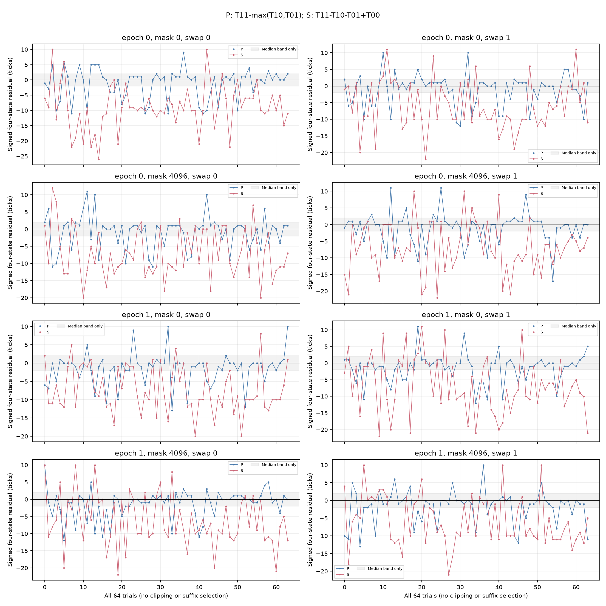

# 同码形四状态冷加载结果（2026-10-10）

## 本次任务的目的（给人类看）

保持P/S机器码与VA不变，仅控制第一/第二line冷位，检验上一批串行理想模型反例是否只是单独A/B的NOP码形所致。冻结合同 [`docs/design/2026-10-10-cold-state-injection.md`](../design/2026-10-10-cold-state-injection.md) 只允许N0；四状态为hot、first-cold、second-cold、cold，冷位对应swap后实际head。UTC目录10月9日，本地采样/报告为10月10日。

**技术通过；激励8/8通过，理想时间模型相容0/8。** 全部6144窗IR=92、datawalk=0，hot端L2/LL均值通过，单冷约一次、双冷约两次L2/LL；E哨兵全部通过。400门376通过/24失败：P残差中位8/8在带内，但绝对q90全部超带；S残差中位与绝对q90全部超带。保持代码形状后反例仍在，不能只归于A/B用NOP替换的码形差异，也不能命名单一硬件根因或物理ROB。

## 覆盖、谱系与复核

2 mapping×64 trial×48格=6144窗，12份116B/29word代码逐字节等于旧P/S/E；两个进程config、48格旋转/反转顺序、事件ID、typed count/timing、no-mux、初末4K backing、源码/launch Gitblob、binary/build/plan/protocol/driver绑定全过。25个raw文件仅在 `data/private/20261009T171035Z-rob-cold-state/`，派生公开证据逐文件SHA锚定。6环境端点重算无warning/violation，max CPU 38.0–39.9°C。root仅串行操作，无并发probe、unfinished journal=0；未改频率、温控或用户态PMU权限。

端点policy7均walt、min/max672000/2745600 kHz，端点读数不能证明窗内频率恒定。CNTFRQ两epoch均19.2MHz，1 tick≈52.083ns；PMU含用户态wrapper，IR92不是JIT29的分配粒度校准。两进程host wall 0.154/0.170秒，不是内部stage时长；LL事件不认证DRAM。

| 来源 | 值 |
|---|---|
| 分支 | `codex/sm8650-tlb-hierarchy-r2` |
| binary源码commit | `1fac9db361eb1777bd6cb9aeccdaa3db5e9b1ba7` |
| 启动/consumer commit | `f339b66e0ae48554f60dec900f8fd98509a4bf11` |
| binary SHA256 | `31f15218613516806c7820a75f367c3f26eb60d8e57c598f7f8ff25f7d911c64` |
| raw manifest SHA256 | `8edd80eb52d595ff47835b0e86f558ddd9e475477ba5e310ab60c5d502d0a1ed` |
| 归档driver SHA256 | `266bf261e57e5a389f228fc177008334fccf9303c5c1d6095dd4ac14f2430813` |
| protocol SHA256 | `61b2d9e871cdfc0896aa25734f207430b2efc9ee646acd8edf3467c2ca572fe9` |
| plan SHA256 | `be48c19ca945fde4a8200ce2001f7cdfb890556c427a6b2e5998298a44613214` |

生成器 [`probes/diagnostic/rob_cold_pair.c`](../../probes/diagnostic/rob_cold_pair.c) 显式 `--single-cold`，与 `--singletons`互斥；驱动 [`tools/diagnostic/run_sm8650_cold_pair.py`](../../tools/diagnostic/run_sm8650_cold_pair.py) profile=singlecold；独立消费者 [`tools/diagnostic/analyze_cold_state.py`](../../tools/diagnostic/analyze_cold_state.py)。[`build.json`](evidence/2026-10-10-cold-state/build.json) 登记NDK27.2/API34与两次独立构建一致。缓存准备都在计时/PMU窗外，各state同touch/barrier基线，DC数量不同，能力检查仅证明指令可执行/完成，不证明无trap。

根Agent另行从JSONL直接重算1024个有符号模型残差、全部四状态tick/PMU原值和逐trial差及SHA，逐值一致；完整source/launch/code/environment链由消费者重算。未使用新代理或并行设备操作者，独立复算指另一条计算路径，不冒称独立作者审查。真实host C config/12exports/6144顺序与冷slot测试、raw破坏反例全部通过；新测试25项（含raw9项），完整诊断205/205、runner203/203、analysis250/250、macOS CTest21/21。旧3072与5120的summary/qualification或model重放逐字节一致。软件合成测量夹具明示为合成，macOS CTest不冒称Linux VMA执行覆盖。

## 逐单元结果

先逐trial计算 `R_P=T_P11−max(T_P10,T_P01)`，`R_S=T_S11−T_S10−T_S01+T_S00`，再统计median、MAD、Type7分位。不得交换max/差/中位顺序，E不扣时间或PMU。固定带abs(median)≤2、q90(abs)≤3；这是描述分辨率门，不是统计显著性检验。

| epoch | mask | swap | P残差中位 / absq90 | S残差中位 / absq90 | 激励 | 模型 |
|---|---:|---:|---:|---:|---|---|
| 0 | 0 | 0 | 0 / 10 | -9.5 / 20.4 | 过 | 不过 |
| 0 | 0 | 1 | 0 / 10 | -7.5 / 13 | 过 | 不过 |
| 1 | 0 | 0 | -1 / 9.7 | -9 / 14.7 | 过 | 不过 |
| 1 | 0 | 1 | -1 / 8.7 | -8 / 18.7 | 过 | 不过 |
| 0 | 4096 | 0 | 0.5 / 9.7 | -9 / 14 | 过 | 不过 |
| 0 | 4096 | 1 | 0 / 10 | -7 / 16.7 | 过 | 不过 |
| 1 | 4096 | 0 | 0 / 9.7 | -8 / 14.8 | 过 | 不过 |
| 1 | 4096 | 1 | -1 / 10 | -8 / 12 | 过 | 不过 |

全部1024个残差中617负值，范围[-26,12]，最大raw tick28；没有删除负值、零tick、离群或选择后缀。各单元S四状态中位举例e0/m0/s0为[1,15,15,18]，e1/m4096/s1为[1,16,14,19]；中位的组合只是描述，正式残差均先逐trial算。完整门、原值、count差和时间序列见 [`model.json`](evidence/2026-10-10-cold-state/model.json)。





所有trial/尾部保留，各panel独立纵轴。灰带仅±2中位带，absq90另需≤3，不是逐点接受带或置信区间。

## 裁定与下一步

本轮有限问题已完成。相同P/S码形下，冷激励全部合格，但把单冷条件时间当双冷串行基线仍被反例推翻；单纯码形替换不足以解释先前不相容。条件延迟、相邻/同页偏移访问历史、时钟/DVFS、缓存维护或内存系统上下文仍混合，不单归DMP、bank或LLCC，也不把P中央接近max称完美独立。

因此不重复冷模型直到过门，不放宽旧门，不因LL≈2或384候选直接进入物理ROB命名。后续若设计有效重叠/资源窗口扫描，须另冻不同可识别问题与filler/串行/依赖对照；精确计时能力与资源分配粒度认证继续沿 `docs/open-items.md`。TLB下一有限鉴别优先观测竞争访问是否在相关翻译层造成激励，区分“无victim响应”与“竞争未充分进入”；新合同后实施，不从旧整圈walk反推ways。旧正式A1/frozen/L1前缀不拼接。

## 重放与工件SHA

```bash
/Users/michaelyao/workspace/cpu-uarch-explorer/.venv/bin/python tools/diagnostic/analyze_cold_state.py \
  data/private/20261009T171035Z-rob-cold-state \
  --summary-output /private/tmp/cold-state-summary-replay.json \
  --output /private/tmp/cold-state-model-replay.json
MPLCONFIGDIR=/private/tmp/sm8650-model-mpl uv run --offline --with matplotlib python \
  docs/reviews/evidence/2026-10-10-cold-state/plot.py
```

| 工件 | SHA256 |
|---|---|
| `summary.json` | `1565de6167a4158ae8936623c7a2d699df3c96a02b92947a35b68fa33fa8e9a8` |
| `model.json` | `426c2a5bd1b102bca9323d80a92afe18416801f5a05fdec488be598d4b77f0e2` |
| `plot.py` | `d1ad8027425e66303e9a65033215229749f46a8e1232d5d2845a71dfa2cc5275` |
| `raw-ticks.png` | `18cffc336fee0d5990bab3626c2dbf0edbc87c654b0533a7a580ee7260da623e` |
| `raw-ticks.svg` | `661218fdce20a75dc2a0a52df44e27b2cb5720a308e7a8e2fa42719400091cb6` |
| `model-residuals.png` | `dc094b0d111d43761406a1c214b462fa252d53384721089a292673900ce262cf` |
| `model-residuals.svg` | `6340fdf3fa894556294a7174448a5ea0345a1aca63e3605828236c9f1011d0d6` |
