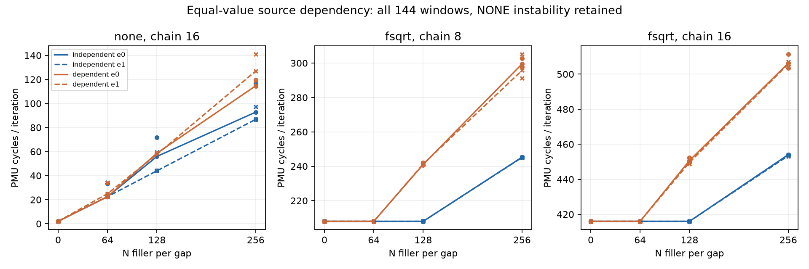
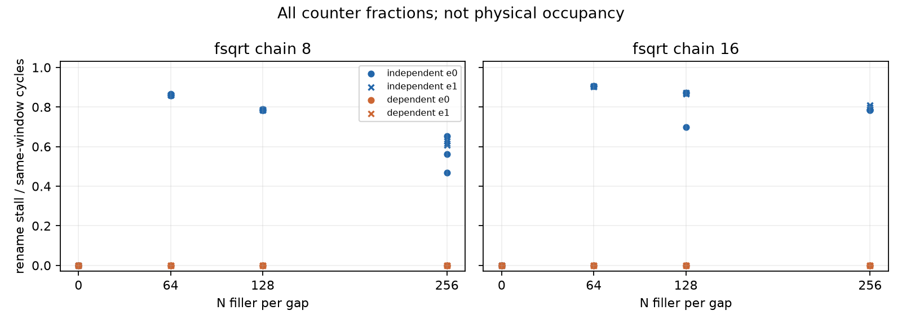

# ROB 同值锚点依赖对照结果（2026-10-11）

## 本次任务的目的（给人类看）

在 `docs/reviews/2026-10-11-rob-zero-value-results.md` 的值域反例后，改变结果就绪依赖：同ADD数量、同输出值、同FMOV桥，只有Rn域X16→X12不同，后者必须等待fsqrt结果。冻结 `docs/design/2026-10-11-rob-anchor-dependency.md` v1，两档chain与NONE负控、N0/64/128/256、双epoch反序。

**技术接受通过；科学主门不通过（not-qualified）。** 四个有符号DID均为正且>5cycles，但NONE独立流波动超10%门，不能认证正式差分归因或物理ROB/PRF/RS。完整失败与全部窗口保留，不重采直到过门。

## 有价值的事实与反例

fsqrt/N128四组匹配的依赖流约241/450cycles，独立流约208/416cycles，差约33–35cycles/iter；带锚点曲线的三窗波动很小。独立ADD的rename占比约78%/87%，依赖ADD降到接近零（N128最大同窗比例3.33e-6，仍有小背景）。因计数有窗口tap与多结构解释，不能直接称RS满或PRF项数。新增依赖可能把背压移到另一处；rename计数接近零不等于全部后端资源不受限，这是零值批之后的第二类反例。

NONE独立流N128的range/median约49.5%/35.2%，主DID所用负控不稳。因此“带锚点两组不同”可作为限定事实，冻结主差分资格仍失败，不事后删NONE、挑三窗或缩门救结论。未查明波动来源；CPU端点既有policy通过不排除DVFS/干扰/前端与执行供给残差。

| epoch | chain | DID cycles/iter（门>5） | 八组最大range/median（门≤.1） | 主门通过 |
|---:|---:|---:|---:|---|
| 0 | 8 | 30.370300 | 0.494676 | False |
| 0 | 16 | 32.016167 | 0.494676 | False |
| 1 | 8 | 19.683372 | 0.352141 | False |
| 1 | 16 | 19.968086 | 0.352141 | False |

## 来源与技术接受

工作树 `/Users/michaelyao/workspace/cpu-uarch-explorer-tlb-r2`、分支 `codex/sm8650-tlb-hierarchy-r2`；root独占串行。probe `docs/cpu-uarch-deep-analysis/rob-deep-analysis/probes/rob_window_probe.c`，consumer `tools/diagnostic/rob_dependency_analysis.py`，driver `tools/diagnostic/run_sm8650_minimal.py`。可选 `--anchor-link`，旧八类无旗标码/config不改变。

| 来源 | 值 |
|---|---|
| binary source | `310fe961e4616143e193c48d8d64bf512d59ebe8` |
| actual launch | `ab8829f9a03105fc4e53d26ade843565cc67c7b8` |
| binary SHA256 | `d2f39f4fbb4cdabe94b58a763a4c06245d9256fb4d678cd44c21eb2f533c9ea4` |
| manifest SHA256 | `e2dbce88a16b0bb3734df37f3d32ba38dfd11cd717d8ce3699d30f3380c66f46` |
| build SHA256 | `ecd6e2eab5aa53f6c627d50329c8e38d4a566989e661b6ca9852c81564383ba6` |
| plan SHA256 | `bb33d18146fa6e355011626b24cbafef9c6994adcfe724aae64fd7b3cb466be7` |
| driver SHA256 | `2878a6d94b9a1f41a6d1b7fcf48bac77709e3a773beb9552f0c11a2363a3f3d5` |
| protocol SHA256 | `da64544a2d912adbec3ce33390eda2dfb132b7a404b4081d66f32cad1fce6bcb` |

实际48进程/144窗/245 raw，所有stderr空；CPU7/FPCR0、六唯一kernel IDs/uint64/no-mux/positivecycles、IR实码相干；IR相对误差[3.3134953808e-06, 0.000453934255824]过既有1%/1000门。原始目录 `data/private/20261011T070947Z-rob-dependency`。98环境端点最高CPU温度范围39.2–43.8°C，仅walt既有policy观察，无频率/温控/THP/全局PMU写入、无环境事务；端点不证窗内恒频。

双NDK27.2/API34/O2静态构建字节一致，48实际体独立Capstone解码逐gap/bridge/ADD source/branch/RET；保存的每组N0字节相同，非零仅2N个Rn域不同且两输入都为sqrt(1)bits。直接JSONL第二算术路径逐144窗/48身份/全部pairs/16contrast/四主门/245SHA与consumer精确一致，同一root完成，不冒称第二评审人。

同目录 `summary.json`、`analysis.json`、`independent-audit.json`、`windows.csv` 保留全部匿名原始计数和有限判断，图为 `cycles.*`/`rename.*`。本批启动前diagnostic265/265，runner203/203、analysis250/250、CTest21/21在runner/native未变基线上通过；实际producer→driver→写盘→consumer正例、20类重哈希损坏反例及首坏ID停块；旁路过程审计测试RED。旧零值软件回归钉到真实launch36031d0，避免新probe/driver冒绑旧binary。

## 全有限观测与收口边界

三窗中位和range全部列出，计数原值在CSV；N为每gap数量，不是entry。

| condition | cycles/iter 中位 | range/median | rename/cycles 中位 |
|---|---:|---:|---:|
| e0-independent-none-k16-a0-n0 | 2.002213 | 0.006558 | 0.000343 |
| e0-dependent-none-k16-a0-n0 | 2.001732 | 0.005023 | 0.000366 |
| e0-independent-none-k16-a0-n64 | 22.510460 | 0.478203 | 0.000030 |
| e0-dependent-none-k16-a0-n64 | 22.506294 | 0.095956 | 0.000037 |
| e0-independent-none-k16-a0-n128 | 55.941833 | 0.494676 | 0.000017 |
| e0-dependent-none-k16-a0-n128 | 58.648094 | 0.008503 | 0.000016 |
| e0-independent-none-k16-a0-n256 | 92.793282 | 0.323150 | 0.000010 |
| e0-dependent-none-k16-a0-n256 | 114.659149 | 0.043919 | 0.000007 |
| e0-independent-fsqrt-k8-a0-n0 | 208.002655 | 0.000036 | 0.000000 |
| e0-dependent-fsqrt-k8-a0-n0 | 208.003120 | 0.000027 | 0.000000 |
| e0-independent-fsqrt-k8-a0-n64 | 208.005104 | 0.000025 | 0.859197 |
| e0-dependent-fsqrt-k8-a0-n64 | 208.005875 | 0.000020 | 0.000000 |
| e0-independent-fsqrt-k8-a0-n128 | 208.005806 | 0.000051 | 0.784293 |
| e0-dependent-fsqrt-k8-a0-n128 | 241.083313 | 0.005657 | 0.000001 |
| e0-independent-fsqrt-k8-a0-n256 | 245.274452 | 0.001290 | 0.563015 |
| e0-dependent-fsqrt-k8-a0-n256 | 299.494049 | 0.016519 | 0.000001 |
| e0-independent-fsqrt-k16-a0-n0 | 416.005615 | 0.000021 | 0.000000 |
| e0-dependent-fsqrt-k16-a0-n0 | 416.005264 | 0.000013 | 0.000000 |
| e0-independent-fsqrt-k16-a0-n64 | 416.007919 | 0.000017 | 0.905823 |
| e0-dependent-fsqrt-k16-a0-n64 | 416.008720 | 0.000021 | 0.000000 |
| e0-independent-fsqrt-k16-a0-n128 | 416.008781 | 0.000021 | 0.871250 |
| e0-dependent-fsqrt-k16-a0-n128 | 450.731339 | 0.005804 | 0.000000 |
| e0-independent-fsqrt-k16-a0-n256 | 454.062111 | 0.000862 | 0.785779 |
| e0-dependent-fsqrt-k16-a0-n256 | 506.305405 | 0.015550 | 0.000000 |
| e1-dependent-fsqrt-k16-a0-n256 | 505.832726 | 0.005622 | 0.000000 |
| e1-independent-fsqrt-k16-a0-n256 | 453.474075 | 0.001254 | 0.797400 |
| e1-dependent-fsqrt-k16-a0-n128 | 449.618546 | 0.004931 | 0.000000 |
| e1-independent-fsqrt-k16-a0-n128 | 416.009644 | 0.000021 | 0.871010 |
| e1-dependent-fsqrt-k16-a0-n64 | 416.010162 | 0.000017 | 0.000000 |
| e1-independent-fsqrt-k16-a0-n64 | 416.006767 | 0.000020 | 0.904007 |
| e1-dependent-fsqrt-k16-a0-n0 | 416.004341 | 0.000017 | 0.000000 |
| e1-independent-fsqrt-k16-a0-n0 | 416.005394 | 0.000013 | 0.000000 |
| e1-dependent-fsqrt-k8-a0-n256 | 295.739098 | 0.046529 | 0.000001 |
| e1-independent-fsqrt-k8-a0-n256 | 245.110229 | 0.001759 | 0.615857 |
| e1-dependent-fsqrt-k8-a0-n128 | 241.333565 | 0.004073 | 0.000002 |
| e1-independent-fsqrt-k8-a0-n128 | 208.009666 | 0.000025 | 0.786389 |
| e1-dependent-fsqrt-k8-a0-n64 | 208.005867 | 0.000041 | 0.000001 |
| e1-independent-fsqrt-k8-a0-n64 | 208.003159 | 0.000036 | 0.860538 |
| e1-dependent-fsqrt-k8-a0-n0 | 208.002724 | 0.000039 | 0.000000 |
| e1-independent-fsqrt-k8-a0-n0 | 208.004066 | 0.000052 | 0.000000 |
| e1-dependent-none-k16-a0-n256 | 126.968826 | 0.171512 | 0.000007 |
| e1-independent-none-k16-a0-n256 | 86.765404 | 0.121204 | 0.000008 |
| e1-dependent-none-k16-a0-n128 | 57.649239 | 0.027616 | 0.000004 |
| e1-independent-none-k16-a0-n128 | 44.007019 | 0.352141 | 0.000021 |
| e1-dependent-none-k16-a0-n64 | 25.000069 | 0.459095 | 0.000001 |
| e1-independent-none-k16-a0-n64 | 22.513138 | 0.528746 | 0.000032 |
| e1-dependent-none-k16-a0-n0 | 2.002022 | 0.003586 | 0.000396 |
| e1-independent-none-k16-a0-n0 | 2.001671 | 0.003221 | 0.000381 |

本有限依赖批已完成，主门失败是终态，不宣称目标已全部完成。停止加密同NOP或把rename比例换算PRF；下一ROB需要针对NONE供给波动和同进程配对取得有区分力的控制，不能直接重跑直到过门。物理ROB/PRF/RS/融合单位未识别，384仍第三方参考。TLB正进行地址族局部转折软件验收；随后原Q-A/Q-B/Q-D及ROB目标逐项对账。正式runner/schema/CMake、窗内clock、ALU/FPU完整operand/latency/throughput沿 `docs/open-items.md` 原归属/触发。
