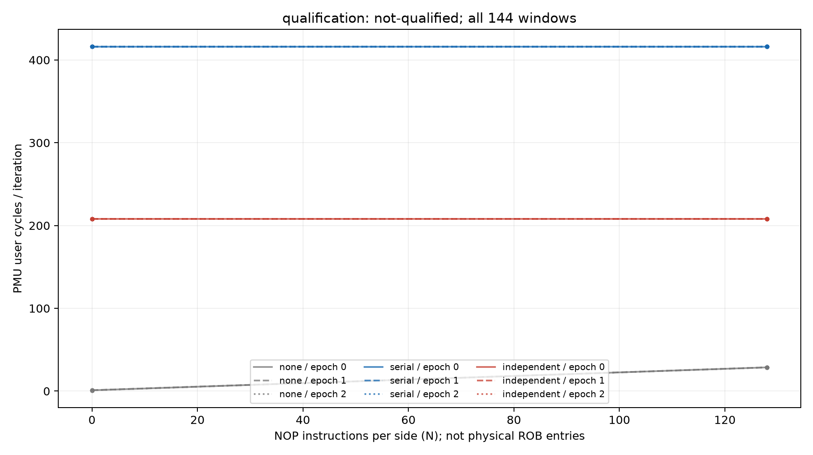

# ROB 双锚点 v1 资格结果：整体未合格（2026-10-11）

## 本次任务的目的（给人类看）

验证同值 D0/D1 独立链相对 D0/D0 串行链的重叠，且匹配真实NOP供给；协议 `docs/design/2026-10-11-rob-dual-anchor.md` v1。**技术接受144/144窗；整体not-qualified，扫描未启动。** v1判据不修改、旧窗不晋升新协议。

独立N0=208.004448–208.026451、串行N0=416.004021–416.014297 cycles/iter；最坏比=.500058751，全部anchor进程稳定，N128独立仍208.007027–208.020172。全部96个SQRT窗D0/D1结果位都为精确1.0；原两个D0锚点与新两链的行为确有不同。但整体资格还要求NONE N0相对稳定门。

NONE N128=28.669495–28.682953，三进程range/median分别.0469%/.0390%/.0311%，有真实NOP供给余量（上界/min独立N0=.137895863）。NONE N0=1.002289–1.126907，epoch1的range/median=10.297713%，超过预注册10%；其他N0进程约2.04%与1.65%。不能用图的尺度或总体中位数隐去这项失败；附 `docs/reviews/evidence/2026-10-11-rob-dual-anchor/qualification/` 全counts/每窗ns/比值/完整summary/78rawSHA和第二算术。环境38端点36.9–39.6°C，全基线，无mux/stderr/IR/bit异常。

独立checker `docs/reviews/evidence/2026-10-11-rob-dual-anchor/check_raw.py` 逐144窗/78SHA/所有门精确相同；同一root第二算术，不冒称第二评审人。summary SHA=`305662a010d9390dbffb210758bbd5b105979069dc68674ada3f0ab1be6e548e`，manifest SHA=`c041d6a4ec6e98ff2dfb63248ae1528037692d585f9af95b414042d219550065`。raw=`data/private/20261011T150218Z-rob-dual-anchor-qualification`，console=`data/private/rob-dual-qualification-console.log`。source=`0d5ac032bb6d37a930b7aef56d2b19aa24c7e750`、consumer/build=`10173531e58eed9b1516f6cced2ade22cf74c219`、actual launch=`b6c1f7b7adaa4b807de4d794c593e12c9e23d039`，binary=`7cb9bdefee5efb833565f038361777108805c22d844d7f93bd58db905f1aa99f`；branch=`codex/sm8650-tlb-hierarchy-r2`，工作树r2。

v1暴露了门设计问题：没有filler的约1cycle空循环，用相对自身10%约束，与待识别的约208cycle重叠差/约52cycle扫描响应尺度脱节；一次约.12cycle扰动远小于供给余量。下一版单独冻结N0噪声上界为独立锚点基线的1%，真实N128及全部非零N仍保留原relative稳定和绝对供给门。该修订由v1观察触发，因此必须新鲜重采，不能给本数据改名通过。新协议 `docs/design/2026-10-11-rob-dual-anchor-v2.md`，新消费/驱动分文件；旧协议/结果封存。物理ROB仍未测得，不由208/416或NOP数报384。

