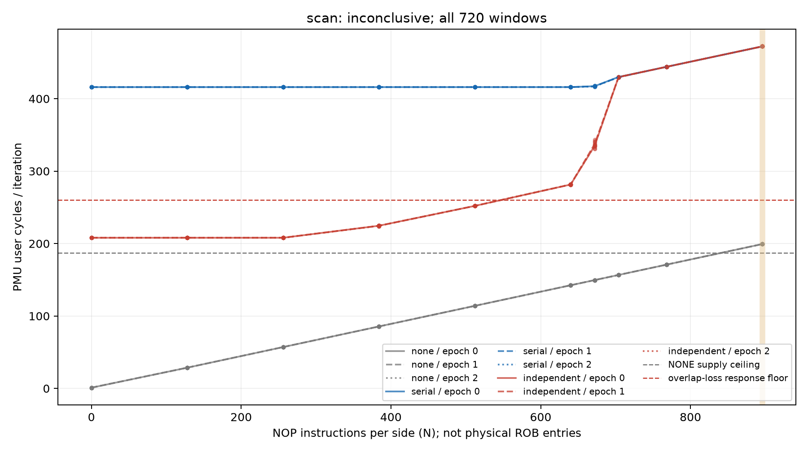

# ROB 双独立锚点与有限间隔扫描（2026-10-11）

## 本次任务的目的（给人类看）

先验证真正D0/D1独立锚点能重叠，再在真实NOP供给控制下观察重叠随间隔变化，补上旧D0/D0串行锚点不能支持的经典模型前提。协议 `docs/design/2026-10-11-rob-dual-anchor-v2.md`；新producer `probes/diagnostic/rob_dual_anchor.c`、消费 `tools/diagnostic/rob_dual_v2_analysis.py`、driver `tools/diagnostic/run_sm8650_rob_dual_v2.py`。

**技术交付通过；双独立锚点资格通过；复制的间隔响应成立；预注册单区间主裁定INCONCLUSIVE，物理ROB entries仍未测得。** 三者不能合成一个“全通过/全失败”。完整fresh资格144窗与完整scan720窗分别采集，不拼资格进scan；旧v1的144窗not-qualified封存于 `docs/reviews/2026-10-11-rob-dual-anchor-v1-results.md`。

## 核心事实与全部点

资格独立N0=208.00517–208.01517、串行416.00365–416.01680 cycles/iter，最坏比.50003208；NOP N128=28.66941–28.68127，全部稳定/低于供给上界。v2新N0各进程range/median也都≤2.13%，因此fresh数据连原相对10%门也会通过；不能把本次通过归因于改门。修订只是事前明确空循环按待测信号计噪声，v1失败不晋升。

扫描自身参考重新验证比=.50003927、N0绝对噪声/独立基线=.00053305、NONE N128上界/独立基线=.13789669，全部资格门通过；90/90进程各自8窗relative range≤10%。下表各条件3epoch×8窗的median仅便于阅读，**判据使用全部窗的上下界及各进程稳定门，不以中位数救门**。N是每侧NOP数量。

| N/侧 | NONE cycles/iter | serial D0/D0 | independent D0/D1 | 冻结操作分类 |
|---:|---:|---:|---:|---|
| 0 | 1.0149 | 416.0046 | 208.0076 | 低于10%操作门 |
| 128 | 28.6712 | 416.0051 | 208.0094 | 低于10%操作门 |
| 256 | 57.1168 | 416.0084 | 208.0123 | 低于10%操作门 |
| 384 | 85.5624 | 416.0098 | 224.6372 | 低于10%操作门 |
| 512 | 114.0075 | 416.0131 | 252.0147 | 落在10%–25%之间 |
| 640 | 142.4532 | 416.0167 | 281.5656 | ≥25%复制响应 |
| 672 | 149.5644 | 417.2016 | 335.7532 | ≥25%复制响应 |
| 704 | 156.6761 | 429.8830 | 429.8299 | ≥25%复制响应 |
| 768 | 170.8980 | 444.0140 | 444.0138 | ≥25%复制响应 |
| 896 | 199.3437 | 472.2159 | 472.2160 | 供给/串行控制未合格 |

- N≤256独立链约208；N384已出现约8%上升，即便代码标签为no-overlap-loss，也只代表低于预注册10%门，不代表真实零效应。
- N512約252（约21%上升）落在10%–25%的模糊带，N640約281.6，N672約335.8，N704約429.8并接近同N串行429.9；N768两者約444。这是一条渐进退化后接近串行的复制轨迹，不支持直接套“单一锐knee=entry容量”。N672三epoch全窗330.97–343.50完整保留。
- N896仍有真实数据，但NONE上界199.37/独立基线約.958>供给门.90，串行472.22/串行基线約1.135>门1.10，故该点不用于有效容量命名，不能删掉或改门。
- 因N512为ambiguous，冻结连续低/高区间规则不成立：status=INCONCLUSIVE、interval=None。主未识别不表示没有响应；也不通过再加几档点把渐进形状改称锐转折。

所有96个资格SQRT窗与480个scan SQRT窗D0/D1位均精确1.0。每窗IR/代码VA/完整words/六kernel IDs/等时无mux/源码和二进制/SHA通过。扫描182环境端点37.6–42.3°C，资格38端点36.9–40.3°C，全baseline，无温控/频率/THP全局写入、无环境journal。窗口clock恒定没有被这些端点证明。rename/cycle全720窗最高约.000809；µOP/IR/该事件不能校准ROB单位或排除一切替代约束。

## 谱系、工件与复现

工作树 `/Users/michaelyao/workspace/cpu-uarch-explorer-tlb-r2`，branch `codex/sm8650-tlb-hierarchy-r2`。binary source=`0d5ac032bb6d37a930b7aef56d2b19aa24c7e750`；v2consumer/build=`f685c8a3fc7b36dbf4722b0afb4c90e18b91322b`；两块actual launch=`91e0cb7818551da4deea510a79619b85d9f1909b`；二进制SHA=`7cb9bdefee5efb833565f038361777108805c22d844d7f93bd58db905f1aa99f`。两次NDK字节一致；未改source/binary的v2不冒称新构建提供额外证据。

| 工件 | qualification | scan |
|---|---|---|
| 私有raw目录 | `data/private/20261011T151649Z-rob-dual-anchor-v2-qualification` | `data/private/20261011T152059Z-rob-dual-anchor-v2-scan` |
| 全console | `data/private/rob-dual-v2-qualification-console.log` | `data/private/rob-dual-v2-scan-console.log` |
| manifest SHA | `bfc7e58109e2b41ded9930e789831dec3328db6a7ebfffcb7f963553891bd74f` | `bf8b5a7372d68f4c9beea94d50fe3cd5da4211b07f26d608895ffaadd7a74d38` |
| 全summary SHA | `ef9ea5267c2a7957e97581cf0e485e5d96f0eb115a219b7a4ce472da15bc8d6c` | `24d1abad72e6db383008f4b9121f8ba435d91f6966729b3a1ef505c6ca87f6cb` |
| 独立raw核对 | 144窗/78SHA精确相同 | 720窗/366SHA精确相同，另绑定资格manifest |

`docs/reviews/evidence/2026-10-11-rob-dual-anchor-v2/` 保存完整build/plan/30程序逐指令解码、实际结果捕获反汇编；两个phase子目录各保存全部匿名counts CSV、无裁剪summary.gz、所有事件/ns比/门/原始SHA的analysis.json、independent-audit.json和response.png/svg。`check_raw.py` 不import主分析器，第二路径逐全部原始计数/稳定门/比值/资格/命名精确一致；同一作者，不假称另一评审人。`plot.py --phase scan` 可再生全部720窗图，目视核验通过。

软件出口 `docs/reviews/2026-10-11-rob-dual-anchor-v2-preflight.md`：真实producer→driver→writer→raw（只mock外部）15/15、完整diagnostic343/343，本轮runner203/analysis250/CTest21已实跑且本批未改。不把native/mock等同目标PMU执行；现在目标执行的原始证据另列如上。

## 第一性原理裁定与下一新干预

旧“两个锚点必已独立”和“供给永远是本批解释不了的原因”不能原样沿用：真实寄存器依赖图已验证、NOP供给有同N实证。新回答是“此固定值FP recurrence的重叠存在，且间隔影响重叠，最终接近串行”。它并没有确定ROB的分配单位或活跃限制。

`docs/reviews/2026-10-11-rob-fusion-unit-audit.md` 记录官方r0p1指南§4.11的NOP+相邻任意指令fusion资格，§2.1/4.1的MOP/µOP区别；[Arm公开事件](https://raw.githubusercontent.com/ARM-software/data/master/pmu/cortex-x4.json)只定义0x3a退休µOP、0x3b投机µOP，未给ROB分配标尺。由此**推论**：N/2或operation/IR都不足以认证384。下一独立控制围绕匹配ALU值/目的集合的ADD、NOP+ADD与双NOP组、实际NONE供给、fusion资格/生命期干预；先新预注册，不复跑本NOP网格追区间。物理entries仍None，当前不同模型族的未识别边界不泛化成永不可测。

TLB已新增四域候选判别见 `docs/reviews/2026-10-11-tlb-cross-region-results.md`。整体goal账 `docs/reviews/2026-10-11-tlb-rob-goal-ledger.md` / `docs/open-items.md` 持续区分有限科学终态与物理参数未解。main/远端本轮未操作，六旧run与他人.gitignore未代提交。
