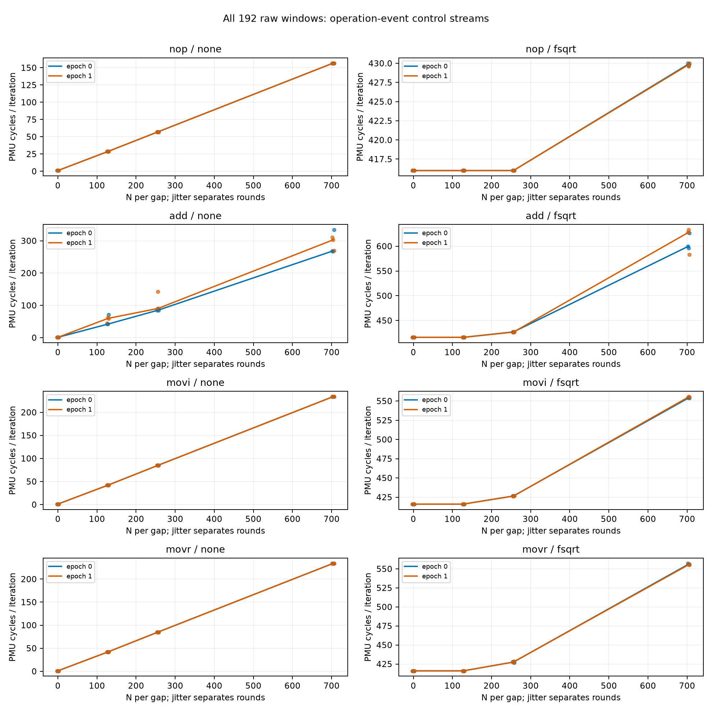
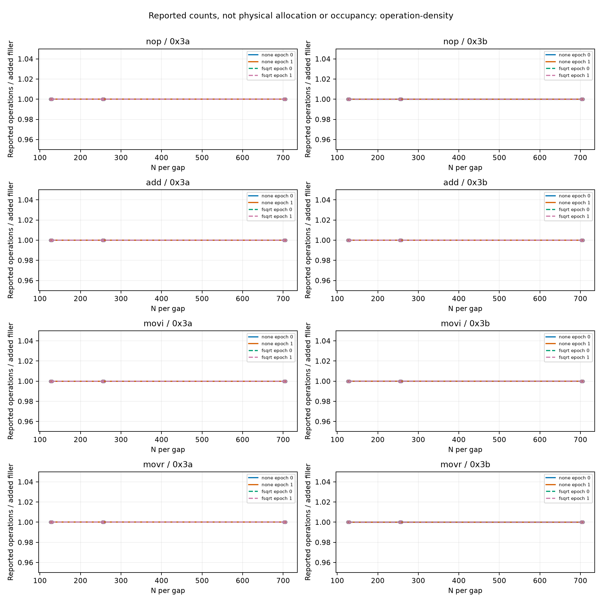
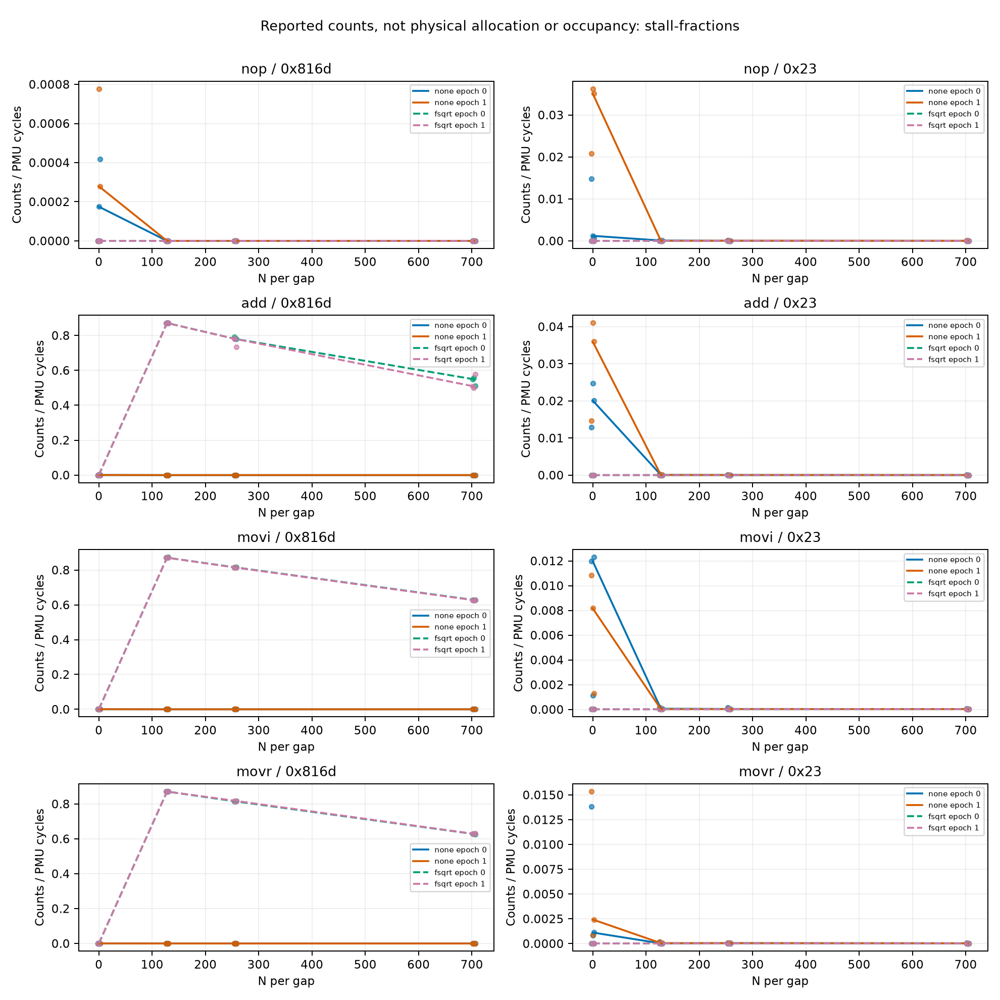

# ROB 操作与 rename 事件资格结果（2026-10-11）

## 本次任务的目的（给人类看）

为 `docs/reviews/2026-10-11-rob-resource-results.md` 的类别差异增加独立观测约束：复用不变真实生成器，资格确认操作事件并观察同窗rename/前端停顿，不把架构指令数量、操作计数或stall事件换算物理ROB。冻结 [`docs/design/2026-10-11-rob-event-qualification.md`](../design/2026-10-11-rob-event-qualification.md) v1。

**技术接受通过，操作正控20/20通过，限定为本控制流的响应资格。** rename/frontend均观察到正响应，专门语义正控未取得，不称全面认证。物理ROB、PRF、RS、融合分配单位仍OPEN。

## 主要事实与第一性原理解释

全部非零N、四类、NONE/Fsqrt、两个epoch的 ΔIR/(2N)恰为1；ΔOP_RETIRED/(2N)在0.999999970–1.000000030，ΔOP_SPEC/(2N)在0.999998838–1.000016272。NOP也约1，并没有提供融合后实际分配粒度的标尺。原始每窗IR−OP_RETIRED仅3–5 counts。该事件组与真实码形相干，但不能据此把NOP数量或操作数除二对齐384，也不能断言未发生融合。官方SOG允许NOP融合；事件tap与ROB分配/退休跟踪的关系未实测认证。

三类GPR写入流的fsqrt N128：总周期仍约416 cycles/iter，rename full中位约362 cycles/iter，比例约87.1%；N0同锚点为0。相同fsqrt的NOP在所有24窗rename计数均0，N704仍有约14 cycles/iter新增响应。NONE中这些GPR流的rename数量只有小背景。因此，rename停顿与长锚点/GPR写入组合显著关联；它可以与锚点等待重叠，不等于其一出现总时长就退化，也不是原N转折的直接计数。该差异约束“各类仅有同一个不带资源结构的instruction-count限制”解释，候选仍包括PRF、重命名跟踪/分配、退休结构及组合依赖；没有唯一物理原因。

MOVR与MOVI仍有相近计数、周期和rename形态。MOVI立即数1，MOVR源x16；官方零延迟MOV条件不能代替本输入的elimination证据。0x23在带锚点各流只有小比例，不排除有发射但供给不足、其它前端瓶颈或采样边界；它不是“全部前端都未限制”的反证。ADD NONE/长点的轮次分散仍保留，此资格门验证的是操作响应，不对它们追加事后周期稳定门或输出新onset。

## 生产、计量与来源

工作树 `/Users/michaelyao/workspace/cpu-uarch-explorer-tlb-r2`、分支 `codex/sm8650-tlb-hierarchy-r2`；root独占串行。每epoch按anchor{none,fsqrt}×N{0,128,256,704}×class{nop,add,movi,movr}交错，epoch1整个32条件逆序，共64进程/192窗。i131072、rounds3全保留、chain16、align0、CPU7/PMUtype8、FPCR0。每gap N、每iter2N filler、32 fsqrt(1)/d0；GPR写x4..11，源x16/17，不写loop/ABI保存集。未修改C码形，最大body<6KiB，不据大小认证前端充分。

代码 [`docs/cpu-uarch-deep-analysis/rob-deep-analysis/probes/rob_window_probe.c`](../cpu-uarch-deep-analysis/rob-deep-analysis/probes/rob_window_probe.c)；consumer [`tools/diagnostic/rob_event_analysis.py`](../../tools/diagnostic/rob_event_analysis.py)，driver [`tools/diagnostic/run_sm8650_minimal.py`](../../tools/diagnostic/run_sm8650_minimal.py)。新source/consumer交付commit f40a2a5；原probe source与本批启动明确分开。

| 来源 | 值 |
|---|---|
| binary source commit | `1ef4baad5e9a34310b6bc53e566bd0b5b7fbfbb7` |
| 实际launch commit | `be0d35bc350208326b0ddb73e95f7e580cfae6a2` |
| binary SHA256 | `cb4645f65d8352e839144541bcaefab32cad5a7ce2006d9fb219479c8384d5ba` |
| manifest SHA256 | `e1a5188e33a1b647e46fc88920dd18c4cee3663b26646dd87ee9b639889b1e17` |
| build SHA256 | `c8607648254923d9a55d10da870c8b0534750ffb894b263841623551c1b0d2a2` |
| plan SHA256 | `44a7246b6dfa89e7080d0e41780f2c157e31a4672a1368cf106431861cbeb5d3` |
| driver SHA256 | `0497b4ead222f2af0ffdb309308451ba92f33cd6241d180978cd8479d9eeae52` |
| protocol SHA256 | `4a55ba34e058aa89aa5e4a67a16375d3266e3dadb81e1f7da85cc0a6a0b7b0c2` |
| consumer SHA256 | `454715aad14b3c8b0aa9f9f557a34f37dae21d031dcce8a0396adba16eff38b2` |

[build.json](evidence/2026-10-11-rob-event/build.json)登记3项binary源依赖与NDK27.2/API34/O2静态flags；两次本日独立构建逐字节等于注册binary。[plan.json](evidence/2026-10-11-rob-event/plan.json)来自64次真实C导出，config/hash与独立码字逐字节一致；[code-audit.json](evidence/2026-10-11-rob-event/code-audit.json)与[decode.py](evidence/2026-10-11-rob-event/decode.py)独立解码全部64，核branch→loop64、两gap、RET及寄存器集合。固定每进程1秒间隔、全环境观察，不改governor/温控/THP/全局PMU用户权限。

事件顺序[11,08,3a,3b,816d,23]，六kernel event ID唯一、计数uint64、正周期/no-mux。64份stderr空、退出成功、3round顺序及325-file完整inventory；Git source/launch/build/plan/driver/protocol/raw SHA逐条核对。IR相对实际生成指令误差0.0000012592–0.0009078391，通过既有1%/1000门。周期为同窗0x11/i，ns/i完整保留，不用名义频率推cycles。

130环境端点无warning/violation，最高CPU 39.2–44.9°C，policy7维持walt及基线min/max；端点cur不证明窗内恒频。环境接受仅说明符合预设较宽policy，不作严格恒温/quiet或排除DVFS、线程干扰的因果证据。64次host调用wall总9.461秒，另有间隔与环境开销。未产生环境事务。

0x3a=OP_RETIRED、0x3b=OP_SPEC、0x816d=STALL_BACKEND_RENAME、0x23=STALL_FRONTEND，按[Arm官方事件表](https://raw.githubusercontent.com/ARM-software/data/master/pmu/cortex-x4.json)。知识库 `cpu-uarch-ref/arm-docs/x4trm.txt`是r0p2/Issue05，非目标r0p1真值；目标MIDR0x410fd821。执行/退休操作、rename full与物理allocation/ROB满不是同一合同。未用争议0x1b补充身份或分配命名。

| 事件 | 原始最小 | 原始最大 | 非零窗 |
|---|---|---|---|
| 0x11 | 131435 | 82960420 | 192/192 |
| 0x8 | 262399 | 189006079 | 192/192 |
| 0x3a | 262395 | 189006075 | 192/192 |
| 0x3b | 262458 | 189007453 | 192/192 |
| 0x816d | 0 | 47668927 | 121/192 |
| 0x23 | 101 | 5617 | 192/192 |

## 全部观测与限定资格

正控只为ADD/MOVI、NONE、N128；每epoch ΔOP_RETIRED与ΔOP_SPEC>128 operations/iter，三窗range/median≤10%，两epoch差额相对均值差≤10%，全部20门通过。数值与失败反例资格边界完整保留于[analysis.json](evidence/2026-10-11-rob-event/analysis.json)。该门没有认证每个硬件操作事件的通用真值、真实allocation或rename满状态。两个stall事件比例均≤1（max rename 0.874227、frontend 0.041013），未触发cycle-semantics-incompatible；非零响应仍未满足专门已知满结构正控。







对应SVG分别为[cycles.svg](evidence/2026-10-11-rob-event/cycles.svg)、[operation-density.svg](evidence/2026-10-11-rob-event/operation-density.svg)、[stall-fractions.svg](evidence/2026-10-11-rob-event/stall-fractions.svg)。操作密度图固定共同尺度.95–1.05，全原值在范围内；不把1e-8残差自动放大成类别差。N0没有新增filler、其密度未定义而非0；全部N0计数在JSON/其它图保留。以下每格epoch0/1中位；rename列为同窗计数/周期的三窗比例中位，不能当资源occupancy。

| class | anchor | N/gap | cycles/iter | OP_RETIRED/iter | rename/iter | rename/cycles |
|---|---|---|---|---|---|---|
| nop | none | 0 | 1.002960 / 1.038124 | 2.001915 / 2.001923 | 0.000175 / 0.000290 | 0.000175 / 0.000279 |
| nop | none | 128 | 28.672516 / 28.670853 | 258.001915 / 258.001915 | 0.000000 / 0.000000 | 0.000000 / 0.000000 |
| nop | none | 256 | 57.116722 / 57.117310 | 514.001907 / 514.001907 | 0.000000 / 0.000000 | 0.000000 / 0.000000 |
| nop | none | 704 | 156.681160 / 156.675980 | 1410.001907 / 1410.001907 | 0.000000 / 0.000000 | 0.000000 / 0.000000 |
| nop | fsqrt | 0 | 416.005165 / 416.004570 | 34.001907 / 34.001907 | 0.000000 / 0.000000 | 0.000000 / 0.000000 |
| nop | fsqrt | 128 | 416.005302 / 416.004593 | 290.001907 / 290.001907 | 0.000000 / 0.000000 | 0.000000 / 0.000000 |
| nop | fsqrt | 256 | 416.007782 / 416.009224 | 546.001907 / 546.001907 | 0.000000 / 0.000000 | 0.000000 / 0.000000 |
| nop | fsqrt | 704 | 429.909393 / 429.826630 | 1442.001907 / 1442.001907 | 0.000000 / 0.000000 | 0.000000 / 0.000000 |
| add | none | 0 | 1.021477 / 1.039276 | 2.001915 / 2.001915 | 0.000572 / 0.000420 | 0.000557 / 0.000404 |
| add | none | 128 | 42.011726 / 59.585983 | 258.001915 / 258.001907 | 0.000000 / 0.000885 | 0.000000 / 0.000015 |
| add | none | 256 | 85.017799 / 90.398895 | 514.001907 / 514.001907 | 0.000458 / 0.000839 | 0.000005 / 0.000006 |
| add | none | 704 | 268.826988 / 302.928337 | 1410.001907 / 1410.001915 | 0.000854 / 0.000931 | 0.000003 / 0.000003 |
| add | fsqrt | 0 | 416.005013 / 416.004921 | 34.001907 / 34.001915 | 0.000000 / 0.000000 | 0.000000 / 0.000000 |
| add | fsqrt | 128 | 416.010223 / 416.008240 | 290.001915 / 290.001915 | 362.488060 / 362.488060 | 0.871333 / 0.871348 |
| add | fsqrt | 256 | 426.963799 / 426.573189 | 546.001907 / 546.001907 | 333.191681 / 332.790680 | 0.780375 / 0.780171 |
| add | fsqrt | 704 | 600.096008 / 628.046089 | 1442.001907 / 1442.001907 | 329.507050 / 319.347435 | 0.549091 / 0.508478 |
| movi | none | 0 | 1.014328 / 1.010376 | 2.001915 / 2.001923 | 0.000145 / 0.000671 | 0.000145 / 0.000664 |
| movi | none | 128 | 42.008705 / 42.005089 | 258.001907 / 258.001915 | 0.000916 / 0.000557 | 0.000022 / 0.000013 |
| movi | none | 256 | 85.005722 / 85.008232 | 514.001907 / 514.001907 | 0.000908 / 0.000946 | 0.000011 / 0.000011 |
| movi | none | 704 | 234.009377 / 234.007980 | 1410.001907 / 1410.001915 | 0.000839 / 0.000854 | 0.000004 / 0.000004 |
| movi | fsqrt | 0 | 416.005180 / 416.004837 | 34.001907 / 34.001915 | 0.000000 / 0.000000 | 0.000000 / 0.000000 |
| movi | fsqrt | 128 | 416.007767 / 416.007996 | 290.001915 / 290.001915 | 362.341385 / 362.407463 | 0.870997 / 0.871155 |
| movi | fsqrt | 256 | 426.522591 / 426.424515 | 546.001907 / 546.001907 | 347.909294 / 347.491058 | 0.815688 / 0.814346 |
| movi | fsqrt | 704 | 554.064354 / 555.252853 | 1442.001907 / 1442.001907 | 348.049042 / 347.955589 | 0.628174 / 0.626719 |
| movr | none | 0 | 1.003082 / 1.002968 | 2.001915 / 2.001915 | 0.000679 / 0.000397 | 0.000677 / 0.000396 |
| movr | none | 128 | 42.003677 / 42.008003 | 258.001915 / 258.001907 | 0.000160 / 0.000984 | 0.000004 / 0.000023 |
| movr | none | 256 | 85.006195 / 85.008911 | 514.001907 / 514.001907 | 0.000931 / 0.000877 | 0.000011 / 0.000010 |
| movr | none | 704 | 234.008774 / 234.009018 | 1410.001907 / 1410.001915 | 0.000854 / 0.000702 | 0.000004 / 0.000003 |
| movr | fsqrt | 0 | 416.004997 / 416.004784 | 34.001907 / 34.001915 | 0.000000 / 0.000000 | 0.000000 / 0.000000 |
| movr | fsqrt | 128 | 416.009270 / 416.008263 | 290.001907 / 290.001907 | 362.335968 / 362.451653 | 0.870981 / 0.871249 |
| movr | fsqrt | 256 | 427.568237 / 427.551872 | 546.001907 / 546.001907 | 348.502876 / 349.613838 | 0.815081 / 0.818198 |
| movr | fsqrt | 704 | 556.173241 / 555.418518 | 1442.001907 / 1442.001915 | 348.865631 / 349.422050 | 0.627626 / 0.628736 |

## 下一步与关闭范围

本有限事件资格批结束，通过其软件/技术与操作正控出口；物理结构参数继续OPEN。不能用OP/IR比当ROB分配系数；仅靠当前rename事件已足够指出GPR资源关联，尚不足以唯一分PRF/重命名或ROB。下一ROB小型控制优先显式零值写入、依赖/结果生命周期与锚点长度；必须另冻实际码形/operand/事件控制，不能因这些结果直接宣称move elimination、PRF数量或384 ROB。本批没有修复FADD超波动原因，也没有重启旧冷load不合格路线。正式runner/schema/CMake接入、窗内clock与ALU/FPU独立探测沿 `docs/open-items.md`。

TLB下一有限同页集victim身份/准备次序合同已冻结于 `docs/design/2026-10-11-tlb-victim-history.md`（5741e87）；该文件为设计，尚无新目标数据。源码、consumer和driver完整验证后才上板，不拼旧A1/frozen/14条L1。root继续按同设备串行推进；本批未push、未合main/回收worktree。

## 回归与独立复算

diagnostic228/228、runner203/203、analysis250/250、macOS CTest21/21通过。新测试先缺consumer RED→真实immutable C exporter GREEN；额外真实driver→落盘→consumer成功64条件，首个坏ID停在1条件，20类重哈希/来源/typed/覆盖/raw反例拒绝。临时去掉新逐进程守卫时该停批测试明确RED，恢复后GREEN；设备执行、PMU/runtime/environment仅模拟，不能称测试夹具是设备科学证据。新NDK binary实际手机64调用才是目标机证据。

旧TLB10400、冷四状态6144、逐遍竞争36480与ROB资源420窗完整raw重新接受/重算，全部公开summary/model逐字节相同。此macOS CTest不替代Linux专属路径覆盖。直接JSONL第二算术脚本[check_raw.py](evidence/2026-10-11-rob-event/check_raw.py)核64身份/192计数、全部points/gates/status与325 SHA，[audit.json](evidence/2026-10-11-rob-event/audit.json)含130匿名环境端点；两条算术路径均root运行，不冒称另一个独立评审人。raw `data/private/20261011T013744Z-rob-event-qualify/`原样保留、不入库；无序列号、VA/PFN或私有环境映射公开。

```bash
/Users/michaelyao/workspace/cpu-uarch-explorer/.venv/bin/python tools/diagnostic/rob_event_analysis.py   data/private/20261011T013744Z-rob-event-qualify   --summary-output /private/tmp/rob-event-summary-replay.json   --output /private/tmp/rob-event-analysis-replay.json
/Users/michaelyao/workspace/cpu-uarch-explorer/.venv/bin/python   docs/reviews/evidence/2026-10-11-rob-event/check_raw.py   data/private/20261011T013744Z-rob-event-qualify /private/tmp/rob-event-summary-replay.json   /private/tmp/rob-event-analysis-replay.json /private/tmp/rob-event-audit-replay.json
```

| 公开文件 | SHA256 |
|---|---|
| `analysis.json` | `52081ccdd2d8902b1cc3fc25152fcaf96d4dbea49820db1f5ab1a3be36e20a98` |
| `audit.json` | `7b03391d306cca90b3afeafc0fc920fda0aaf4759b7229ebb4d4081fbe1555f5` |
| `build.json` | `c8607648254923d9a55d10da870c8b0534750ffb894b263841623551c1b0d2a2` |
| `check_raw.py` | `acc9162243ad5600a5fad6516574b01f6fb40dd4a9b1c0d117097e2613fc9a44` |
| `code-audit.json` | `c2367446de47c4112695e4dec5be253685d8f42589ab2cc831ed88c8deb2a179` |
| `cycles.png` | `8202a12710b529489a227df1d7b620f829de66cbaae338d153938e9ad95226c2` |
| `cycles.svg` | `74c58eeb968c1f2ffaf84f6aed284805a47727e9cd39f52ca2f32a4419a85695` |
| `decode.py` | `ff50d5d826af458f87b76bcced68f12af6e0c685068b5a9efc25e306d3c011c2` |
| `operation-density.png` | `6bd706a0a430583364dad778ff5b9e40bf37da90400abd4cd2c315be92984b36` |
| `operation-density.svg` | `8e81b5dc46a0c3aaa4b326d2fb38c7250af442a8917722055e18ccbfc85cc5f3` |
| `plan.json` | `44a7246b6dfa89e7080d0e41780f2c157e31a4672a1368cf106431861cbeb5d3` |
| `plot.py` | `431b2a82b653a778b45e10e8ec60b1d965efb136d8e8f58f5ba8f6486c2bfd25` |
| `stall-fractions.png` | `69f212066fe8a40e3d9ed6952636e1a6cb49b1d7e21e403a5a03bbf73c877fac` |
| `stall-fractions.svg` | `a3ff7266ef7b80f31ed99db0f3ec1ffc7c11877ce3df0db1ac08e2414129d5a4` |
| `summary.json` | `2be93fba5ada9583c90dc3c56c0cb5f1ea2026d2475caf5c83fca5f8e95f2061` |
