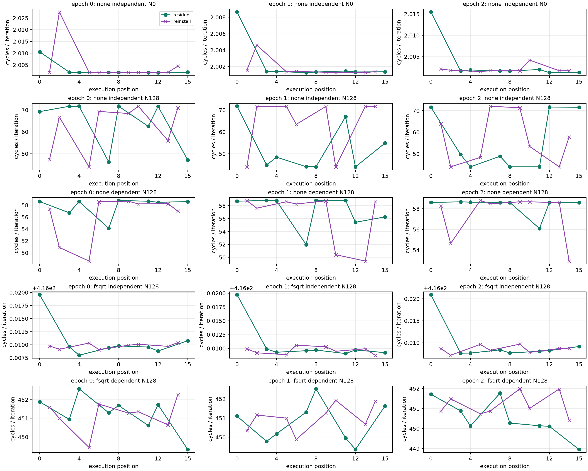

# ROB 原字节维护对照结果（2026-10-11）

## 本次任务的目的（给人类看）

前批同VA的NONE流仍不稳定。本批把一个程序常驻同一VA，逐窗仅改变暖身前是否额外重装相同字节，检验维护操作的解释力。协议 `docs/design/2026-10-11-rob-resident-control.md` v1，未改变历史not-qualified门或拼入旧记录。

**技术接受通过；主结果是 resident-supply-still-variable，维护效应未按冻结门复制。** 不是失败重试，也不是证实无效应：未额外重写窗仍波动，配对差正负混杂，没有依据把旧供给波动只归因RW/RX/Icache维护。carryover、代码variant切换、干扰、backend调度/供给等仍未唯一辨识。

## 全部观测与结论边界

15进程/240窗、66文件SHA完整接受，无stderr/mux/IR/同VA/generation漂移；32环境端点35.3–40.3°C通过既有baseline，未写频率/温控/THP参数。未额外重装不等于整个生命周期从未维护：resident也会跟在reinstall之后，两者均用相同131072暖身和测量迭代。

| 条件 | resident稳定进程 | reinstall稳定进程 | 全24配对Δ范围 cycles/iter | 冻结维护效应 |
|---|---:|---:|---|---|
| NONE independent N0 | 3/3 | 3/3 | −0.01339～0.02560 | 未复制 |
| NONE independent N128（主） | 0/3 | 0/3 | −27.73841～27.66622 | 未复制 |
| NONE dependent N128 | 2/3 | 0/3 | −9.98217～6.28937 | 未复制 |
| FSQRT16 independent N128 | 3/3 | 3/3 | −0.01224～0.00233 | 未复制 |
| FSQRT16 dependent N128 | 3/3 | 3/3 | −3.13496～2.93847 | 未复制 |

稳定只指各进程8窗的range/median≤10%，不是跨进程恒定。主条件resident C=44.00298～71.74639，三个进程range/median=36.12%/59.49%/56.09%；reinstall C=44.00304～72.00636，40.95%/38.60%/50.34%。不挑44或72的簇当真实供给常数，不用总体中位数掩盖轨迹。

主条件全部48窗cycles/ns=2.70071～2.74609，而cycles/iter相差约64%；这些比值仅是同窗PMU用户cycles/墙钟ns诊断，包含包装/调度口径差，不命名真实瞬时频率。它削弱“仅统一频率缩放造成墙钟变化”的简单解释，仍不能排除干扰或与频率相关的内部行为。N0的比值更宽2.17～2.76而cycles/iter稳定，也说明N0不代表N128供给。

FSQRT independent周期约416.01且0x816d/cycle中位约0.871，dependent约450.91～451.08而该事件全部为0；NONE该事件及0x23均很小。原事件比完整保留，不把它们当物理PRF/RS/ROB分配或证明某部件完全空闲。N0的OP_SPEC/OP_RETIRED每cycle接近2是操作速率，不是概率，合法保留。

## 可复现交付与谱系

工作树 `/Users/michaelyao/workspace/cpu-uarch-explorer-tlb-r2`，branch `codex/sm8650-tlb-hierarchy-r2`；代码 `probes/diagnostic/rob_resident_control.c`，共享规则 `probes/common/rob_codegen.h`，消费 `tools/diagnostic/rob_resident_analysis.py`，驱动 `tools/diagnostic/run_sm8650_rob_resident.py`。新探针未改legacy与旧配对协议。

| 谱系 | 值 |
|---|---|
| binary source | `fe53c23755747e509963538153f04181ef0594b3` |
| consumer/build | `71cb2a339bbc5d9392c070800cfb560635a40f12` |
| actual launch | `b27d95b4338e03d9251918f21c6d56bb84bbd04c` |
| binary SHA256 | `09ff24e3672d71fdda478de3e258d26f4419024ec55be0c9ae621cf28963dd67` |
| manifest SHA256 | `21a9ff6e97179c3ef4a6e225cf578fc2d9c57f898f5b1017fe6995721e09b736` |
| complete summary SHA256 | `ec464cfca0281012f226eb98305a47cdd2eac4ea56a88cac1487e59bd508eb8b` |

private raw=`data/private/20261011T140336Z-rob-resident-control`，全console同目录父层 `rob-resident-launch-console.log`；raw不入库。`docs/reviews/evidence/2026-10-11-rob-resident-control/` 包含真实完整plan/build/逐指令解码、全部240计数CSV、无裁剪summary.gz、analysis、66SHA、独立check_raw.py/independent-audit.json与可再生plot.py/response.*。直接原始JSONL第二算术逐全部窗/所有配对/稳定门/命名精确相符，同一root不冒称第二评审人。

软件出口 `docs/reviews/2026-10-11-rob-resident-control-preflight.md`：诊断307/307、runner203/203、正式analysis250/250、CTest21/21；双NDK、五程序真实计划及字节/独立解码、完整writer→loader反例与首坏停机通过。

## 接续的研究问题

额外原字节维护没有产生统一方向效应，NONE波动也无需本窗额外维护就存在；不能继续以同VA或N0稳定跳过供给资格。物理ROB仍未测得，原MODEL_UNIDENTIFIABLE是已观察模型组的边界，不是全局不可能。下一ROB有效干预须改变就绪资源流/目的寄存器或分配生命周期并提供独立供给控制；单纯继续N128配对/提高重复次数不构成新辨识。

TLB接续 `docs/design/2026-10-11-tlb-cross-region.md`：共同victim、四256MiB域、低位恒定与高位折叠恒定相反候选，先软件出口再串行采样；与本批不同的新问题。目标账/OI保留物理ways/hash、ROB allocation、窗内clock等未解条目，不宣称“TLB/ROB全部完成”。main/远端本轮未操作。
