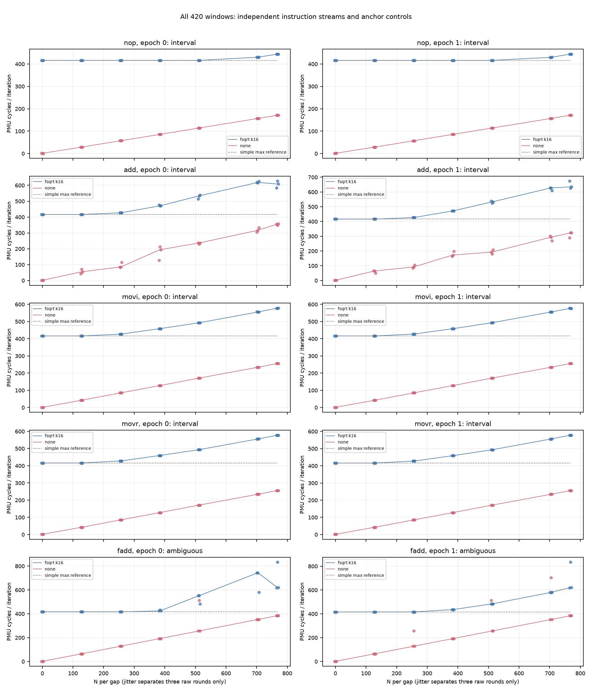
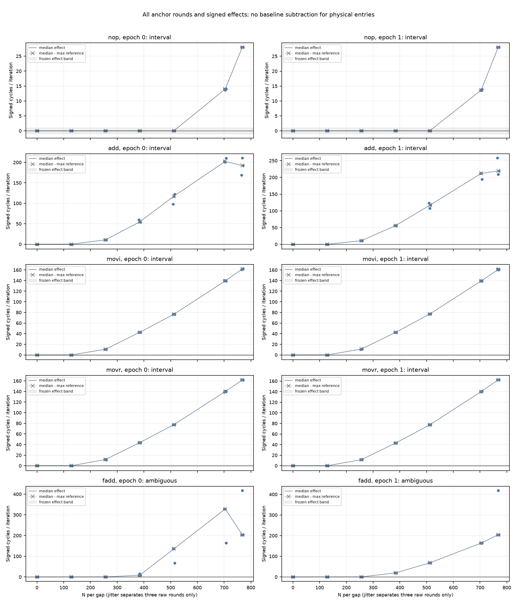

# ROB filler资源与有效隐藏窗口结果（2026-10-11）

## 本次任务的目的（给人类看）

复用已验证的实际生成器，比较NOP/ADD/MOVI/MOVR/FADD在相同fsqrt锚点下的响应，攻击“纯NOP阈值就是ROB条目数”的解释。冻结 [`docs/design/2026-10-11-rob-filler-resource.md`](../design/2026-10-11-rob-filler-resource.md) v1：140进程/420窗，不重开冷load原资格，不围绕384改参数。

**全批技术接受通过。** 五类科学命名逐类如下，任何ambiguous/删失都保留，不把它们称为有效容量。物理ROB/PRF/RS/融合认证继续OPEN；此报告权限为指令流的操作性隐藏响应。

| class | 冻结状态 | 每gap N区间 | 原因 |
|---|---|---|---|
| nop | interval | (512,704] | two-epoch-persistent-effect |
| add | interval | (128,256] | two-epoch-persistent-effect |
| movi | interval | (128,256] | two-epoch-persistent-effect |
| movr | interval | (128,256] | two-epoch-persistent-effect |
| fadd | ambiguous | — | anchor-round-spread-over-10-percent |

## 生产链、码形与溯源

工作树 `/Users/michaelyao/workspace/cpu-uarch-explorer-tlb-r2`；分支 `codex/sm8650-tlb-hierarchy-r2`。class×anchor{none,fsqrt}×N{0,128,256,384,512,704,768}为70条件，epoch1整个反序。每进程131072迭代、三窗全保留，chain16、实际loop mod64=0、CPU7/PMUtype8、事件[11,08,03,17,34,02]、FPCR0。5份class各自N0 baseline，未跨class/epoch混池。N是每gap filler数，每iter有2N；fsqrt共32条、专用d0与稳定sqrt(1)操作数，NONE没有锚点。

程序 [`docs/cpu-uarch-deep-analysis/rob-deep-analysis/probes/rob_window_probe.c`](../cpu-uarch-deep-analysis/rob-deep-analysis/probes/rob_window_probe.c) 本轮不改。ADD/MOVI/MOVR写x4..11，FADD写d4..7，未写锚点d0、loop x3或ABI保存集；MOVI是写立即数1，不能冒称零立即数操作。每条件实际host C导出，经独立A64 words和Capstone解码，全部140代码的计数、branch→loop64、两gap、RET、寄存器集合与config一致。最大body仍<7KiB；这不排除dispatch、融合、分配/重命名/调度或退休约束。

| 来源 | 值 |
|---|---|
| binary源码commit | `1ef4baad5e9a34310b6bc53e566bd0b5b7fbfbb7` |
| 新driver/consumer/注册计划commit | `dcb1a2ef15d3af0a6c325ab114fc57485b41c043` |
| 实际启动commit | `1551c99252c36d088ab66145bb92d6aefc551170` |
| binary SHA256 | `cb4645f65d8352e839144541bcaefab32cad5a7ce2006d9fb219479c8384d5ba` |
| manifest SHA256 | `90e8f3a9ef35411fa28735e978e9fe002a3d27e190367a7b0ca205e47425a2d8` |
| build SHA256 | `956cad28d41eb3387acda693109387be0222ee6857ebacc9fe0cc71a275a7423` |
| plan SHA256 | `c5b371c7a26d7ac8d652d9a69ed496542f80f7c94428ab29164f349571ff651c` |
| driver SHA256 | `2d6e52d5b463b793b393b618967b94474cc5e54362d614afd75e414af86ccee3` |
| protocol SHA256 | `cd4ecca1d3e0db2e7c1ac8d6a9082ca7a18c2c48019ff0fd1703f9a24fde21f1` |

[`build.json`](evidence/2026-10-11-rob-resource/build.json) 登记3项binary依赖、NDK27.2/API34/O2静态flags，10月11日两次新构建仍逐字节等于1ef4baa注册binary。 [`plan.json`](evidence/2026-10-11-rob-resource/plan.json)来自真实host producer，含每条件config与代码SHA；[`code-audit.json`](evidence/2026-10-11-rob-resource/code-audit.json)保存独立解码，生成脚本 [`decode.py`](evidence/2026-10-11-rob-resource/decode.py)。driver [`tools/diagnostic/run_sm8650_minimal.py`](../../tools/diagnostic/run_sm8650_minimal.py) 强制host-exporter、每进程固定1秒间隔；消费者 [`tools/diagnostic/rob_resource_analysis.py`](../../tools/diagnostic/rob_resource_analysis.py) 是本轮唯一命名入口。

## 接受与计量边界

140次成功退出、140份stderr为空、705原始文件、420typed/no-mux/正周期窗口；每窗6事件经kernel ID映射、runtime六ID唯一且uint64。完整config、结果/round顺序、code、manifest/build/plan SHA、Git source/driver/protocol与全部环境逐条核对。旧通用汇总不为新profile自动提供计划绑定，本轮raw反例在上板前发现plan SHA缺少贯通及额外raw文件被忽略，已于1551c99修正并回归；未用失败软件版本上板。

282环境端点重算无warning/violation，max CPU 38.0–55.7°C。policy7端点维持walt与基线min/max；cur值仅端点观察，不证明窗内恒频。全程root独占串行，无unfinished journal；未改governor、温控、全局cache/THP/用户态PMU权限。140次host调用wall总22.482秒，另有预定1秒间隔与环境/部署开销，不称为纯内核计时。

实际IR对i×loop_instructions+17的相对误差范围为0.00000116–0.00090784，符合既有允许带。IR相干只证明动态指令流与生成码相容，不认证ROB分配单位。周期来自同窗0x11/i；ns/i和其它计数完整保存在匿名 [`summary.json`](evidence/2026-10-11-rob-resource/summary.json)，不用名义频率推cycles。

| 事件 | 原始窗口最小 | 最大 | 非零窗 |
|---|---|---|---|
| 0x11 | 131393 | 109356822 | 420/420 |
| 0x8 | 262399 | 205783295 | 420/420 |
| 0x3 | 0 | 22 | 419/420 |
| 0x17 | 0 | 54 | 281/420 |
| 0x34 | 0 | 2 | 144/420 |
| 0x2 | 0 | 50 | 415/420 |

0x02为L1I_TLB_REFILL，0x01才是L1I_CACHE_REFILL，依据[Arm官方事件表](https://raw.githubusercontent.com/ARM-software/data/master/pmu/cortex-x4.json)。启动冻结v1两处将0x02误标为I-cache refill；本轮事件编码与统计/命名规则始终未变，labels勘误见冻结稿v1.0.1，实际来源表仍锚定启动时v1的Gitblob/SHA。此计数不证明前端充分性，也未认证特定物理cache层/容量。

## 完整曲线与冻结门

对每class、每epoch，三窗中位m_e(N)与自身fsqrt N0作D_e(N)。δ=1 cycle/iter仅为预定效果量，不是统计置信界。全部该class fsqrt格range/median≤.10；两个epoch都持续D>1、至少两个高点且此前全|D|≤1才给(N_prev,N_i]。128首点高为left-censored，末点独高right-censored；epoch分歧、负向越界、回落或超波动门为ambiguous。NONE不统一扣除；简单max[fsqrt0,noneN]只是可被推翻的供给参考。





可缩放 [cycles SVG](evidence/2026-10-11-rob-resource/cycles.svg)、[effects SVG](evidence/2026-10-11-rob-resource/signed-effects.svg)；全部原值、状态原因、range和signed供给残差见 [`analysis.json`](evidence/2026-10-11-rob-resource/analysis.json)。下表每格按epoch0/1列出，没有删除r0、负值、噪声簇或事后加点。

| class | N/gap | fsqrt中位 cyc/iter | D cyc/iter | NONE中位 cyc/iter |
|---|---|---|---|---|
| nop | 0 | 416.016 / 416.005 | +0.000 / +0.000 | 1.010 / 1.040 |
| nop | 128 | 416.017 / 416.005 | +0.000 / +0.000 | 28.674 / 28.673 |
| nop | 256 | 416.018 / 416.008 | +0.002 / +0.003 | 57.119 / 57.117 |
| nop | 384 | 416.012 / 416.010 | -0.005 / +0.005 | 85.562 / 85.565 |
| nop | 512 | 416.016 / 416.016 | -0.001 / +0.011 | 114.007 / 114.011 |
| nop | 704 | 430.011 / 429.634 | +13.995 / +13.629 | 156.676 / 156.677 |
| nop | 768 | 444.015 / 444.017 | +27.999 / +28.012 | 170.897 / 170.898 |
| add | 0 | 416.005 / 416.005 | +0.000 / +0.000 | 1.020 / 1.003 |
| add | 128 | 416.008 / 416.008 | +0.003 / +0.003 | 54.762 / 64.358 |
| add | 256 | 426.698 / 426.613 | +10.693 / +10.608 | 85.011 / 91.779 |
| add | 384 | 470.495 / 471.783 | +54.490 / +55.778 | 194.020 / 172.402 |
| add | 512 | 533.346 / 532.646 | +117.340 / +116.641 | 236.562 / 192.776 |
| add | 704 | 618.219 / 627.694 | +202.214 / +211.689 | 316.362 / 293.261 |
| add | 768 | 608.125 / 635.127 | +192.120 / +219.122 | 355.798 / 322.808 |
| movi | 0 | 416.004 / 416.005 | +0.000 / +0.000 | 1.010 / 1.010 |
| movi | 128 | 416.007 / 416.016 | +0.003 / +0.012 | 42.006 / 42.003 |
| movi | 256 | 426.593 / 427.016 | +10.589 / +11.012 | 85.017 / 85.005 |
| movi | 384 | 458.505 / 458.355 | +42.501 / +42.350 | 127.507 / 127.505 |
| movi | 512 | 492.622 / 493.045 | +76.617 / +77.040 | 171.007 / 171.007 |
| movi | 704 | 555.236 / 555.209 | +139.231 / +139.204 | 234.009 / 234.014 |
| movi | 768 | 577.863 / 576.991 | +161.859 / +160.986 | 256.012 / 256.010 |
| movr | 0 | 416.005 / 416.005 | +0.000 / +0.000 | 1.005 / 1.044 |
| movr | 128 | 416.008 / 416.009 | +0.003 / +0.004 | 42.007 / 42.007 |
| movr | 256 | 427.782 / 427.416 | +11.777 / +11.410 | 85.011 / 85.006 |
| movr | 384 | 459.491 / 458.831 | +43.486 / +42.826 | 127.511 / 127.511 |
| movr | 512 | 493.481 / 493.285 | +77.476 / +77.280 | 171.011 / 171.008 |
| movr | 704 | 555.740 / 555.902 | +139.735 / +139.897 | 234.010 / 234.009 |
| movr | 768 | 577.650 / 578.503 | +161.645 / +162.498 | 256.008 / 256.009 |
| fadd | 0 | 416.005 / 416.005 | +0.000 / +0.000 | 1.043 / 1.012 |
| fadd | 128 | 416.011 / 416.011 | +0.006 / +0.006 | 64.010 / 64.006 |
| fadd | 256 | 416.016 / 416.014 | +0.011 / +0.009 | 128.005 / 128.019 |
| fadd | 384 | 424.078 / 435.618 | +8.073 / +19.613 | 192.008 / 192.006 |
| fadd | 512 | 551.600 / 483.822 | +135.595 / +67.817 | 256.019 / 256.008 |
| fadd | 704 | 743.890 / 579.922 | +327.885 / +163.917 | 352.010 / 352.022 |
| fadd | 768 | 619.590 / 620.207 | +203.584 / +204.202 | 384.009 / 384.010 |

## 对解释的约束（本批事实，不扩大命名）

NOP的操作性响应区间(512,704]包含旧k16细扫(640,672]，只能说相容，不能跨批拼出更窄区间。ADD/MOVI/MOVR在相同k16锚点下都早至(128,256]，推翻了“同一个按架构指令数计的阈值可通用于这些流”的解释。MOVI写立即数1；MOVR从x16复制。两者曲线接近，连NONE供给时间也接近，但没有独立操作计数、elimination资格或重命名生命周期观测，不能据此认证move elimination，更不能把差额命名成PRF条目。

所有NONE中位都小于自身fsqrt N0约416 cycles/iter，简单max参考始终为锚点baseline。曲线新增成本不能仅由“NONE单独运行耗时已大于锚点”解释；这仍不排除两者组合后的前端/分配、调度、退休或执行约束。ADD epoch0从N704的618.219降至N768的608.125，两点D仍超过预定效果门，不违反持续越门合同；本报告不称严格数值单调。

FADD有四格超过10%三窗range/median：epoch0 N512/704/768分别12.51%/22.11%/34.64%，epoch1 N768为34.65%。两个epoch N512中位551.600/483.822，N704为743.890/579.922，均保留，ambiguous不得只选较安静的轮次补成区间。原策略接受端点最高55.7°C，温度上限90°C较宽，不意味着恒温或严格quiet；端点频率也不代表窗内恒频。温度、时间次序与类别在该批有残差混杂，数据不足以唯一判热、DVFS或FP执行原因。下一轮若需因果命名，须另冻更小的交错资源/依赖对照，资格确认专门事件后再决定是否需要固定频率profile。

## 理论边界与下一步

本地全局知识库 `/Users/michaelyao/workspace/cpu-uarch-ref/docs/Arm_Cortex_X4_Core_Software_Optimization_Guide.pdf` r0p1/Issue3.0 §4.11说明NOP可融合；§4.12将部分MOV列为零延迟且不使用调度/执行资源，并对寄存器MOV留条件限制。本轮MOVR可作资源对照，不能仅凭官方列举或一个周期曲线证明本输入已发生elimination；MOVI的立即数1不在零立即数名单。零延迟也不等于不占退休/跟踪结构。384仍仅第三方候选，不是拟合中心。

类别响应差异先约束“一个instruction-count阈值可通用于所有filler”的假设，不能唯一归PRF/RS/ROB，也不能从N/2得384。后续先按本报告反例选择有限的资源/分配观测：资格确认的专门事件、依赖/结果生命周期对照与锚点长度敏感性；不继续盲目加密NOP或追冷load串行模型。TLB逐遍竞争已另案完成，下一有限对照换victim身份/历史，见 `docs/open-items.md`；旧A1/冷资格数据不拼入此批。

## 复算与回归

独立脚本 [`check_raw.py`](evidence/2026-10-11-rob-resource/check_raw.py) 直接从JSONL复算420计数/周期、140条件、五class的全部门与供给参考，不导入判据函数；全部705 SHA重算一致。 [`audit.json`](evidence/2026-10-11-rob-resource/audit.json)保留282匿名环境端点与统计。两算术路径都由root运行，不冒称另一位评审人。raw目录 `data/private/20261011T010911Z-rob-resource/`原样保留、不入库；公开数据无VA/PFN/序列号。

上板前diagnostic222/222、runner203/203、analysis250/250、macOS CTest21/21通过。两类新测试均编译immutable C producer；只有外部runtime/PMU/env合成，是软件证据而非板上科学门。旧TLB10400、ROB四状态6144与本日TLB36480公开结果重放逐字节一致。macOS CTest不代替Linux专属路径验证。

```bash
/Users/michaelyao/workspace/cpu-uarch-explorer/.venv/bin/python tools/diagnostic/rob_resource_analysis.py \
  data/private/20261011T010911Z-rob-resource \
  --summary-output /private/tmp/rob-resource-summary-replay.json \
  --output /private/tmp/rob-resource-analysis-replay.json
/Users/michaelyao/workspace/cpu-uarch-explorer/.venv/bin/python \
  docs/reviews/evidence/2026-10-11-rob-resource/check_raw.py \
  data/private/20261011T010911Z-rob-resource /private/tmp/rob-resource-summary-replay.json \
  /private/tmp/rob-resource-analysis-replay.json /private/tmp/rob-resource-audit-replay.json
```

| 公开文件 | SHA256 |
|---|---|
| `analysis.json` | `d0555229fef647252860792fe593d03bd5b77d0cb0fc1739579c6c0c6592c1db` |
| `audit.json` | `d25b463e0508fe0473d1e77a9a9b8bda2edf484134a8b12d206a2355b48e438b` |
| `build.json` | `956cad28d41eb3387acda693109387be0222ee6857ebacc9fe0cc71a275a7423` |
| `check_raw.py` | `1b6390b8a95009f454c2912946e721826ef1f97946f3f3357cc0e0d73d737890` |
| `code-audit.json` | `ae53bc7988f2251478f1808bc06de1ae3ffe4313909b9f09bac137bbd8cb83d0` |
| `cycles.png` | `5fa3595f2295096c785c132fa7fc86dfec899304294b275f41ad950917f133f1` |
| `cycles.svg` | `fda88cdd48ef42eccb3a9016e9da44b15452820501bc29dc58ee8f302a295ec1` |
| `decode.py` | `ddf7953382f95d0e9f74ecbde97460f520482bf08b3336d71940d22a89f45ea8` |
| `plan.json` | `c5b371c7a26d7ac8d652d9a69ed496542f80f7c94428ab29164f349571ff651c` |
| `plot.py` | `82c7d401fe820c4ca21f00986bfb1cc22d429368ef6f1d0f730c94227b52b695` |
| `signed-effects.png` | `4df68a5b5a4a335660ea36991f66b978f77530979a99adc8de813c50ed190eb4` |
| `signed-effects.svg` | `b2855aa86eafa25187e32708f9e533f51ca14577f889bdc671d4e54a970a9fec` |
| `summary.json` | `3869508c41b816cbf52fba2811da28a4f88049680730aa5fd93589a694cd916b` |
