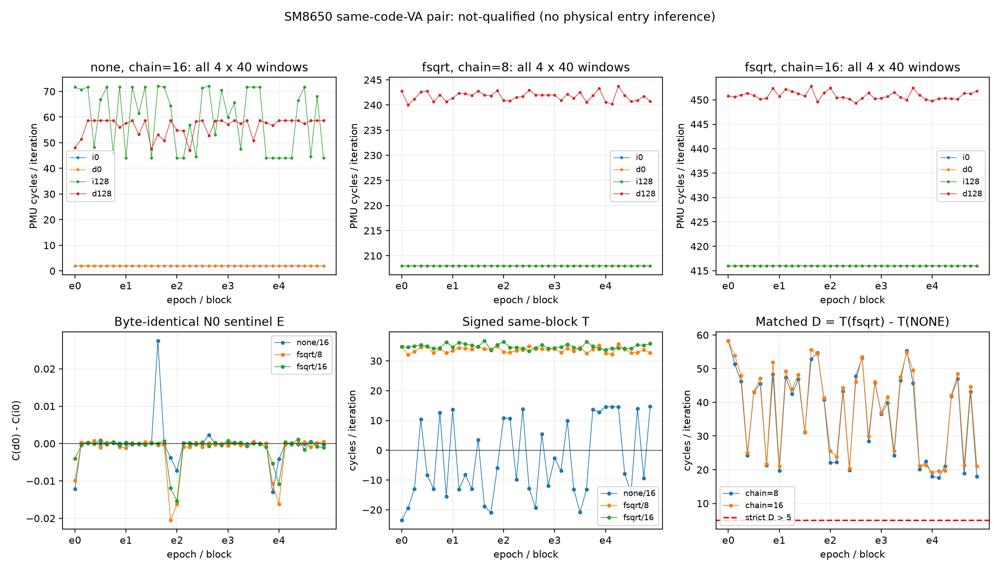

# ROB 同进程/同代码地址配对结果（2026-10-11）

## 本次任务的目的（给人类看）

检验跨进程同值依赖批的NONE负控波动能否通过同进程、同代码VA、交错顺序控制。协议 `docs/design/2026-10-11-rob-same-address-pair.md` v1先冻结；15进程/480窗完整有限批，未改阈值、挑窗口或重复至过门。

**技术通过；科学主门不通过（not-qualified）。** 15/15个N0哨兵过门、80/80个D>5，然而40个NONE的T中位−8.072620、范围宽度38.219238 cycles/iter，分别违反|median|≤5与range≤5。稳定的N0不能为N128供给流代背书，正D也不能绕过负控失败。物理ROB/PRF/RS条数未识别。

## 从反例中得到什么

每进程四variant在同一64KiB mapping基址交替执行，N0 i/d程序逐字相同，N128只有256个ADD Rn位域不同，输入与计算输出值相同。全部同窗PMU/IR/代码计划/实际基址通过，所以新的NONE不稳不是软件层把不同VA冒充同VA。新批同进程且同VA仍不足以控制负控；不能完全排除旧批ASLR的贡献，也不能据此唯一归因DVFS、干扰、前端或执行资源。新协议的RW/RX和Icache维护在窗外，但其残余状态仍是替代机制之一，未认证与旧常驻代码协议等价。

N0的最大|哨兵中位|仅0.000580，最大E range0.031296 cycles/iter，远小于冻结门；但NONE i128的全部40窗为44.003159–72.003021，d128为47.006531–58.726990。两者局部差分T为−23.510902～14.708336，不能当静态供给参考扣除。保留每block signed值，而不只展示正D或总中位。

带fsqrt的i128仍约208.006/416.009，d128约241.872/450.700 cycles/iter。对应40窗rename/cycle中位约.783781/.871258与1.09e-6/0；k8依赖端最大1.91e-6，不能统称所有计数为零。这是限定的依赖相关周期/事件响应，不能命名哪一个物理队列先满；两链长度的D都正也不校准allocation单位。

| chain | D最小 | D中位 | D最大 | >5 |
|---:|---:|---:|---:|---|
| 8 | 17.603882 | 42.158470 | 58.271378 | 40/40 |
| 16 | 19.163445 | 42.669079 | 58.293434 | 40/40 |

每epoch/block的T=[C(d128)−C(d0)]−[C(i128)−C(i0)]，D=T(fsqrt)−T(none)，C来自本单窗0x11/131072。共同NONE用于两chain是相关负控，80个D不是80次物理独立实验。range门是预定效果/稳定性标准，不是统计置信区间。

## 来源、程序与技术接受

工作树 `/Users/michaelyao/workspace/cpu-uarch-explorer-tlb-r2`；分支 **codex/sm8650-tlb-hierarchy-r2**。root独占串行，m0b/main/远端没有新操作。生产 `probes/diagnostic/rob_dependency_pair.c`，共同码生成 `probes/common/rob_codegen.h`，消费 `tools/diagnostic/rob_pair_analysis.py`，驱动 `tools/diagnostic/run_sm8650_rob_pair.py`。

| 项 | 值 |
|---|---|
| binary source | `4cebc24e20f623f507d91eb610698a19602e8d8d` |
| actual launch | `4f44c983e60bb2d0b42b6c05ad259888f56fb893` |
| binary SHA256 | `695cfc381b3fef229b3a2796889d09f598c150472caf1b38e7ed2d6ce7a8b383` |
| protocol SHA256 | `e0de76d5f6403445993a1c1ddb6ec1194b0390e1c00460a2ce728aa35af51e29` |
| plan SHA256 | `842365fc5d85832059dd671d4d5320083b6c4896dd5f7f19ebbc62e7a2493a86` |
| build SHA256 | `e46a91ab7085bf52a3d7271cfa6888b6d83ad3a1f98695774acfd55cb0c1a00f` |
| driver SHA256 | `4c7c9db891721be3296f0b0e67abecb33dca384c5d08eb1ffddd169c1c49e914` |
| manifest SHA256 | `43226365fa36b8413470ab5d0a79843a155f1e141ee9a45191fb18004731205c` |
| complete summary（解压）SHA256 | `4a56596375f7df14b30dad7377ca529cf300e90da7cd9950a0a8f19557c144dd` |

源码4cebc24、consumer/build11abe30、实际启动4f44c98分列。NDK27.2.12479018/API34静态O2/Werror双构建逐字一致，设备部署SHA相同；源/header三依赖与source及launch Gitblob一致。旧probe抽取后56个legacy config/机器码逐字不变，新12program与独立数学构造和Capstone全部一致。目标raw的program words再次逐字匹配注册plan；N0相同、N128 Rn-only、no-spill/branch/RET/ABI维持。

五epochs各none16/fsqrt8/fsqrt16，8block×4window、奇block反序、奇epoch完整反序；每窗重写同VA、清Icache、RX及131072暖身均在测量外，测量131072迭代。CPU7、FPCR0、PMUtype8、六unique kernel IDs、GROUP+ID/pinned/user-only/no-mux/noRESET、code_matches_plan和code_base逐窗验收。15个进程的code_base不同，各自32窗保持同一基址；公开summary保留这类审计字段，未声称PFN独立或含物理地址。IR相对误差范围[6.2185e-6,.000453934]，在max1000/1%带内；包装税没有硬扣。

65 raw文件在 `data/private/20261011T083409Z-rob-same-address-pair/`，全部stdout/空stderr、manifest/driver/32环境端点、全SHA完整保留，不入库；完整启动日志 `data/private/rob-pair-launch-console.log`。端点最高CPU温度38.0–42.0°C，baseline policy重算通过，进程前15s间隔。未写频率、温控/THP或全局PMU、未创建环境事务；端点不证窗内恒频。15次host调用wall总11.212秒，包括adb/warmup/JIT维护/输出，非纯内核时间。cycles/ns只是用户执行/墙钟比，不命名真实频率。

## 全部观察与门

下表为各epoch内八block，所有窗口在CSV/完整summary中，不跨epoch拼曲线或删NONE噪声。

| epoch | anchor/chain | i0中位 | d0中位 | i128中位 | d128中位 | T最小 / 中位 / 最大 |
|---:|---|---:|---:|---:|---:|---|
| 0 | none/16 | 2.001759 | 2.001842 | 71.211777 | 58.603645 | -23.510902 / -12.991119 / 12.634186 |
| 0 | fsqrt/8 | 208.002419 | 208.002586 | 208.006275 | 241.599140 | 32.044220 / 33.593449 / 34.760475 |
| 0 | fsqrt/16 | 416.004856 | 416.004978 | 416.008564 | 450.863068 | 34.166023 / 34.855305 / 36.304680 |
| 1 | none/16 | 2.001926 | 2.001869 | 68.086491 | 55.413345 | -20.895035 / -10.613224 / 13.610718 |
| 1 | fsqrt/8 | 208.003174 | 208.002861 | 208.005924 | 242.136898 | 33.379280 / 34.130596 / 34.877769 |
| 1 | fsqrt/16 | 416.004189 | 416.004333 | 416.008389 | 451.326832 | 33.596718 / 35.324234 / 36.760628 |
| 2 | none/16 | 2.001667 | 2.001694 | 55.001141 | 56.632610 | -19.243416 / -2.198154 / 13.807671 |
| 2 | fsqrt/8 | 208.003090 | 208.002396 | 208.005730 | 241.822983 | 32.841003 / 33.817139 / 34.949303 |
| 2 | fsqrt/16 | 416.005085 | 416.005066 | 416.008755 | 450.395199 | 33.326294 / 34.386368 / 36.425987 |
| 3 | none/16 | 2.001900 | 2.001938 | 62.717228 | 57.600822 | -20.838875 / -4.767815 / 13.745300 |
| 3 | fsqrt/8 | 208.002945 | 208.002434 | 208.005695 | 241.926929 | 32.581520 / 33.920616 / 35.304924 |
| 3 | fsqrt/16 | 416.004650 | 416.004261 | 416.008984 | 450.617908 | 33.994194 / 34.608921 / 36.425385 |
| 4 | none/16 | 2.001976 | 2.001896 | 44.311188 | 58.605373 | -14.247711 / 14.292656 / 14.708336 |
| 4 | fsqrt/8 | 208.002609 | 208.002655 | 208.005863 | 240.813068 | 32.200607 / 32.807484 / 35.715744 |
| 4 | fsqrt/16 | 416.005386 | 416.005695 | 416.009594 | 450.285130 | 33.766891 / 34.277061 / 35.790451 |



`docs/reviews/evidence/2026-10-11-rob-same-address-pair/` 中：analysis.json保存60point/120block/480same-window比、15哨兵、40NONE T与80D；windows.csv全部六事件整数计数；summary.json.gz保存完整15进程/480窗的匿名派生summary，解压SHA精确绑定analysis.input_sha256，不删除代码VA/实际ID字段或负值。plot.py完整重现PNG/SVG；check_raw.py从原始JSONL直接重算计数/IR/代码身份/全部差/门及65SHA，与主消费者逐值相同。第二算术路径由同一root完成，未冒称第二独立评审人。

## 软件出口与有限终态

fresh diagnostic298/298、runner203/203、正式analysis250/250、macOS CTest21/21，软件证据见 `docs/reviews/2026-10-11-rob-same-address-pair-preflight.md`。真实producer→registered driver→writer→raw consumer正例，22类重哈希反例/首坏程序停1进程/旁路auditor测试均通过；软件中的外部计数模拟不代替本批手机数据。首次全量遗漏共享头的失败记录保留，修复依赖后再全量通过。本机native测试不冒称Linux PMU覆盖，本批才有实际目标执行。

本有限配对控制已完成，其not-qualified是正式失败终态；不删除负控、扩大range门或重复测到过门。不从正D或rename近零计算ROB/RS/PRF容量。下一收口见 `docs/reviews/2026-10-11-tlb-rob-identifiability.md`：有限证据与物理单位缺口分列，原科学未知、窗内clock、资源生命周期/单位标尺及formal runner/schema/CMake按owner/触发留在 `docs/open-items.md`。

```bash
.venv/bin/python tools/diagnostic/rob_pair_analysis.py data/private/20261011T083409Z-rob-same-address-pair --summary-output /tmp/rob-pair-summary-replay.json --output /tmp/rob-pair-analysis-replay.json
.venv/bin/python docs/reviews/evidence/2026-10-11-rob-same-address-pair/check_raw.py data/private/20261011T083409Z-rob-same-address-pair /tmp/rob-pair-summary-replay.json /tmp/rob-pair-analysis-replay.json /tmp/rob-pair-audit-replay.json
.venv/bin/python docs/reviews/evidence/2026-10-11-rob-same-address-pair/plot.py
```
