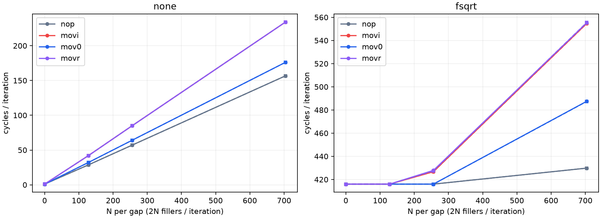
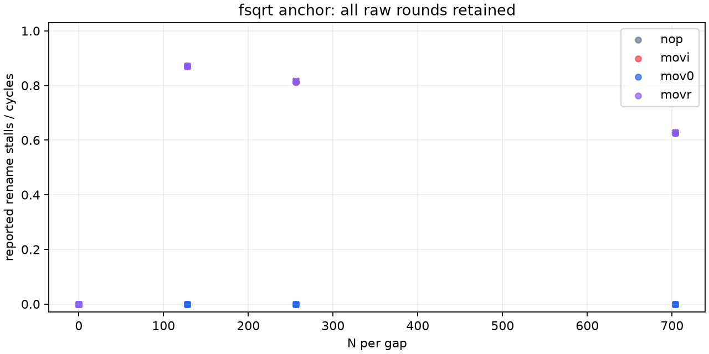

# ROB 零值对照结果（2026-10-11）

## 本次任务的目的（给人类看）

检验 GPR 写入+长 fsqrt 的 rename 停顿是否对值域敏感。预注册 `docs/design/2026-10-11-rob-zero-value.md` v1；零值与非零值仅 MOVZ 的 bit5 不同。

**技术接受通过、有限科学主门12/12通过。** MOVZ #0/#1 在本协议中的 rename 响应不同；不认证物理 ROB/PRF、一般消除机制或分配单位。

## 主要结论

同 fsqrt/N128，MOVI rename/cycles 两epoch分别0.871044931、0.871547722；MOV0均为0。两者总周期仍约416 cycles/iter。这直接反证“同架构指令数必有同一资源响应”，也说明出现rename停顿不等于总周期立即增加。

NONE/N128 MOV0/MOVI周期比为 0.764896442, 0.764728953；只报告速度差，未认证通用zero elimination。MOV0/fsqrt/N704仍约487 cycles/iter但rename为0，NOP相同点约430、MOVI约555；其它前端/退休/融合或分配约束仍可能存在，不能用零rename作为全资源不受限的证明。

## 来源与接受边界

工作树 `/Users/michaelyao/workspace/cpu-uarch-explorer-tlb-r2`、分支 `codex/sm8650-tlb-hierarchy-r2`；root独占串行。64进程/192窗、i131072、chain16、N为每gap数量、每iter2N；fsqrt(1)32条，两epoch整体反序。全部3轮保留、64stderr为空、六kernel event ID在各进程内唯一、计数uint64/正周期/no-mux。source/build/launch/plan/protocol/driver与325 raw SHA通过；直接JSONL第二算术路径逐窗/IR/bit差/SHA一致。

| 来源 | 值 |
|---|---|
| binary source commit | `e23c6bb12a2cfc74a18d0feb57fab83da7c4a170` |
| actual launch commit | `36031d02391a7eb904646957c3d6d580bd0a8aff` |
| binary SHA256 | `60f974931e7d6b0d8303381b3aa6bd77ded1568eb74803a1d260c1b0e98c12e4` |
| manifest SHA256 | `a714af4c16f428b6bc173f41a6a1bab85836ae3d262d534e84b780656e8461fb` |
| build SHA256 | `6ec1c5cba69490c7b8a7ff5b2322b731ba18637347f4971d5bf185e049c61efd` |
| plan SHA256 | `a1939b07c5579e7c0c472129971d79edcfbef8e502a5162515ceb97955465b01` |
| driver SHA256 | `04a88ced26b1d1e6a9c33353e0f3562d9f6989c8a352ebb687a4072ef70638e4` |
| protocol SHA256 | `a874017c2d0b5df593f7b7100f648941ddaf709e0d985113b53e80d93059f27c` |

原始记录目录（private、永不提交）：`data/private/20261011T033907Z-rob-zero-value`；完整匿名计数和所有raw SHA见本证据目录 analysis/summary/windows.csv。独立重算由同一root完成，不冒称第二独立评审人；跨进程kernel ID总数没有微架构含义。

130环境端点满足既有观察policy，最高CPU端点范围39.6–45.1°C；没有改变governor/频率/温控/THP/全局PMU，也没有产生环境事务。端点不能证明窗内恒频。IR相对误差范围 [1.2592203433543623e-06, 0.0009078390759876564]，通过既有1%/1000门。

## 全部有限观测

下表每格epoch0 / epoch1，cycles为三窗中位，rename为同窗比例中位。全部192原值另见windows.csv。

| class | anchor | N/gap | cycles/iter | rename/cycles |
|---|---|---:|---|---|
| nop | none | 0 | 1.017548 / 1.012573 | 0.000262 / 0.000677 |
| nop | none | 128 | 28.671745 / 28.674141 | 0.000000 / 0.000000 |
| nop | none | 256 | 57.117149 / 57.117279 | 0.000000 / 0.000000 |
| nop | none | 704 | 156.676453 / 156.678703 | 0.000000 / 0.000000 |
| nop | fsqrt | 0 | 416.004417 / 416.006081 | 0.000000 / 0.000000 |
| nop | fsqrt | 128 | 416.005661 / 416.006241 | 0.000000 / 0.000000 |
| nop | fsqrt | 256 | 416.008827 / 416.007217 | 0.000000 / 0.000000 |
| nop | fsqrt | 704 | 429.812370 / 429.819817 | 0.000000 / 0.000000 |
| movi | none | 0 | 1.013496 / 1.009911 | 0.000271 / 0.000768 |
| movi | none | 128 | 42.005623 / 42.017227 | 0.000001 / 0.000005 |
| movi | none | 256 | 85.010078 / 85.009659 | 0.000000 / 0.000001 |
| movi | none | 704 | 234.009033 / 234.007996 | 0.000003 / 0.000004 |
| movi | fsqrt | 0 | 416.005127 / 416.005020 | 0.000000 / 0.000000 |
| movi | fsqrt | 128 | 416.007072 / 416.008400 | 0.871045 / 0.871548 |
| movi | fsqrt | 256 | 426.737045 / 426.747711 | 0.813771 / 0.816651 |
| movi | fsqrt | 704 | 554.687973 / 554.578468 | 0.626985 / 0.627903 |
| mov0 | none | 0 | 1.002960 / 1.002998 | 0.000647 / 0.000540 |
| mov0 | none | 128 | 32.129951 / 32.131790 | 0.000000 / 0.000000 |
| mov0 | none | 256 | 64.134293 / 64.131752 | 0.000000 / 0.000000 |
| mov0 | none | 704 | 176.134239 / 176.133575 | 0.000000 / 0.000000 |
| mov0 | fsqrt | 0 | 416.004990 / 416.004662 | 0.000000 / 0.000000 |
| mov0 | fsqrt | 128 | 416.007408 / 416.007751 | 0.000000 / 0.000000 |
| mov0 | fsqrt | 256 | 416.009361 / 416.009933 | 0.000000 / 0.000000 |
| mov0 | fsqrt | 704 | 487.495155 / 487.366982 | 0.000000 / 0.000000 |
| movr | none | 0 | 1.025742 / 1.038322 | 0.000310 / 0.000492 |
| movr | none | 128 | 42.006310 / 42.008331 | 0.000021 / 0.000022 |
| movr | none | 256 | 85.005257 / 85.006126 | 0.000009 / 0.000010 |
| movr | none | 704 | 234.008484 / 234.008186 | 0.000003 / 0.000004 |
| movr | fsqrt | 0 | 416.004700 / 416.005722 | 0.000000 / 0.000000 |
| movr | fsqrt | 128 | 416.008499 / 416.007500 | 0.871945 / 0.870996 |
| movr | fsqrt | 256 | 427.872017 / 427.431175 | 0.814568 / 0.816610 |
| movr | fsqrt | 704 | 555.247658 / 555.504288 | 0.625836 / 0.627972 |

## 回归、限制与下一步

本批启动前 diagnostic245/245、runner203/203、analysis250/250、CTest21/21通过；实际C字节唯一差与旧七类输出不变、64体独立Capstone解码、NDK两次一致通过。完整driver写盘/回读正例与二十类raw反例通过；旁路过程审计时首坏ID测试明确失败。旧事件批测试已绑定真实历史driver/launch，避免新源码假绑旧binary。

零值关联门关闭，不关闭 physical ROB/PRF/RS/融合单位、rename满结构专门语义正控、窗内clock及正式runner/schema/CMake接入。下一ROB优先结果依赖/生命周期与锚点长度控制；TLB先跑已冻结的配对target/VPN跨度控制。禁止从本报告发布384或其它精确entry数。

## 入库状态

自动审批额度重置后恢复入库；原始数据保留在private，报告与匿名派生工件按范围提交。TLB地址几何对照尚未上板，后续报告单独登记。
