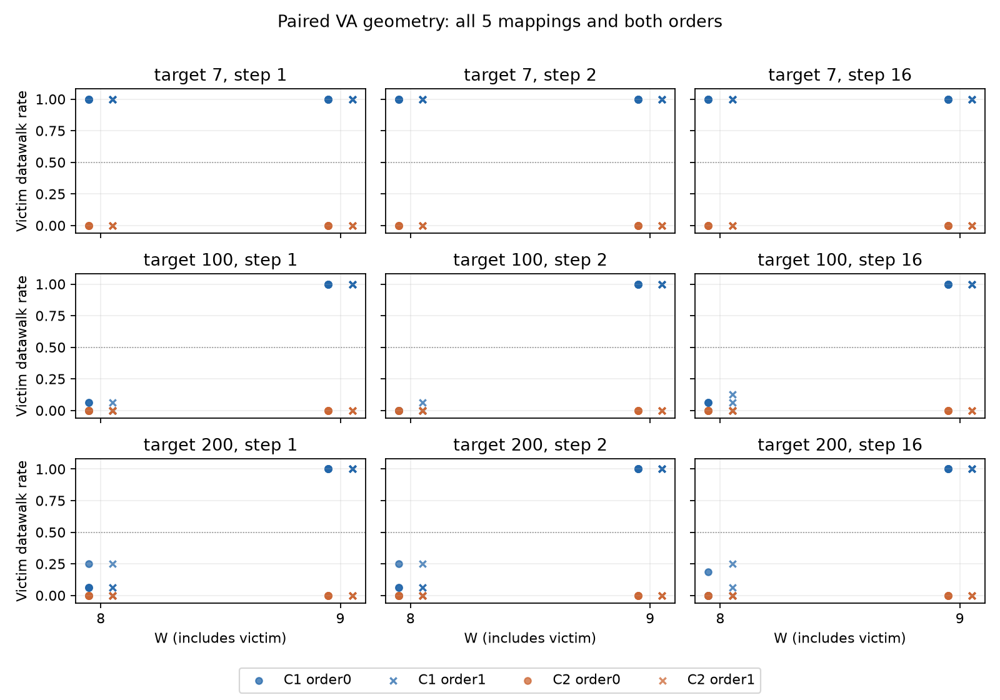
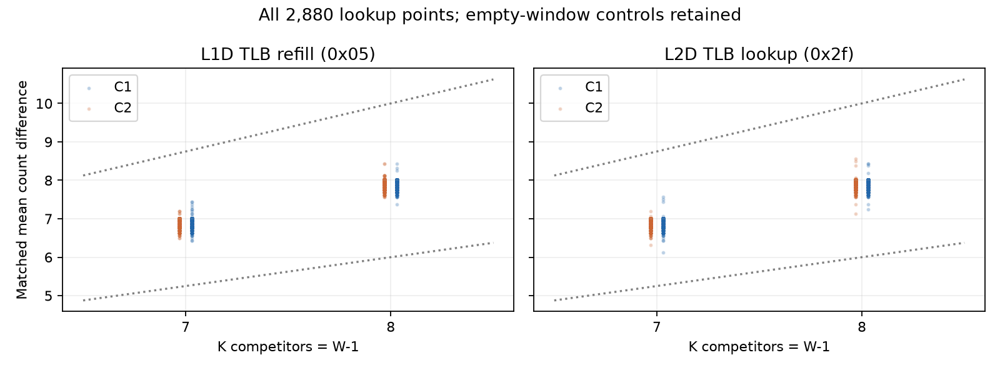

# TLB 地址几何对照结果（2026-10-11）

## 本次任务的目的（给人类看）

检验此前 target100 的 W8→W9 响应是否局限于该 target/约1MiB高VPN间隔。协议 `docs/design/2026-10-11-tlb-address-geometry.md` v1：同mapping配对三个target×三跨度、两收集签名、两order、W1/8/9，五独立mapping。没有拼入旧A1。

**技术接受通过；通用8页边界被当前协议的target反例推翻。** target7 的C1在W8和W9均双order 5/5；target100/200仅W9双order 5/5。三种跨度均同模式。C2所有格无复制响应。不能把全部结果平均成同一“8ways”。

## 事实与解释边界

全部77760窗/540cell/五stderr为空，2880/2880竞争lookup点通过预注册双门。360victim比较均无lookup-not-observable、control-background或single-load-residual；W1全部datawalk0、单victim最大walk1。非零率由16trial计算，每mapping双order≥.5，五mapping全过才复制；mapping才是重复单位。

表中每格“复制mapping数 / 5 [十个mapping×order非零率最小,最大]”；原计数全部保留，不以孤立walk宣称复制。

| target | VPN step | C1 W8 | C1 W9 | C2 W8 | C2 W9 |
|---:|---:|---|---|---|---|
| 7 | 1 | 5/5 [1, 1] | 5/5 [1, 1] | 0/5 [0, 0] | 0/5 [0, 0] |
| 7 | 2 | 5/5 [1, 1] | 5/5 [1, 1] | 0/5 [0, 0] | 0/5 [0, 0] |
| 7 | 16 | 5/5 [1, 1] | 5/5 [1, 1] | 0/5 [0, 0] | 0/5 [0, 0] |
| 100 | 1 | 0/5 [0, 0.0625] | 5/5 [1, 1] | 0/5 [0, 0] | 0/5 [0, 0] |
| 100 | 2 | 0/5 [0, 0.0625] | 5/5 [1, 1] | 0/5 [0, 0] | 0/5 [0, 0] |
| 100 | 16 | 0/5 [0, 0.125] | 5/5 [1, 1] | 0/5 [0, 0] | 0/5 [0, 0] |
| 200 | 1 | 0/5 [0, 0.25] | 5/5 [1, 1] | 0/5 [0, 0] | 0/5 [0, 0] |
| 200 | 2 | 0/5 [0, 0.25] | 5/5 [1, 1] | 0/5 [0, 0] | 0/5 [0, 0] |
| 200 | 16 | 0/5 [0, 0.25] | 5/5 [1, 1] | 0/5 [0, 0] | 0/5 [0, 0] |

跨度从约1/2/16MiB改变而该模式仍复制，只排除“仅原target100/约1MiB几何”的解释。target7 W8与其它target不同，支持地址族相关的有效响应；未区分descriptor共享/额外条目、未建模hash、PFN/cache或替换行为。C是收集模型，C1响应/C2无响应不是唯一硬件哈希证明，lookup不证明admission。W8复制不等于7ways，W9复制不等于8ways。

## 来源、审计与工件

工作树 `/Users/michaelyao/workspace/cpu-uarch-explorer-tlb-r2`；分支 `codex/sm8650-tlb-hierarchy-r2`，root单操作者串行。实际探针 `probes/diagnostic/tlb_address_geometry.cpp`；driver `tools/diagnostic/run_sm8650_geometry.py`；consumer `tools/diagnostic/tlb_geometry_analysis.py`。NDK27.2/API34双构建逐字节一致；实际窗口反汇编 `docs/reviews/evidence/2026-10-11-tlb-address-geometry/measured-window.txt` 验证最终F后不重新读取target元数据。host实链108cell/15552shot不是目标数据。

| 谱系 | 值 |
|---|---|
| binary source | `1db75b991922f2fd1e3632db30c269f1cc779a15` |
| actual launch | `8a60ad7ee279c54fb8419d7ba5d1deb079ad69b1` |
| binary SHA256 | `0093bbfb6680412c27ad7006328a545ddb643f964c143dd413c7961fde1fd666` |
| manifest SHA256 | `bcc093af66383256f08f7f59d4e68816c2f8425ae18a2080825206179e52e632` |
| build SHA256 | `14a2023de8bbb5b0ea8074560750ef14531186c71e8eee7ab12767611a751df7` |
| plan SHA256 | `5dc7ccad4e9d8e11196d1f3d85e81ce9a6d924ece0db02f433730f649635687f` |
| driver SHA256 | `6ab722396ab5269bc34d8febbaadf7f8c7f7e2cf3f37d93db838af4c42055db7` |
| protocol SHA256 | `d1ac270175f476175b1607aa14985948995f04d3618ea9f10b0ed2345118cca6` |

private原始目录 `data/private/20261011T065447Z-tlb-address-geometry`，25 raw SHA全部锚定。直接JSONL第二算术路径逐77760窗、全部请求身份/几何/2880门/360率/36复制结果与consumer精确一致；由同一root完成，不冒称第二独立评审人。十二环境端点最高CPU温度范围37.6–41.1°C；观察walt既有policy，无频率/温控/THP/全局PMU写入，无环境事务；端点不证窗内恒频。

匿名完整计数 `docs/reviews/evidence/2026-10-11-tlb-address-geometry/windows.csv`；同目录 `summary.json.gz` 是consumer未删减summary的确定性gzip，解压内容SHA=`4e374838b766058c5f7bbd28ddcbf3f4f19388532fe83b01a81e2ff4499cabf0`（与analysis.input_sha256一致），压缩仅为避免重复存放21MiB缩进文本，不裁剪窗口。`analysis.json`完整有限判据、`independent-audit.json`第二算术与25 SHA、`response.*`/`lookup.*`两图。VPN区域/局部键仅VA代理，不测物理页表cacheline；public保留可核算的VA几何代理键；原始JSONL与设备序列号不入库。

## 软件证据、裁定与下一步

diagnostic256/256通过，runner203/203、analysis250/250、CTest21/21在本轮runner/native未改变的基线上通过。真实C++plan/selector→driver写盘→raw回读五进程软件正例与十九类重哈希损坏反例通过；首坏step停1进程，旁路audit_process使其测试RED。软件PMU样本是模拟外部值，真实目标数据单独归本报告。

有限几何对照已完成。下一局部容量对照按target7/100的差异冻结同victim/max页集W6–9，与负控和跨度配对，不只围绕100再加密；正式采样前另有source/build/launch注册。物理TLB ways/唯一索引/descriptor归因与QD有效在飞占用仍开放，归当前端到端负责人；原合同Q-A/Q-B/Q-D应在最终报告逐项对账，不能用本B类对照替代全部问题。旧正式A1/frozen/不完整14条L1不拼接；后置项继续 `docs/open-items.md` 跟踪。
