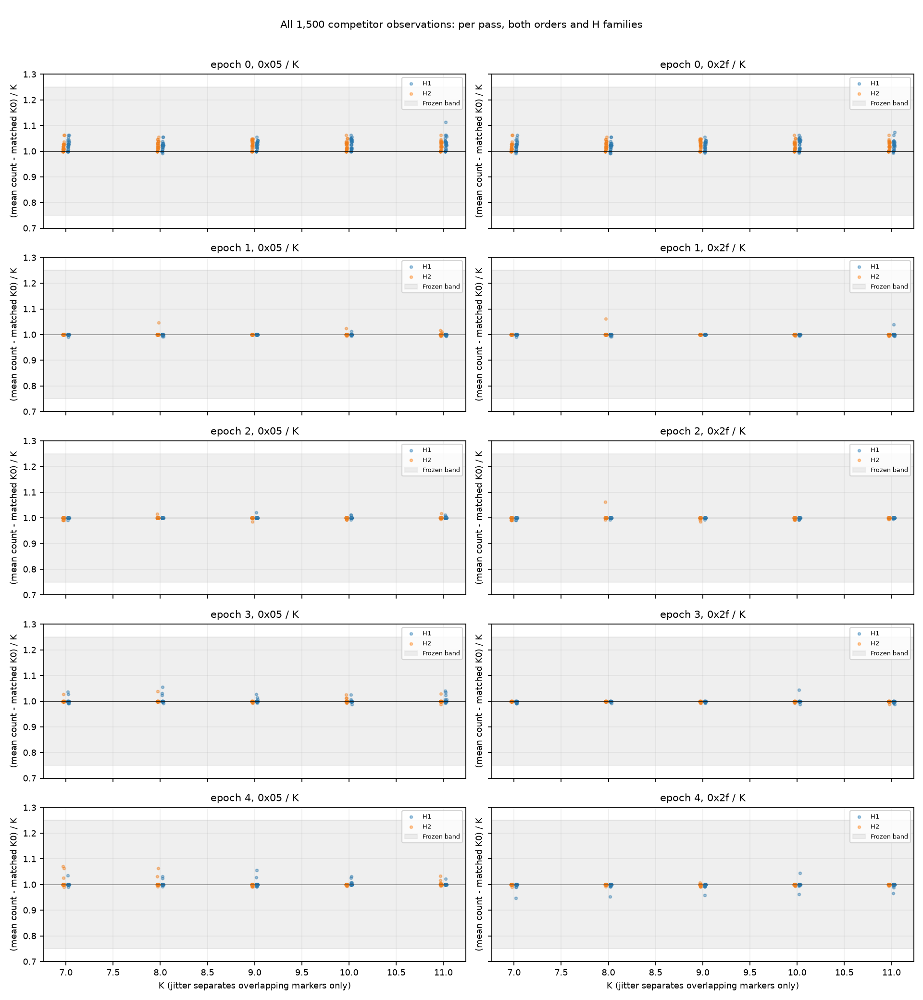
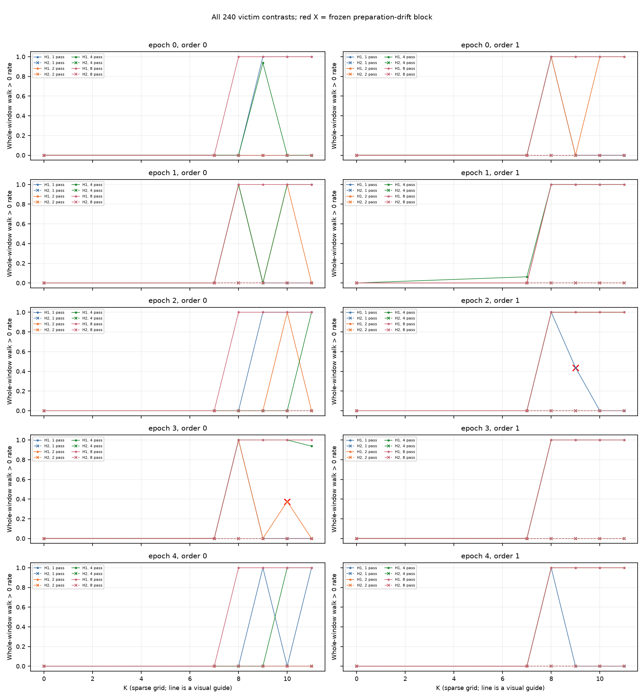
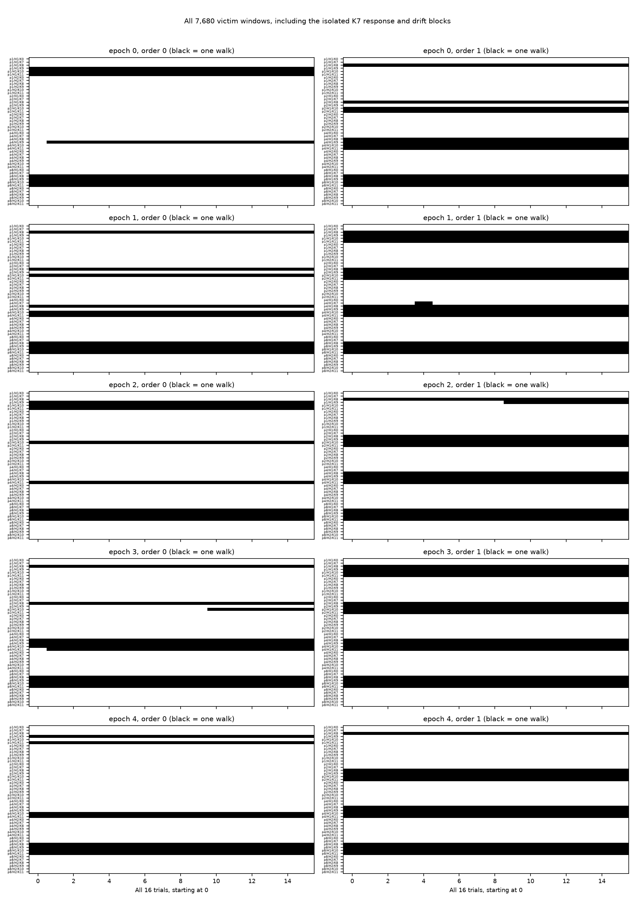

# TLB竞争逐遍观测与victim响应结果（2026-10-11）

## 本次任务的目的（给人类看）

检查旧整圈工作集转折(8,9]、单victim有界响应0/5之间的差异：竞争访问是否产生相关计数激励，重复遍数能否改变victim响应。冻结源 [`docs/design/2026-10-10-tlb-competition-observation.md`](../design/2026-10-10-tlb-competition-observation.md) v1.0.1；协议与证据目录保留冻结日期10月10日，本轮实际执行、报告日期为10月11日。

**技术审计通过；竞争激励1500/1500通过；5/20个K/遍数组合通过重复响应门。** 8遍时K8/9/10/11均双方向5/5 mapping复现，4遍时K11为4/5。单遍K8仅2/5，K9/10/11均0/5。重复访问与victim响应有关，“竞争页完全未进入相关查找”不足以解释本批单遍不响应；lookup不证明allocation/admission，尚不能认证物理8ways、纯LRU或miss概率。

## 完整性与来源

分支 `codex/sm8650-tlb-hierarchy-r2`，工作区 `/Users/michaelyao/workspace/cpu-uarch-explorer-tlb-r2`。5个fresh-process mapping，奇数epoch完整反序；target100、seed137、最大12页、offset64*i、F128、history12不变。96cells/mapping×16trial×(passes+1)，共480cells、**36480窗**（竞争28800、victim7680），每进程7490条原始JSONL。5组VA不同不认证PFN独立，36480相关窗口不是36480个独立复制单位。

192个backing端点/mapping、共960端点都base4K/AnonHugePages0；所有六事件为uint64、cycles>0，enabled>0且running=enabled，完整role/pass/trial和cell顺序吻合注册plan。5份stderr空，CPU7 affinity/逐cell检查与启动MIDR0x410fd821、4K页长成立。snapshot计数采用 `probes/common/perf_window.h` 的请求位置映射，不能称本探针保存了内核事件ID。实际窗口包括用户态read_snapshot包装，竞争K次load与victim一次load的指针/metadata在最后F前已取得。

12环境端点从启动commit策略重算无warning/violation，max CPU温度38.4–41.1°C；policy7全部walt、min/max672000/2745600kHz、cur672000kHz。端点不能证明窗内恒频；结论基于事件计数，不由ns乘名义频率。5次host调用wall分别为0.280, 0.276, 0.263, 0.264, 0.263秒（不含固定15秒epoch冷却），不是探针内部分段时长。未改governor、热服务、PMU用户访问权限；启动独占/journal检查通过。

| 来源 | SHA / commit |
|---|---|
| binary源码commit | `18aff85b95a07180263876441b553187dae59e48` |
| 实际启动commit | `ff55b068068a1f8c13a245961b25a24f02b860d0` |
| binary SHA256 | `432d0dc51480992b7d347cded756f5479812af5d308a1f8f127a9c01af5f2aa2` |
| manifest SHA256 | `03db7c9e761c4150ba4735731f2a952357349684b8c0a3948ec3e0c68becdab3` |
| build SHA256 | `59af33615c8c91293a7fb4cad451ea220f9bb1a8b7fc0ee7028e586712df2ffc` |
| plan SHA256 | `85dfbce5d311d11388399684fa82e243f5cfbc60b18f4bb5aab0c8d30012a466` |
| driver SHA256 | `e5bf974b60a7e597e6b1a7f7dbd139e54d1663be89d64fd5cde038e8cdbee4e6` |
| protocol SHA256 | `5e4c4e981841a08b85b1f0aeafa56bb10d064f73b554f90045492823d39cf35f` |

[`build.json`](evidence/2026-10-10-tlb-competition/build.json) 登记8项递归源依赖、NDK27.2/API34、O2静态构建及两次独立字节一致。源实现18aff85、构建7f94dc5、raw链测试与实际窗截取更正ff55b06；最后一项只更正此前误截调用引用的反汇编文件，无binary变化。[`binary-window-audit.txt`](evidence/2026-10-10-tlb-competition/binary-window-audit.txt)中函数0x244c80：最后F load=0x244cac，before snapshot=0x244cc0，目标load=0x244cd0，after snapshot=0x244ce4；K0跳过目标loop，竞争slot4/countK，victim slot0/count1。

## 竞争激励：可观察，但不等同于接纳

全部1500个非零K/pass位置分别匹配同epoch/H/order/遍数/pass_index的16个K0窗。两事件均值差都在冻结[0.75K,1.25K]；H1的0x05/K范围0.9875–1.1136、0x2f/K范围0.9464–1.0739，H2分别0.9861–1.0714、0.9861–1.0625。门检验事件计数与K次miss/lookup激励相容，不独立认证0x2f全部语义、真实hash或每个VPN都占一个entry。A/C控制与K0背景分开，未从datawalk中扣ITLB。



[SVG](evidence/2026-10-10-tlb-competition/lookup-counts.svg)显示全部点；[`analysis.json`](evidence/2026-10-10-tlb-competition/analysis.json)保留每点六事件的全部16原值、16控制值、均值差与两条门。

## victim：重复遍数改变响应，短遍数不单调

每格先重新[ F→history12 ]×8，然后F→victim训练一次；每个竞争遍与最终victim前都F128。H1−H2的walk>0率差≥0.5，且K0两H率≤0.125、count≤1、前后8窗率漂移≤0.25，才称观察到响应。两方向先在同mapping联合通过，再计≥4/5 mapping；不能跨mapping拼方向。

| K | 1遍 | 2遍 | 4遍 | 8遍 |
|---|---|---|---|---|
| 7 | 0/5 | 0/5 | 0/5 | 0/5 |
| 8 | 2/5 | 2/5 | 2/5 | 5/5 ✓ |
| 9 | 0/5 | 0/5 | 2/5 | 5/5 ✓ |
| 10 | 0/5 | 2/5 | 3/5 | 5/5 ✓ |
| 11 | 0/5 | 0/5 | 4/5 ✓ | 5/5 ✓ |

8遍时K8..11全部A率1/C率0，每格16窗、两个方向、五mapping成立；K7在8遍全部0。K7其它格仅一窗响应：epoch1、逆序、4遍、trial4，未达到命名门。K0全部1280窗walk0，C全部3840窗walk0；全部victim无count>1、ITLB全0。不能将K7全域描述为“绝无响应”。

两格准备漂移按原门阻止响应命名，但全部数据保留：epoch2/K9/逆序/1遍，A的walk为9个0后7个1，率0.4375、漂移0.875；epoch3/K10/正序/2遍为10个0后6个1，率0.375、漂移0.75。它们不是技术失败、不是测量纪律违规，也没有被删成合格curve。短遍数有明显非单调K形状，不能选择首个高点命名容量。





对应可缩放 [rates SVG](evidence/2026-10-10-tlb-competition/victim-rates.svg)、[windows SVG](evidence/2026-10-10-tlb-competition/victim-windows.svg)。竞争窗8681/28800有datawalk、7716窗count>1（多load窗允许）；victim1852/7680有walk且都是1。全36480窗0x2d=0x34+0x35；唯一ITLB窗位于竞争，不把这条相干关系冒充逐load归因。

## 可升级的结论与剩余问题

旧报告 [`docs/reviews/2026-10-09-tlb-capacity-results.md`](2026-10-09-tlb-capacity-results.md) 的F128整圈操作转折(8,9]仍成立，当前代码重放其10400窗公开结果逐字节一致。本批8遍时K7低、K8高，与“victim加8个竞争页”操作边界相容；本协议没有容量估计器，不返回physical ways/驻留概率。这里是描述性对应，不能回填旧单遍响应门。

单遍事件已显示竞争激励，重复遍数仍影响victim，因而仅“L1完全屏蔽竞争”解释不足。剩余候选包括真实索引/接纳/替换历史、descriptor竞争与包装访问；它们尚未被逐一分离。观测插入会改访问历史，五mapping也非旧批配对，不能把新旧变化唯一归因重复遍数。下一TLB最小对照优先换victim身份/训练次序，在同页集上攻击index0保护或历史偏差；不再盲目扩大K。ROB下一问题按同码形反例转资源/有效重叠对照，不追旧串行模型或384。

## 复算、证据等级与回归

消费者 [`tools/diagnostic/tlb_competition_analysis.py`](../../tools/diagnostic/tlb_competition_analysis.py)先全raw/source/build/plan/protocol/driver/env验收，再公开全部480cells/36480匿名窗口。独立算术脚本 [`check_raw.py`](evidence/2026-10-10-tlb-competition/check_raw.py)直接从JSONL分组，未调用判据函数，逐一比对1500竞争点、240victim点、20复制项及summary SHA；[`audit.json`](evidence/2026-10-10-tlb-competition/audit.json)登记25个原始文件SHA、逐进程数量与12匿名环境端点。两条路径均由root运行，不冒称另一位评审人。原始VA/完整环境只留 `data/private/20261011T005101Z-tlb-competition/`，不裁剪、不提交；公开完整匿名窗见 [`summary.json`](evidence/2026-10-10-tlb-competition/summary.json)。

实测前全量diagnostic217/217、runner203/203、analysis250/250、macOS CTest21/21通过。raw链测试编译注册Git源并执行真实--plan/selector，外部计数与环境合成为软件契约证据；与本节目标板实测证据分开。macOS CTest不增加Linux VMA路径覆盖；该路径本次960backing端点为目标板证据，不等同于完整边界测试。

```bash
/Users/michaelyao/workspace/cpu-uarch-explorer/.venv/bin/python tools/diagnostic/tlb_competition_analysis.py \
  data/private/20261011T005101Z-tlb-competition \
  --summary-output /private/tmp/tlb-competition-summary-replay.json \
  --output /private/tmp/tlb-competition-analysis-replay.json
/Users/michaelyao/workspace/cpu-uarch-explorer/.venv/bin/python \
  docs/reviews/evidence/2026-10-10-tlb-competition/check_raw.py \
  data/private/20261011T005101Z-tlb-competition \
  /private/tmp/tlb-competition-summary-replay.json /private/tmp/tlb-competition-analysis-replay.json \
  /private/tmp/tlb-competition-audit-replay.json
```

| 公开证据文件 | SHA256 |
|---|---|
| `analysis.json` | `429e3b4caf4763048f181e7109714f025c8a591aa3109e41364e17c5df9a38b6` |
| `audit.json` | `cf88ce4133b7d256542800f913013682bf0af1272cafbf07b234e7a1e072d701` |
| `binary-window-audit.txt` | `118b0a332570dc0f8fa2c1a14f5487e75a494745de227380688d724b76308a96` |
| `build.json` | `59af33615c8c91293a7fb4cad451ea220f9bb1a8b7fc0ee7028e586712df2ffc` |
| `check_raw.py` | `57663e6ed28c93d6247580f3b719dd06149eeed4bd5b67ed574cc3441289d741` |
| `lookup-counts.png` | `0e23d10ee915b080832516d8a82163291ad4fa9f8afbba41390d9968d0160be0` |
| `lookup-counts.svg` | `60220fa64fb75f047360fd68e01dbee0ea59fb7bfc0221c403226bce285c2d09` |
| `plan.json` | `85dfbce5d311d11388399684fa82e243f5cfbc60b18f4bb5aab0c8d30012a466` |
| `plot.py` | `ef08034cd48c14b4ffc3937dcd4cea9397fd2696e04e29514751227c6c76d2e3` |
| `summary.json` | `abfe82f5c8189d95a6103a8ad88d8cd133269776064bd9d8f7ce890b17fff02b` |
| `victim-rates.png` | `aad3d6c04c572141e436b0a1febac6781b83a4e4c7585bee1b3d674d58fdeac2` |
| `victim-rates.svg` | `75904e67aec906835a341bee6ba61467b837a4b7d2d56d5610b4e03325a30b20` |
| `victim-windows.png` | `de3681e54dae0b5cca742e02b2feced73706f13ce9e601218c9f18af4c4d0db2` |
| `victim-windows.svg` | `d1a229575328da6a052a9f86c734eb4f2f4f11735b47ebda38267420c9bcd947` |
