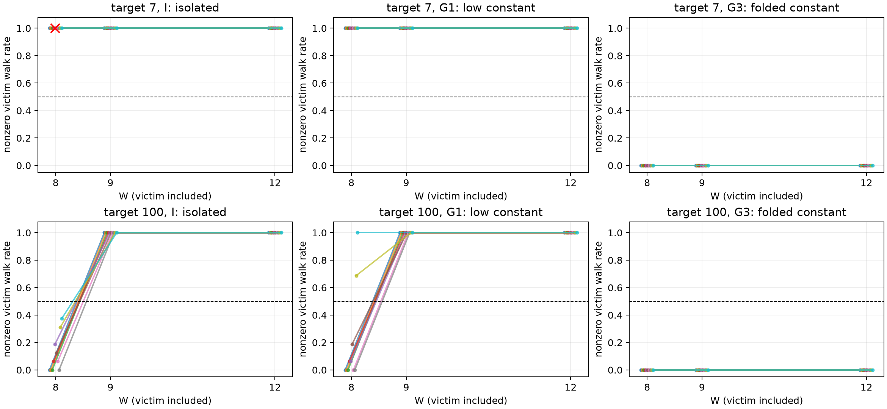

# TLB 四域高位折叠反证结果（2026-10-11）

## 本次任务的目的（给人类看）

旧256MiB域内的H1低位候选与H3高位折叠候选可等价。本批跨四个纯域，保持同一victim虚拟页/节点及G1/G3逐页高位/页内offset/竞争量/访问顺序匹配，检验两候选的相反预测。协议 `docs/design/2026-10-11-tlb-cross-region.md` v1，不改旧A1或旧局部结果。

**技术接受与预注册W12主判据通过：replicated-low-only-candidate-favored。** 两target的五mapping×双order全部I/G1=response、G3=no-response，分别支持本候选组的低位签名。单域高位折叠等价已被本次正交控制打破；不能把有限候选偏好命名为全地址域唯一hardware hash或物理ways。

## 全部观测与保留残差

| target | W | I单域率（十曲线） | G1四域低位恒定率 | G3四域折叠恒定率 |
|---:|---:|---|---|---|
| 7 | 8 | 全1；其中一比较INCOMPUTABLE | 全1 | 全0 |
| 7 | 9 | 全1 | 全1 | 全0 |
| 7 | 12（主） | 全1 | 全1 | 全0 |
| 100 | 8 | 0～0.375，全no-response | 0～1，response/no-response混合 | 全0 |
| 100 | 9 | 全1 | 全1 | 全0 |
| 100 | 12（主） | 全1 | 全1 | 全0 |

唯一不可计算比较：epoch2、target7/I、direction0、W8，16次victim中一窗datawalk=2，其余=1；按预注册single-load-residual规则保留为INCOMPUTABLE，不删窗/改阈值，也不影响只取W12的主判据。全部W1的所有competition/victim datawalk为0；1440/1440逐pass lookup激励门成立。179/180次victim比较可计算；不能把全部34560窗口冒称全部科学qualified。

target100的G1/W8随mapping/order变化，说明即使低位签名得到跨域支持，操作性边界仍依赖访问条件；不由W8/9反推恰7/8物理ways，不把十条曲线平均以掩盖分歧。G3在全部三W、两target、五mapping、双order均无响应，不等于保证其12页全部被某一叶TLB层admit。

六族共60个目标虚拟页；加512个filler，协议prefault payload为2288KiB，另有代码/运行时/页表内存。本批reserve2GiB只是地址范围，不是2GiB物理访问冲刷。四域G1/G3恰3/3/3/3；两族对应VA仅低两VPN位不同，匹配同2MiB父覆盖和L3八项组VA代理。未读取PTE/CONT/PFN，不认证实测PTE cacheline或排除aggregation/cache/replacement等模型外解释。

## 结构知识与设备证据分列

`/Users/michaelyao/workspace/cpu-uarch-ref/docs/Arm_Cortex_X4_Core_TRM_102484_0003_06_en.pdf` §5.1/Table5-1说明L1数据TLB96项、全相联，以及L2 TLB2048项、8-way并共享descriptor中间翻译；这些是官方r0p3文档结构，不是本r0p1设备新测出的精确物理数。此前L1操作区间(96,112]与96项说明相容，W7/8/9条件化响应不反证物理8-way，因为叶项、descriptor与替换并未分离。

该TRM §9 p74明示内部TLB RAM读取只在EL3可用，其它EL会产生Undefined Instruction。Android root/KernelSU仍在EL1侧，不据root身份尝试该接口；EL3/安全固件配合是另一设备能力边界，不能当普通软件probe或静默假定可用。

## 可复现交付与谱系

工作树 `/Users/michaelyao/workspace/cpu-uarch-explorer-tlb-r2`，branch `codex/sm8650-tlb-hierarchy-r2`；代码 `probes/diagnostic/tlb_cross_region.cpp` / `probes/diagnostic/tlb_cross_region_layout.h`，消费 `tools/diagnostic/tlb_region_analysis.py`，驱动 `tools/diagnostic/run_sm8650_region.py`。旧组件默认行为/合同未改。

| 谱系 | 值 |
|---|---|
| binary source | `7ed6434d846fd49e609097f396a5cdac2cd1161d` |
| consumer/build | `8bd0588a5544936b71891516b395e812749c23b0` |
| actual launch | `f8edac73f1adf123a9a0516137c85be40d7d24bb` |
| binary SHA256 | `2ac083ee8e7905925cb8f20097c329a7fced2786e784056797b2004a28124a95` |
| manifest SHA256 | `7d5c81babb9957bd47d09aa6b4284dd7767f6fc3c71696ebb1c6faa3092e9c50` |
| full summary SHA256 | `9c7cc95d2c8a1f630a7b1e30855fad28cfba292d903be71a1af86423519e18a6` |

private raw `data/private/20261011T143207Z-tlb-cross-region`，26文件SHA均绑定；root独占串行五进程、进程间15s，12环境端点最高CPU温度36.5–39.6°C、baseline通过，未写频率/温控/THP/全局PMU。端点不证明窗内恒频。raw不入库，完整stdout/stderr/console保留。

`docs/reviews/evidence/2026-10-11-tlb-cross-region/` 包含全部真实plan/build/窗反汇编、匿名34560计数CSV、无裁剪summary.gz、analysis的1440门/180比较/全部残差、26SHA及check_raw.py/independent-audit.json/可再生plot.py/response.*。直接JSONL第二算术逐所有窗、所有比值/门/数学选址/主裁定精确一致；同一root不冒称第二评审人。

软件出口 `docs/reviews/2026-10-11-tlb-cross-region-preflight.md`：新10项真实producer链/反例通过，完整diagnostic317/317；本轮未改的runner203/analysis250/CTest21已通过；双NDK/逐窗码审计和首坏停机全链齐。

## 接续

本有限Q-C正交辨识完成，不需要复跑四域W12追更多正例。低位候选在这组模型/激励下获复制支持；物理ways/完整hash与PTE/CONT/PFN归因仍未实测。下一ROB有更根本的软件模型问题：现有FSQRT两个gap都使用D0，所以两个anchor并不独立，不能直接套经典双独立long-miss的重叠模型。应先冻结D0/D1独立链与D0/D0串行链的同值对照并实测重叠资格，再决定容量扫描；仍不由NOP数或OP/IR比强报384。所有未解问题在 `docs/open-items.md`，旧正式Phase未冒称完成，main/远端本轮未操作。
