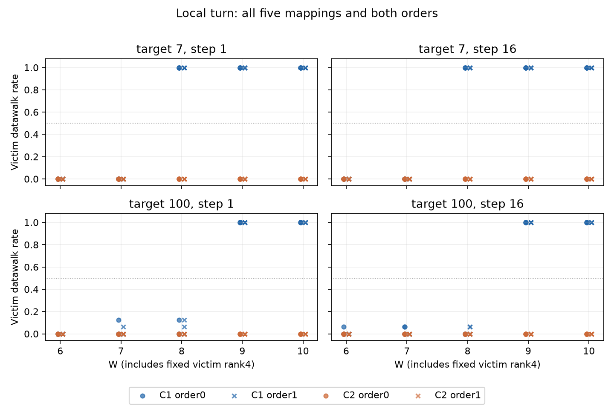
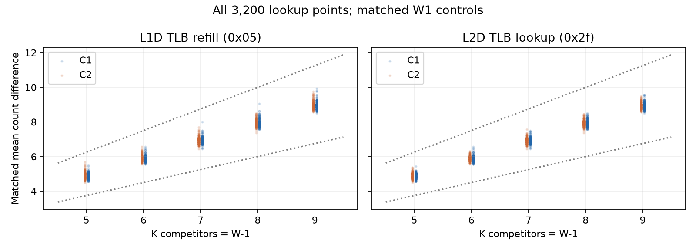

# TLB 匹配地址族局部转折结果（2026-10-11）

## 本次任务的目的（给人类看）

在几何反例 `docs/reviews/2026-10-11-tlb-address-geometry-results.md` 后，固定每族最大12页集与victim4，扫描W6–10，在两个target、两个跨度、两个方向、五个新mapping和分散负控中定位转折。协议 `docs/design/2026-10-11-tlb-local-turn.md` v1，不拼旧A1。

**技术与本批有限区间判据通过。** target7/C1为(7,8]，target100/C1为(8,9]，每个跨度都十条mapping×order曲线一致；C2负控全部no-onset-through10。用户指定的“补反证，再测局部转折”有限任务完成，原全部TLB/ROB目标仍需逐项对账。

## 全部有限终态

横轴W含一个固定victim，其余K=W−1；不是物理ways。表中JSON interval保存相邻端点，数学口径为(左,右]；至少两高側点、所有低侧无复制、全部高侧响应且无非单调才可命名，非零率≥.5。

| target | VPN step | 收集签名 | 状态 | 区间端点 | 一致曲线 |
|---:|---:|---|---|---|---|
| 7 | 1 | C1 | replicated-operational-interval | (7,8] | 10/10 |
| 7 | 1 | C2 | no-onset-through10 | — | 10/10 |
| 7 | 16 | C1 | replicated-operational-interval | (7,8] | 10/10 |
| 7 | 16 | C2 | no-onset-through10 | — | 10/10 |
| 100 | 1 | C1 | replicated-operational-interval | (8,9] | 10/10 |
| 100 | 1 | C2 | no-onset-through10 | — | 10/10 |
| 100 | 16 | C1 | replicated-operational-interval | (8,9] | 10/10 |
| 100 | 16 | C2 | no-onset-through10 | — | 10/10 |

两跨度保持同区间，C1/C2方向差仍复制。它限定访问协议下、地址族条件化的victim响应；没有唯一识别descriptor竞争/额外条目、真实hardware hash、PFN/cache与替换。不能由target7换算7ways、100换算8ways，不能把二者平均为通用容量。此前单target的(8,9]保留为该条件有限结果，通用化解释由几何反例撤销。

## 接受、原值与来源

96cell/mapping×144shot×五mapping=69120窗，完整五stderr为空。3200/3200竞争激励matched W1的0x05/0x2f差分在[.75K,1.25K]；400victim比较无lookup不足/control-background/single-load-residual。全W1 datawalk0、单victim最大walk1；低側偶发walk全部保留，按冻结非零率判定而非挑点。八个地址族实际几何和4K无THP端点核验；lookup不证明admission。

工作树 `/Users/michaelyao/workspace/cpu-uarch-explorer-tlb-r2`，分支 `codex/sm8650-tlb-hierarchy-r2`；root独占串行。probe `probes/diagnostic/tlb_local_turn.cpp`；布局 `probes/diagnostic/tlb_local_turn_layout.h`；consumer `tools/diagnostic/tlb_turn_analysis.py`；driver `tools/diagnostic/run_sm8650_turn.py`。旧geometry/victim helper合同未扩大。实际窗口元数据在最终F之前取得，反汇编同证据目录 `measured-window.txt`；全实链96cell/13824shot属host验证。

| 来源 | 值 |
|---|---|
| binary source | `ac38cd358b20de08a977c9ab59bc5b2cc3d75503` |
| actual launch | `4aa3fe2188f3803ae29f71a7810c2ca9ab9a84a3` |
| binary SHA256 | `cb0400a40d0877e88bcdbb07cb5902728dd7e1376db5f0f6c647e21a83a69e07` |
| manifest SHA256 | `61600fd9d0a22f86eadc84e0d98f9ed0263d8af199b00cf3469ee2823783faaf` |
| build SHA256 | `a286d7a06309da1d55292c3cf01ec0295fa93b47840eab6fbaf9ef276b47ccab` |
| plan SHA256 | `73e1ac96cf48910c5189522caf62aa9f3fb35d587de6380436225e563dec9f56` |
| driver SHA256 | `d3f533f81e74d1f6edf43dedc6411e0a58f31a5161ef6e9c74e106f7b581898d` |
| protocol SHA256 | `b34c285925f5765a40e9f4c34e952dfa1992c392aae69def1b6c9d60b258df49` |

NDK27.2/API34/O2静态两次独立构建逐字节一致。private目录 `data/private/20261011T072131Z-tlb-local-turn`，25 raw SHA全部绑定；直接JSONL第二算术路径69120窗/全部身份/八族几何/3200门/400率/80曲线/八onset与consumer精确一致，同一root不冒称独立评审人。十二环境端点最高CPU温度范围38.8–42.3°C，既有walt观察policy通过、无环境事务或频率/温控/THP/全局PMU写入；端点不证窗内恒频。

同目录 `windows.csv`完整匿名计数、`analysis.json`所有有限判断、`independent-audit.json`第二算术与25 SHA、`summary.json.gz`无删减summary（解压SHA=`e0137e7ebea943164bd3b371d30a799e50ea1044ead5ce45f7fa11e766cfabd3`，与analysis.input_sha256一致），`response.*`/`lookup.*`两图。public几何代理不是物理PTE/PFN测量，原始JSONL及设备序列号不入库。

## 软件出口及下一目标

diagnostic274/274通过；runner203/203、analysis250/250、CTest21/21在未改runner/native基线上通过。实际producer→driver写盘→raw回读全部五映射软件正例和十九类重哈希损坏反例通过，首坏step停一进程；旁路audit_process时测试RED。左右删失、非单调、覆盖、激励失败与十曲线聚合为实际生产形态回归；自审左端高但后续回落反例先RED，非单调优先级修后GREEN。模拟PMU值与本真实目标数据明确分开。

本有限局部转折任务完成，停止在同一曲线上无限加密。下一原目标缺口是Q-A分布形态与Q-D翻译有效在飞占用/供给负控；ROB同值依赖已技术接受但NONE负控波动导致科学主门不通过，另作有区分力的同进程配对/供给诊断。物理TLB ways/唯一hash与ROB/PRF/RS/融合保持未识别，旧正式A1/frozen/14条不拼接；所有后置项在 `docs/open-items.md`。远端本轮不操作。
