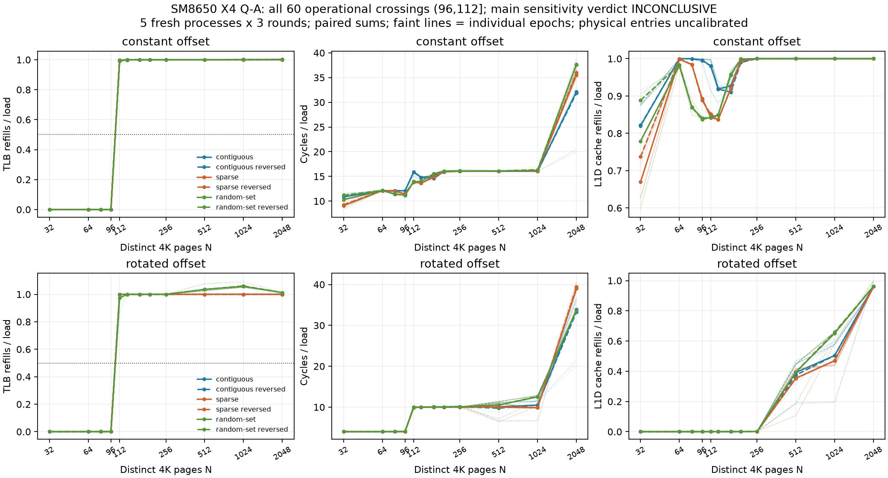

# SM8650 Q-A页集合/offset/order实测（2026-10-11）

## 本次任务的目的（给人类看）

将页集合、访问顺序和页内offset分开，检验L1D TLB refill分布敏感性并排除仅靠latency读容量的解释。`docs/design/2026-10-11-tlb-page-distribution.md` v1先冻结，五mapping完整有限块，未改门/追门/拼旧批。

**有限必做交付通过；预注册分布主裁定INCONCLUSIVE。** 全2175/2175窗口技术接受，2160/2160背景门通过；3页集合×2offset×2order×5mapping的60曲线全部0.5refills/load操作交叉区间(96,112]。无一个主对比满足两order/5epochs全部|delta|≥.05且同向；又有部分delta≥.05，因此不能改名NO_DIFFERENCE。随机集合N1024的全部delta为正[.04997349,.09777514]，最低值严格低于.05门；保留这一细节而非四舍五入跨门，也不能因此否定同向数值证据。物理entry与HPA/PFN归因均未认证。

## 来源、程序与原始记录

| 项 | 实際 |
|---|---|
| branch/worktree | `codex/sm8650-tlb-hierarchy-r2` / `/Users/michaelyao/workspace/cpu-uarch-explorer-tlb-r2` |
| binary source | `57f96a9a35128b7b27aaba67f8d819516b7c96a4`，consumer/build b6143a8 |
| actual launch | `f14f3de02d496bf9a3dc43ac07229e1e885e4b8c`（与source分开，manifest保存driver/protocol/build/plan SHA） |
| Android SHA256 | `5cb662dfd5e0d88cbc0502b510fc499a32de3f1dbdf103020f9c7c1ceec39cbf`，NDK27.2/API34静态O2，独立构建两次一致，部署SHA相同 |
| raw | `data/private/20261011T080845Z-tlb-page-distribution`；25文件完整SHA/五stdout/全部stderr/12环境端点/driver/manifest |
| probe/codegen | `probes/diagnostic/tlb_page_distribution.cpp` / `tlb_page_distribution_layout.h` |
| consumer/driver | `tools/diagnostic/tlb_distribution_analysis.py` / `tools/diagnostic/run_sm8650_distribution.py` |
| target | redmi-k70pro-01，CPU7/MIDR0x410fd821/type8/4K/FP路径无；真实设备映射/序号不入库 |
| complete technical checks | GROUP六unique kernel IDs，等时no mux/uint64；所有before/after4K backing、完整node heads返回；IR最大相对误差6.11e-5 |
| environment | 12端点37.6–41.6°C，全部baselinequiet-state，无cpufreq/温控写或journal；端点不证明窗内恒频 |

同1GiB VA pool内三族最大2048页的union实际prefault6080页（约23.75MiB data pages，非1GiB驻留），各cell实际访问N页/N×64B lines；同N采样loads相同，保留 span 与 touched/data line footprint不同字段。contiguous i、sparse65i、random-set64group[i]+i%64；page_id的mod64都等于i%64，旋转offset直方图完全匹配。order独立seed137随机环与反向同环，随机集合由seed271选择不同256KiB group，不是换order冒充随机集合。

HPA/PTE_CONT在全部mapping明确UNKNOWN；AnonHugePages=0只资格4K backing，未作无聚合证明。[Arm事件定义](https://raw.githubusercontent.com/ARM-software/data/master/pmu/cortex-x4.json)中0x05是refill事件（含投机等路径），0x03包括walk带来的cache traffic；这里比值不是miss probability，不截成[0,1]。r0p3 TRM §5.1官方fully associative/96 entries是外部结构参考，本测操作区间与其相容，未由事件给物理slot标尺。

## 原理判断与反证

1. **小集合的有效L1热端转折很清楚。** rotated三族N≤96，TLB refill/load约0–.0002，cycles/load约4；N112后多数refill/load≈1，cycles/load≈10。相同数据line footprint/offset直方图、反方向和五mapping都保留(96,112]。因此旧[120,1024]宽区间不能当物理项数；此次局部协议给更强的有限热端约束。
2. **offset是强数据布局反证。** N64/96 constant already~11–12cycles/load且cache refill≈.84–1，rotated~4且cache refill≈0，但两者TLB refill仍低。后者不能用“TLB更小”解释前者的延迟上升；同N页集/访问数也不意味着同cache压力。cycle差是协议净差，不直接认证L1/L2 translation latency。
3. **分布主门保守未过，细节仍有信息。** sparse-contiguous主delta所有N约[-.000581,.000406]，有限域内很小。random-set在N112某映射出现[-.138236,~0]，N512[.024070,.077112]、N1024[.049973,.097775]、N2048[.010756,.012692]。多数方向可复现却幅度不满足预注册十点门；未后验降低.05/删除低侧样本。
4. **大集合不只含L1容量。** random-set某epoch0x05/load最大1.09784，不能称109.8%缺失概率；N2048 cache traffic及walk增加。physical/PTE/cache/替换/投机路径竞争，不能把INCONCLUSIVE改成“没有分布差异”或某个聚合机制被唯一确认。

## 完整Σ比表（random order，反序与所有epoch原值在证据）

各点5epochs×3round的计数sum/loads sum，不用median(counter)/median(loads)。表列预注册grid的代表点，未列的N64/80/128/160/192与reverse-random全部在144point JSON/CSV/图中，不删记录。

| set | offset | N | TLB refill/load | cycles/load | cache refill/load | D-walk/load |
|---|---|---:|---:|---:|---:|---:|
| contiguous | constant | 32 | 0.000055 | 10.8721 | 0.820132 | 0.000002 |
| contiguous | constant | 96 | 0.000277 | 12.1004 | 0.996442 | 0.000007 |
| contiguous | constant | 112 | 0.997977 | 15.8631 | 0.980786 | 0.000003 |
| contiguous | constant | 256 | 1.000017 | 16.0871 | 1.000002 | 0.000021 |
| contiguous | constant | 512 | 1.000049 | 16.0640 | 1.000002 | 0.000080 |
| contiguous | constant | 1024 | 1.000238 | 16.0725 | 1.000002 | 0.000379 |
| contiguous | constant | 2048 | 1.000465 | 32.1496 | 1.000002 | 0.582763 |
| contiguous | rotated | 32 | 0.000041 | 4.0010 | 0.000019 | 0.000006 |
| contiguous | rotated | 96 | 0.000199 | 4.0022 | 0.000054 | 0.000003 |
| contiguous | rotated | 112 | 1.000010 | 10.0017 | 0.000091 | 0.000005 |
| contiguous | rotated | 256 | 1.000041 | 10.0882 | 0.000521 | 0.000021 |
| contiguous | rotated | 512 | 1.000063 | 10.0722 | 0.392180 | 0.000087 |
| contiguous | rotated | 1024 | 1.000199 | 10.5049 | 0.504284 | 0.000368 |
| contiguous | rotated | 2048 | 1.000126 | 33.8969 | 0.961326 | 0.661123 |
| sparse | constant | 32 | 0.000054 | 9.0942 | 0.669609 | 0.000004 |
| sparse | constant | 96 | 0.000271 | 11.4737 | 0.893468 | 0.000005 |
| sparse | constant | 112 | 0.990452 | 13.8442 | 0.842800 | 0.000005 |
| sparse | constant | 256 | 1.000019 | 16.0597 | 1.000002 | 0.000018 |
| sparse | constant | 512 | 1.000072 | 16.0809 | 1.000002 | 0.000105 |
| sparse | constant | 1024 | 1.000083 | 16.0917 | 1.000002 | 0.000569 |
| sparse | constant | 2048 | 1.002104 | 35.5245 | 1.000003 | 0.702932 |
| sparse | rotated | 32 | 0.000037 | 4.0010 | 0.000019 | 0.000007 |
| sparse | rotated | 96 | 0.000193 | 4.0024 | 0.000058 | 0.000004 |
| sparse | rotated | 112 | 1.000007 | 10.0016 | 0.000090 | 0.000005 |
| sparse | rotated | 256 | 1.000029 | 10.0043 | 0.000537 | 0.000022 |
| sparse | rotated | 512 | 1.000125 | 10.0190 | 0.353829 | 0.000078 |
| sparse | rotated | 1024 | 1.000051 | 9.8548 | 0.470024 | 0.000493 |
| sparse | rotated | 2048 | 1.000113 | 39.0378 | 0.961270 | 0.851580 |
| random-set | constant | 32 | 0.000050 | 10.2967 | 0.779202 | 0.000002 |
| random-set | constant | 96 | 0.000275 | 11.1944 | 0.840531 | 0.000008 |
| random-set | constant | 112 | 0.995762 | 13.9145 | 0.841748 | 0.000006 |
| random-set | constant | 256 | 1.000049 | 16.1127 | 1.000002 | 0.000039 |
| random-set | constant | 512 | 1.000294 | 16.1074 | 1.000002 | 0.000208 |
| random-set | constant | 1024 | 1.001169 | 16.1997 | 1.000002 | 0.004059 |
| random-set | constant | 2048 | 1.001396 | 37.6636 | 1.000002 | 0.761078 |
| random-set | rotated | 32 | 0.000030 | 4.0013 | 0.000019 | 0.000007 |
| random-set | rotated | 96 | 0.000201 | 4.0446 | 0.000060 | 0.000005 |
| random-set | rotated | 112 | 0.972355 | 9.8723 | 0.000092 | 0.000005 |
| random-set | rotated | 256 | 1.000025 | 10.0611 | 0.000567 | 0.000034 |
| random-set | rotated | 512 | 1.035569 | 10.5283 | 0.394720 | 0.000157 |
| random-set | rotated | 1024 | 1.057786 | 12.5087 | 0.651683 | 0.001173 |
| random-set | rotated | 2048 | 1.011813 | 33.7087 | 0.963140 | 0.622798 |

## 证据与验收

`docs/reviews/evidence/2026-10-11-tlb-page-distribution/`：summary.json.gz是完整725cells/2175窗/全部实际page/order/offset及mapping，解压原始JSON字节SHA绑定analysis.json。windows.csv全部2175计数（含15floor），analysis.json全部144聚合点、720epoch点、2160同窗/相减比与门、24对比×10delta、60完整曲线。independent-audit.json包含25raw SHA；第二套直接原始JSONL位算/IR/同窗Σ比/2160门/24对比/60区间完全一致，未调用生产consumer。response.png/svg全epoch、双order/offset/sets，目视核对通过。

上板前软件 `docs/reviews/2026-10-11-tlb-page-distribution-preflight.md`：真实producer/graph→driver/writer→raw成功与25类重哈希反例，首bad-N只1process；auditor bypass测试RED。background失败曾遗漏curve/comparison出口，两反例先RED后GREEN补全。fresh diagnostic289/289；formal runner203/analysis250/CTest21为此前未改路径基线，不冒称本次fresh。

本批完成Q-A有限必做，主终态INCONCLUSIVE与操作区间分别保留，未升级ATTRIBUTED/物理entries。未知机制转 `docs/open-items.md` 由端到端负责人按新正交干预触发，不在相同曲线无限加密。整体目标账 `docs/reviews/2026-10-11-tlb-rob-goal-ledger.md`；后续ROB同进程/同VA控制，不复活旧正式A1/frozen，也不声称main/远端合并。独立诊断JSONL不是formal schema v2。
