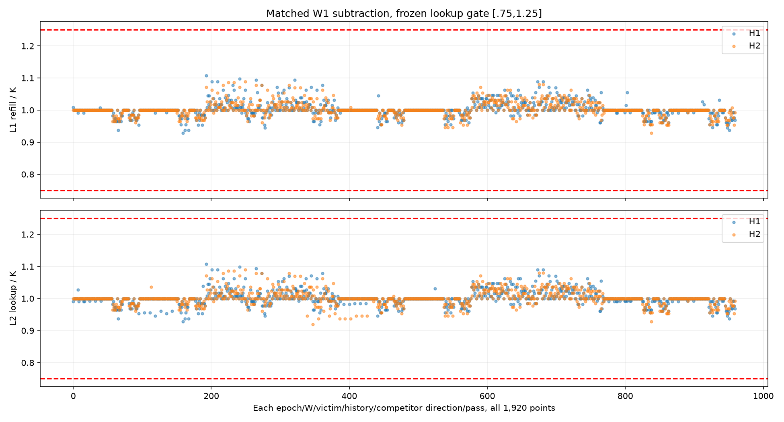
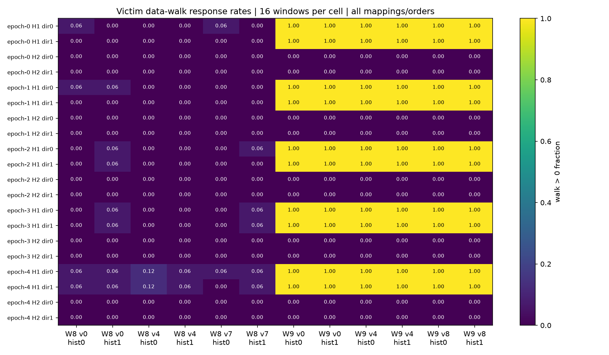
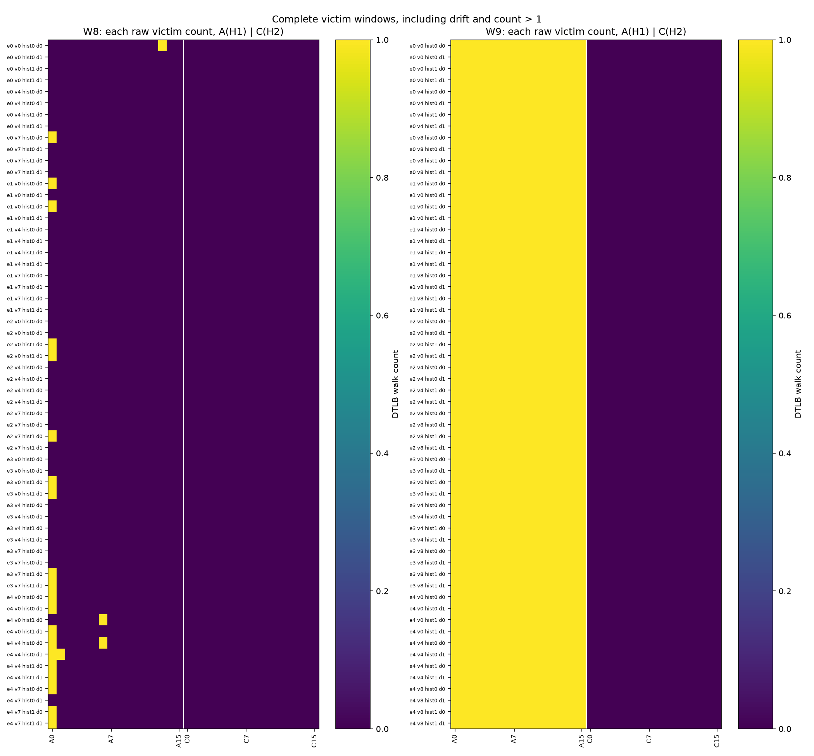

# TLB 同页集合 victim 与准备顺序反证结果（2026-10-11）

## 本次任务的目的（给人类看）

检验此前 W8/9 操作性转折是否只依赖固定 page0 或固定十二页准备顺序。保持每个 W 的活跃页集合不变，换 victim 身份、准备顺序和竞争顺序；不把响应直接换算物理 ways。冻结 [`docs/design/2026-10-11-tlb-victim-history.md`](../design/2026-10-11-tlb-victim-history.md) v1.0.1，采样前明确响应判定须两个 H 全部八遍 lookup 门通过。

**技术通过；1920/1920 lookup 激励点通过；W9 的六个身份/历史组合均在五个 mapping 两个竞争方向复现，W8 六项均未出现复制响应。** W9 的 H1 全部960个 victim 窗 walk=1，H2全部960窗 walk=0；W8 H1有24/960孤立 walk，最高单cell率0.125，不能称8页完全不会miss。本结果推翻“仅固定page0/固定准备顺序才有响应”的有限解释，强化本协议(8,9]的局部操作性边界；物理8ways/LRU仍未认证。

## 生产与接受

工作树 `/Users/michaelyao/workspace/cpu-uarch-explorer-tlb-r2`，分支 `codex/sm8650-tlb-hierarchy-r2`。root独占设备串行运行；5个fresh-process mapping的实际目标VA集合不同，不认证PFN独立。target100、seed137、最大12页、旧9页前缀、node偏移64*i、F128保持；H1/H2是软件收集假设（VPN低8位 / 与VPN>>8 XOR），不称已认证硬件hash。W{8,9}各victim{0,floor(W/2),W−1}×history正逆×竞争正逆×两H，主48cells；W1/v0/K0同history/order/H空竞争8cells，56cells/mapping。奇数mapping整个计划反序，共280cells/40320窗：35840竞争、4480victim。窗口相关性高，五个mapping为复制单位，不把40320当独立样本量。

代码 [`probes/diagnostic/tlb_victim_history.cpp`](../../probes/diagnostic/tlb_victim_history.cpp)、[`tlb_victim_history_layout.h`](../../probes/diagnostic/tlb_victim_history_layout.h)，consumer [`tools/diagnostic/tlb_victim_history_analysis.py`](../../tools/diagnostic/tlb_victim_history_analysis.py)，driver [`tools/diagnostic/run_sm8650_minimal.py`](../../tools/diagnostic/run_sm8650_minimal.py)。源bebd4f9、注释出处修正48d21c6，消费/构建702ce52、生产链测试与实际启动978ab69。

每cell在trial外建链一次：竞争访问恰为[0,W)除victim，换victim不改变W页集合；slot0自环、slot3十二页history闭环、slot4竞争闭环，槽同cacheline。每trial [F→history12]×8，再F→victim一次训练，然后八遍 F→snapshot→K竞争loads→snapshot，最终 F→snapshot→一次victim load→snapshot。准备不是全局reset，snapshot用户包装和相关翻译/descriptor竞争仍在窗中。全部metadata在最后F前取得，未用窗内元数据读取代替目标load。

5进程各8178条JSONL，全部8064窗、112个backing端点，合560端点base4K/AnonHugePages0。CPU7/启动MIDR0x410fd821/4096页长、完整config/geometry/role/pass/trial/typed uint64/no-mux成立；五份stderr空。25-file inventory与Git/source/build/plan/protocol/driver/raw SHA全部接受；每样本六请求位置[11,05,2d,2f,34,35]完整，不称保存了kernel event ID。

[build.json](evidence/2026-10-11-tlb-victim-history/build.json)登记7个递归源依赖、NDK27.2.12479018/API34/O2静态flags，两次独立构建逐字节一致；[plan.json](evidence/2026-10-11-tlb-victim-history/plan.json)来自真实host C++正逆导出。实际二进制[反汇编](evidence/2026-10-11-tlb-victim-history/binary-window-audit.txt)：函数0x244e58，最后F load0x244e84、before snapshot0x244e98、目标load0x244ea8、after snapshot0x244ebc。count0跳过loop，victim count1/slot0，竞争countK/slot4。

12环境端点无warning/violation，CPU最高38.4–42.4°C；policy7全部walt、min/max672000/2745600kHz，端点cur不证明窗内恒频。接受仅为既有较宽policy，不作严格恒温/quiet或排除DVFS/干扰的证据。每进程前预定15秒冷却；五次host执行wall总0.938秒，不含冷却/环境采集。未写governor、热服务、THP、全局PMU或环境事务。

| 来源 | 值 |
|---|---|
| binary source commit | `48d21c6aa77cb81e8a18b78e841f85c2bd38f0b9` |
| 实际 launch commit | `978ab69c7386afac9e7d730a6daa9c8d1c13d497` |
| binary SHA256 | `6fcbfb2fa4414de4fe9a00ebd7ccbf4b03870edb810af81ee5ecf748fe35d4bf` |
| manifest SHA256 | `145fc0b30fa0b4094accdf060e64d6b7fd75323ccecfca35ab79cbea5a8f01c3` |
| build SHA256 | `5242635dccbbd5991e813bc18296e6952b2f3a92bbcb4051d747e0af698ef4fc` |
| plan SHA256 | `c99c4397918aba8ec46c6d60b99e9f91f247dbfebdaa1d829473150285d4e3ba` |
| driver SHA256 | `666de5a6463d2a34d8c8923dadfae802bc27c8b27365b5e8c7d391c989561205` |
| protocol SHA256 | `159cb195eabdc10f49bc5db60696242e3b790f3f122a88f03c7b6bc22c56221c` |
| consumer SHA256 | `3379a9cc67c482c7b7bf74b6a102a12be5df33f947974c8b23b4e91f5732dcdc` |

## 全部判据与观测

每非零K/pass的16窗匹配同epoch/H/history/order/pass位置W1控制。0x05和0x2f均值差分别落在[.75K,1.25K]，1920点全通过；总体除K范围分别0.928571–1.107143、0.919643–1.107143。事件相容只说明相关lookup激励可观察，不认证admission/真实same-set或每VPN恰一entry。



victim门固定：两个H全部八遍lookup过门、对应W1两H walk>0率≤.125、单load窗count≤1、前后8率漂移≤.25、H1−H2率差≥.5。两个竞争方向先在同mapping联合成立，再要求≥4/5mapping；没有先删格或按结果挑阈值。本批120配对点全部无污染/漂移命名，W9差值全1，W8差值0–.125。

| W | victim | history正序 | history逆序 |
|---|---|---|---|
| 8 | 0 | 0/5 | 0/5 |
| 8 | 4 | 0/5 | 0/5 |
| 8 | 7 | 0/5 | 0/5 |
| 9 | 0 | 5/5 | 5/5 |
| 9 | 4 | 5/5 | 5/5 |
| 9 | 8 | 5/5 | 5/5 |

| victim观测域 | 原始窗 | walk=0 | walk=1 | 单cell率范围 |
|---|---|---|---|---|
| W1 H1 | 320 | 320 | 0 | 0 |
| W1 H2 | 320 | 320 | 0 | 0 |
| W8 H1 | 960 | 936 | 24 | 0–.125 |
| W8 H2 | 960 | 960 | 0 | 0 |
| W9 H1 | 960 | 0 | 960 | 1 |
| W9 H2 | 960 | 960 | 0 | 0 |





SVG：[lookup-counts](evidence/2026-10-11-tlb-victim-history/lookup-counts.svg)、[victim-rates](evidence/2026-10-11-tlb-victim-history/victim-rates.svg)、[victim-windows](evidence/2026-10-11-tlb-victim-history/victim-windows.svg)。W1和全部六事件原值仍完整保留于[summary.json](evidence/2026-10-11-tlb-victim-history/summary.json)；图不只呈现过门格。

竞争窗datawalk非零2731/35840，其中1580窗count>1，合法多load窗不按单load残差门拒绝。victim datawalk非零984/4480，没有count>1。9个ITLB非零窗（竞争7、victim2）保留；全40320窗0x2d=0x34+0x35，未将instruction walk误算成datawalk。本批W1的datawalk全0，但其它lookup/Iwalk包装背景并非恒为零。环境事件、snapshot页/descriptor干扰不能因此视为已排除。

## 科学出口与下一可识别问题

本有限反证批结束，技术与预注册观测出口通过。W9跨三个victim、两种history与两order成立，W8孤立walk不复制：操作性边界更稳健，固定身份/固定次序不是唯一解释。未经测试的其它victim/target、高位hash、PFN-cache、descriptor/I-D共享、真实替换算法继续OPEN；整圈walk不等于窗前缺失项。没有物理capacity估计量，未拼旧A1/frozen/14条不完整L1。

下一TLB先做配对地址几何/descriptor区间控制（每mapping同时多个target或不同VPN跨度），才能检验当前低位索引解释及替代竞争来源；不得把新协议结果与旧批拼成ways或直接宣称LRU。具体矩阵另冻，当前没有该控制的目标数据。ROB沿已完成操作事件资格结果，下一小型零值/依赖生命周期控制；正式runner/schema/CMake、窗内clock与ALU/FPU归属/触发继续在 `docs/open-items.md`。

## 回归、复算与审计

diagnostic237/237、runner203/203、analysis250/250、macOS CTest21/21通过；NDK真实完整编译通过。host真实producer/selector、逐页链接轨迹和独立Python期待核会员集合；消费器使用真实plan/geometry而只模拟外部计数/backing。真实driver→写盘→回读正例5进程/40320窗，首个typed victim坏点停1进程，完整failed stdout保留；18类重哈希/身份/环境/覆盖/额外文件反例拒绝。临时移除逐cell守卫时测试明确失败，恢复后通过。这些为软件证据，本节前面实际手机五进程才为目标机证据。

旧TLB10400、冷四状态6144、竞争36480、ROB资源420、ROB事件192完整raw重审/重算，summary与analysis无漂移。第二直接JSONL算术路径[check_raw.py](evidence/2026-10-11-tlb-victim-history/check_raw.py)核40320计数、1920激励点、120配对、12复制项与25 SHA，[audit.json](evidence/2026-10-11-tlb-victim-history/audit.json)含12匿名环境端点；均root执行，不称另一独立评审人。发布前第一次读取发生在driver最终环境文件写入前，完整inventory守卫拒绝；等待driver退出后全量接受，没有补写或更改原始文件。

raw原样保留 `data/private/20261011T020257Z-tlb-victim-history/`，不入库；公开文件不包含VA/PFN/序列号。报告证据与图均再次生成核验，本批本地提交、不操作远程/main/worktree回收。

```bash
/Users/michaelyao/workspace/cpu-uarch-explorer/.venv/bin/python tools/diagnostic/tlb_victim_history_analysis.py data/private/20261011T020257Z-tlb-victim-history --summary-output /private/tmp/tlb-victim-summary-replay.json --output /private/tmp/tlb-victim-analysis-replay.json
/Users/michaelyao/workspace/cpu-uarch-explorer/.venv/bin/python docs/reviews/evidence/2026-10-11-tlb-victim-history/check_raw.py data/private/20261011T020257Z-tlb-victim-history /private/tmp/tlb-victim-summary-replay.json /private/tmp/tlb-victim-analysis-replay.json /private/tmp/tlb-victim-audit-replay.json
```

| 公开文件 | SHA256 |
|---|---|
| `analysis.json` | `38d4506f3115ba596231e9a8c1470ff9429ba390047727d01e6c0dd944c9c59f` |
| `audit.json` | `1bcc7f1c4b82141551474097e97c77e258917a503235a078adb8187c1f210af3` |
| `binary-window-audit.txt` | `0d96b5353be61d6363c43618cf88e82e464e09eccfefc3705dbf6073975c9c9f` |
| `build.json` | `5242635dccbbd5991e813bc18296e6952b2f3a92bbcb4051d747e0af698ef4fc` |
| `check_raw.py` | `59cb80fa6e0d2a16eb639718584a9a5b77b4e94b376860d9e870bfdcc5357bf3` |
| `lookup-counts.png` | `8cccfab448efdb7bae3dce11b237ba82be3b54524e25f573a30a0b5582d025e2` |
| `lookup-counts.svg` | `86788de0840e00782c4fac0dd51156cc3a585dd10adca1b9d934331b25cc8cdc` |
| `plan.json` | `c99c4397918aba8ec46c6d60b99e9f91f247dbfebdaa1d829473150285d4e3ba` |
| `plot.py` | `07de295d64ec0a66203ccd8b7f1c09918b34d84f2957c873b9569643a5cedc24` |
| `summary.json` | `9a9091680620ad53a218c5004aa0eb8cc2c988b7af888ee4b0e8ba82027e6bb5` |
| `victim-rates.png` | `d3855cf7596693042aad8d864cbaee4552eca039b417fb6da9d8617b04408433` |
| `victim-rates.svg` | `b328d23e6e9bbe119d7d04b2c385956a46903b4867e1c7c41250a7d426a694f6` |
| `victim-windows.png` | `f5d6863584e771422ce3e31099104589631571e79d3dd907c49d9d22c3da7811` |
| `victim-windows.svg` | `1dcd3dc4a0d7a3006a56266065127590381adf2a3f297706ad206901920a137e` |
