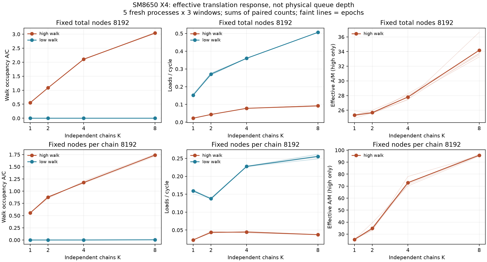

# SM8650 TLB K链有效在飞占用实测（Q-D）

## 本次任务的目的（给人类看）

独立K链是否带来更多有效在飞翻译，并以固定总页数/固定每链页数、相同data line数的低walk控制阻止单曲线物理容量归因。协议 `docs/design/2026-10-11-tlb-walk-parallel.md` v1 已先冻结。

**裁定：通过有限Q-D交付，qualified-effective-occupancy；不认证walker/MSHR/load queue物理深度。** 5fresh进程、495/495窗口技术接受，长窗作用域240/240通过。固定总8192页，K1/2/4/8占用0.553/1.085/2.106/3.039，在所有5epochs有增长；每链8192页条件改变working set，K8吞吐低于K4、驻留积分/causing count上升，不能拿占用平台宣布硬件队列数。

## 实际谱系与完整性

| 项 | 实际值 |
|---|---|
| worktree / branch | `/Users/michaelyao/workspace/cpu-uarch-explorer-tlb-r2` / `codex/sm8650-tlb-hierarchy-r2` |
| binary source | `0bda583e793fa61ed32e7e9f9ba3e384dae29965`（probe两文件）；consumer/build `757bb46` |
| launch | `38eb98310d16a4e90daba51b1c698cba14ea25de`，manifest另锚driver/protocol/build/plan SHA |
| Android binary SHA256 | `0038f7f17769532cf5f9a5abae3b5ebbd88d82a56758b4fbb45736fc1415c7d1`，两次NDK构建字节一致，部署SHA匹配 |
| complete raw | `data/private/20261011T074650Z-tlb-walk-parallel`；全量stdout/stderr/12环境端点/driver/manifest，25文件SHA |
| target | redmi-k70pro-01，CPU7，MIDR0x410fd821，4K，PMUtype8；真实设备标识不入库 |
| backing / windows | 全before/after AnonHugePages=0，头部闭环，全PMU IDs6 unique，enabled==running，IR与实际loop吻合 |
| environment | 12端点38.9–48.3°C，全部baseline preconditions通过；未写频率/热策略/事务；端点不是窗内频率恒定证明 |
| code | `probes/diagnostic/tlb_walk_parallel.cpp` / `tlb_walk_parallel_layout.h`；consumer `tools/diagnostic/tlb_walk_parallel_analysis.py`；driver `tools/diagnostic/run_sm8650_parallel.py` |

`docs/reviews/evidence/2026-10-11-tlb-walk-parallel/build.json` / `plan.json` / `code-audit.json` / `decode.py`保存4核实际ELF独立解码：K自依赖LDR+SUBS+B.NE，无数组/stack/spill；heads装载/保存与perf/read包装在loop外但仍计入窗口开销。

## 长窗完整Σ比（每点5epochs×3round，全部保留）

同窗 C=CPU_CYCLES、M=DTLB_WALK、A=DTLB_WALK_PERCYC。ΣA/ΣC与ΣA/ΣM由同15个窗口计数求得，未使用ratio-of-medians。A/C可以大于1；不是“有walk的周期比例”。0x8128一手定义计每周期在进展walk数量，[Arm事件表](https://raw.githubusercontent.com/ARM-software/data/master/pmu/cortex-x4.json)。0x03包含walk产生的refill；0x17也非纯data-load指标，不能按它们的差值剥离data cache与walk。

| scope | layout | K | A/C | M/C | A/M cycles | loads/C | M/loads | 0x03 / 0x17 per load |
|---|---|---:|---:|---:|---:|---:|---:|---:|
| total | high | 1 | 0.55342 | 0.02184 | 25.338 | 0.02248 | 0.971607 | 1.00000 / 0.03292 |
| total | high | 2 | 1.08452 | 0.04223 | 25.678 | 0.04345 | 0.972039 | 1.00003 / 0.02775 |
| total | high | 4 | 2.10568 | 0.07574 | 27.803 | 0.07810 | 0.969768 | 1.00002 / 0.02854 |
| total | high | 8 | 3.03871 | 0.08891 | 34.179 | 0.09206 | 0.965709 | 1.00001 / 0.02972 |
| total | low | 1 | 0.00001 | 0.00000 | 98.375 | 0.15241 | 5.08626e-07 | 0.24356 / 0.00010 |
| total | low | 2 | 0.00002 | 0.00000 | 92.800 | 0.27109 | 6.35783e-07 | 0.31039 / 0.00011 |
| total | low | 4 | 0.00004 | 0.00000 | 178.600 | 0.36014 | 6.35783e-07 | 0.69486 / 0.00036 |
| total | low | 8 | 0.00012 | 0.00000 | 250.667 | 0.50623 | 9.53674e-07 | 0.91289 / 0.00017 |
| per-chain | high | 1 | 0.55450 | 0.02170 | 25.551 | 0.02242 | 0.967777 | 1.00000 / 0.03932 |
| per-chain | high | 2 | 0.87730 | 0.02517 | 34.857 | 0.04369 | 0.576143 | 1.00004 / 0.25414 |
| per-chain | high | 4 | 1.17829 | 0.01616 | 72.935 | 0.04441 | 0.363785 | 1.00004 / 1.28471 |
| per-chain | high | 8 | 1.73791 | 0.01815 | 95.728 | 0.03719 | 0.488132 | 1.00003 / 1.67451 |
| per-chain | low | 1 | 0.00001 | 0.00000 | 128.800 | 0.15909 | 3.17891e-07 | 0.19982 / 0.00012 |
| per-chain | low | 2 | 0.00002 | 0.00000 | 45.894 | 0.13749 | 2.98818e-06 | 0.99996 / 0.00843 |
| per-chain | low | 4 | 0.00040 | 0.00001 | 61.206 | 0.22757 | 2.86738e-05 | 1.00001 / 0.02994 |
| per-chain | low | 8 | 0.00469 | 0.00007 | 67.183 | 0.25524 | 0.00027345 | 1.00004 / 0.25083 |

low长窗虽符合≤.001门，仍有稀疏walk：各点总M为[8,10,10,15,5,47,451,4301]，不是全部零。低walk的A/M对极少事件/窗口边界敏感，不用于walk latency或队列深度推断。原始M=0窗给None+walk-inactive；背景相减不截负数，本批无负相减值。

固定总页数high的5epoch A/C范围：K1[.55097,.55515]、K2[1.08067,1.08702]、K4[2.09247,2.11579]、K8[3.02108,3.06538]。其M/loads约.966–.972，工作集walk-active；low吞吐K1 .152→K8 .506，说明同K内核可以超过high的.022→.092，但它们的实际物理cache映射和walk共享流量仍不同。只能说translation服务关联有效响应，不能唯归因某队列。

固定每链页数high：总页8192→65536，真实触碰resident上限32→256MiB，line footprint512KiB→4MiB，VAspanhigh约544MiB→4.25GiB；low分别128→1024页，相同line数。K4→K8 loads/C .04441→.03719，A/M72.94→95.73。M/loads也从K1 .968变为K8 .488，原任务所警惕的工作集/walk率混淆确实出现，不能把这条K曲线当独立walker容量曲线。

## 开销、时长与不掩盖的反例

5epoch floor中位C=[83,83,104,103,111]，M/A均0；所有长窗background门通过。短窗不是全部合格：235/240 scope/background门通过，5个per-chain-low-K8短窗M/loads越过.001门（具体值保留在analysis）。按冻结v1主命名使用长窗；短窗失败不是丢弃或用长窗替换raw，不能外推短窗作用域已全qualified。

high短/长A/C比：固定总K1/2/4/8=.9973/.9988/.9896/.9855；固定每链=.9940/.9539/1.0346/1.1171。最大偏离11.7%保留，提示大working set的驻留/供给并非简单线性时长不变；无后验救门/删窗口/补run。

## 可复核证据与出口

- `summary.json.gz` 为全部495窗口/165cell/实际完整索引图的无裁剪summary；解压后的原始JSON字节SHA是 `analysis.json` 的input_sha256。
- `windows.csv` 全495原窗（包含15floor）；`analysis.json` 全32长短点/480同窗与相减比/240长门，`independent-audit.json` 全25raw SHA。
- 另一套直接raw解析与索引位算，逐窗IR/IDs/time、480同窗比、32Σ点、240匹配low共变/background门完全一致，未调用生产consumer。
- `response.png` / `response.svg` 全部epochs与聚合图，已目视核对，无裁剪或物理capacity轴。
- 软件出口 `docs/reviews/2026-10-11-tlb-walk-parallel-preflight.md`：fresh diagnostic281/281，21类重哈希raw反例，首坏只1进程，audit绕过测试RED；formal runner203/analysis250/CTest21是此前未改路径基线，不冒称本批fresh全层运行。

本批Q-D有限必做完成；物理walker深度保持未识别。继续Q-A与ROB同进程控制，整体TLB/ROB目标对账 `docs/reviews/2026-10-11-tlb-rob-goal-ledger.md`。独立JSONL未接formal schema，不宣称main合并/推送。事件已有长链资格，本次为长K窗补作用域，短K窗留下上述部分不合格范围。
