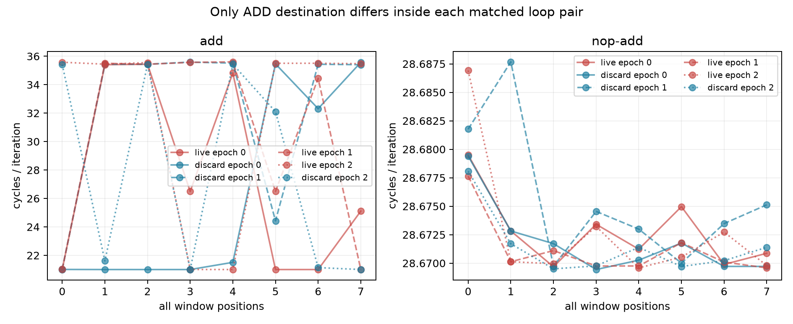

# ROB架构目的控制：丢弃结果仍波动（2026-10-12）

**技术链与参考资格通过，预注册主结论INCONCLUSIVE。** “把ADD目的改XZR即可消除观察波动”的预期被本批反例否定：裸ADD live与discard三个进程均明显波动；NOP+ADD两种目的全部稳定。不能因此唯一命名PRF、fusion、前端或ROB物理容量。

## 本次任务的目的与证据

冻结 `docs/design/2026-10-12-rob-destination-control.md`，仅改变ADD Rd：live循环X4..X11、discard XZR，input同为0x1111+0x2222；同前缀的循环只差Rd5bits，return检查在循环外。五pattern×三epochs NONE64，另共享三N0引用；24/24进程、192/192真机窗全部技术通过。live返回0x3333、discard/双NOP返回0；48个FP引用窗D0/D1精确1.0。

参考门全过：max independent0/min serial0=0.50006512（约208/416重叠），空循环noise/anchor=0.00010083，双NOP64 max/anchor=0.137914，引用/双NOP稳定，全部192窗Icache/iteration≤.001。待研究live波动不作资格删除项，完整数值照常进入比较。

| epoch | NONE64 pattern | median cycles/轮 | range/median | 状态 |
|---|---|---:|---:|---|
| 0 | nop-pair | 28.671417 | 0.059% | 稳定 |
| 0 | add-live | 25.802498 | 55.941% | 波动 |
| 0 | nop-add-live | 28.672028 | 0.034% | 稳定 |
| 0 | add-discard | 21.258884 | 68.520% | 波动 |
| 0 | nop-add-discard | 28.670990 | 0.035% | 稳定 |
| 1 | nop-add-discard | 28.674011 | 0.063% | 稳定 |
| 1 | add-discard | 35.436203 | 41.107% | 波动 |
| 1 | nop-add-live | 28.670113 | 0.028% | 稳定 |
| 1 | add-live | 34.938995 | 41.786% | 波动 |
| 1 | nop-pair | 28.670265 | 0.014% | 稳定 |
| 2 | nop-pair | 28.671745 | 0.029% | 稳定 |
| 2 | add-live | 35.490799 | 41.067% | 波动 |
| 2 | nop-add-live | 28.670330 | 0.060% | 稳定 |
| 2 | add-discard | 26.857143 | 53.743% | 波动 |
| 2 | nop-add-discard | 28.670803 | 0.030% | 稳定 |

裸ADD live range/median41.1–55.9%，discard41.1–68.5%；NOP+ADD live/discard均<.063%。主ADD discard-stability为false/false/false，所以没有DISCARD_DESTINATION_REMOVES_OBSERVED_VARIABILITY；按冻结表是INCONCLUSIVE。前缀对照为VARIABILITY_NOT_REPLICATED（两者均稳定），discard−live中位差为−.001038/+.003899/+.000473cycles/轮。

Rd=XZR没有架构结果，但实现可分配临时资源、消除或选择不同管线；这批只反驳“去掉架构目的足以消除状态”的简单预期，不证明所有PRF解释被排除。NOP前缀与稳定状态伴生，仍不认证实际fusion/MOP allocation；0x3a/IR在本批近1，裸ADD≈130、prefix/双NOP≈258 retiredµOP/iteration，这不是ROB entry计数。数据/码形变化更有区分力，重复旧NOP网格不能补α标尺。

## 完整复核、谱系与下一项

原始私有目录 `20261012T035513Z-rob-destination-control`，全部102文件SHA闭合。直接raw第二算术验证192窗/24点/6资格值、两prefix全部稳定性与signed median差、48FP窗及192 checksum完全一致。公开完整CSV、summary/analysis gzip、原始SHA、独立核对及图在 `docs/reviews/evidence/2026-10-12-rob-destination-control/`。温度端点38.0–43.6°C，无基线违规，不认证窗内恒频；所有负/正差和波动窗保留。

branch `codex/sm8650-tlb-hierarchy-r2`，worktree `/Users/michaelyao/workspace/cpu-uarch-explorer-tlb-r2`。

| 角色 | commit / 路径 |
|---|---|
| source | `f85e2bbdae997f888594f0a37bd493bdea6c8973` / `probes/diagnostic/rob_destination_control.c` |
| consumer / build | `083c386` / `tools/diagnostic/rob_destination_analysis.py`、`tools/diagnostic/run_sm8650_rob_destination.py` |
| actual launch | `f640160aa23641f41104e2bf2d11ccb4c986761c` |
| binary SHA256 | `2a54d91239e5273bf997d7d23f9a8412ff065dcd2c92308e8903c31f4d68fdba` |

两NDK27.2/API34/O2/Werror/static构建字节一致；60实际计划与oracle、30程序独立Capstone、GP/FP结果捕获汇编已核；12新软件测试及398/398整树diagnostic通过。native软件与外部PMU mock不冒充本192真机窗。正式runner/schema/CMake及main尚未集成；旧not-qualified不晋升。

本有限目的控制结束，不在本协议N扫。下一ROB可另冻稳定双NOP与NOP+ADD-discard、同bytes/无架构GPR结果的独立锚点窗口对照，询问是否有共同操作边界；必须保留α与活跃约束未知，不能把eligible group改名physical MOP/entry。TLB下一需分离descriptor/translation prefetch与stored-pointer表示，owner/触发登记 `docs/open-items.md`。
