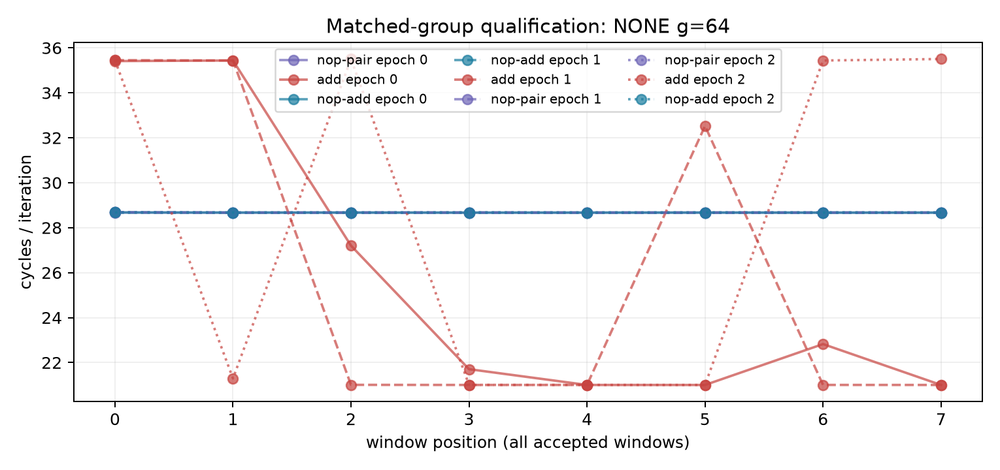

# ROB 匹配语法组：资格不通过（2026-10-12）

**裁定：本批软件/技术链通过，科学资格不通过，扫描未启动。物理ROB entries仍未识别。** 没有以放宽门、删窗或重跑追门替代新对照。

目的与冻结规则见 `docs/design/2026-10-12-rob-fusion-groups.md`。ADD与NOP+ADD匹配实际ADD工作、值与目的序列，双NOP提供无GPR工作控制；g是语法组，不是已校准MOP/ROB条目。

## 完整事实

18/18进程、144/144窗口通过精确码/IR/IDs/noMUX/CPU/结果/环境技术审计；48个带FP窗D0/D1均精确1.0，ADD返回0x3333。全部78个raw文件SHA闭合，原始私有目录 `20261012T015907Z-rob-fusion-groups-qualification`。第二直接raw算术验证全部144窗/18点/6资格值一致，见 `docs/reviews/evidence/2026-10-12-rob-fusion-groups/qualification-independent-check.json`。

D0/D1独立约208、同D0串行约416cycles/轮，maxI0/minS0=0.50004808，锚点稳定门过；空循环绝对noise/anchor=0.00059325、NONE64最大/anchor=0.170692也过。三个ADD NONE64进程全不稳定：窗间约21→35.5cycles/轮，range/median=51.1–68.8%，明显超过10%；NOP+ADD及双NOP对应负控稳定。非唯一原因：取指/解码/fusion、调度/写回、寄存器生命周期及窗内clock未被本批分离，不能宣称温度、cache或PRF已定因。

| epoch | NONE64 pattern | 中位cycles/轮 | range/median | 稳定门 |
|---|---|---:|---:|---|
| 0 | nop-pair | 28.670 | 0.0% | 通过 |
| 0 | add | 22.263 | 64.8% | 不通过 |
| 0 | nop-add | 28.671 | 0.0% | 通过 |
| 1 | nop-add | 28.670 | 0.0% | 通过 |
| 1 | add | 21.007 | 68.8% | 不通过 |
| 1 | nop-pair | 28.670 | 0.1% | 通过 |
| 2 | nop-pair | 28.672 | 0.0% | 通过 |
| 2 | add | 28.365 | 51.1% | 不通过 |
| 2 | nop-add | 28.671 | 0.0% | 通过 |

额外失败：epoch1串行g0的首窗Icache refill=134/131072=.00102234，略高于预注册.001门；该窗完整保留，不因差距小而放行。ADD波动三个进程均出现，且其每窗Icache门全过，不能以这一个取指失败解释全部ADD波动。端点环境温度 38.8–46.9°C，无基线违规；端点频率不认证窗内恒频。

完整原值CSV `docs/reviews/evidence/2026-10-12-rob-fusion-groups/qualification-windows.csv`，summary/analysis gzip与全部SHA同目录；图不删任何窗。

## 分支与提交

均在 `codex/sm8650-tlb-hierarchy-r2`，worktree `/Users/michaelyao/workspace/cpu-uarch-explorer-tlb-r2`。

| 角色 | commit / 路径 |
|---|---|
| source | `9a09fa2fcf059ab081566530f3b41dc3a203b0c8` / `probes/diagnostic/rob_fusion_groups.c` |
| build / consumer | `b5e260f8ad95d8c26d09af60cfb49a34c67aebcf` / `tools/diagnostic/rob_fusion_analysis.py`、上述evidence/build.json |
| ownership补全 | `8182b4321924605a34af0582409cad876558d748` / `tools/diagnostic/run_sm8650_rob_fusion.py` |
| actual launch | `04f3980443b08282d2df618ea4dc375944d18389` |
| 新生产链测试 | `04f3980` / `tools/diagnostic/tests/test_rob_fusion_raw.py` |
| binary SHA256 | `929474de2b5a00cb48a744c303332596a36999fe72300326ee533a131ca6cd10` |

两次NDK27.2/API34/O2/Werror/static字节一致；全部54实际程序独立反汇编、108顺逆plan与oracle一致；15项新测试、358/358全diagnostic通过。外部PMU mock仅为软件证据，以上144窗是真机证据。正式runner/schema/CMake接入尚未完成。

## 后续触发

本批有限资格已结束，不启动1152窗扫描。下一ROB先针对相同ADD NONE流的状态切换作可区分的配对干预（结果依赖/寄存器生命周期或可观测供给状态）；不能把NOP+ADD更稳当作fusion或allocation证书。α单位标尺及ROB活跃约束仍OPEN。登记 `docs/open-items.md`；TLB均衡页集的独立批继续，旧A1/frozen/14条L1不拼接。
