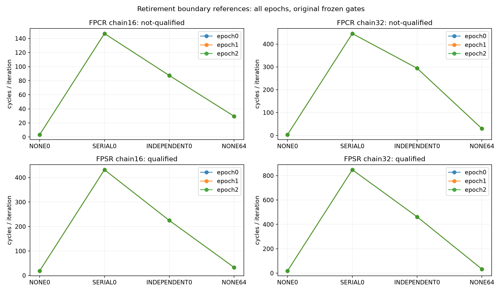

# ROB退休边界资格：FPSR_REFERENCE_QUALIFIED（2026-10-12）

## 本次任务的目的（给人类看）

用真实数据依赖输入重置及MRS FPSR/FPCR唯一sysreg差，对原跨迭代参考作正交约束；先資格，不启动容量扫描。`docs/design/2026-10-12-rob-retirement-drain-next.md` v1.0/1c4f686的全部384窗完成，技术链通过，FPSR qualified、FPCR not-qualified；二者分列不覆盖。

| mode | chain | control | E0,E1,E2窗口中位 cycles/iteration |
|---|---:|---|---|
| fpcr | 16 | none/0 | 3.333631, 3.333671, 3.333663 |
| fpcr | 16 | serial/0 | 147.007614, 147.007702, 147.007619 |
| fpcr | 16 | independent/0 | 87.475409, 87.443945, 87.433125 |
| fpcr | 16 | none/64 | 29.501100, 29.501073, 29.501119 |
| fpcr | 32 | none/0 | 3.279177, 3.333713, 3.333792 |
| fpcr | 32 | serial/0 | 446.025594, 446.027726, 446.027334 |
| fpcr | 32 | independent/0 | 294.014100, 294.014689, 294.014342 |
| fpcr | 32 | none/64 | 29.501078, 29.500982, 29.501112 |
| fpsr | 16 | none/0 | 19.000702, 19.000679, 19.000700 |
| fpsr | 16 | serial/0 | 432.005886, 432.005842, 432.005943 |
| fpsr | 16 | independent/0 | 225.003512, 225.003656, 225.003428 |
| fpsr | 16 | none/64 | 33.144023, 33.144044, 33.144157 |
| fpsr | 32 | none/0 | 19.000671, 19.000687, 19.000673 |
| fpsr | 32 | serial/0 | 848.011713, 848.010560, 848.010557 |
| fpsr | 32 | independent/0 | 462.006540, 462.005803, 462.005639 |
| fpsr | 32 | none/64 | 33.144036, 33.144072, 33.144010 |

冻结每point range/median≤.05使FPCR不合格；完整失败点 [{"epoch": 0, "mode": "fpcr", "anchor": "none", "groups": 0, "chain": 32, "range_fraction": 0.06634208394092017}, {"epoch": 1, "mode": "fpcr", "anchor": "none", "groups": 0, "chain": 16, "range_fraction": 0.06551794867100334}]。FPCR其它门仍见完整JSON，不按另一个门重判本终态。FPSR最大I0/minS0={16:0.520839,32:0.544813}，所有供给/无锚点噪声/取指门通过。跨epoch的I0中位变化逐项显示，不把资格通过叫每epoch完全相同或窗内clock认证。

**主要实证**：相同原FP operand/result及码形下，mode仅sysreg编码不同，FPCR参考不再等于旧跨迭代208/416模型；FPSR参考大致体现两独立/串行13-cycle链增量，实际所有值在表中。数据重置/特殊状态寄存器等待影响本测量的生命周期响应。原FP结果在每iteration reset前捕获，窗口末原结果两word及raw status由outside-loop buffer核验；384窗全为精确1.0/0/checksum0。该oracle验证窗口末输出及固定操作数程序，不宣称观测了每个内部FP运算的隐藏状态。

MRS FPSR约束较早FP指令execute/retire，**不证明禁止后来指令的推测fetch/rename/allocation**，不证α实际单位或唯一活跃ROB限制。本终态只为FPSR参考资格，physical entries=None；没有自动capacity N扫描，不为384补offset，旧2352 main INCONCLUSIVE与E2g+k=(352,368]不改。

代码 `probes/diagnostic/rob_fp_drain.c` /source8ecf4b9，consumer `tools/diagnostic/rob_drain_analysis.py` / driver `tools/diagnostic/run_sm8650_rob_drain.py` /9d514b4，build50ee8f8 / actual launchafe6bee，branch codex/sm8650-tlb-hierarchy-r2。binary SHA `d0b18aa6b2362af46c8c135d77d384eb331823f9609bcf959a0d46b59d4e48ad`，两NDK27.2/API34/static/C11/Werror字节一致、32 actual plan/32独立Capstone/NDK asm oracle与13真实producer→writer→raw软件测试通过。530完整diagnostic通过450.330秒，`docs/reviews/evidence/2026-10-12-rob-retirement-drain/regression.json`；未重跑未改formal路径。

raw私有 `data/private/20261012T145638Z-rob-retirement-drain-qualification/`，198 raw SHA；公开full analysis/CSV/完整参考图及直接第二算术。第二算术每窗IR/原结果/status/noMUX、每mode gates/状态与consumer精确一致。环境端点37.7–56.1°C无基线违规，无sysfs/governor mutation；架构FPSR清零只属本进程且非性能声明。下一先写明scope/单位与未来speculation替代模型再冻结新N网格或barrier控制，所有未知在 `docs/open-items.md`；整体physical TLB/ROB目标未完成。
