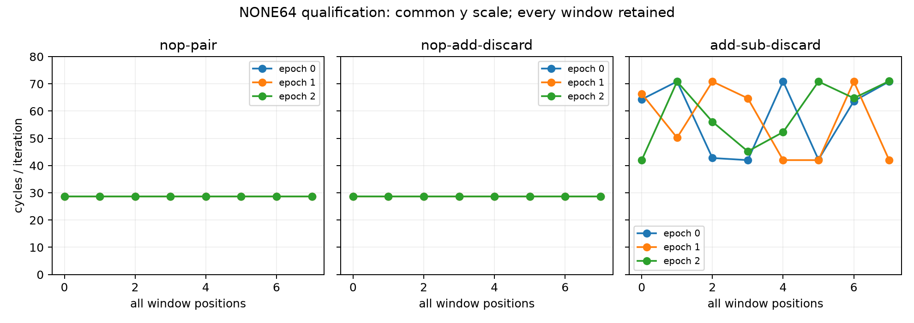

# ROB相对单位与两链长：资格不通过，扫描禁止启动（2026-10-12）

**本批技术链通过；资格状态 `not-qualified`。物理ROB entries与实际allocation单位均未认证。**

## 本次任务的目的（给人类看）

按 `docs/design/2026-10-12-rob-retirement-units.md` 冻结v1，检验三种同为两ISA、无架构GPR结果的语法组（双NOP、NOP+ADD XZR、ADD XZR+SUB XZR）及chain16/32的参考/供给能否用于共同边界研究。SUB不置标志，D0/D1=精确1.0；one syntactic group不预设为实际MOP/entry。此前XZR控制的192窗和旧资格失败不晋升、不拼接。

完整24进程/192真机窗、102 raw SHA闭合；每窗GROUP+ID、无multiplex、实际code/IR/checksum审计通过，96个FP窗结果精确1.0。链长16/32的independent/serial max/min=0.50004730/0.50002982，空窗绝对noise/short anchor=0.00066290，NONE64 max/short anchor=0.34135240。参考稳定=True，全部NONE64稳定=False，取指背景门=False。

| epoch | NONE64 pattern | median cycles/轮 | range/median | 10%供给门 |
|---|---|---:|---:|---|
| 0 | nop-pair | 28.670490 | 0.053% | 稳定 |
| 0 | nop-add-discard | 28.672161 | 0.026% | 稳定 |
| 0 | add-sub-discard | 63.973915 | 45.197% | 波动 |
| 1 | add-sub-discard | 57.463390 | 50.177% | 波动 |
| 1 | nop-add-discard | 28.671795 | 0.045% | 稳定 |
| 1 | nop-pair | 28.670303 | 0.032% | 稳定 |
| 2 | nop-pair | 28.671059 | 0.039% | 稳定 |
| 2 | nop-add-discard | 28.670219 | 0.078% | 稳定 |
| 2 | add-sub-discard | 60.420776 | 47.983% | 波动 |

另有9个取指窗越过131.072计数的门，原始计数134–180均保留，见 `docs/reviews/evidence/2026-10-12-rob-retirement-units/qualification-secondary-observations.json`。**未预注册的描述观察**：ADD+SUB每轮cycles范围42.003–71.003，IR约258.002保持一致；同窗平均cycles/ns仅2.7115–2.7462。这不提供窗内恒频证书；简单平均频率变化解释缺少本批支持，供给/执行状态仍需正交干预。即使仅看取指未越线窗口，ADD+SUB的明显波动也真实存在，不能靠删除首窗获得资格。

本阶段不测试实际分配单位。即使资格通过，后续共同边界也只检验明示的α模型代理 `U=α*g+2*chain`，需六条完整复制曲线；physical ROB条目及活跃资源限制仍未知。完整失败/波动窗口保留，禁止更改资格门或重跑挑选通过窗。

## 工件与谱系

raw私有目录 `20261012T050519Z-rob-retirement-units-qualification`，source branch `codex/sm8650-tlb-hierarchy-r2`。
source `df2171dcb191dcf05374e3ed3e8a9dd77f77e6d6`（`probes/diagnostic/rob_retirement_units.c`），consumer/build `47ff455`，actual launch `f2c99a9f844a868601e8664cfe6271b552c9e943`；binary SHA256 `84b2d3bae29107030eb9b8d0b84c90bc7bb8a9e1faea6f038f844887ad12de6e`。NDK27.2/API34/O2/Werror/static两次字节一致，288实际计划/144独立Capstone程序以及7+9软件测试/414整树diagnostic通过。软件mock模型与本192真机窗分列。

consumer `tools/diagnostic/rob_units_analysis.py`、driver `tools/diagnostic/run_sm8650_rob_units.py`、公开完整CSV/analysis、raw SHA与第二算术复核在 `docs/reviews/evidence/2026-10-12-rob-retirement-units/`。第二算术直接读raw校验全部192窗口统计、96FP结果、全部门值与判定，未调用consumer来计算这些门。环境端点37.3–42.0°C无基线违规，不认证窗内恒频。

下一行为：本资格批结束，2352窗扫描未启动；登记供给反例，转向新可识别干预，不重复本曲线追门。 负责人=当前端到端Agent，r2分支未宣告main集成或整体物理目标完成；未竟问题在 `docs/open-items.md`。
