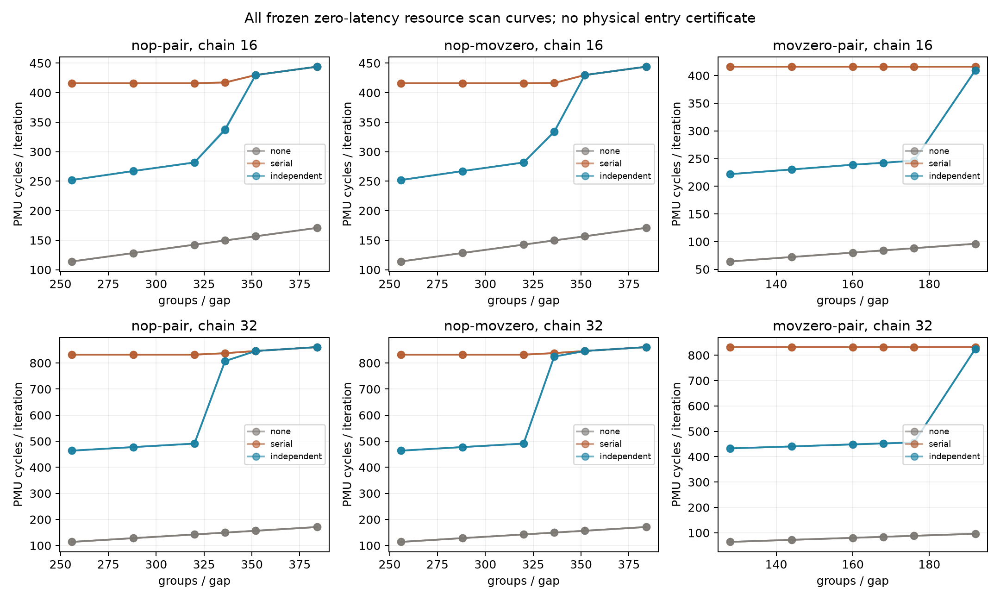

# ROB零延迟MOV完整扫描：INCONCLUSIVE（2026-10-12）

**2352/2352窗口完成，资格保持True；共同代理区间=None。物理entries和实际allocation单位仍未认证。**

## 本次任务的目的（给人类看）

按 `docs/design/2026-10-12-rob-zero-latency-units.md` 固定矩阵，在真实192窗资格通过后检验NOP-eligible两类与MOV/MOV、两链长是否支持共同U=α*g+2*chain模型。α、生命周期和活跃限制是候选假设，不是PMU直接量。不得将third-party384作为拟合目标。

| pattern | chain | 三epoch区间复制 | groups/gap区间 | 模型proxy区间 |
|---|---:|---|---|---|
| nop-pair | 16 | False | None | None |
| nop-pair | 32 | False | None | None |
| nop-movzero | 16 | False | None | None |
| nop-movzero | 32 | False | None | None |
| movzero-pair | 16 | False | None | None |
| movzero-pair | 32 | False | None | None |

**原冻结取指门的具体失败**：2352窗中1792窗超过.001 L1I refill/iteration，18条曲线全部按原消费入口判INCOMPUTABLE。这是容量判据未形成区间的明确原因，不是“未观测到任何响应”。另一生命周期预测在 `docs/reviews/2026-10-12-rob-lifetime-heldout-results.md` 单独报告；不替换本批原门或终态。

所有294进程/2352窗、1182raw SHA保留；每点8窗供给/取指门、near-serial与below/ambiguous分类、非单调与删失优先、两个高侧平台点、三epoch复制以及共同交集直接从raw第二算术复算，与consumer相等。完整带符号cycles、六事件和曲线在 `docs/reviews/evidence/2026-10-12-rob-zero-latency-units/scan-analysis.json.gz` 与 `scan-windows.csv`，任何不合格点均未删除。资格链接的raw manifest SHA和同binary匹配通过。

**结论边界**：共同模型兼容只约束有效退休窗口，不能证明ROB是唯一活跃瓶颈、α已直接认证或FP/loop跨迭代释放符合简化方程。若区间不复制、供给失败或共同交集为空，终态INCONCLUSIVE；即使存在common proxy也不命名physical ROB条目。新MOV类与更长窗口共同变化，不用这批洗掉旧ALU供给失败或把稳定唯一归因MOV。

raw私有目录 `20261012T102234Z-rob-zero-latency-units-scan`；branch `codex/sm8650-tlb-hierarchy-r2`，source `5aecbbb04a68de41a72d3014f76720b9f3131f63` / build7c7647e / actual launch `3124a73add9f55e4c16973f74c22402bb85e0fce` / binary SHA256 `8fa4425cbfdbbd7d96358cbb6cd96bf9f4e46b3c5fa0ede6c2ee473b7f0d1b81`。代码 `probes/diagnostic/rob_zero_latency_units.c` / consumer `tools/diagnostic/rob_zero_units_analysis.py` / driver `tools/diagnostic/run_sm8650_rob_zero_units.py`。双NDK27.2/API34/static/Werror、288plan/144独立decode、7+9软件与launch前457完整diagnostic通过；software mock与device分列。环境端点39.6–46.7°C无基线违规，不认证窗内恒频；无需恢复sysfs，无环境mutation。

本有限新协议结束，physical ROB仍OPEN；不无限加密本曲线或为迎合384改变α/门。实际单位与活跃约束、TLB正交控制、main集成/远端备份均归 `docs/open-items.md`，没有宣告总体物理目标完成。
