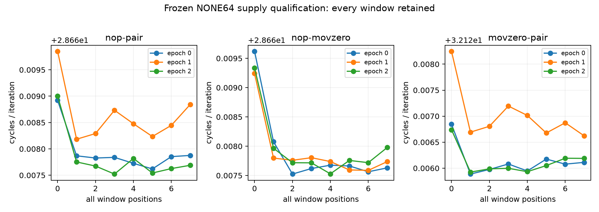

# ROB零延迟MOV与两链长：资格通过，扫描待执行（2026-10-12）

**本批技术链通过；资格状态 `unit-controls-qualified`。物理ROB entries与实际allocation单位均未认证。**

## 本次任务的目的（给人类看）

按 `docs/design/2026-10-12-rob-zero-latency-units.md` 冻结v1，检验三种两ISA语法组（双NOP、NOP+MOVZ live、MOVZ live+MOVZ live）及chain16/32的参考/供给能否用于共同边界研究。MOV #0为官方零延迟资源类、非空MOV组实际返回X4=0，D0/D1=精确1.0；one syntactic group不预设为实际MOP/entry。新warm/measure统一1048576迭代、进程间固定15秒；代码类与窗口长度共同改变，不唯一归因MOV；此前ADD/SUB旧失败不晋升、不拼接。

完整24进程/192真机窗、102 raw SHA闭合；每窗GROUP+ID、无multiplex、实际code/IR/checksum审计通过，96个FP窗结果精确1.0。链长16/32的independent/serial max/min=0.50001311/0.50001191，空窗绝对noise/short anchor=0.00024655，NONE64 max/short anchor=0.15445994。参考稳定=True，全部NONE64稳定=True，取指背景门=True。

| epoch | NONE64 pattern | median cycles/轮 | range/median | 10%供给门 |
|---|---|---:|---:|---|
| 0 | nop-pair | 28.667846 | 0.005% | 稳定 |
| 0 | nop-movzero | 28.667646 | 0.007% | 稳定 |
| 0 | movzero-pair | 32.126079 | 0.003% | 稳定 |
| 1 | movzero-pair | 32.126839 | 0.005% | 稳定 |
| 1 | nop-movzero | 28.667749 | 0.006% | 稳定 |
| 1 | nop-pair | 28.668462 | 0.006% | 稳定 |
| 2 | nop-pair | 28.667682 | 0.005% | 稳定 |
| 2 | nop-movzero | 28.667738 | 0.006% | 稳定 |
| 2 | movzero-pair | 32.126024 | 0.003% | 稳定 |

本阶段不测试实际分配单位。即使资格通过，后续共同边界也只检验明示的α模型代理 `U=α*g+2*chain`，需六条完整复制曲线；physical ROB条目及活跃资源限制仍未知。完整失败/波动窗口保留，禁止更改资格门或重跑挑选通过窗。

## 工件与谱系

raw私有目录 `20261012T101155Z-rob-zero-latency-units-qualification`，source branch `codex/sm8650-tlb-hierarchy-r2`。
source `5aecbbb04a68de41a72d3014f76720b9f3131f63`（`probes/diagnostic/rob_zero_latency_units.c`），consumer/build `7c7647e`，actual launch `3c4d8656009a28f802f59d608d4e2901de8830ec`；binary SHA256 `8fa4425cbfdbbd7d96358cbb6cd96bf9f4e46b3c5fa0ede6c2ee473b7f0d1b81`。NDK27.2/API34/O2/Werror/static两次字节一致，288实际计划/144独立Capstone程序以及7+9软件测试/457整树diagnostic通过。软件mock模型与本192真机窗分列。

consumer `tools/diagnostic/rob_zero_units_analysis.py`、driver `tools/diagnostic/run_sm8650_rob_zero_units.py`、公开完整CSV/analysis、raw SHA与第二算术复核在 `docs/reviews/evidence/2026-10-12-rob-zero-latency-units/`。第二算术直接读raw校验全部192窗口统计、96FP结果、全部门值与判定，未调用consumer来计算这些门。环境端点36.9–45.9°C无基线违规，不认证窗内恒频。

下一行为：按原冻结协议运行2352窗有限扫描；任何结果仍不能直接命名物理entries。 负责人=当前端到端Agent，r2分支未宣告main集成或整体物理目标完成；未竟问题在 `docs/open-items.md`。
