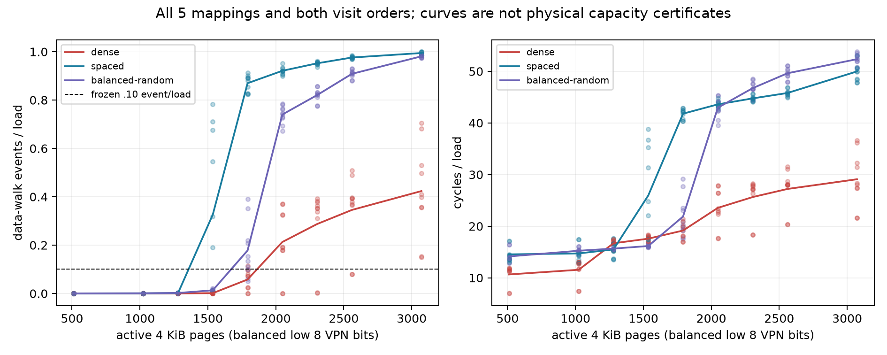

# TLB 均衡页集合：几何反证通过，统一容量未识别（2026-10-12）

**主对照通过：GEOMETRY_SENSITIVE；物理TLB entries/ways/hash命名不通过。** 同样页数、实际VPN低8位直方图和offset分布，不同地址几何仍给出复制的walk差；三族十曲线均为heterogeneous，不能将均值曲线当精确容量。

## 本次回答了什么

冻结 `docs/design/2026-10-12-tlb-balanced-reach.md`。三族dense/spaced/balanced-random每N都覆盖全部256个低8位候选bin，次数完全相等，offset也匹配；地址之间跨度和上层descriptor VA代理改变，visit order保持独立seed/反向。这里的bin没有认证physical hardware set；AnonHugePages=0也不认证无CONT/HPA。

同一N下，spaced相对dense的0x34/loads增加，在N1792/2048/2304/2560/3072各自十个mapping×order配对全≥.10；balanced-random在2048及以上四点也复制。**仅由活跃页数及候选低8位分布决定的简单全局reach模型，不能解释这批数据。** 这是真实反例，不是换网格后追一个2048数字。

| 对照族−dense | N | 十配对walk事件率差范围 |
|---|---:|---|
| spaced | 1792 | [0.755999, 0.888302] |
| spaced | 2048 | [0.539038, 0.917971] |
| spaced | 2304 | [0.559450, 0.947747] |
| spaced | 2560 | [0.470907, 0.893513] |
| spaced | 3072 | [0.291955, 0.843053] |
| balanced-random | 2048 | [0.301457, 0.745485] |
| balanced-random | 2304 | [0.400439, 0.820713] |
| balanced-random | 2560 | [0.405910, 0.828753] |
| balanced-random | 3072 | [0.277846, 0.826519] |

## 转折的诚实边界

阈值固定为每N三个round全≥.10，先查资格/跨线/非单调，左右删失不硬报锐点；每族五mapping×两order十曲线。

| 地址族 | 可给区间 | 右删失 | ambiguous | 实际出现的操作区间 | 跨十曲线终态 |
|---|---:|---:|---:|---|---|
| dense | 7 | 2 | 1 | (1536,1792], (1792,2048] | heterogeneous |
| spaced | 8 | 0 | 2 | (1280,1536], (1536,1792] | heterogeneous |
| balanced-random | 2 | 0 | 8 | (1536,1792] | heterogeneous |

dense epoch3双order仅3072越线，右删失；epoch4反向存在跨线。balanced-random八条ambiguous并没有被均值掩盖。所有30curve/18comparison及原始事件率完整保存在 `docs/reviews/evidence/2026-10-12-tlb-balanced-reach/analysis.json.gz`。这是条件化walk转折范围，不是页数乘/除ways的容量证书。

## 第一性原理解释与下一鉴别

官方 `/Users/michaelyao/workspace/cpu-uarch-ref/docs/Arm_Cortex_X4_Core_TRM_102484_0003_06_en.pdf` r0p3 §5.1指出L2/MMUTC同时服务I/D，除VA→PA映射还缓存walk得到的intermediate descriptor PA；translation-table prefetcher也存在。目标r0p1与资料revision分列，2048/8-way是结构参考，不能预设为2048个纯4KiB数据leaf。低8位leaf分布均衡，不保证不同层级descriptor的分布/占用/替换均衡。

例如N2048：dense的512-descriptor VA父项数为5，spaced=1028–1029，balanced-random=1479–1530；对应walk事件率分别[.000371,.370428]/[.899091,.951892]/[.671885,.784430]。L2 refill同步接近walk，不仅延迟改变；但这只是伴生和VA代理，不能由相关性唯一鉴定共享walk-cache竞争、descriptor预取、CONT/HPA、PFN或cache机制。spaced与random的父项数排序也不能单独预测walk大小。

下一优先补**同进程可观测PFN/physical连续性与页表层级分布**，再设计保持一个因素不变的配对干预；先确认Android root的pagemap是否提供非零PFN，不能把masked零值当PFN0。原raw未含PFN，保持UNKNOWN，不回填旧映射。若不能观测，另记录能力边界，不继续同曲线加密找“容量”。

## 完整证据与谱系

五进程全部完成，825/825窗技术通过，810/810数据窗背景/翻译激励门通过；空窗15窗也保留。独立直接raw第二算术验证全部窗率、空窗校正（负值不裁零）、30曲线、18比较完全一致。AnonHugePages逐格前后0；事件[cycles,IR,L1 dTLB refill,L2 TLB refill,L2 access,data walk]按kernel IDs读取、无MUX。没有cache/i-walk独立tap，不能认证其低噪声。端点温度38.9–42.6°C，无基线违规，端点频率不等于窗内恒频。

4GiB是VA reserve；实际prefault union=9191个4KiB页（35.902MiB payload），没有4GiB flush。原始私有目录 `20261012T022348Z-tlb-balanced-reach`，全部26 raw文件SHA锚定。完整匿名825行CSV、mapping/page/order/offset/父项VA列表、summary/analysis、独立核对与SHA在 `docs/reviews/evidence/2026-10-12-tlb-balanced-reach/`。

branch `codex/sm8650-tlb-hierarchy-r2`，worktree `/Users/michaelyao/workspace/cpu-uarch-explorer-tlb-r2`。

| 角色 | commit / 路径 |
|---|---|
| source | `fee3fbe9531d1b0ea1e97478afe634d559c57f9f` / `probes/diagnostic/tlb_balanced_reach.cpp`、`probes/diagnostic/tlb_balanced_reach_layout.h` |
| consumer / build | `7fb7bb0` / `tools/diagnostic/tlb_reach_analysis.py`、`tools/diagnostic/run_sm8650_tlb_reach.py`、上述evidence/build.json |
| actual launch | `82871d16f0b171fdbe1852767a8ca036c2857a83` |
| producer→driver→writer→raw测试 | `82871d1` / `tools/diagnostic/tests/test_tlb_reach.py`、`tools/diagnostic/tests/test_tlb_reach_raw.py` |
| binary SHA256 | `95abd5ba3fc3846b4236dd4133e057e58f99c4d1e93251bfb792c8fb05eec16c` |

两NDK27.2/API34/O2/Werror/static构建字节一致；实际LDR/SUBS/B.NE反汇编；native完整54图/全部闭环访问、112布局导出与独立oracle一致；10新测试及368/368全diagnostic回归通过。旧runner203/analysis250/CTest21是此前未改路径基线，本批不把macOS执行当Linux PMU证据。独立JSONL不是正式schema-v2，旧A1/frozen/14条L1未拼接；formal软件接入、未知结构与后续触发登记 `docs/open-items.md`。
