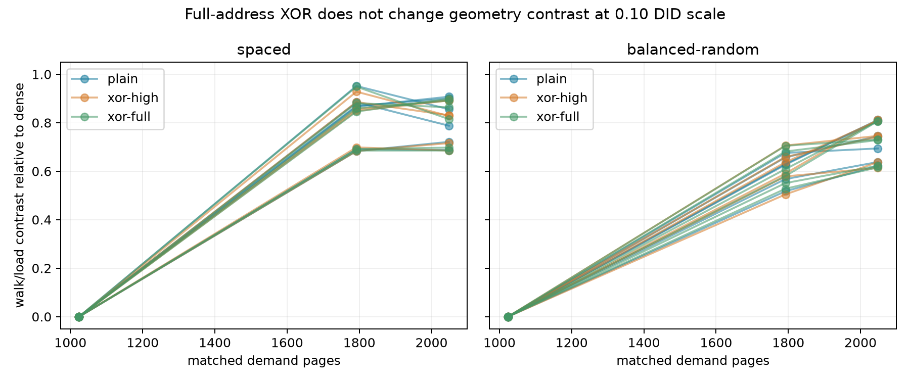

# 同PFN全位指针表示：几何walk差仍未跨复制变化门（2026-10-12）

**技术与486/486背景门通过；495/495目标窗完整，主GEOMETRY_CONTRAST_NOT_CHANGED_AT_DETECTION_SCALE。** full/plain六组DID的六epoch/order值全部在±.10内，最大绝对差约.071。阳性几何效应在plain与full中都保留，阴性不等于严格零差。

## 本次任务的目的（给人类看）

冻结 `docs/design/2026-10-12-tlb-full-pointer-representation.md`，同一映射/data PFN/offset/物理访问顺序上比较plain=0、high=0x00a5000000000000、full=0x9e3779b97f4a7c15。same四ISA decode body，不把旧333高位批晋升或硬拼映射；三fresh进程、双order、N={1024,1792,2048}，全部实际图/页面/IR/noMUX通过。

| shape | N | 六配对D_full−D_plain范围 | ≥.10复制变化 |
|---|---:|---:|---|
| spaced | 1024 | [-0.000004, +0.000002] | 否 |
| spaced | 1792 | [-0.071042, +0.064621] | 否 |
| spaced | 2048 | [-0.023691, +0.027273] | 否 |
| balanced-random | 1024 | [-0.000007, +0.000019] | 否 |
| balanced-random | 1792 | [-0.046672, +0.047722] | 否 |
| balanced-random | 2048 | [-0.015421, +0.034702] | 否 |

## 更强干预的事实与边界

532992 raw pagemap位/PFN身份、525312个实际stored word前后解码一致；其中175104个full字的39/48/56-bit投影及64-byte cacheline投影均不同于对应需求next VA，干预真实发生，仍返回同物理闭环图。L1/L2 HWPRF有计数，辅助背景门通过；完整主/辅（high/plain、full/high）及带符号walk/cycles/tap变化已导出，不凭平均值洗掉数值差。

**必要性解释受约束**：在.10检测尺度下，直接把原始存储字或其常见低地址位投影当正确next需求地址，并不是本协议几何差的必要来源。更复杂的解码关联/值预测或其它预取没有被唯一排除；zero-XOR内部消除、额外decode依赖、descriptor/replacement/aggregation仍有残余。tap非DMP专属，不能把有计数或相关性当因果。

**未预注册的物理几何诊断**：dense前2048页三个epoch有1185/1232/502个ascending PFN邻接对；按VA与PA共同对齐的2页块为0/424/17，4页0/3/5，8/16页均0。只描述原始页几何，不是CONT位或HPA使能状态；未对不对齐的可能范围聚合下结论。下一需同VA集合、同物理需求轨迹而改变VA→PFN关联，确保无相邻物理页的干预，或实际PTE/descriptor观测。不能用本阴性直接命名physical entries/ways/hash。

## 工件、独立核验与谱系

private raw `20261012T065812Z-tlb-full-pointer-representation`，18文件SHA；公开 `docs/reviews/evidence/2026-10-12-tlb-full-pointer-representation/` 保存完整匿名CSV/summary/analysis、SHA、PFN几何计数与独立复核。第二算术直接raw重算495窗、全部比例/gates、主辅DID、actual图与所有低位投影，均相等。温度端点38.0–45.7°C，基线无违规，不认证窗内恒频。

branch `codex/sm8650-tlb-hierarchy-r2` / worktree `/Users/michaelyao/workspace/cpu-uarch-explorer-tlb-r2`。source `c719772fc3834d0e332f92c6a61df07c32b3a8eb`：`probes/diagnostic/tlb_full_repr.cpp`、`probes/diagnostic/tlb_full_repr_layout.h`；consumer/build dd31d08：`tools/diagnostic/tlb_full_repr_analysis.py`、`tools/diagnostic/run_sm8650_tlb_full_repr.py`；actual launch `4d7554d5fef6eacd289caf0cb7a546dedbe2dcf4`；binary SHA256 `0ccca56595479ec1a0f4c1f04637367e3c08cde1cb363324f5ef59e461f841fe`。双NDK27.2/API34/Werror/static一致，112actual plan/224layout，54真实host共享FD图，动态四ISA与前批字节相同/两个真实调用点已核；新9+5、27新旧表示相关回归通过。427是此前完整diagnostic基线，不能写成当前新增全部整树通过；本轮新ROB完成后整树复核。软件mock不当本495真机证据。

本有限协议结束，所有signed effects原样保留，不放宽门/挑窗口。下一物理邻接/descriptor控制和ROB零延迟类跟踪 `docs/open-items.md`；整体物理目标尚未达到，未宣告main集成或远端推送。
