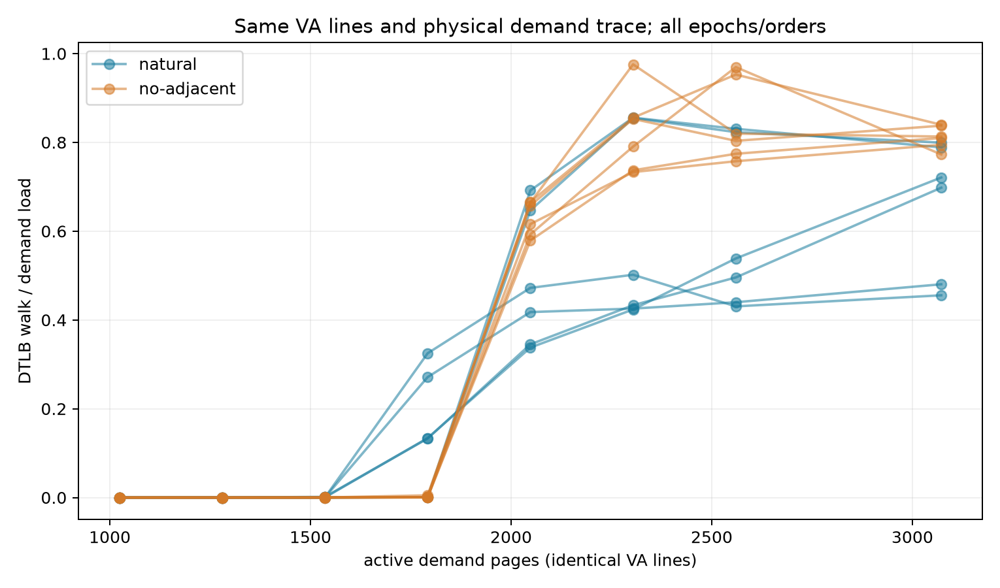

# 同VA/PFN关联干预：INCONCLUSIVE（2026-10-12）

**297/297窗口技术完整；主背景门=True；自然连续激励=NOT_EXCITED。物理entries与HPA因果均未认证。**

## 本次任务的目的（给人类看）

冻结 `docs/design/2026-10-12-tlb-pfn-association.md` v1.1；同memfd、同VA页/line集合、同物理页/line/order，π保留mod64且实际active相邻PFN差非±1。全位XOR/相同四ISA，八N/双物理order/三fresh epochs；inactive每cell恢复identity，实际映射类的32cell host反例已守住。

| N | 六no-adjacent−natural walk/load差范围 | .10复制变化 |
|---:|---:|---|
| 1024 | [-0.000029, -0.000001] | False |
| 1280 | [-0.000044, +0.000018] | False |
| 1536 | [-0.001385, -0.000003] | False |
| 1792 | [-0.324477, +0.004187] | False |
| 2048 | [-0.026045, +0.278133] | False |
| 2304 | [-0.002053, +0.473861] | False |
| 2560 | [-0.019551, +0.529602] | False |
| 3072 | [+0.038284, +0.357598] | False |

| assignment | 六曲线reach状态 | 操作区间 |
|---|---|---|
| natural | heterogeneous | None |
| no-adjacent | INTERVAL_REPLICATED | (1792, 2048] |

实际π节点187392、raw pagemap位/PFN761856、实际stored words374784独立检查。每一个no-adjacent cell的active邻接为0，canonical/alias前后相同，full物理閉环与相同VA line集合通过；natural激励N=[]。任何阴性解释须带激励状态。全部signed数值/删失/非单调保留；π改变虚拟访问顺序，阳性只能说关联敏感，不唯一归因HPA；阴性不排除其它压缩/descriptor/translation预取，不回填旧UNKNOWN。

source `e88adef5926e5d4f0a65d998e41c3dbfbdbaee1d`（`probes/diagnostic/tlb_pfn_association.cpp` / `probes/diagnostic/tlb_pfn_association_space.h` / `probes/diagnostic/tlb_pfn_association_layout.h`），build f054ae6 / software launch a78539e / actual launch `04d99859708d9cc2263da80b0159e741f09c6601`，branch `codex/sm8650-tlb-hierarchy-r2`，binary SHA256 `d5cae85ea8203e164b7002f7d4eb4989456f48803e8074fda3e285f7e7ea6afc`。双NDK27.2/API34/static/Werror一致，68plan/272动态geometry、40字节kernel与前批相同/两个真实调用点；5布局+7真实生产空间/统计+5生产链与157全部TLB回归通过。software mock不冒充本297真机窗。

raw私有 `20261012T120718Z-tlb-pfn-association`，公开 `docs/reviews/evidence/2026-10-12-tlb-pfn-association/` 含完整CSV/summary/analysis、全部SHA/adjacency、图与第二算术。第二算术直接raw独立复算所有排列/图/PFN/gates、六配对差和12条reach曲线与consumer逐项一致。环境端点41.5–46.3°C，无基线违规，不认证窗内恒频。

本有限协议结束，下一解释/physical未知和main/远端在 `docs/open-items.md`；没有宣告整个TLB/ROB物理目标完成。
