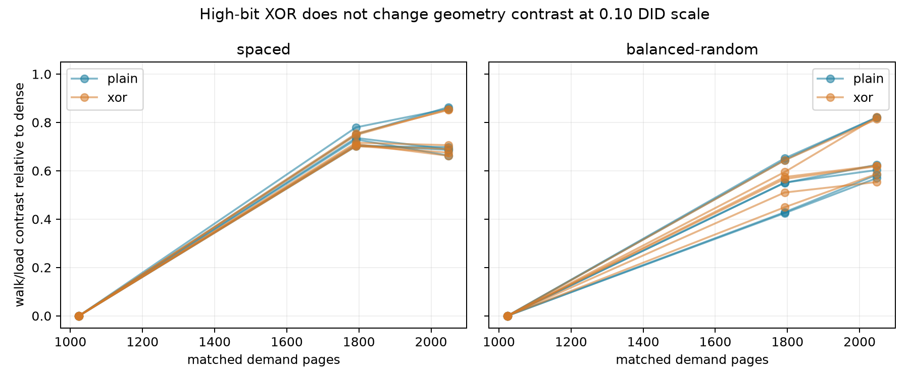

# 同物理页高位指针编码：几何walk差未达复制变化门（2026-10-12）

**技术与全部背景门通过；主结果GEOMETRY_CONTRAST_NOT_CHANGED_AT_DETECTION_SCALE。** 六个shape/N对比的六配对差分之差均在±.10 walk/load内；不等于效应严格为零，也不排除全部DMP/预取。

## 本次任务的目的（给人类看）

按 `docs/design/2026-10-12-tlb-pointer-representation.md`，同一memfd/需求PFN/VA/offset/visit order下，比较plain与mask=0x00a5000000000000。两模式共用动态X17的LDR/EOR/SUBS/B.NE四ISA循环；旧三ISA alias结果不晋升本批。三个fresh映射/双order/N={1024,1792,2048}，333/333目标窗、324/324背景门全部通过，plain几何正对比复制。

| VA shape | N | 六个epoch/order的D_xor−D_plain范围 | ±.10复制门 |
|---|---:|---:|---|
| spaced | 1024 | [-0.000001, +0.000004] | 否 |
| spaced | 1792 | [-0.032630, +0.008540] | 否 |
| spaced | 2048 | [-0.036360, +0.042938] | 否 |
| balanced-random | 1024 | [-0.000004, +0.000018] | 否 |
| balanced-random | 1792 | [-0.049715, +0.081484] | 否 |
| balanced-random | 2048 | [-0.029947, +0.018331] | 否 |

## 实际证据与可推翻边界

357888原始pagemap位/PFN身份与350208个实际stored word的before/after闭环解码全部独立核验；需求物理访问图一致，4KiB/smaps/no huge全过。原始回传未裁剪，全部333窗CSV及按epoch的带符号walk/cycles/tap变化保留，不只报均值。L1/L2 HWPRF tap有非零计数，点级范围0–0.786508/0–0.196258，辅助背景门通过；这不是全部translation预取或DMP活动的完备/专用正控，不反推概率或因果。

**高位干预的局限明确**：本mask低48位为0，存储值保留实际指针的低48位。未知内部预取器若只取低地址位，仍可能得到原需求地址；普通TBI行为也不能直接推定内部识别策略。因此本有限阴性只限制这一编码与.10检测尺度，不能叫“指针预取已经排除”。下一全位编码对照须另冻新矩阵/新数据，并把plain/high/full放在同一物理映射内比较，不能拿不同批映射硬拼因果；descriptor/聚合/物理entries/ways/hash仍OPEN。

## 完整工件与谱系

私有raw `20261012T062152Z-tlb-pointer-representation`，18文件SHA闭合；公开 `docs/reviews/evidence/2026-10-12-tlb-pointer-representation/` 包含完整匿名summary/analysis、CSV、SHA与独立复核。第二算术直接读raw检查333窗、全部比例/背景门/带符号DID及最终状态，图/PFN计数均吻合。温度端点38.4–44.2°C，无基线违规，不认证窗内恒频。

branch `codex/sm8650-tlb-hierarchy-r2`，worktree `/Users/michaelyao/workspace/cpu-uarch-explorer-tlb-r2`。source `da1355dd0c6c38189bb0847042405f19961d2933` / `probes/diagnostic/tlb_pointer_repr.cpp`、`probes/diagnostic/tlb_pointer_repr_layout.h`；consumer/build eed4aee / `tools/diagnostic/tlb_repr_analysis.py`、`tools/diagnostic/run_sm8650_tlb_repr.py`；actual launch `256cbbeac28cd08fa1a54646b44b5f11d66876cd`；binary SHA256 `59ba7a28279b2597498dd0ae868e21c5b1982c27ac4652cf84cf4a37febe1375`。双NDK27.2/API34/O2/static/Werror字节一致，76实际计划/152布局、独立ELF/Capstone动态mask四ISA确认；8图/数学+5生产链测试以及427整树diagnostic通过，软件mock不当本333真机证据。

本有限协议结束，不改门追结果。下一全位表示与descriptor层级干预登记 `docs/open-items.md`；原物理参数目标尚未达到，未宣告main合并、远端推送或分支回收。
