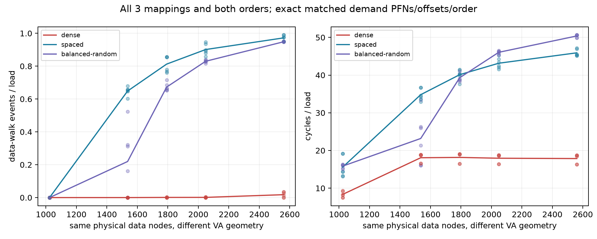

# TLB同物理数据页对照：VA几何效应通过（2026-10-12）

**主判据通过：GEOMETRY_SENSITIVE_WITH_MATCHED_DATA_PFNS。** 279/279真机窗技术接受、270/270数据窗背景门通过；330240次pagemap wire独立核验present/not-swapped/PFN掩码及alias身份全部一致。不同data PFN不是本协议几何效应的必要条件；物理TLB entries/ways/hash仍未唯一识别。

## 本次任务的目的与实际对照

冻结 `docs/design/2026-10-12-tlb-shared-alias.md` v1.0.1。一个10MiB memfd的同2560个数据页同时alias到dense/spaced/balanced-random三个VA族；相同N的实际demand数据PFN、offset、index order精确配对，VPN低8位hist亦匹配。循环只LDR/SUBS/B.NE，kernel ID/noMUX/IR/闭环返回都过；没有测量中remap或TLBI。12GiB只是三arena的VA reserve，非physical flush。

| 对照族−dense | N | 六个epoch×order的walk率差范围 | 固定.10门 |
|---|---:|---:|---|
| spaced | 1024 | [-0.000002, 0.000005] | 未复制 |
| spaced | 1536 | [0.602072, 0.679026] | 复制 |
| spaced | 1792 | [0.759727, 0.857095] | 复制 |
| spaced | 2048 | [0.853474, 0.945903] | 复制 |
| spaced | 2560 | [0.926226, 0.976245] | 复制 |
| balanced-random | 1024 | [0.000001, 0.000022] | 未复制 |
| balanced-random | 1536 | [0.000107, 0.523442] | 未复制 |
| balanced-random | 1792 | [0.651365, 0.715903] | 复制 |
| balanced-random | 2048 | [0.815498, 0.840406] | 复制 |
| balanced-random | 2560 | [0.911735, 0.949950] | 复制 |

spaced四N复制、balanced-random三N复制；N1024两族差近零提供低规模负控，random/N1536跨[.000107,.523442]异质完整保留，不能均值救门。全部10comparison/90数据格/270数据窗原值及九空窗在 `docs/reviews/evidence/2026-10-12-tlb-shared-alias/`；图保留所有epoch/order点，不把均值线当物理容量。

## 结论能走多远

“换了数据物理页，所以walk变化”不足以解释本新协议的结果。旧anonymous批次PFN未观测，仍UNKNOWN；不能回填旧映射或断言旧机制完全相同。descriptor物理布局/层级索引、虚拟高位、pointer数值引起的DMP/预取及其它缓存流量仍未分开。同demand PA轨迹不等于全部cache pressure相同。MMUTC包括I/D与intermediate descriptor；官方2048/8-way不是2048纯leaf的直接实测证书。

补充**非预注册诊断**：三进程canonical序列的160个完整16页块，满足 `i%16=0 && PFN[i]%16=0 && PFN[i+j]=PFN[i]+j` 的块数均0/160。只是一项明确的物理连续/对齐条件统计，不是CONT位读数，不排除其它聚合/压缩，也不拿它代替主.10差分判据。辅助curve/reach字段只作描述，不将未预注册的容量辅助输出提升成正式条目结果。

## 完整复核与谱系

原始目录私有 `20261012T031721Z-tlb-shared-alias`，18文件SHA全部锚定。第二条直接raw算术复核全部279窗、90数据格率/校正、270门、10配对及330240个wire值，见 `docs/reviews/evidence/2026-10-12-tlb-shared-alias/independent-check.json`。absolute PFN与canonical/alias VA只留private；公开summary已经去地址/PFN、父项编号转相对索引。KernelPageSize/MMUPageSize=4KiB，AnonHugePages/ShmemPmdMapped/FilePmdMapped全0；这些仍不是HPA/CONT观察。端点温度38.4–43.8°C，无基线违规，不认证窗内恒频。

branch `codex/sm8650-tlb-hierarchy-r2`，worktree `/Users/michaelyao/workspace/cpu-uarch-explorer-tlb-r2`。

| 角色 | commit / 路径 |
|---|---|
| 最终source | `a32ee8de9346ed58a8fd1ed24a4dd8832d3d20fb` / `probes/diagnostic/tlb_shared_alias.cpp`、`probes/diagnostic/tlb_shared_alias_layout.h` |
| consumer / build | `f37560c` + raw wire `a32ee8d` + summary守卫 `855350b`；最终双构建 `d74851d` / `tools/diagnostic/tlb_alias_analysis.py`、`tools/diagnostic/run_sm8650_tlb_alias.py` |
| actual launch | `f5ae99a968f5b40c2ae26e7257b463db7b19fc51` |
| binary SHA256 | `eba95f1f6f7811965223d51e85b93fb16918e795e7e11d0c8b55ac4afcfeb16e` |

双NDK27.2/API34/O2/Werror/static字节一致；实际内核反汇编；macOS以本机16KiB粒度真实共享FD/30图逐node核验（软件证据，非Android4KiB PMU覆盖）；9项实际计划→驱动→writer→raw测试及386/386全诊断通过。formal runner/schema/CMake尚未接入，main未集成；旧A1/frozen/失败窗不拼接。

下一TLB优先可区分descriptor/translation prefetch或聚合的干预，物理结构仍按 `docs/open-items.md`；下一ROB按 `docs/design/2026-10-12-rob-destination-control.md` 架构结果目的控制，不继续旧ADD/NOP曲线追数字。当前通过关闭的是同PFN几何效应这一有限问题，不是全部CPU部件探测完成。
