# TLB 微架构深度分析报告

> 版本：v1.5（2026-09-29）——外部评审2（源码评审，基于 v1 代码）处理：阻断项 1–4 与评审1 重叠（已由探针 v2.0 修复），新增有效意见（预热消除、perf 失败伪报 0、slow 分子含等待、绑核失败应终止、gen/run 审计断裂、README 一致性）全部修复（探针 v2.1）；登记见附录
> 范围：TLB 技术原理、组件关系、总体架构、探测原理剖析（含对参考材料的批判性审视）、面向 Cortex-X4 的分级探测方案建议。
> 边界声明：本报告未读取 cpu-uarch-explorer 本仓的任何方案与代码；所有推断基于下列外部材料与公开资料。

## 版本沿革

| 版本 | 日期 | 变更摘要 |
|---|---|---|
| v1.0 | 2026-09-29 | 初版：三份必读材料（X4 优化指南 / TLB 探测论文 / lmbench）分析、探测原理剖析与 X4 分级探测方案 |
| v1.1 | 2026-09-29 | 并入 Cortex-X4 TRM 原文（102484_0003_06_en）：TLB 参数全部升级为 TRM 地面真值；裁决 iTLB 48 vs 128 矛盾；新增 EL3 RAMINDEX 直读路径；新增 translation prefetcher 与合组条目两个混淆变量 |
| v1.2 | 2026-09-29 | 双视角专家审阅（体系结构 + CPU 微架构，13 项意见，记录见附录）：事实修正 3 项（页表级数、miss 代价表述、判据口径）、重要补充 6 项（虚拟化作用、内存序契约、lmbench 对照组 cache 假设失效、in-flight 翻译并行度、walk-cache 条目干扰、结构配对说明）；新增 9 幅 mermaid 图 |
| v1.3 | 2026-09-29 | 探测落地平台明确为 Android Linux arm64 / 高通 SM8650（§5.2 平台约束 + macOS M4 Pro 交叉编译部署说明）；新增 §2.7 page-walk cache 技术原理；第二章全面扩写（§2.1 管道角色表 + µOP 数据流图、§2.2 walk FSM 与同页合并、§2.3 VIPT 无别名定量、§2.4 TLBI 变体表、§2.5 SMMU 细节）；§2.1 管道表逐行标注原文/推断依据（M8）；附录新增术语与缩略语表；探针骨架落地 M4：快速/慢速重访对照 + 时延百分位 |
| v1.4 | 2026-09-29 | **外部评审1 修订**（登记见附录审阅记录）：探针 v2.0——`l2_set_probe` 改 prime+probe 协议（filler 驱逐 L1 + 分阶段 PMU 计数 + 首轮剔除 + 对照组），哈希/校验统一用最终 VA + 分桶取样；`tlb_capacity_probe` 三分布改为真集合（修 stride 越界 bug）、新增 -K 独立链并行 walk 探针；报告修正 VIPT 算术、撤销"40 位 PA 使 1 GB 块无意义"错误论断、页聚合控制改为映射级、§5.6 改为短跳板探针、MMUTC 角色推断降级 |
| v1.5 | 2026-09-29 | **外部评审2 处理**（源码评审，基于 v1 代码，登记见附录）：阻断项 1–4 与评审1 重叠（v2.0 已修复，复核确认）；新增有效意见 6 条全部修复（探针 v2.1）——预热循环 volatile 化（Clang -O2 实测消除）、perf 打开失败不再伪报 0（fd<0→n/a + time_enabled/running 多路复用检测）、slow 模式 ns_per_load 剔除 busy-wait、绑核失败即终止、run 模式落盘实际地址（修 gen/run 审计断裂）、`--rawlog` 逐轮原始数据；两份 .c 增加版本记录头 |

## 0. 材料清单与可信度分级

| 材料 | 角色 | 可信度处理 |
|---|---|---|
| Arm Cortex-X4 Core Software Optimization Guide（Issue 3.0, r0p1） | 必读 1 | 官方一手，但**全文无 TLB 章节**（详见 §4.1），仅提供 MMU/地址宽度/MMU TC 等旁证 |
| **Arm Cortex-X4 Core TRM（102484_0003_06_en，r0p3）** | **权威依据（v1.1 起）** | 官方一手，第 5 章 Memory management 给出全部 TLB 结构参数；第 9 章给出 TLB RAM 直接读编码；第 17 章给出全部 TLB PMU 事件 |
| Agredo et al., *Inferring TLB Configuration with Performance Tools*, J. Cybersecur. Priv. 2024 | 必读 2 | 同行评审论文，方法可借鉴，结论绑定 Intel x86，迁移性作者自己都说有限 |
| lmbench `src/tlb.c` + `src/lib_mem.c` | 必读 3 | 经典基准源码，只测"性能拐点"，不能单独给出结构 |
| 《lmbench 与论文 TLB 探测方法源码分析报告（格式修订版）》 | 参考（需审视） | 主体判断基本正确，个别地方过度谨慎或表述有可改进处（详见 §4.4） |

---

## 1. TLB 技术原理及其在计算机体系结构中的作用

### 1.1 要解决的问题：虚拟地址到物理地址的翻译

现代 OS 给每个进程提供独立、连续、受保护的虚拟地址空间（VA）。CPU 发出的访存地址是 VA，而 cache 与内存系统最终需要物理地址（PA）。VA→PA 的映射以**页**为粒度（ARM 上典型 4 KB / 16 KB / 64 KB，Armv8.2+ 长描述符格式还支持 2 MB / 512 MB / 1 GB 的块映射），映射关系存放在内存中的多级页表里。X4 的具体地址宽度为 48 位 VA / 40 位 PA（见必读 1 特性列表）。

页表本身是内存中的数据结构，若每次 load/store/取指都逐级查页表，代价不可接受：48 位 VA 在 4K/16K 粒度下精确对应 **4 级页表**（L0–L3，每级索引 9/11 位），一次翻译就是 4 次**串行依赖的内存访问**（v1.2 修正：原表述"4~5 级"不精确），每次几十上百周期——比一次 L2/L3 访存还慢一个数量级。这就是"内存墙"之外的"**翻译墙**"：乱序宽度、load 带宽做再大，翻译供给跟不上，流水线照样挨饿。量级概念：现代大核每周期可发出 2~3 个访存，若其中 1/100 需要 40 周期的 walk，平均每个周期就要 0.4~1.2 个周期的翻译补贴——TLB 的使命就是把这笔账压到接近零。

### 1.2 TLB 的基本原理

TLB（Translation Lookaside Buffer）是 MMU 内部缓存"最近用过的 VA→PA 翻译"的专用 cache。其工作方式与普通 cache 同构，也有命中/缺失、容量、相联度、替换策略、各级层次，但**索引的不是数据而是翻译**：

- **查找键**：VPN（虚拟页号，即 VA 去掉页内偏移）+ 上下文标记（ARM 上是 ASID/VMID；x86 上是 PCID/VPID）。上下文标记使不同进程/虚拟机的同名 VPN 可以共存而不互相驱逐。
- **查找值**：PPN（物理页号）+ 权限与属性位（AP、UXN/PXN、shareability、cacheability、DBM、nG/全球位等），命中时**权限检查与地址翻译同时完成**。
- **命中路径**：与 L1 tag 查找并行进行，命中时翻译对流水线几乎零开销。
- **缺失路径**：miss 触发**硬件页表遍历**（hardware page table walk），遍历器按 TTBR 逐级读页表（这些读本身还经过 data cache 层级，部分实现另有 page-walk cache 缓存中间级），找到后回填 TLB 再重放访存；若页表项无效则触发同步异常（page fault）交给 OS。

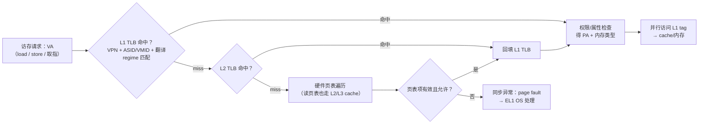

必读 2 对这条数据通路有清晰的模块级描述（Figure 1：进程以 VA 访问 → VPN 查 TLB → 命中得 PPN+offset；miss → MMU 页表遍历 → 回填 TLB → 访问 PA；遍历失败 → page fault → OS 处理）。[必读2 §1.1.1, p.2]

### 1.3 TLB 在体系结构中的四个作用

1. **性能供给者**：把翻译的平均代价从"每访问若干次内存"压到"接近零"。这是它存在的第一理由——没有 TLB，虚拟内存机制的性能模型不成立。
2. **安全/隔离的执行者**：TLB 条目携带权限位与 ASID/VMID 上下文，是"进程隔离"在硬件上的落点之一。TLB 侧信道（必读 2 的动机）恰恰说明它正确实现时也是隔离边界的一部分。
3. **软硬件契约的缓存点**：OS 修改页表（unmap、mprotect、换页）后必须通过 `TLBI` 类指令或 ASID 轮转使旧翻译失效——TLB 是"页表内容"这份软件契约的硬件缓存，缓存一致性（软件管理）问题在这里显式暴露给 OS。
4. **虚拟化的硬件基础（v1.2 补充）**：TLB 缓存的翻译可以是 stage 1（VA→IPA，OS 视角）、stage 2（IPA→PA，Hypervisor 视角）或两者的组合结果；VMID 标记让虚拟机切换免于全量刷 TLB。没有带 VMID 的 TLB，type-1/2 hypervisor 的地址翻译开销将不可接受。

### 1.4 ARMv9.2（X4）上下文中的翻译体系

X4 实现 Armv9.2-A（必读 1）：AArch64 全 EL、VMSA 页表格式、支持 4K/16K/64K 粒度、硬件遍历、MMU Translation Cache 带 SECDED 保护的 parity/ECC。这些事实对探测方案的意义：

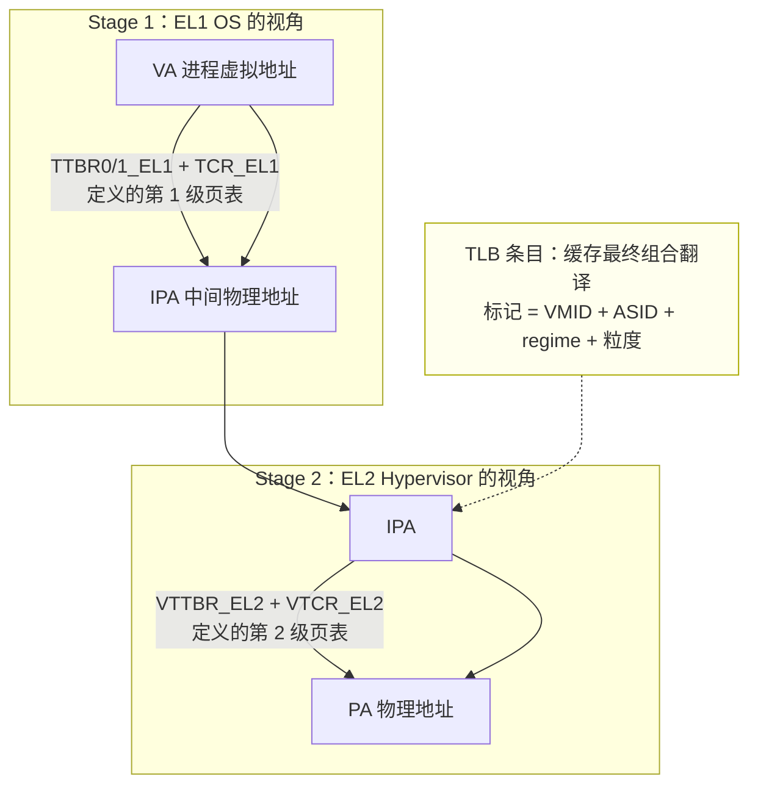

- **两阶段翻译**：裸机下只有 stage 1；虚拟化下 stage 1 输出 IPA，stage 2 再把 IPA 映到 PA。TLB 缓存的是**组合结果**（一次 lookup 完成两级翻译），但 L2 TLB 也单独缓存 stage-2 的中间级（TRM Table 5-1）。
- **多粒度并存**：同一颗核可同时存在 4K/16K/64K/2M 多种粒度映射，各级 TLB 对混合粒度的支持方式（是否分结构、tag 中是否含粒度位）是探测时必须显式控制或显式排除的变量。
- **48 位 VA / 40 位 PA**：VPN 可用位段 12..47（4K 粒度时为 VPN[35:0]），构造同 set 地址时有充足的位可操纵（§5.5 的 XOR 假设空间由此而来）。注意 **40 位 PA 并不排斥 1 GB 块**：40 位地址空间含 2¹⁰ = 1024 个对齐的 1 GB 物理区间，TRM Table 5-1 明确 L2 TLB 支持 1 GB 块（v1.4 修正：v1.3 曾错误推断"1 GB 块无意义"）；L1 dTLB 所列最大粒度 512 MB 是该级 TLB 的支持范围，不能归因于 PA 宽度。
- **硬件遍历 + 中间级缓存**：miss 代价不是固定常数，受页表在 cache 层级中的驻留影响——这是所有"以延迟测容量"方法（含 lmbench）的共同混淆变量。

---

## 2. TLB 与其他组件的关系及可能的接口形式

TLB 没有任何面向 ISA 的直接编程接口（除了系统寄存器与维护指令），它全部的价值在于与周边组件的接口关系。按数据/控制流向梳理：

### 2.1 与 CPU 流水线（取指单元 / Load-Store Unit）

**接口形式：微操作级内部接口，非总线**。X4 把访存指令译码成 µOP 后送入专用发射管道，翻译请求就嵌在 µOP 的执行过程里——TLB 对流水线没有独立"接口引脚"，它就是 load/store µOP 数据通路的一部分。

**取指侧**：PC（VA）送入 iTLB 查找，命中得 PA 后与 I-cache tag 并行比较（VIPT 语义，§2.3）。X4 取指带宽最高 10 指令/周期，iTLB 按请求批次查找，只有跨页取指才需要第二次翻译。

**数据侧：先弄清优化指南管道表里各管道的角色**（21 条发射管道中与访存相关的 6 条；**前两列摘自优化指南 §2.1 Figure 2-1 / Table 2-1 原文**，第三列是基于 VIPT 原理与 TRM 事实的推断，依据逐条标注于表下）：

| 管道 | 承担的 µOP（指南原文短语） | 与地址翻译的关系（推断，依据见表下） |
|---|---|---|
| **Load/Store 0（LS）** | "Load, Store address generation and special memory µOPs"（load/store 地址生成 + cache 维护、memory tagging、原子等特殊内存 µOP） | AGU 产出 VA，发起本次 dTLB 查找（推断①） |
| **Load 1 / Load 2** | "Load µOPs"（执行 load：VA 送 L1D 并行查 tag/data，数据返回写寄存器——此句为概括） | 每条 load 需要一次翻译命中（推断①） |
| **Store 1** | "Store address generation µOPs"（store 的地址 µOP） | store 的翻译需求在这条管道上（推断①）；消歧为乱序 store 通用机制，指南未点名（推断②） |
| **Store data 0/1** | "Store data µOPs" | **不发起翻译**——地址已由 Store 1 译好（推断③） |
| FP/ASIMD 0–3 | "…store data µOPs…"（部分向量管道兼任 SD，指南原文） | 向量 store 的数据通路 |

依据标注：**推断①**（翻译随地址产生）= VIPT 基本原理：查 L1 tag 前必须先把 VA 译成 PA，地址生成 µOP 必伴随一次 dTLB 查找；指南全文无 TLB 章节，未直接描述。**推断②**（消歧）= OoO 核通用机制。**推断③**（SD 不参与翻译）= 由"Store 1 = 地址 µOP"与"Store data = 数据 µOP"的原文分工直接推出。"每周期每管道收 1 个 µOP"亦为指南原文（"Each issue pipeline can accept one µOP per cycle"）。

store 拆成 SA + SD 两条 µOP 的原因：地址通路需要 AGU + TLB + cache tag 三类资源，数据通路只需要寄存器读口 + store buffer 写口——拆开后"算地址"与"搬数据"同周期并行，store 吞吐不被地址计算卡住（教科书级解释，非 X4 文档原文）。

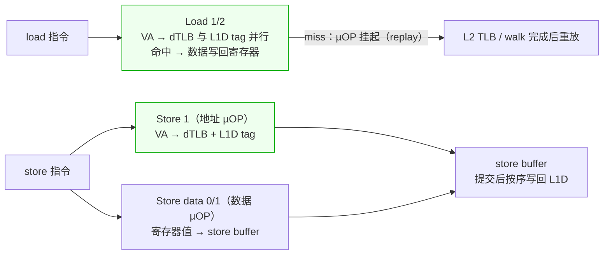

**翻译供给带宽的定量关系（含推断边界）**：地址生成管道共 4 条——LS0（可发 load 或 store 地址）+ Load 1/2 + Store 1，每周期各收 1 个 µOP（指南原文）→ **翻译需求上限为 4 个请求/周期**（LS0 发 load 时；发 store 地址时亦可与 Load 1/2 并行，故 3~4）。cache 侧，L1D 配 3 份物理 tag RAM（TRM Table 9-5 的 Pipe 0/1/2 Copy 位）支撑最多 3 个并发查找。地址管道数（4）与 tag RAM 份数（3）不严格相等，两者如何仲裁配对**文档未公开**——"翻译供给必须与 cache 查找带宽同阶"是我们基于 VIPT 结构的推断（load 带宽做再大，翻译供给跟不上照样挨饿，"翻译墙"的管道级体现），v1.3 修正了此前"每周期 3 个并发翻译请求（2 load + 1 store）"的过度具体化表述。

**乱序执行下的三个关键机制**：
- **投机翻译**：load/store 在提交前就查 TLB；误预测/异常时冲刷 µOP 即可，TLB 填充这类微架构副作用不回滚——这正是 §4 的探测能"看"到投机行为的原因。
- **miss 挂起与重放**：L1 TLB miss 的 µOP 不杀掉，挂入队列等 L2/walk 完成后重放；挂起条目数有限（§3.3 的 in-flight 行），超限时 miss 串行化——这是 M4 K 链并行度实验（probes `-K`，§3.3）的硬件基础。
- **store buffer**：翻译完成的 store 先入 store buffer 按序提交，store 的 TLB miss 时延因此对程序不可见（被缓冲吸收），探测时延信号主要由 load 侧承担。

**关键时序契约**：L1 TLB 命中必须 1 个周期量级返回，否则成为 load-to-use 关键路径——所以 L1 TLB 做全相联小容量（X4 参数见 §3.4），查找可以全并行、无 set 冲突风险。

### 2.2 与 MMU / 页表遍历器

- **接口形式：内部 miss 处理握手**。两级查找的次序是固定的（TRM §5.4 / Figure 5-1）：L1（I 或 D）miss → 查 L2 TLB → L2 miss → 硬件遍历。L2 TLB 是 I/D 共用的，任何一侧的 miss 都进同一个 L2。
- **遍历器的执行细节**：walk 是一个逐级推进的有限状态过程——从 TTBR_ELx 基址 + VA 顶层索引位算出第一级描述符地址，读回后校验 valid/权限，再以其为基址算下一级，直到末级得到 PA + 属性。每个 in-flight walk 占用遍历器的一个上下文；**同页（同 4K 区域）的多个 pending miss 会被合并**（去重），不同页并行推进——所以探测时"突增的 miss 率"不一定线性反映在 walk 事件上。
- **i-side 与 d-side 的回填路径不同**（TRM PMU 语义，§2.6-1）：dTLB miss 由 L2 TLB 直接回填；iTLB miss 的翻译先经 **MMUTC** 再回填 iTLB。这意味着 I/D 两侧对同一颗 L2 TLB 的观察路径不对称，探测 iTLB 时不能用 dTLB 的事件语义直接类推。
- **遍历器旁通常配有 page-walk cache**（缓存中间级描述符，大幅缩短 walk），其原理与探测影响详见 §2.7。
- **接口形式：系统寄存器配置面**。TTBR0/1_ELx（页表基址）、TCR_ELx（粒度、翻译区间、TxSZ、 walks 级数与 HA/HD 硬件管理位）、SCTLR_ELx（M 位使能翻译）、MAIR_ELx（属性）、CONTEXTIDR/ASID——OS 通过这些寄存器定义 TLB 条目属于哪个翻译上下文；TTBR/ASID 变化时硬件按架构规则部分失效条目。VTTBR_EL2/VTCR_EL2 是 stage-2 的对应物（§1.4）。

### 2.3 与 cache 层次

- **查找并行性的定量基础（VIPT，v1.4 修正算术）**：X4 L1I/L1D 均为 64 KB、4-way、64 B line → 每 way = **16 KB**，共 **256 sets**（索引 8 位，TRM Table 9-2/9-5 的 RAM 定位字段即 "Virtual address [13:6]"）。"VIPT behaving as PIPT" 是 TRM 的明确声明，**但其无别名机制 TRM 未给出实现细节**——按教科书 VIPT 理论，way 尺寸（16 KB）大于 4K 页本应产生别名（VA[13:12] 参与索引但属于页号位），Arm 实际如何消除别名（物理着色、受限 way、或早期翻译等）属于未公开实现，v1.4 起不再给出臆测机制，列为开放问题。确定无疑的事实是：TRM 声明了该行为，且 L1 查找与 dTLB 命中按并行流水线组织（§2.1）。
- **页表遍历走 cache，且对 cache 事件可见**：遍历器读页表就是普通 data 读（经 L2/L3），TRM 明确 `L1D_CACHE`/`L1D_CACHE_REFILL`/`L2D_CACHE_RD` 都**计入 translation table walk**——这意味着 cache 探测与 TLB 探测在事件层面互相可见：跑 TLB 探针会污染 cache 实验的计数，反之亦然（实验设计上的隔离要求）。
- **L2 TLB 与 L2 cache 的 bank 配对**：L2 TLB 常按 bank 组织以匹配 L2 的 bank 结构，降低查找功耗；TRM Table 9-32 的 "Entry 0–255 per way" 即 L2 TLB 的物理组织。
- **内存序契约的缓存（v1.2 补充）**：TLB 条目不缓存只地址，还缓存**内存类型**（Device nGnRnE … Write-Back）。访问的 gathering/reordering/early-ack 语义由翻译属性强制——同一份代码经不同映射执行，内存序保证可以完全不同。因此 TLB 同时是"内存序契约"的缓存点，这对 Device memory（驱动、MMIO）的正确性是硬约束。
- **粒度耦合**：大页（2M/512M）下 L1D 的 VIPT 边界更宽松（索引位全部来自页内偏移），也是大页同时改善 cache 与 TLB 的机制。

### 2.4 与 OS（软件可见接口）

- **TLBI 维护指令族**——OS 改页表后的缓存失效协议。按粒度分类（EL1 视角，E1 后缀有 IS 广播变体）：

| 指令 | 失效粒度 | 典型使用场景 |
|---|---|---|
| `TLBI VAE1` / `VALE1` | 单个 VA（stage 1 某级） | unmap / mprotect 单页 |
| `TLBI ASIDE1` | 整个 ASID | ASID 回收 |
| `TLBI VAAE1` | 全局 VA（所有 ASID） | 共享页（如内核文本）修改 |
| `TLBI VMALLE1` / `VMALLS12E1` | 当前 PCID 全量 / stage1+2 全量 | 进程退出、页表切换 |
| `TLBI RVAE1` 等 range 变体 | VA 区间 | 大区间 unmap（如 munmap 大块） |

架构保证：TLBI 的执行会**连带失效 walk cache / MMUTC 中的对应条目**（§2.7），对软件透明——OS 不需要知道硬件把中间级缓存在哪里。
- **page fault 同步异常路径**：遍历失败（无效项/权限不足/AF-DBM 硬件更新在非 WB 区域，ESR_ELx.DFSC/IFSC 编码区分，TRM §5.5–5.6）以同步异常上报，经 EL1（Linux）处理（按需调页、COW、mprotect 强制执行等）。**对探测的意义**：fault 编码是诊断自建页表/权限实验的免费通道。
- **上下文切换的两条路线**：换 ASID 保留旧进程条目（硬件省功耗，TLB 利用率高）vs 刷 TLB（安全隔离更彻底，如 KPTI 类缓解）。Linux 采用 ASID + 保留策略；切换 ASID 后旧条目在 TLB 中仍有效但不参与匹配——探测时跨进程实验必须显式控制 ASID 变量。
- **透明大页/巨型页**：OS 的粒度选择改变 TLB 覆盖的地址范围。**粒度与覆盖的杠杆比（v1.2 强调）**：L2 的 2048 条翻译，4K 粒度只覆盖 8 MB，2M 粒度覆盖 4 GB——同条目数覆盖差 512 倍；而 L1 dTLB 的 96 条 512M 块映射可覆盖 48 GB。粒度是覆盖范围上最便宜的放大器，也是探测时最大的软件侧混淆变量。

### 2.5 与 I/O 侧翻译器（SMMU/IOMMU）及系统结构

- **SMMU 是同构的 DMA 翻译器**：为 DMA 主设备（GPU、Modem、UFS、显示）提供与 CPU MMU 相同的 stage-1/stage-2 翻译——同样有 TLB、walk cache、ATS/PRI 接口：翻译 miss 可经 **PRI（Page Request Interface）** 向 OS 要页（外设缺页），外设也可经 **ATS（Address Translation Services，PCIe 语义）** 直接查询 SMMU 的翻译缓存。SM8650 上 GPU/Modem 各自带 IOMMU context，与 X4 的 MMU 在结构上同构但完全独立——**CPU 侧 TLB 探测的结论不能外推到 SMMU**。
- **DSU-120 簇内的位置**：L2 TLB 属每个核心的私有 MMU；L3（DSU-120）与一致性互连只搬运 PA——LLC 侧不存在 TLB（缓存行按 PA 存），但 **snoop/一致性互连只认 PA**，这决定了 TLB miss 的代价在多核下还受互连往返影响（遍历器读页表可能命中远端 L3）。
- **对系统级探测的潜在价值**：SMMU 的 TLBI 与 CPU 的 TLBI 经同一套命令空间协调（TLBISYNC 等），若未来做系统级一致性实验，SMMU 侧事件（ arm_smmu PMU）可作对照通道。

### 2.6 与 PMU（探测者的入口）

X4 TRM 第 17 章给出了精确的 TLB 事件清单（v1.1 已核对原文，事件号与语义如下）：

| 事件号 | 助记符 | 语义（TRM 原文要点） |
|---|---|---|
| 0x0002 | `L1I_TLB_REFILL` | L1 iTLB 从 **MMU Translation Cache（MMUTC）** 回填的次数，含导致翻译故障的回填 |
| 0x0005 | `L1D_TLB_REFILL` | L1 dTLB 从 **L2 TLB** 回填的次数，含导致翻译故障的回填 |
| 0x0025 | `L1D_TLB` | load/store 对 dTLB 的访问次数（同周期 load+store 计 2） |
| 0x0026 | `L1I_TLB` | 取指对 iTLB 的访问次数 |
| 0x002D | `L2D_TLB_REFILL` | L2 TLB 被回填（由 I 或 D 侧 miss 触发） |
| 0x002F | `L2D_TLB` | L2 TLB 访问次数（由 L1 refill 引起；MMU 关闭时不计） |
| 0x0034 / 0x0035 | `DTLB_WALK` / `ITLB_WALK` | 引发至少一次页表遍历的 D/I 侧访问 |
| 0x005C–0x005F | `L2D_TLB_REFILL_RD/WR`、`L2D_TLB_RD/WR` | L2 TLB 按读写细分 |
| 0x8128–0x813F | `*_WALK_PERCYC`、`ITLB_STEP`、`DTLB/ITLB_WALK_LARGE/SMALL` 等 | 遍历周期数、步数、大/小页遍历细分 |

三个对探测设计至关重要的语义事实：
1. **`L1D_TLB_REFILL` 与 `L1I_TLB_REFILL` 的"来源"不同**：dTLB 从 L2 TLB 回填，iTLB 从 MMUTC 回填——两级 TLB 结构在事件语义里显式体现。
2. **含故障回填也计数**：翻译故障（fault）会计入 refill，冷启动扫描的数据必须剔除首轮。
3. **MMU 关闭时 `L1D/I_TLB(_REFILL)` 仍计数、`L2D_TLB` 不计数**——事件语义校验实验（§5.3）要利用这一点设计对照。
4. **access 与 refill 是两类事件（v1.2 强调）**：`L2D_TLB`(0x002F) 计 lookup 次数，`L2D_TLB_REFILL`(0x002D) 计 **fill 次数**——容量/相联度判据应建立在 refill 上，供给率（hits per refill）分析才用 access 作分母。

### 2.7 Page-walk cache 技术原理（v1.3 新增）

**动机：walk 的串行多级内存读是翻译代价的主体**。4K 粒度 + 48 位 VA 的 walk 要沿页表逐级取描述符（L0→L1→L2→L3），每级都是一次**依赖前一级结果**的内存读（这些读经 L2/L3 cache 层级）。但中间级描述符的局部性极强：同一进程的所有翻译共享 L0/L1 表项，全系统的内核半部（TTBR1 区域）共享同一批中间级表——每次最终翻译 miss 都重读这些中间级是巨大的重复劳动。

**原理**：在遍历器旁设置小容量缓存（CAM/全相联组织常见），按中间级描述符的地址/索引缓存已经读到的页表项；后续 walk 在中间级命中即可**跳过对应级数的内存读**，把 4 级 walk 缩短到 1~2 级。与 TLB 缓存"最终翻译"不同，walk cache 缓存的是"通往最终翻译的中间跳"——两者是同一问题的两个缓存层：TLB 消灭 walk，walk cache 消灭 walk 内部的多级读。

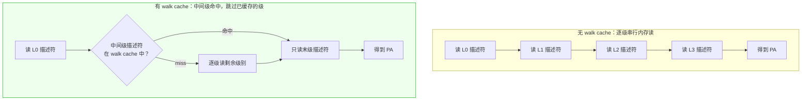

**形态与厂商实例**：

| 厂商/架构 | 实现形态 |
|---|---|
| Intel | PDE cache / page walk cache：缓存各级页目录项，官方资料称可把 walk 的内存读减少到 1 次 |
| AMD | PDP/PDE cache：同理，缓存上级页表项 |
| **ARM 公版（X4）** | **已确认**：L2 TLB 缓存中间级描述符（TRM Table 5-1 "Intermediate PAs (descriptor PAs) obtained during a translation table walk"；条目格式用 IR1 bit[46] "Walk cache entry" 区分，Table 9-45）+ 独立的 **MMUTC**（PMU 语义确认其为 iTLB 回填源，§2.6）。**未确认**：MMUTC 的条目内容、容量、是否等同"独立 page-walk cache"——TRM 未公开（v1.4 降级为开放问题，v1.3 曾将其直接断定为独立 walk cache） |
| 机制相邻但不同：**translation table prefetcher** | 预取**连续的下一张页表**到 cache 层级（仍是内存读，只是提前发起）；walk cache 则直接**省掉**内存读。两者都缩短 walk，都是探测混淆变量（§5.1-6） |

**一致性**：walk cache 与内存中的页表**无硬件一致性**（无监听机制）；架构保证 `TLBI` 维护指令会连带使其失效（对 OS 透明），因此软件维护协议与 TLB 完全相同——改页表 → TLBI。这也意味着它与 TLB 同属潜在的共享侧信道面（与必读 2 的安全动机同构）。

**对探测方案的三点影响**：
1. **时延通道被系统性污染**：walk 代价成为 1~4 级内存读的随机变量（取决于中间级命中与否），"以延迟测容量"的方法（含 lmbench）在 L2 层必然失真——这是 §5.3 必须 PMU 化的核心理由之一。
2. **可分解观测（X4 PMU）**：`DTLB_WALK`/`ITLB_WALK`（0x0034/0x0035）计引发 walk 的访问数；`*_WALK_PERCYC`（0x8128/0x8129）计 walk 占用周期；`ITLB_STEP`（0x8137）计 walk 步数；0x8138–0x813F 按大/小页细分。**步数/周期分布可作为 walk cache 行为的定量探针，但需对照校准**（固定页表布局下比较命中/未命中场景）——平均值不能不经对照直接换算为命中率（v1.4 修正，回应评审 A5）。
3. **L2 TLB 探测的条目纯度问题**：X4 的中间级条目与最终翻译条目共存于同一 8-way×256 sets 结构（§3.4），同 set 竞争对象不纯——§5.5-4 的 way 跳变判据需考虑这一点；EL3 dump 时可按 bit[46] 分解两类条目后再拟合索引函数。

---

## 3. TLB 可能的总体架构

### 3.1 分层的必然性

单级 TLB 面临根本矛盾：要大容量（覆盖更多工作集、少 walk）就不能快（单周期命中）。与 data cache 完全相同的逻辑导出了相同的解法——**层次化**：

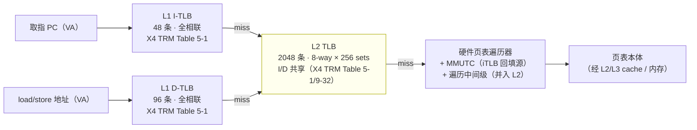

- **micro-TLB（L0）**：紧跟在请求源头的极小块（常全相联），把 L1 TLB 的访问从关键路径上再往后推一级；ARM Cortex 系公开资料显示 A 系近年实现多采用"无独立 micro-TLB，L1 TLB 直接贴 LSU/取指口"的折中（X4 TRM 亦未列出 micro-TLB，v1.2 注明），探测中表现为 L1 命中延迟接近 1 拍。
- **L1 I/D-TLB**：分离、私有、全相联或低组数，追求单周期命中，容量小（32~128 条量级）。
- **L2 unified TLB**：指令/数据共享的次级翻译缓存，较大（1K~3K 条）、组相联（4~12 way），miss 才触发 walk。
- **页表遍历器 + 中间级缓存（translation/walk cache）**：walk 的各级 PTE 亦有局部性，缓存中间级（如 L3/L2 PTE）可省 1~2 级内存访问。X4 的 MMUTC 与"并入 L2 TLB 的中间级描述符条目"（§3.4）属于此类，技术原理与探测影响详见 §2.7。

### 3.2 条目组织与索引函数（探测真正要逆的东西）

每条 TLB entry 概念格式：`{context tag: VMID|ASID, VPN tag, granule/pgsize, PPN, attr bits}`（TRM §5.2/§5.3：TLB 匹配条件是 VA[48:N]（N 为块大小的 log2）+ 翻译 regime + ASID（或 global 位）+ VMID 同时相等）。

索引函数把 VPN+context 映到 {set, way}：
- **L1 全相联**：无 set 概念，任何 N 个不同 VPN 都互相竞争（N 超过容量即驱逐）。证据：**X4 TRM Table 5-1** 明确 "L1 instruction TLB: fully associative, 48 entries; L1 data TLB: fully associative, 96 entries"（v1.2 修正：原引用 V3 TRM 同源外推，现直接引 X4 TRM）。
- **L2 组相联**：典型 `set = hash(VPN)`，hash 可能是简单位选（VPN[low+k:low]）、折叠 XOR（如必读 2 推断的 Intel XOR-7），或厂商私有哈希。替换策略常见 pseudo-LRU/RRIP 变体。**索引函数与替换策略不公开**，这正是必读 2 整套方法要逆向的目标——在 X4 上，sets/ways 已由 TRM 确认为 256×8，剩余未知量只剩哈希函数本身。

### 3.3 关键微架构行为清单（探测可观测点）

| 行为 | 可观测后果 | 对应探测 |
|---|---|---|
| 容量 | 工作集超过容量 → miss 率跳变 | 扫描容量（lmbench 式 + PMU 验证） |
| 相联度/索引 | 同 set 地址数超过 way 数 → 驱逐，refill 计数上升 | 同 set 地址构造（必读 2 Listing 1/3） |
| 替换策略 | 驱逐顺序影响"第几个地址开始 miss" | 渐变梯度图（必读 2 方法） |
| ASID 标记 | 换 ASID 后旧条目是否保留 | 跨进程探测对 |
| 粒度支持 | 不同粒度映射是否共享结构 | 多粒度矩阵扫描 |
| 中间级缓存 | walk 代价随 PTE 驻留变化 | 遍历延迟分布测量 |
| in-flight 翻译限制（v1.2 补充；v1.4 探测方法重构） | miss 风暴时延迟尾部拉长（walk 排队/合并），refill 计数出现锯齿 | **K 独立链并行度扫描**（-K 模式，probes v2）：K 路互不依赖的 L2-miss 链逐拍交错，配合 `DTLB_WALK_PERCYC`(0x8128) 找饱和点（评审 R2：单条串行链任意时刻只有 1 个 outstanding miss，测不了并行度） |

最后一行是微架构视角的重要补充：遍历器的并行 walk 数与 translation queue 深度有限，**容量拐点在事件计数上未必干净**——当 miss 率突增时，观测到的首先可能是延迟尾部变厚而非计数跳变。判据设计应同时看计数与时延分布（百分位），这也支持 §5.1"PMU 优先、时延辅证"的总则。

### 3.4 Cortex-X4 的具体化（TRM 确认值，v1.1 更新）

必读 1（Software Optimization Guide）**不含任何 TLB 容量/结构参数**。X4 的权威结构在 TRM 第 5 章（Memory management）。**TRM Table 5-1 给出的 X4 TLB 配置（102484_0003_06_en，p.55）**：

| 组件 | 容量 | 组织 | 支持粒度 | 其他 |
|---|---|---|---|---|
| L1 instruction TLB | **48 条** | **全相联** | 4K / 16K / 64K / 2M | 只缓存 VA→PA（stage 1）最终翻译 |
| L1 data TLB | **96 条** | **全相联** | 4K / 16K / 64K / 2M / **512M** | 同上 |
| L1 TRBE TLB | 2 条 | — | 任意页/块大小 | 服务 Trace Buffer Extension |
| **L2 TLB** | **2048 条** | **8-way 组相联，I/D 共享** | 4K/16K/64K/2M/32M/512M/1G + stage-2 IPA 映射（2M/1G@4K granule、32M@16K、512M@64K） | **同时缓存页表遍历的中间级描述符 PA**（walk cache 角色并入 L2 TLB） |

MMUTC（MMU Translation Cache）在 X4 上是独立于表格外存在的结构（iTLB 由它回填），L2 TLB 条目里也带 "Walk cache entry" 位（L2 TLB IR1 bit[46]）——即中间级与最终翻译共存于 L2 TLB。MMU 还包含**translation table prefetcher**（检测连续页表并预取下一项，可在 ECTLR 关闭）——这是探测时必须控制的混淆变量。

**TRM 第 9 章（Direct access to internal memory）提供了第三条路**：EL3 可通过 RAMINDEX 系统寄存器**直接 dump TLB 全部条目**（L1 I-TLB RAMID=0x04 条目 0–47；L1 D-TLB RAMID=0x0A 条目 0–95；L2 TLB RAMID=0x18，Way 0–7 × 条目 0–255）。**这条编码信息直接确认 L2 TLB = 256 entries/way × 8 ways**（Table 9-32），并给出了每条目的完整字段格式（VA、PA、ASID、VMID、粒度、权限、coalesced 位等，Table 9-14~9-16 / 9-23~9-25 / 9-43~9-46）。若目标板具备 EL3 访问能力（如 rooted 手机 + 内核 EL3 patch、或开发板 ATF 环境），**可以跳过全部推断直接读真实条目**——索引函数、替换状态、ASID 分布一览无遗。TRM 未公开的是 **VPN→256 sets 的索引哈希函数**与替换策略——这两项仍是探测/逆向的剩余目标。

其他影响探测的 TRM 事实：
- **TLB 冲突处理**（§5.6 TRM）：L1/L2 TLB 冲突由硬件自动失效冲突条目解决，默认不产生异常（`IMP_CPUECTLR_EL1.DTLB_CABT_EN` 可改，Arm 强烈建议不动）——同 set 探测不会挂死，但冲突条目会被静默清掉。
- **TLB 条目合组**（coalesced entry）：连续位（contiguous hint）的多个翻译可合并为一条目（L2 格式 bit[6]），容量扫描若踩中含 hint 的映射会**高估**容量——合组由映射内容与硬件 HPA 聚合（ECTLR 可关）决定，**与访问顺序无关**，必须在映射层面控制（§5.1-6）。
- **硬件 Access flag / dirty 管理**（§5.5 TRM）：AF/DBM 硬件更新要求页表放在 Inner/Outer Write-Back 区域，否则 abort——自建页表环境需遵守。

v1.0 中的假设与第三方矛盾裁决：**iTLB = 48 条（TRM 原文），chipsandcheese 的 128 条说法有误**；L1 dTLB 512M 块支持为 X4 新增（X2/X3 为 48 条且不列 512M）——512M 是 L1 dTLB 级别的支持上限（TRM Table 5-1），与 PA 宽度无因果关系（v1.4 修正）。

---

## 4. TLB 微架构探测原理分析

### 4.1 探测的物理基础

所有 TLB 探测都建立在两个可观测量的差异上（v1.2 配图）：

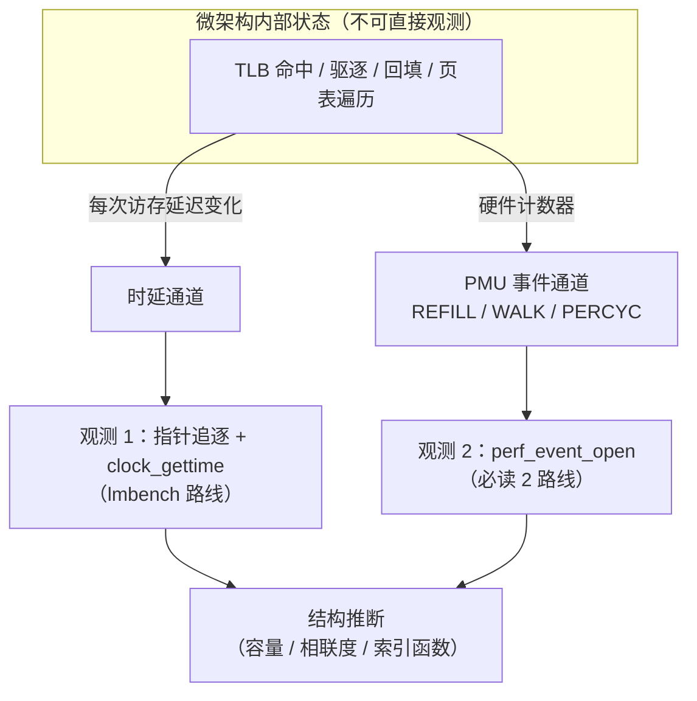

1. **时间**：TLB 命中 ≈ 0 额外代价；L1 miss → L2 查找（数个周期，v1.2 修正：原表述"至少一次额外流水"含糊，L1→L2 hit 的额外代价远小于 walk）；L2 miss → 页表遍历（20+ 周期且随页表驻留变化）。**lmbench 的 1.15 阈值实际主要对 walk 敏感**，因为 L1→L2 hit 的代价太小撑不起 15% 的比值跳变。控制其他变量后，访问延迟对工作集大小的分段函数拐点即 TLB 边界。
2. **事件**：PMU 把 miss/refill 计数直接暴露（§2.6），比时延更干净——不受频率波动、cache 状态影响，且能区分 L1 miss 但 L2 命中（`*.REFILL` vs `*.WALK`）与 L2 真 miss。

必读 2 的方法论本质：**构造"恰好踩在同一候选 set 上"的受控地址序列，用 PMU 事件计数检验"当假设的 set 内地址数超过假设的 way 数时事件是否跳变"，在 {sets, ways, 索引函数} 参数空间中做假设检验**。热力图是事件数随 (sets, ways) 的二维图，梯度图是一阶差分用于定位跳变沿。

### 4.2 lmbench `tlb.c` 剖析

**做法**（源码事实）：
- 压力组：`tlb_initialize()` 建立跨 N 个页、每页一个字的**随机顺序指针追逐链**（`p = (char**)*p`），保证每步都依赖 load 延迟，且"若 N 大于 TLB 覆盖，每步都是 TLB miss + cache 命中"（lib_mem.c 注释原文的设计意图）；对照组：`mem_initialize()` 建立 N 个 cache line 的同类链，工作集 N×line 远小于一页，翻译常驻。
- 判据：`R(N) = T_probe(N) / T_control(N) > 1.15`（`THRESHOLD` 宏）；先指数扫描（`i <<= 1`）定位区间再二分，返回 lower 边界，输出 "tlb: N pages"。

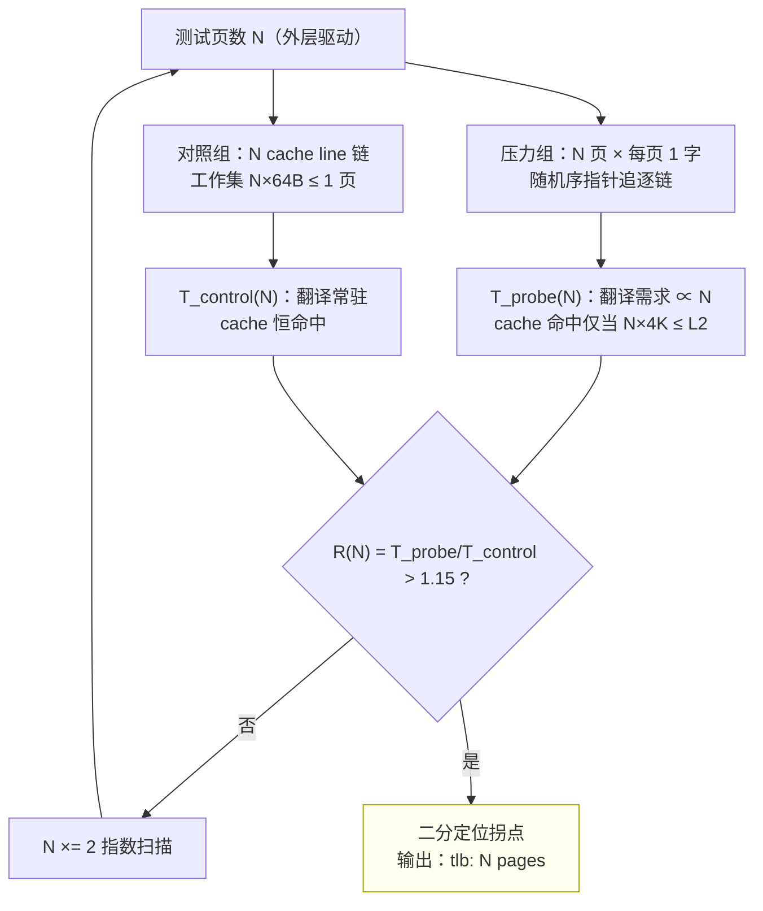

**价值**：
- 设计干净地分离了"翻译供给"与"数据供给"：两组链的依赖结构、访问次数完全相同，唯工作集跨页数不同。
- 随机页序消除页访问的局部性，防止硬件预取/prefetcher 伪造命中。
- 作为**第一级粗扫**工具非常好用，成本极低。

**局限（必须认清）**：
1. 输出是"性能边界"，不是结构：拐点可能来自 L1 dTLB 满、L2 TLB 满、page walk 串行化或 page-walk cache 行为中的任何一个，也可能是组合；单次扫描无法区分层级。
2. 只测数据侧、单一粒度（系统默认页），对大页/指令侧/混合粒度一无所知。
3. 阈值 1.15 是经验值，不同核、不同频率下拐点位置会漂移；二分返回的 lower 边界对阈值敏感。
4. 指针追逐的串行依赖使测量对 load-to-use 延迟整体敏感——任何与 TLB 无关的延迟变化（cache 行为、DVFS、SMT 干扰）都会污染比值。
5. 无 PMU 交叉验证，无法解释拐点成因。
6. **对照组的 cache 假设在大 N 时不成立（v1.2 新增，微架构视角）**：lib_mem.c 的设计意图是"压力组也保持 cache 命中、只暴露 TLB 代价"，但压力组工作集是 N×4K——N 超过几百页就超出 L2，链步进本身就是 cache miss。此时 R(N) 混合了 **cache 容量效应与 TLB 效应**，这是 lmbench 在 L2 TLB 容量（2048 页 = 8 MB ≫ L2 1 MB）上系统性失真的根因，也解释了阈值为何只敢设 1.15 这么低。

结论：lmbench 回答"**什么时候开始为翻译付代价**"，不回答"**哪一级、多少 sets/ways**"。这与参考报告的结论一致，我认同。

### 4.3 必读 2 论文方法剖析

**DTLB（Listing 1）**：按候选 sets S 生成页号 `1, 1+S, 1+2S, ...` 的地址并各读一字节。**仅在候选线性映射 `set = VPN mod S` 成立时才同 set**。作为假设检验工具成立；作为"测量程序"它不含预热/重复/计数区间控制（在 shell + perf 流程里）。

**ITLB（Listing 2）**：整区填 NOP、每页尾放 RET，构造"逐页执行"的代码区。x86 单字节 NOP 使每页恰好一"函数"；ARM 上无单字节 NOP（A64 指令定长 4 字节），等价物是 `MOV X0,X0`/`NOP`（4B）+ 页尾 `RET`，构造思路直接可移植。

**STLB（Listing 3）**：反解候选 XOR-N 索引——取 `U = L ⊕ T` 使两个 N 位字段异或等于目标 set T。论文对 Xeon STLB 的结论（XOR-7、128 sets）与官方 256 sets×6 ways 不符，作者以实验图样为准——这提示**厂商公开规格不可尽信，实测优先**，这个态度值得继承；但其 ways=12 是"1536 ÷ 128"倒算的，依赖容量先验。

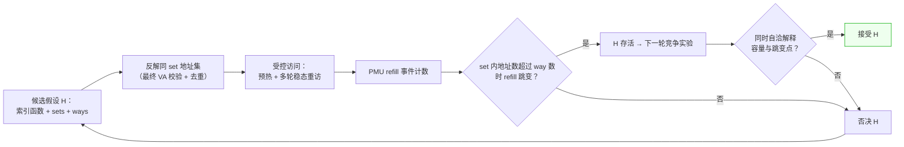

**方法论缺陷（批判性审视）**：
1. **迁移性失败有结构原因**：作者在 Power9 上失败的根本原因不是"运气"，而是把 Intel 的 (a) 事件语义等价物假设、(b) 索引函数假设同时带进了新 ISA。ARM 上 L1 TLB 全相联（无 set 可言）这一点就足以让"sets×ways 热力图"方法在 L1 层整体失效——热力图方法只适用于组相联的 L2 TLB。
2. **梯度图不是独立判据**：多个案例中作者承认需要表 1-3 的容量先验才能定下 ways；即"事件跳变给 sets，容量除法给 ways"。这套组合可用，但论文表述容易让人误以为梯度图自足。
3. **printf 在探针循环内**、取模可能折叠地址（见参考报告 §4.3-4.4 的数学核查）等实现瑕疵，说明其代码证据链不干净——复现者应修复而非照抄。
4. **10 runs × 10 samples** 的统计量（均值/标准差/偏度/峰度）只用于画图前的聚合，没有系统性统计检验（无置信区间、无多重比较校正），"拐点判读"带主观性。

### 4.4 对《源码分析报告（格式修订版）》的审视意见

**认同的部分**（经我独立核对源码/论文后确认）：
- 核心定位正确：lmbench 找拐点、论文做结构假设检验，两者不可互相换算容量。
- 对 Listing 3 的三条数学核查（取模破坏 XOR 结构、基址页号非零时最终 VPN 的 XOR 等式不成立、注释与掩码表达式不符 `(1<<N)-1` 实际取 N 位而非 N+1 位）全部成立，且"用返回的最终虚拟地址重算候选 set"的修复建议正确且必须。
- 代码事实/模型推导/实验结论三层切分是良好的写作纪律。

**不同意见与补充**：
1. **报告对 Listing 1 的"同 set"推导默认了线性映射，但对 ARM/X4 而言方向应反过来**：X4 的 L1 dTLB 经 TRM 确认为**全相联**（v1.2 更新，原为"假设"），不存在 set 索引——在 X4 上"构造同 set 地址"在 L1 层是 trivially 的（任何 N 个页都互斥），Listing 1 式扫描退化为纯容量扫描，价值反而下降；真正需要 XOR/哈希反解的是 L2 TLB。
2. 报告 §2.3 指出"不能仅凭读取第几个地址断言稳态 way 数"，正确；但还应再进一步：**一次性冷访问序列测出的是 fill 行为而非替换行为**，要测稳态相联度必须循环重访同一地址集并观察重访 miss——这是原论文流程中没说清、复现者最易踩的坑。
3. 报告未讨论论文方法在**全相联 L1** 上的退化和 **PMU 事件在 ARM 上的语义差异**——后者（`L1D_TLB_REFILL` 到底计什么）曾是 ARM 上比地址构造更先决的问题；**v1.1 已借 TRM 解决**（§2.6 的语义表），此条作为历史风险点保留。
4. 报告的 mermaid 流程图信息密度低，价值有限；其第 7 节"复现核查清单"是最实用的部分，建议在它的基础上扩充为 §5.8 的实验纪律。

### 4.5 小结：探测方法的谱系

| 方法 | 能给出 | 不能给出 | 适用层级 |
|---|---|---|---|
| lmbench 时延拐点 | 容量边界（混合成因） | 层级归属、sets/ways、粒度 | 全层级粗扫 |
| PMU 容量扫描 | 容量边界 + 层级归属（分事件） | sets/ways、索引函数 | 全层级 |
| 同 set 地址构造 + PMU | sets×ways、索引函数假设检验 | 全相联结构内部行为 | 组相联层（X4 的 L2 TLB） |
| 全相联直接冲突扫描 | 容量、（间接）替换策略痕迹 | — | 全相联层（X4 的 L1 TLB） |
| 执行页探测（NOP sled） | I-side 容量/层级 | 与 D-side 的共享关系（需对照） | I-TLB |
| EL3 RAMINDEX 直读（v1.2 新增） | 条目内容、set 分布、替换状态 | 无 EL3 的平台不可用 | 全层级（X4 特有） |

---

## 5. 建议的 TLB 微架构探测方法（落脚 Cortex-X4 各级 TLB）

### 5.0 总体路线图

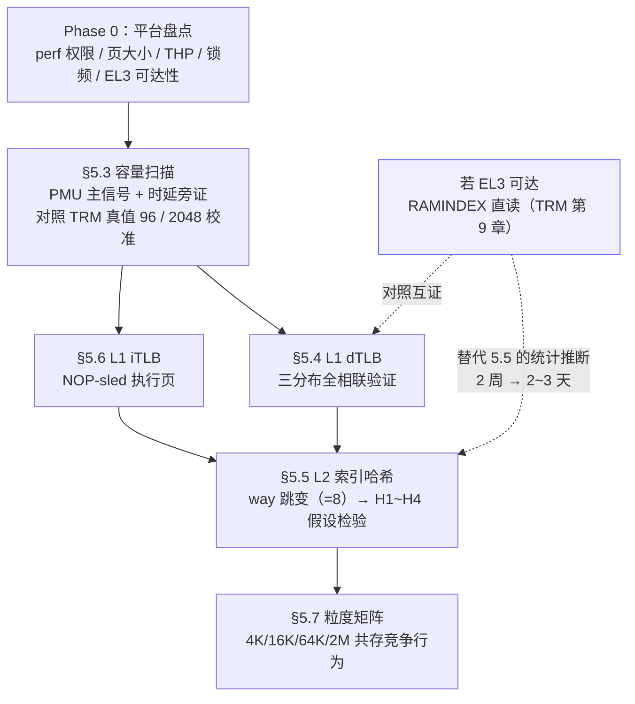

### 5.1 设计总则

1. **PMU 优先、时延辅证**：以 `L1D_TLB_REFILL`(0x0005)、`L2D_TLB_REFILL`(0x002D)、`L2D_TLB`(0x002F)、`DTLB_WALK`(0x0034) 等事件为主信号（完整清单与语义见 §2.6，均已核对 X4 TRM 第 17 章），时延拐点只作旁证。目标板上仍需用 `perf list` 确认内核导出了这些事件。
2. **假设预注册**：每个实验先写下零假设与接受/拒绝判据，再跑实验；禁止先跑数据再凑解释。容量/组织/粒度的零假设直接采用 TRM Table 5-1 值（§3.4），探测目的从"猜结构"变为"**在已知地面真值上校准测量方法 + 测 TRM 未公开项（索引哈希、替换策略、实测 refill 行为）**"。
3. **先测全相联、后测组相联**：X4 的 L1 全相联 / L2 8-way×256 sets（TRM 确认），两套工具链完全不同（§5.4 vs §5.5），不要混用。
4. **单变量控制**：每次只动一个维度（页数、粒度、地址间距、进程上下文），其余固定并记录。
5. **最终虚拟地址落盘**：所有构造地址在访问前记录到日志，事后用候选索引函数重算 set 并去重（吸取必读 2 Listing 3 的教训）。
6. **控制合组/聚合（映射级，v1.4 修正：与访问顺序无关）**：TLB 条目合组取决于**映射内容**（页表描述符的 contiguous hint 位）与**硬件聚合状态**（TRM 控制寄存器的 `HPA_L1_DIS`/`HPA_DIS` 位，默认启用），用户态访问顺序不影响合组。控制手段：(a) Phase 0 确认实验映射不含 contiguous hint（Linux arm64 会对部分连续 PTE 置 PTE_CONT，需抽查 /proc/pagemap 或经内核接口固定映射属性）；(b) 能触达 ECTLR 时记录并（可行时）关闭 HPA 位，留档；(c) 若上述均不可确认，"标称容量处出现干净拐点"必须降级为**待验证假设**而非验收判据。另：translation table prefetcher 会预取连续的下一张页表（污染 walk 计数），探测页的页表项应分散布置。

### 5.2 Phase 0：平台与事件盘点（半天）

**目标平台（v1.3 落地）：Android Linux arm64，高通 SM8650（Snapdragon 8 Gen 3）**。公开资料确认其 CPU 配置为 1× Cortex-X4（prime 大核，最高约 3.3 GHz）+ 5× Cortex-A720 + 2× Cortex-A520——**本报告的全部 TLB 探测仅针对其中的 X4 核**，小核（A720/A520，DSU 内同簇）不应混入测量。

该平台带来的具体约束与对策：

| 约束 | 影响 | 对策 |
|---|---|---|
| 无原生 `perf` 工具 | §4/§5 的 `perf stat` 命令不可用 | 用 Android NDK **simpleperf**（`simpleperf stat -e r5,r2d,r2f --` 等价于 perf 的 RAW 事件），探针本身走 `perf_event_open` 不受影响 |
| `perf_event_open` 权限 | 非 root 直接打不开计数器 | 需 root（userdebug/eng 固件或已 root 设备）；检查 `/proc/sys/kernel/perf_event_paranoid`，必要时 `setprop`/sysctl 放宽并记录 |
| vendor 内核裁剪 | X4 TRM 第 17 章的部分事件（如 0x8128–0x813F 遍历细分）可能未导出 | Phase 0 用 `simpleperf list` 实测可用集，以实测清单为准修订事件矩阵（§2.6 表为全集上限） |
| CPU 拓扑与绑核 | X4 是 prime 核，SM8650 8 核中通常为 CPU7 | Android（toybox）taskset 用**十六进制掩码**语法：`taskset 80 ./probe`（0x80 = CPU7）；桌面 Linux 的 `taskset -c 7` 是 util-linux 语法，Android 不支持 `-c`。也可用 `taskset -p 80 <pid>` 绑已运行进程；探针内置 `--pin 7`（sched_setaffinity）等价。**先验证哪颗是 X4**：`cat /proc/cpuinfo` 查 part 号（Cortex-X4 = 0xd82, implementer 0x41），或比对 `cpuinfo_max_freq`（最高频者） |
| DVFS / 热管理 | 手机负载触发热降频，时延通道信号漂移 | 锁频或定期间隔记录当前频率（simpleperf 的 `cpufreq` 事件或 sysfs 采样）；PMU 通道（计数）不受频率影响，是主信号的又一理由 |
| 页大小 | Android arm64 内核通常 4K 基页 | 4K 作为基线；16K/64K 粒度需内核重建或等内核态通道，列为独立开放项 |
| THP | 内核配置相关，可能开启 | 探测前确认并显式 `madvise(MADV_NOHUGEPAGE)` 固定粒度 |
| EL3（QHEE/TrustZone） | 生产设备的 EL3 固件为高通签名，RAMINDEX 路径**默认不可达** | §5.5 默认走 **H1~H4 假设检验**路线；EL3 直读仅在有签名的实验固件/开发板时启用（开放项 4 相应调整） |
| SELinux | 限制 debugfs/sysfs 访问 | userdebug 固件关闭或绕过 SELinux 并记录策略状态 |

Phase 0 盘点清单（在通用清单基础上按平台执行）：

- 确认 X4 板卡的 kernel、simpleperf 可用性、`perf_event_paranoid`、可用 PMU 事件清单（`simpleperf list`）；拿不到事件计数则整体降级为纯时延方案（信噪比差一个量级，需相应加大重复次数）。
- 确认系统页大小（`getconf PAGESIZE`）、THP 是否开启（**必须关闭 THP/或显式 `madvise` 固定粒度**，否则 4K 扫描会被透明大页污染）、CPU 亲和性（`taskset 80` 锁 X4 核、屏蔽小核干扰、锁频或记录频率）。
- 确认支持的分支：4K 粒度是基线；16K/64K 粒度与 2M 大页映射作为独立实验维度（用 `mmap` + 自定义页表或内核模块/现成大页机制获取映射）。
- **盘点 EL3 可达性（按上表预期为不可达）**：若平台可获得 EL3（开发板 ATF 环境 / 签名实验固件），优先评估 TRM 第 9 章 RAMINDEX 直接 dump 路径（§3.4）。
- 记录 ECTLR 中 translation table prefetcher 的默认状态；能关则实验前关闭并记录。

**交叉编译与部署（主机 = macOS M4 Pro，v1.3 补充）**：

macOS 直接 `cc` 的产物是 Mach-O，**不能在 Android 上运行**——必须用交叉工具链产出 `aarch64-linux-android` ELF。推荐 Android NDK（r26 LTS 或更新）：

```bash
# 1. NDK 工具链路径（注意：NDK r26/r27/r28 的 macOS 主机工具链仍是 x86_64，
#    目录为 prebuilt/darwin-x86_64；M 系 Mac 经 Rosetta 2 运行，首次使用需装 Rosetta）
NDK=~/Library/Android/sdk/ndk/27.0.12077973
CC=$NDK/toolchains/llvm/prebuilt/darwin-x86_64/bin/aarch64-linux-android34-clang
#    （API 级别按设备实际选：SM8650 出厂 Android 14 → android-34）

# 2. 交叉编译（源码零修改：纯 C + libc；linux/perf_event.h 由 NDK sysroot 提供；
#    __linux__ 分支在 bionic 下生效；-static 免去推 libc 的麻烦，若失败可去掉）
$CC -O2 -Wall -Wextra -static -o tlb_capacity_probe tlb_capacity_probe.c
$CC -O2 -Wall -Wextra -static -o l2_set_probe l2_set_probe.c

# 3. 部署到设备并运行（需 root）
adb push tlb_capacity_probe l2_set_probe /data/local/tmp/
adb shell
sailfish:/ $ su
sailfish:/data/local/tmp # chmod +x tlb_capacity_probe l2_set_probe
sailfish:/data/local/tmp # taskset 80 ./tlb_capacity_probe -N 96 -R 200 -d 2 \
                             -e 0x0005 -e 0x002D --addrlog addr_N96.log
#    或 simpleperf 采集：simpleperf stat -e r5,r2d -- taskset 80 ./tlb_capacity_probe -N 96 -R 200 -d 2
```

替代方案（无 NDK 时）：手机上 Termux `pkg install clang` 原生编译（arm64 Android 直接出 ELF，无需交叉），再把二进制放到 /data/local/tmp 运行。

### 5.3 容量扫描：L1 dTLB 与 L2 TLB 的分离

**探针**：改进版 lmbench 链——保留"每页一字 + 随机页序 + 指针追逐"的骨架，修正三点：
1. 预热阶段与测量阶段显式分离，测量段只循环已驻留的链；
2. 每组 N 同时采集 `L1D_TLB_REFILL` 与 `L2D_TLB_REFILL`；
3. N 以细粒度（×1.05 步进或 8 条步进）扫描 32~2560 条区间，而不仅指数扫描。

**判据**：以 `L1D_TLB_REFILL` 曲线首个显著抬升平台定 L1 dTLB 容量（TRM 地面真值 96）；以 `L2D_TLB_REFILL` 抬升点定 L2 TLB 容量（TRM 地面真值 2048）。事件语义校验用 TRM 已明示的事实设计对照（§2.6）：(a) 96 < N < 2048 区间、**剔除首轮后**应观测到 `L1D_TLB_REFILL ≈ 访问数`、`L2D_TLB_REFILL ≈ 0`（L1 全 miss、L2 全命中；首轮 N 次 miss 会产生 N 次 refill + walk，v1.2 明确口径）；(b) refill **含故障回填**——每轮测量必须剔除首轮冷访问；(c) 记住 0x002D 计的是 **fill 次数**、0x002F 计的才是 access 次数（§2.6-4），不要把两者混为一个"miss 率"；(d) MMU 关闭时 `L1D_TLB_REFILL` 仍计数而 `L2D_TLB` 不计——可用对照区验证计数器行为。若实测拐点与 96/2048 系统性偏离，先查混淆变量（合组条目、prefetcher、THP），再质疑真值。

**陷阱**：N×4K 工作集达 8 MB（2048 页）时已逼近 L2 cache（1 MB）与 L3，指针链步进本身会 cache miss——这正是必须 PMU 化的原因（也呼应 §4.2 局限 6：lmbench 在此处必然失真）；时延组只保留 N ≤ 256 的子区间作 L1 层旁证。

### 5.4 L1 dTLB 结构探测（TRM：全相联 96 条，原生支持 4K/16K/64K/2M/512M）

全相联结构没有 set 可构造，探测目标转为**容量标定 + 替换行为痕迹**：

1. **容量精确化**：在 5.3 拐点附近（80~112 条）以 1 条步进扫描 refill 率，取 refill 率从 0 到平台值的过渡中点作为容量点估计；重复 ≥30 次给出均值 ± 置信区间。对照 TRM 真值 96 评估测量偏差。
2. **全相联验证（区别于组相联的判据；v1.4 修正分布定义）**：全相联的判据是"**页号集合**的分布形态不影响容量拐点"（不是访问顺序）。实验固定 N=95/96/97，用三种**真集合**对照（探针 `-d` 模式，v2 已修：v1 的 random 只打乱访问顺序、stride 越界访问，均不构成分布对照）：
   - (a) 连续集合 {0..N-1}（`-d 0`）；
   - (b) 大步距集合 {i×256}（`-d 1`，按 N×256 分配区域——v1 的越界 bug 已修）；
   - (c) 随机集合：从大区域随机取 N 个不同页号（`-d 2`）；
   - 另保留 `-d 3`（lmbench 式随机**顺序**）仅作访问顺序影响的对照，不参与分布判据。
   若 (a)(b)(c) 的 refill 拐点一致，支持全相联；若大步距/随机集合提前抬升，则存在 set 结构，转 §5.5 方法。

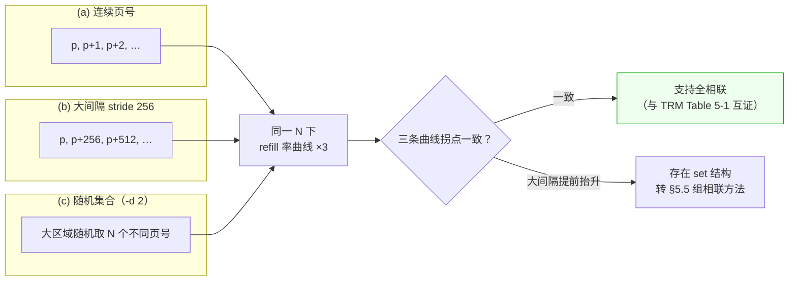

3. **替换策略痕迹**（可选深挖）：N=96 时以不同顺序重访子集，观察"第 k 次重访是否 miss"的序列，可区分 LRU 类与随机类替换——此项置信度天然较低，只作定性记录。
4. **EL3 直读对照**（若可达）：RAMINDEX（RAMID=0x0A，entry 0–95）dump L1 dTLB 全部条目，直接观察有效位分布与内容（Table 9-23~9-25 格式），与地面真值互证。

### 5.5 L2 TLB 结构探测（TRM：8-way × 256 sets，**仅剩索引哈希函数待逆向**）

sets=256、ways=8 已由 TRM Table 9-32（L2 TLB RAMID=0x18：Way[20:18] 0–7，Entry[7:0] 0–255）确认，容量 2048 由 Table 5-1 确认。因此本节的任务从"三组参数全猜"收缩为**单参数问题：VPN→256 sets 的索引哈希函数**（以及替换策略的辅助确认）。这是必读 2 方法真正适用的层级：

1. **先决验证**：5.3 的容量标定给出 2048 地面真值；先跑 way 跳变实验确认实测 way=8（§5.5-3 判据），方法学通了再进入哈希逆向。
2. **索引函数假设族**（ARM 公版核常见假设，按优先级）：
   - H1 位选：`set = VPN[7:0]`（= VA[19:12]，4K 粒度、256 sets 的直接截取）；
   - H2 折叠 XOR：`set = VPN[7:0] ⊕ VPN[15:8]` 及其 N 变体；
   - H3 高位折叠：`set = VPN[7:0] ⊕ VPN[23:16]`；
   - H4 多字段 XOR（三字段及以上）或含 ASID 位的哈希。
   对每族 H 实现"给定目标 set T 反解 VA 集合"的生成器。**v1.4 修正（回应评审 R3）**：哈希与校验一律对**最终虚拟地址**计算（基址页号计入，v1 误对 mmap 内相对页号计算且复核的也是相对量——注释与代码自相矛盾）；候选按区域**分桶取样**（每桶取首个匹配），避免连续取前 16 个匹配导致高位恒定、H1/H3 与 H2/H4 在样本上不可区分。
3. **way 数测定（v1.4 重构为 prime+probe，回应评审 R1）**：v1 的 run 模式只重访 w ≤ 16 个目标页——它们全部驻留 96 条 L1 dTLB，稳态后根本不再查 L2，**测不到 L2 冲突**。v2 协议：每轮先追逐 filler 链（默认 512 页随机序，> 96 条 L1 容量）驱逐目标出 L1，再访问目标 w 页——每个目标访问都是 L1 miss、真实到达 L2。三层判读：
   - **协议门控**：probe 段 `L1D_TLB_REFILL` ≈ w 且 `L2D_TLB`(0x002F) ≈ w，否则协议无效（filler 不足）；
   - **跳变判据**：剔除 round 0（冷启动）后，w ≤ 8 → probe 段 `L2D_TLB_REFILL`(0x002D) ≈ 0；w ≥ 9 → 跳到 ≈w/轮。PMU 计数在进程内按阶段读增量（filler 段/probe 段分开），建链与首轮自动排除；
   - **对照组**：`-T2` 提供另一目标 set（同 filler 干扰），跳变应为目标 set 特异；
   - **清洁度降级（评审 R1）**：即使协议正确，w > 8 后"每页每轮必 miss"仍受替换策略与 walk-cache 条目占比影响——**跳变点是判据，逐形态不作判据**；"way=8 处干净跳变"由 TRM 真值保证其存在，但实测曲线的干净程度是开放问题。

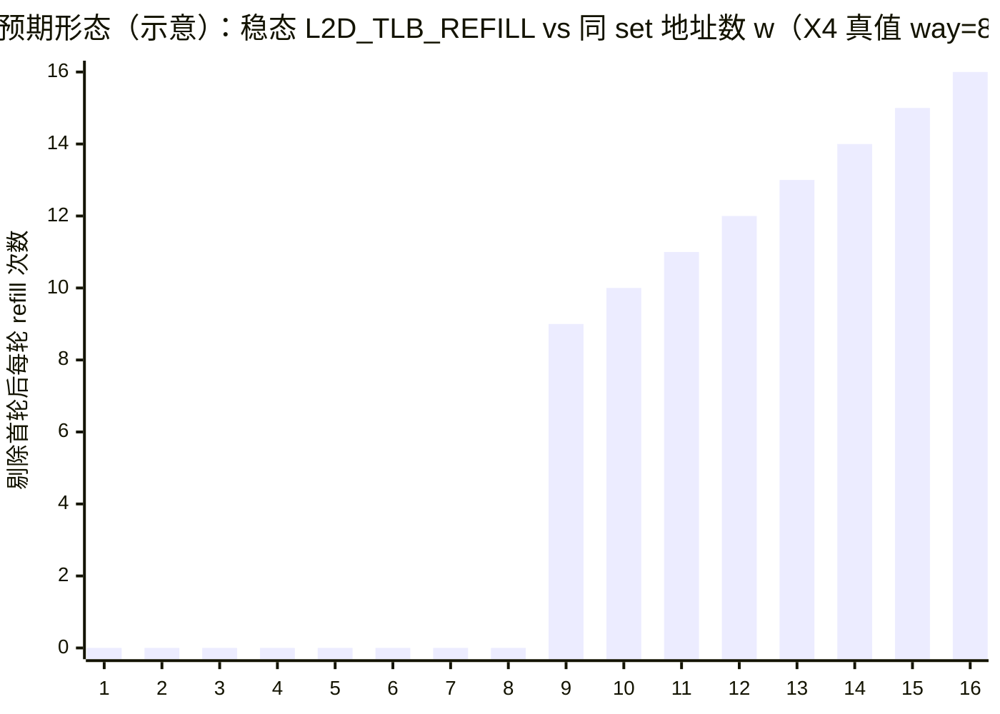

对每个假设 H 独立做；**只有能使跳变点=8（且通过协议门控）并与容量 2048 自洽的 H 被接受**。
4. **walk-cache 条目的干扰（v1.2 补充）**：X4 的 L2 TLB 共存"中间级描述符"条目（Table 5-1 + IR1 bit[46]"Walk cache entry"位），同 set 竞争的对象不止最终翻译条目——w>8 时的驱逐/跳变形态可能受 walk 条目占比影响。判据仍以跳变点为准；若 EL3 可达，dump 时按 bit[46] 分解两类条目再拟合。
5. **EL3 直读捷径**（若可达）：RAMINDEX（RAMID=0x18）逐 Way×Entry dump 2048 条目，从条目的 VA 字段（Table 9-43~9-46 格式）直接统计"同一 set 的条目有哪些 VA"——索引函数可直接拟合出来，无需统计推断。**有 EL3 的平台优先走这条路**。
6. **热力图/梯度图**：沿用必读 2 的呈现（sets×ways 的事件热力图 + 一阶梯度），但判读规则改为"候选 H 族的竞争图样一致性"，而非纯视觉拐点。
7. **iTLB 对 L2 的共享验证**：用 §5.6 的取指探针造成 L2 refill（`L2D_TLB_REFILL` 由 I 或 D 触发，TRM 已确认共用事件），随后数据探针在同一 VPN 集合上测量 D-side 命中——若共享，数据侧应观察到 L2 hit。注意 ASID 与权限位（XN）差异可能阻止条目复用，实验设计时让两侧翻译属性一致。

### 5.6 L1 iTLB 探测（TRM：全相联 48 条，原生支持 4K/16K/64K/2M；v1.4 探针设计修正）

- **探针（v1.4 修正，回应评审 A4）**：v1.3 设计"每页整页 NOP + 页尾 RET、从页首执行"会让每次访问实际执行约一页指令（4K 页 ≈ 1024 条 NOP）——48 页代码量 192 KB 已超 64 KB L1 I-cache，且引入取指预取与返回预测效应，iTLB 信号被前端行为淹没。改为**短跳板探针**：每页只放一条数条指令的等长跳板（如取数→RET），`BL` 到**页内不同偏移**的跳板位置作对照（iTLB 按页翻译，页内偏移不影响翻译粒度，但可作页内行为对照）；同时记录 `L1I_CACHE_REFILL`(0x0001) 与分支事件（0x0021/0x0022）以剥离 I-cache/BTB 成分。用 `L1I_TLB_REFILL`(0x0002) / `ITLB_WALK`(0x0035) 计数。注意 TRM 语义：iTLB 由 **MMUTC** 回填，`L1I_TLB_REFILL` 抬升点对应 MMUTC/iTLB 边界行为。
- 容量扫描与 §5.3 平行（N 扫 40~56 区间细化，TRM 真值拐点 48）；L1 全相联验证复用 §5.4-2 的真集合三分布法（代码页布局形态：连续 / 大步距 / 随机集合）。
- 区分 I-side 与 BTB/分支预测效应：`L1I_TLB_REFILL` 事件与总周期数同时记录；若时延信号与 refill 计数背离，说明执行时间被前端其他结构主导，以事件为准。

### 5.7 页粒度矩阵（4K 基线 + 16K/64K/2M）

- 每种可获得粒度重复 §5.3 容量扫描：TRM 已确认 L1 dTLB 原生支持 4K/16K/64K/2M/512M、L1 iTLB 支持 4K/16K/64K/2M、L2 TLB 支持 4K~1G 全粒度——本节的实测目标是**标定混合粒度共存时的竞争行为**（条目是否跨粒度共享 96/48 条配额），而非确认支持性。
- 覆盖量换算：容量（条）× 粒度 = 覆盖地址范围；报告**同时**给出两者（如 "96 条 4K = 384 KB；96 条 512M = 48 GB"），避免跨粒度比较时误读。
- 粒度共存实验：4K 映射 N 页 + 单个 2M 映射交替访问，观察 L1 refill 是否互相驱逐（共享结构）或和平共处（分结构）。

### 5.8 实验纪律清单（在参考报告第 7 节基础上扩充）

1. 最终虚拟地址全量落盘 + 候选 set 重算 + 去重（§5.1-5）。
2. 预热与测量区间显式分离；测量段不含任何初始化、日志输出、系统调用。
3. 每配置 ≥30 次独立重复（独立进程、重新映射），报告均值、95% 置信区间；事件计数与时延（含百分位）同时存档。
4. CPU 锁核、关 IRQ 干扰（或记录）、禁 THP、记录 DVFS 频率轨迹。
5. 每次实验记录零假设与判据；失败数据同样落盘（结构化 failure 记录），不静默丢弃。
6. 事件语义校验实验前置（§5.3 的 L1 miss/L2 hit 区间法）——fill(0x002D) 与 access(0x002F) 口径分开，首轮剔除规则写进分析脚本。
7. 测量循环必须以编译屏障 + sink 防优化消除（probes/ 骨架已内置，勿移除）。
8. 所有脚本、原始 CSV、图、结论版本化，保证从数据到结论可一键复现。

### 5.9 预期结果与验收判据表（预注册用；H0 列 = TRM 地面真值）

| 项目 | TRM 真值（H0） | 验收判据（实测验证） | TRM 出处 |
|---|---|---|---|
| L1 dTLB 容量 | 96 条 | refill 拐点 92~100，三分布拐点一致 | Table 5-1 |
| L1 dTLB 组织 | 全相联 | §5.4-2 三分布无差异 | Table 5-1 |
| L1 dTLB 粒度 | 4K/16K/64K/2M/512M | §5.7 各粒度扫描行为一致 | Table 5-1 |
| L1 iTLB 容量 | **48 条**（第三方 128 条说法被 TRM 否决） | 执行页扫描拐点 46~52 | Table 5-1 |
| L1 iTLB 组织 | 全相联 | 同上三分布法 | Table 5-1 |
| L2 TLB 容量 | 2048 条 | L2 refill 拐点 1900~2200 | Table 5-1 |
| L2 TLB 组织 | **8-way × 256 sets（已确认）** | way 跳变点=8（方法学校准） | Table 9-32 |
| L2 TLB 粒度 | 4K~1G + stage-2 IPA + 中间级描述符 | §5.7 粒度矩阵 | Table 5-1 |
| L2 索引哈希 | **TRM 未公开** | 唯一能通过全部竞争实验的 H 假设 | 本方案核心产出 |
| L2 I/D 共享 | 共享 | §5.5-7 交叉命中实验为正 | Table 5-1 |
| MMUTC | 存在（iTLB 由它回填） | `L1I_TLB_REFILL` 行为与 `L1D_TLB_REFILL` 对照 | §5.1 + PMU 章 |
| 遍历预取器 | 存在，ECTLR 可关 | 连续页表区 walk 计数显著低于打散区 | Table 5-1 |

任何与 H0 不符的结果不被丢弃，而是作为新假设进入下一轮——但有了 TRM 真值后，**排查顺序应反过来：先怀疑测量方法与混淆变量（合组、prefetcher、THP、DVFS），再怀疑文档**（必读 2 时代"实测优先于文档"的教训在 TRM 原文可得时应降级为"文档与实测冲突时双侧举证"）。

**v1.4 降级声明（回应评审 R1/A3）**：上表中"refill 拐点落在标称容量附近"的全部判据，都预设**实验映射不含合组条目、聚合处于已知状态**。若 Phase 0 无法确认这两点（§5.1-6），这些判据自动降级为"待验证假设"——实验首轮跑出的第一职责是确认映射与聚合状态，而非验证容量。

### 5.10 路线建议

1. 第 1 周：Phase 0 盘点（**含 EL3 可达性评估**）+ §5.3 容量扫描——产出 L1/L2 容量点估计与 TRM 真值偏差报告。
2. 第 2 周：§5.4 L1 结构 + §5.6 iTLB——产出 L1 级完整画像。
3. 第 3~4 周：§5.5 L2 索引哈希逆向——**若 EL3 可达则改为 RAMINDEX 直读 + 拟合**（工作量从 2 周降到 2~3 天）；若不可达走 H1~H4 假设检验。
4. 第 5 周：§5.7 粒度矩阵 + 数据整理成报告。

---

## 附：本报告材料关键引用点

- X4 TLB 结构（Table 5-1）、TLB 匹配流程（§5.3）、遍历流程（§5.4, Figure 5-1）、冲突处理（§5.6）、PBHA（§5.8）：**Cortex-X4 TRM 第 5 章（p.54–62）**。
- TLB RAM 直接读（RAMINDEX 编码 Table 9-4/9-7/9-32；L1 I/D TLB 条目格式 Table 9-14~9-16 / 9-23~9-25；L2 TLB 条目格式 Table 9-43~9-46）：**TRM 第 9 章（p.74–91）**。
- TLB PMU 事件（0x0002/0x0005/0x0025/0x0026/0x002D/0x002F/0x0034/0x0035/0x005C–0x005F/0x8128–0x813F）：**TRM 第 17 章（p.123–137）**。
- X4 特性（MMU、48-bit VA/40-bit PA、MMU TC ECC）：Cortex-X4 Software Optimization Guide §2 特性列表（p.10）。
- X4 执行管道组织：同指南 §2.1（p.11-13）。
- TLB 数据通路概述：必读 2 §1.1.1 及 Figure 1（p.2-3）。
- 必读 2 探测代码与结论：Listing 1/2/3（p.7-8）；Xeon DTLB 16×4、ITLB 16×8、STLB XOR-7/128 sets（p.11-12）；Power9 迁移失败（p.17-19）。
- lmbench 阈值与搜索：`tlb.c` 的 `THRESHOLD 1.15`、`find_tlb()` 指数+二分；`lib_mem.c` 的 `tlb_initialize()` 每页一字随机链设计意图注释。

## 附：待办与开放问题（v1.5）

| # | 状态 | 事项 | 归属 / 触发条件 |
|---|---|---|---|
| 1 | ✅ 已完成 | 获取 Cortex-X4 TRM 原文（102484_0003_06_en 已入库 cpu-uarch-ref/docs/，iTLB 48 vs 128 矛盾已裁决：48 条） | — |
| 2 | ⬜ 待办 | SM8650（Android）simpleperf 可用事件集与 `perf_event_paranoid` 状态实测确认（X4 TRM 事件全集 vs 内核导出集可能裁剪） | Phase 0 首件事 |
| 3 | ⬜ 待办 | 16K/64K 粒度与 2M/512M 大页映射的用户态获取方式（内核配置 / `hugetlbfs` / 内核模块） | 按 SM8650 内核确定；4K 基线先行 |
| 4 | ✅ 已裁决 | EL3 可达性：SM8650 生产设备为高通签名固件，RAMINDEX 路径默认不可达——§5.5 默认走 H1~H4 假设检验；获得签名实验固件后再启用直读 | 签名固件可得时 |
| 5 | ⬜ 待办 | ECTLR 中 translation table prefetcher 的关闭方式与默认状态确认 | 涉及 EL1/EL2 权限，Phase 0 记录 |
| 6 | ⬜ 待办 | in-flight 翻译并行度（walk 队列深度）：K 独立链协议测量（§3.3 行）；v1.3 快速/慢速方案已弃用（评审 R2） | §5.3 M4 实验阶段 |
| 7 | 🔍 开放问题 | X4 L1 "VIPT behaving as PIPT" 的实现机制：16 KB/way > 4K 页的理论别名如何消除，TRM 未公开 | 查后续 TRM / Arm 技术博客 / 微架构逆向（评审 A1） |
| 8 | 🔍 开放问题 | MMUTC 的条目内容、容量与功能定位：PMU 仅确认其为 iTLB 回填源 | 0x8137 ITLB_STEP 对照实验 +（若有）EL3 观察（评审 A5） |

## 附：专家审阅记录（v1.2 首轮 13 项 + v1.3 追加 5 项 + v1.4 外部评审1 九项 + v1.5 外部评审2 七项）

本轮由"计算机体系结构"与"CPU 微架构"两个视角交叉审阅 v1.1，发现 13 项意见，全部已处理：

| # | 视角 | 位置 | 严重度 | 意见 | 处理 |
|---|---|---|---|---|---|
| A1 | 体系结构 | §1.1 | 事实修正 | "4~5 级页表"不精确：48-bit VA 在 4K/16K 粒度下精确为 4 级（L0–L3） | 已改 |
| A2 | 体系结构 | §1.3/§1.4 | 重要补充 | TLB 的第 4 个体系结构作用：虚拟化的硬件基础（stage-2 + VMID）缺失 | 已补（含 mermaid 两阶段图） |
| A3 | 体系结构 | §2.3 | 重要补充 | TLB 缓存的不只是地址，还有内存类型/序契约（Device memory 的 G/R/E 语义） | 已补 |
| A4 | 体系结构 | §1.4/§2.4/§3.4 | 增强 | PA 宽度决定块大小合法集（40-bit PA → 512M 上限，1G 无意义）；覆盖杠杆比（4K vs 512M 差 12.8 万倍）值得强调 | 已补 |
| A5 | 体系结构 | §1.1 | 增强 | "翻译墙"缺量级概念 | 已补（每周期翻译补贴估算） |
| M1 | 微架构 | §4.1 | 事实修正 | "miss → 至少一次额外流水"含糊：L1→L2 hit 只数个周期，1.15 阈值实际对 walk 敏感 | 已改 |
| M2 | 微架构 | §4.2 | 重要补充 | lmbench 对照组"cache 命中"假设在大 N 时不成立（N×4K 超 L2），比值混入 cache 容量效应——L2 TLB 测量系统性失真的根因 | 已补（局限 6 + 图注） |
| M3 | 微架构 | §5.3 | 口径修正 | "L2D_TLB_REFILL ≈ 0"必须限定剔除首轮；0x002D 计 fill 次数而非 access 次数 | 已改 |
| M4 | 微架构 | §3.3 | 重要补充 | 缺 in-flight 翻译并行度（walk 队列深度）这一可观测行为——计数拐点可能不干净，应先表现为延迟尾部 | 已补（清单新行 + 时延百分位要求） |
| M5 | 微架构 | §5.5 | 重要补充 | L2 TLB 内 walk-cache 条目与最终翻译共存，同 set 竞争对象不纯；EL3 dump 可按 bit[46] 分解 | 已补 |
| M6 | 微架构 | §2.1 | 增强 | iTLB/dTLB 与取指口/LSU 配对、L1D 三 tag RAM（Pipe Copy 位）的结构性说明 | 已补 |
| M7 | 微架构 | §4.4 | 一致性 | v1.1 后仍存"V3 TRM 外推/假设全相联"等过时表述；PMU 语义问题已在 v1.1 解决应注明 | 已改 |
| G1 | 通用 | 全文 | 增强 | 9 幅 mermaid 图（原理/两阶段/架构/观测/双组/检验环/路线/三分布/way 跳变） | 已插入 |
| G2 | 通用 | §5.2（v1.3） | 平台落地 | 探测平台明确为 Android Linux arm64 / SM8650：工具链（simpleperf）、权限、绑核、DVFS、EL3（QHEE 不可达）约束逐条落表 | 已插入 |
| G3 | 通用 | probes（v1.3） | 代码落地 | M4（in-flight 翻译并行度）落地为探针的快速/慢速重访对照 + 时延百分位输出 | 已实现 |
| M8 | 微架构 | §2.1（v1.3 复核） | 依据标注 | 管道表逐行区分"指南原文/TRM 事实/推断"；修正"每周期 3 个并发翻译请求"的过度具体化（地址管道实为 4 条、tag RAM 3 份，配对关系文档未公开） | 已改 |

遗留：xychart-beta 图（§5.5-3）依赖渲染器支持 mermaid ≥ 10.4；若目标环境不支持，用同位置文字判据（w≤8 refill≈0，w≥9 跳变）替代即可。

### 外部评审（v1.4）

第三方静态评审（仅资料核对与代码走查，未在 SM8650 上实测）提出 4 条阻断性问题与 5 条体系结构判断修正。**经逐条独立复核：4 条阻断性问题全部属实（含探针代码 2 个真 bug），5 条判断修正全部采纳**；评审原文归档于 `review-外部评审意见.txt`。

| # | 类型 | 意见 | 复核与处理 |
|---|---|---|---|
| R1 | 阻断 | L2 同 set 实验测不到稳态冲突：w≤16 页全驻留 L1 dTLB，稳态不再查 L2；外层 perf 含建链与首轮，无分阶段计数 | 属实。探针 v2 改 prime+probe（filler 驱逐 + 进程内分阶段 PMU + round 0 剔除 + `-T2` 对照组）；§5.5-3 重写；曲线清洁度降级（跳变点是判据，形态不是） |
| R2 | 阻断 | 快速/慢速重访测不了并行 walk 数：串行依赖链任意时刻仅 1 个 outstanding miss | 属实（微架构机制推理正确）。M4 重构为 `-K` 独立链协议 + `DTLB_WALK_PERCYC` 饱和点；§3.3/§5.3/开放问题 6 同步修订 |
| R3 | 阻断 | 同 set 地址未按最终 VA 校验：代码对 mmap 相对页号哈希且复核相对量（注释与代码矛盾）；前 16 个候选高位恒定，假设不可区分 | 属实（代码 bug）。v2 对最终 VA 计算与校验 + 分桶取样；§5.5-2 修订 |
| R4 | 阻断 | 三分布不构成三种分布：random 只打乱访问顺序；stride 模式越界访问（第 i×256 页超出 N 页分配） | 属实（越界为代码 bug）。v2 改为真集合（连续/大步距/随机集合，区域按模式分配），保留随机序为对照；§5.4-2 修订 |
| A1 | 判断修正 | VIPT 算术错误：64KB÷4way = 16KB/way、256 sets（VA[13:6]），"索引全在页内故无别名"不成立 | 属实。§2.3 改为：TRM 声明"VIPT behaving as PIPT"为事实，实现机制未公开、不再臆测，列开放问题 |
| A2 | 判断修正 | "40 位 PA 使 1 GB 块无意义"与 TRM 明列的 L2 1GB 块支持矛盾 | 属实（40 位 PA 有 1024 个 1GB 区间）。§1.4/§3.4 撤销该论断 |
| A3 | 判断修正 | 合组取决于映射与硬件状态（contiguous hint + HPA 位，默认启用），非访问顺序；"干净拐点"应降为待验证假设 | 属实。§5.1-6/§3.4 改为映射级控制手段；§5.9 加降级声明 |
| A4 | 判断修正 | §5.6 整页 NOP 执行量（48 页=192KB）超 L1 I-cache，引入预取/返回预测效应 | 属实。§5.6 改为短跳板探针 + 页内偏移对照 + I-cache/分支事件剥离 |
| A5 | 判断修正 | 由"iTLB 从 MMUTC 回填"断定 MMUTC 是独立 walk cache 证据不足；STEP 平均值不能直接换算命中率 | 属实。§2.7 MMUTC 角色降级为开放问题；STEP 需对照校准 |

评审总结论（采纳）：保留已核实的 X4 参数与 PMU 事件表；先修正探针的可观测路径、地址构造与页聚合控制，再将 L2 哈希、way 曲线、walk 并行度、MMUTC 功能写为**实测结论**；RAMINDEX dump 是条目快照，单次 dump 不能给出替换状态或唯一全域索引函数。

### 外部评审 2：源码评审（v1.5）

针对 `probes/` 两份 C 源码与 README 的专项评审。**评审基于 v1 代码**（行号与当前 v2.1 有出入，用户已提示；逐条按当前代码复核）。复核结论：阻断项 1–4 与评审1 的 R1/R3/R4 一一对应（v2.0 已修复，复核确认）；以下为新发现的有效意见，v2.1 全部修复：

| # | 意见 | 复核 | 处理（探针 v2.1） |
|---|---|---|---|
| 2-5 | 预热循环非 volatile 且结果未使用，Clang -O2 实测将其整体消除（评审方在优化后 IR 中确认）；`volatile char *g_sink` 只限定所指字符，指针 store 仍可被消除 | 属实，且 v2.0 仍存留（评审1 只抓到了测量循环，预热是评审2 新抓到的） | 预热改 volatile 追逐 + 结果写 `char *volatile` sink；两文件的 sink 声明同步修正 |
| 2-6 | `perf_read` 在 fd<0 时返回 0，权限不足时伪装成"零 refill"；未检查 time_enabled/time_running，多路复用时把未缩放计数当完整窗口 | 属实（Linux 路径 fd<0 → 返回 0） | fd<0 → 明确 n/a + 打开时逐事件告警；read_format 带 TIME_ENABLED/TIME_RUNNING，输出 mux 比例提示（两文件） |
| 2-7 | slow 模式 `ns_per_load` 把轮间 busy-wait 计入分子 | 属实 | ns_per_load 改为逐轮追逐时间之和，墙钟单独输出 wall_ns |
| 2-8 | 逐轮时延只输出汇总百分位，无法做首轮剔除/分布分析 | 属实 | 新增 `--rawlog` 逐轮原始数据落盘 |
| 2-9 | 绑核失败仅 perror 后继续运行，异构平台上容量归属失效 | 属实 | `--pin` 失败即退出（return 1） |
| 2-10 | gen 与 run 是不同进程（ASLR 基址不同），仅 gen 落盘无法审计 run 的地址集合 | 属实（v2.0 只修了哈希计算，没修审计链） | run 模式同样落盘实际使用的目标 VA + 重算 set |
| 2-11 | README 只有数据侧探针、§5.6 iTLB 探针无源码；示例命令与平台语法一致性 | 部分属实 | README 增补 iTLB 探针 TODO 声明与 simpleperf 等价命令说明；两份 .c 增加版本记录头 |

另：评审2 指出"匿名映射的页粒度未验证"——与报告 §5.1-6(a) 的 Phase 0 要求一致，保持登记（探针不重复实现，由盘点脚本检查 /proc/pagemap）。

## 附：术语与缩略语表（v1.3）

### 地址翻译与页表

| 术语 | 全称 | 本报告中的含义 |
|---|---|---|
| VA / PA / IPA | Virtual / Physical / Intermediate Physical Address | 虚拟地址 / 物理地址 / 中间物理地址（stage 1 的输出、stage 2 的输入） |
| VPN / PPN | Virtual / Physical Page Number | 页号：地址去掉页内偏移后的部分，TLB 的查找键/值主体 |
| PTE / 描述符 | Page Table Entry / descriptor | 页表项；长描述符格式下各级均称描述符 |
| L0–L3 | Translation table level 0–3 | 页表层级；48 位 VA 在 4K/16K 粒度下为 4 级 |
| 粒度 granule | Translation granule | 页大小基元：4K / 16K / 64K，由 TCR_ELx.TG0 选择 |
| 块映射 block | Block descriptor | 末级之上的大块映射：2M/32M/512M/1G（合法集受 PA 宽度约束，X4 上限 512M） |
| Stage 1 / Stage 2 | — | 两段地址翻译：VA→IPA（OS）、IPA→PA（Hypervisor） |
| 翻译 regime | Translation regime | 翻译上下文类别（如 Non-secure EL1&0），TLB 匹配条件之一 |
| ASID / VMID | Address Space / Virtual Machine ID | 进程/虚拟机上下文标记，TLB 条目的组成部分 |
| TTBR / TCR / VTTBR / VTCR | Translation Table Base / Control Register | 页表基址与翻译控制寄存器（stage 1 / stage 2 各一套） |
| MAIR | Memory Attribute Indirection Register | 内存类型间接寄存器，决定映射的 Device/Normal 属性 |
| AF / DBM（HA/HD） | Access Flag / Dirty Bit Modifier | 访问标志与脏位；TCR 的 HA/HD 位启用硬件自动更新 |
| PBHA | Page-Based Hardware Attributes | 页表内可携带的 4 个实现自定义硬件属性位 |
| TLBI | TLB Invalidate | TLB 维护指令族（VAE1/ASIDE1/VMALLS12E1 等，§2.4） |
| page fault | — | 遍历失败引发的同步异常；ESR_ELx.DFSC/IFSC 编码故障类型，FAR 记录地址 |
| contiguous hint / coalesced | — | 相邻同属性翻译可合并为一条目（探测混淆变量，§3.4） |
| VIPT / PIPT | Virtually/Physically Indexed, Physically Tagged |  cache 索引方式；X4 L1 为 VIPT 但每 way 4KB = 页大小，行为等同 PIPT（§2.3） |

### 微架构与硬件

| 术语 | 全称 | 本报告中的含义 |
|---|---|---|
| TLB | Translation Lookaside Buffer | 翻译缓存；本文核心对象 |
| L1 I/D-TLB | Level-1 Instruction/Data TLB | X4：48/96 条，全相联（TRM Table 5-1） |
| L2 TLB | Level-2 TLB | X4：2048 条，8-way×256 sets，I/D 共享，兼存遍历中间级 |
| micro-TLB | — | 紧贴请求源的极小翻译缓存级（X4 未列出，通用模型概念，§3.1） |
| MMU / 遍历器 | Memory Management Unit / walker | 翻译单元与硬件页表遍历引擎 |
| walk | Translation table walk | L2 TLB miss 后的逐级页表读取过程 |
| page-walk cache / MMUTC | — | 缓存遍历中间级描述符的结构（X4：MMUTC + 并入 L2 的条目，§2.7） |
| translation table prefetcher | — | 预取连续下一张页表的硬件优化（ECTLR 可关） |
| set / way | — | 组相联结构的组号/路数；全相联 = 单 set |
| 索引哈希 | index hash | VPN→set 的映射函数（X4 未公开，§5.5 探测目标） |
| pseudo-LRU / RRIP | — | 常见替换策略近似（X4 L1I pseudo-LRU、L1D RRIP，TRM §6/§7） |
| refill / access | — | PMU 两类口径：fill 次数 vs lookup 次数（§2.6-4） |
| µOP / MOP | Micro/Macro-OP | 处理器内部微操作/宏操作 |
| AGU | Address Generation Unit | 地址生成单元 |
| SA / SD | Store Address / Store Data µOP | store 拆分的地址/数据微操作（§2.1） |
| store buffer | — | store 提交前的缓冲，吸收 store 的 miss 时延 |
| replay | — | miss µOP 挂起后由硬件重放执行 |
| OoO | Out-of-Order | 乱序执行 |
| in-flight / translation queue | — | 进行中的翻译/miss 挂起队列（深度文档未公开，M4 实验对象） |
| RAS / ECC / SECDED / parity | — | 可靠性扩展与纠错编码；X4 L1D/L2 用 SECDED，L1I/MMU RAM 用 parity |
| MTE | Memory Tagging Extension | 内存标记扩展（store/load tag µOP 的来源之一） |
| TRBE / SPE / ETE | Trace Buffer / Statistical Profiling / Embedded Trace Extension | 调试追踪与采样剖析扩展 |
| PMU / AMU | Performance / Activity Monitoring Unit | 性能计数器 / 活动计数器 |
| GIC | Generic Interrupt Controller | 中断控制器 CPU 接口 |
| DSU-120 / CHI | DynamIQ Shared Unit / Coherent Hub Interface | 簇共享单元（L3）与一致性互连协议 |
| SMMU/IOMMU | System MMU / IO MMU | DMA 侧翻译器（§2.5） |
| ATS / PRI | Address Translation Services / Page Request Interface | PCIe 设备直查翻译/请求缺页的接口 |
| RAMINDEX | — | EL3 直接读 TLB/cache RAM 的索引寄存器（TRM 第 9 章） |
| EL0–EL3 | Exception Level 0–3 | 异常级；EL3 最高（固件），QHEE 为高通 EL3 实现 |
| SM8650 / prime 核 | — | Snapdragon 8 Gen 3；X4 所在的大核（通常 CPU7） |
| 铁律/地面真值 | ground truth | 已由 TRM 原文确认的参数值（探测的校准基准） |

### 探测方法与平台工具

| 术语 | 含义 |
|---|---|
| 指针追逐 pointer chase | `p = *(char**)p` 式串行依赖链，暴露 load-to-use 时延 |
| NOP sled | 代码页填 NOP + 页尾 RET 的执行页探针（§5.6） |
| lmbench | 经典微基准套件，其 `tlb.c` 测"性能拐点"（§4.2） |
| simpleperf | Android 官方性能工具（perf 的等价物） |
| perf_event_open | Linux PMU 计数器 syscall（探针内嵌采集） |
| r5 / r2d 等 | simpleperf 的 RAW 事件写法（= 事件号 0x0005 / 0x002D） |
| THP | Transparent Hugepage，透明大页（探测混淆变量） |
| DVFS | 动态电压频率调整（时延通道干扰源） |
| NDK 交叉编译 | macOS 主机产出 aarch64-linux-android ELF 的过程（§5.2） |
| toybox taskset | Android 精简工具集；绑核语法 `taskset 80`（十六进制掩码） |
| hugetlbfs | Linux 大页映射机制（粒度矩阵实验用） |
| KPTI / COW | 内核页表隔离 / 写时复制（上下文与 fault 路径相关） |
| 热力图 / 梯度图 | 必读 2 的 (sets×ways) 事件可视化与一阶差分判读法 |
| 预注册 preregistration | 实验前先写下零假设与判据的纪律（§5.1-2 / §5.9） |

